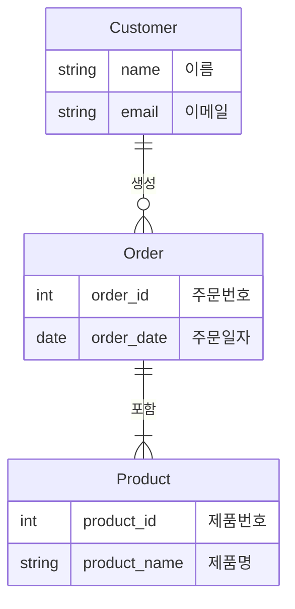
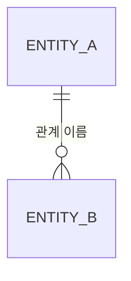
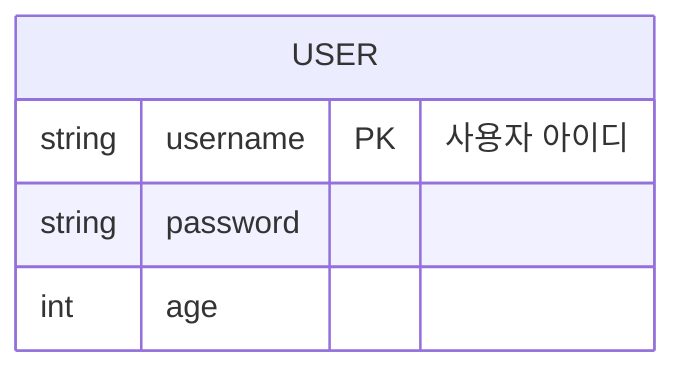

- GET /fridge/slots — 칸 목록 조회(필터: floor, view, page, size)
- GET /fridge/bundles — 포장 목록 조회(필터: slotId, owner, status, search, page, size)
- POST /fridge/bundles — 포장 생성(허용량 초과 시 422 CAPACITY_EXCEEDED)
- GET /fridge/bundles/{bundleId} — 포장 상세 조회
- PATCH /fridge/bundles/{bundleId} — 포장 수정
- DELETE /fridge/bundles/{bundleId} — 포장 삭제
- POST /fridge/bundles/{bundleId}/items — 포장에 물품 추가
- PATCH /fridge/items/{itemId} — 물품 수정
- DELETE /fridge/items/{itemId} — 물품 삭제





Mermaid의 **`erDiagram`**은 데이터베이스의 구조와 관계를 시각화하는 데 매우 강력한 도구입니다. 앞서 겪으셨던 오류를 방지하면서, 정확하고 풍부한 다이어그램을 그리기 위한 핵심 문법을 정리해 드립니다.

---

## 1. 기본 구조

ER 다이어그램은 크게 **엔티티(Entity)**, **속성(Attribute)**, **관계(Relationship)** 세 부분으로 구성됩니다.

코드 스니펫



---

## 2. 관계 표현 (Cardinality)

가장 중요한 부분은 엔티티 사이의 선 모양입니다. 선의 양 끝 기호에 따라 관계의 종류가 결정됩니다.

|**기호**|**의미**|**설명**|
|---|---|---|
|`||`|
|`|{`|**1 or more**|
|`|o`|**0 or 1**|
|`o{`|**0 or more**|없거나 여러 개 (선택)|

**[예시]**

- `A ||--o{ B` : A 하나당 B는 0개 이상 존재할 수 있음 (1:N)
- `A ||--|| B` : A 하나당 B는 반드시 하나 존재해야 함 (1:1)

---

## 3. 엔티티와 속성 정의

엔티티 내부의 데이터 필드(속성)는 중괄호 `{}` 안에 정의합니다.

코드 스니펫



- **형식:** `타입 이름 제약조건 "설명"`
- **제약조건:** `PK`(Primary Key), `FK`(Foreign Key)를 명시할 수 있습니다.
- **설명:** 따옴표 `""`를 사용하여 한글이나 상세 설명을 넣을 수 있습니다.
    
표 없이 줄글과 불렛포인트만으로 더욱 직관적으로 설명해 드릴게요.

관계를 표현하는 기호는 **선의 양 끝에 붙는 두 개의 기호**만 이해하면 끝납니다. 이 기호들은 **"상대방 엔티티에 데이터가 몇 개나 있을 수 있는가?"**를 나타냅니다.

---

### 1. 딱 세 가지만 기억하세요 (기본 기호)

선의 끝에 붙는 모양은 각각 이런 의미를 담고 있습니다.

- **`|` (직선):** 숫자 **1**을 의미합니다. (반드시 존재해야 함)
- **`o` (동그라미):** 숫자 **0**을 의미합니다. (없어도 됨, 선택 사항)
- **`{` 또는 `}` (갈퀴):** **여러 개(Many)**를 의미합니다.
    

---

### 2. 가장 많이 쓰는 4가지 조합

이 기호들을 두 개씩 합쳐서 선 끝에 배치합니다.

- **`||` (1개뿐인 관계):** 정확히 **딱 1개**여야 할 때 씁니다.
    - 예: "모든 주문은 **반드시 1명**의 고객이 있어야 한다."
- **`|o` (0개 또는 1개):** **없거나, 있다면 딱 1개**일 때 씁니다.
    - 예: "회원은 프로필 사진이 **없거나 1개**만 등록할 수 있다."
- **`|{` (1개 이상):** **최소 1개는 있어야 하고 여러 개**도 가능할 때 씁니다.
    - 예: "게시글에는 **최소 1개 이상**의 태그가 붙어야 한다."
- **`o{` (0개 이상):** **없어도 되고 여러 개**여도 될 때 씁니다.
    - 예: "고객은 주문을 한 번도 안 했을 수도 있고, **여러 번** 했을 수도 있다."
        

---

### 3. 관계를 읽는 비법: "반대편을 보세요"

코드를 작성할 때 `A ||--o{ B`라고 쓴다면, 해석은 이렇게 합니다.

1. **A 입장에서 B를 볼 때 (오른쪽 기호 `o{` 확인):** "A 하나에 연결된 B는 0개일 수도 있고 여러 개일 수도 있구나."
2. **B 입장에서 A를 볼 때 (왼쪽 기호 `||` 확인):** "B 하나에 연결된 A는 반드시 딱 1개여야 하는구나."
    

---

### 4. 실제 코드로 적용하기

위의 규칙을 적용한 실제 예시 코드입니다.

코드 스니펫

```mermaid
erDiagram
    %% [사용자]는 [프로필]을 가질 수도 안 가질 수도 있음 (1:0~1)
    USER ||--|o PROFILE : "소유"

    %% [게시글] 하나당 [댓글]은 없을 수도, 여러 개일 수도 있음 (1:N)
    POST ||--o{ COMMENT : "포함"

    %% [학생]은 [수업]을 반드시 하나 이상 들어야 함 (1:1~N)
    STUDENT ||--|{ CLASS : "수강"
```

---

