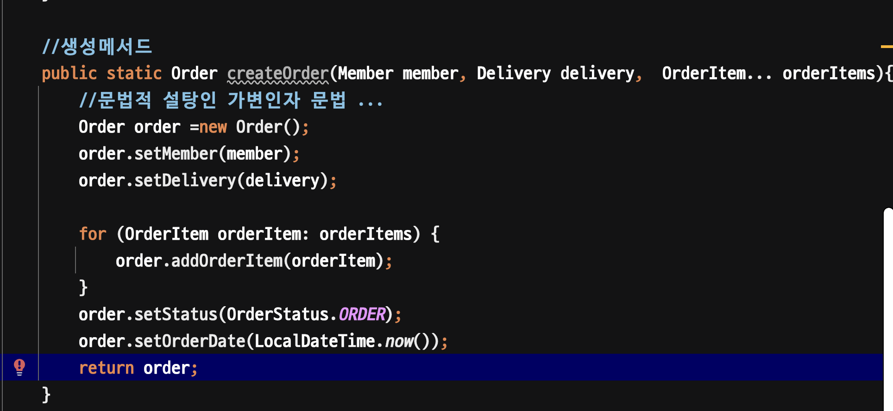

## 📜 원본 맥락

![[01_Sources/{S} 김영한 응용.md#^4h4frx]]

---
## 정리

이 코드는 **생성 메서드(Creation Method)**를 통해 객체 생성 로직을 캡슐화하는 디자인 패턴을 보여줍니다. 이 방식을 다른 프로젝트에 적용하려면 다음과 같이 핵심 원칙을 정리하고 활용할 수 있습니다.

### 핵심 원칙 정리

1. **생성 로직 캡슐화**: 객체를 직접 `new` 키워드로 생성하지 않고, `createOrder()`와 같은 **정적 팩토리 메서드(Static Factory Method)**를 통해 생성합니다. 이렇게 하면 객체 생성에 필요한 모든 초기화 작업(회원, 배송, 주문 상품 설정 등)이 메서드 내부에 통합됩니다.
2. **응집력(Cohesion) 향상**: `Order` 객체를 생성할 때 필요한 모든 필수 요소(회원, 배송 정보, 주문 상품)가 하나의 메서드에 모여있으므로, 객체 생성 로직이 외부에 노출되지 않습니다. 이를 통해 클래스의 응집력이 높아집니다.
3. **변경에 용이한 구조**: 주문 생성 로직에 변경이 필요할 때, `createOrder()` 메서드 내부만 수정하면 됩니다. 예를 들어, 주문 상태를 `ORDER`에서 다른 값으로 바꾸거나, 주문 날짜를 다르게 설정해야 할 때 이 메서드만 변경하면 되므로, 이 메서드를 호출하는 외부 코드에는 영향을 주지 않습니다.
4. **가변 인자(Variable Arguments) 활용**: `orderItems`와 같이 여러 개의 동일한 타입 인자를 받을 때, `...` 문법을 사용하여 인자 개수에 유연하게 대응할 수 있습니다. 이는 코드의 재사용성을 높여줍니다.

### 다른 프로젝트에 적용하는 방법

이러한 방식을 적용하고 싶다면, 다음의 패턴을 따르세요.

1. **생성자 대신 정적 팩토리 메서드 사용**:
    
    - **Bad**: `new Order(member, delivery, orderItems);` (생성자가 복잡해지고, 초기화 로직이 외부에 노출)
    - **Good**: `Order.createOrder(member, delivery, orderItems);` (생성 로직을 메서드 내부에 숨김)
        
2. private 생성자 사용:

    Order 클래스의 기본 생성자를 private으로 선언하여 외부에서 new 키워드로 직접 객체를 생성하는 것을 막고, 오직 createOrder() 메서드를 통해서만 객체가 생성되도록 강제할 수 있습니다.

3. 명확한 메서드명 사용:

    메서드 이름을 createOrder()와 같이 목적을 명확하게 드러내는 이름으로 작성하여, 이 메서드가 어떤 역할을 하는지 한눈에 파악할 수 있도록 합니다.

이러한 **캡슐화된 생성 메서드** 방식을 사용하면, 객체 생성 및 초기화 로직이 깔끔하게 정리되어 유지보수와 재사용성이 높은 코드를 작성할 수 있습니다.

---
## 💭 나의 추가적 생각/질문