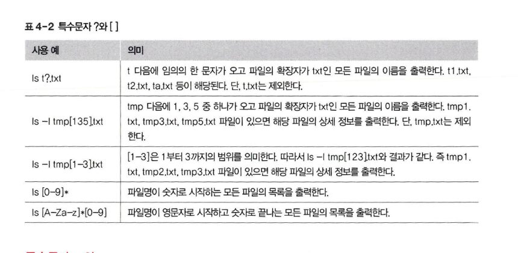
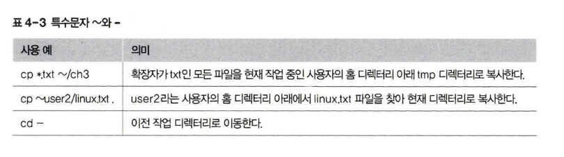

### 🔥 [최종 암기] 리눅스 명령어 & 출력 대응표

## 중요
- 9번 시 그널은 강제 종료이기 때문에 무조건 종료되지만 좀비 프로세스의 경우 9번 시그널을 받아도 종료되지 않을 수 있다.

#### 1. 리다이렉션 & 파이프 (가장 헷갈림, 출제 1순위)

|**상황/문제**|**정답 명령어**|**예상 결과/동작**|
|---|---|---|
|**덮어쓰기** (화면 출력 X, 파일 저장)|`ls > file.txt`|화면엔 아무것도 안 나옴. `file.txt`에 목록이 저장됨(기존 내용 삭제).|
|**이어쓰기** (내용 추가)|`ls >> file.txt`|`file.txt`의 기존 내용 **끝에** 목록이 추가됨.|
|**에러 메시지만** 파일로 저장|`ls /없는파일 2> err.log`|표준 에러(2번)만 `err.log`에 저장됨.|
|**정상 결과 + 에러** 모두 저장|`ls > all.log 2>&1`|화면 출력 없이 정상/에러 메시지 모두 `all.log`에 저장.|
|**에러 메시지 버리기** (블랙홀)|`ls 2> /dev/null`|화면에도 안 나오고 파일로도 저장 안 됨 (삭제).|
|**파이프** (앞 결과 → 뒤 입력)|`ps -ef|grep bash`|

#### 2. 권한 설정 (`chmod`, `umask`) - 계산 문제 주의

|**상황/문제**|**정답 명령어**|**예상 결과/동작**|
|---|---|---|
|**숫자 모드** (소유자 모든 권한, 나머지 읽기/실행)|`chmod 755 file`|`-rwxr-xr-x` 로 변경됨. (7=4+2+1, 5=4+1)|
|**보안 강화** (나만 읽고 쓰기, 남은 접근 불가)|`chmod 600 file`|`-rw-------` 로 변경됨.|
|**문자 모드** (그룹에 쓰기 권한 추가)|`chmod g+w file`|그룹 권한 부분에 `w`가 생김 (`rw-rw-r--`).|
|**SetUID 설정** (실행 시 소유자 권한)|`chmod 4755 file`|`-rwsr-xr-x` (소유자 실행 권한 자리가 `s`로 바뀜).|
|**Sticky Bit 설정** (공용 디렉토리, 삭제 제한)|`chmod 1777 /tmp`|`drwxrwxrwt` (맨 끝자리가 `t`로 바뀜).|
|**기본 권한 확인**|`umask`|`0002` 또는 `0022` 출력.|
|**[계산]** umask가 022일 때 파일 생성 권한?|(명령어 아님)|**644** (`rw-r--r--`). (파일 기본 666 - 022 = 644)|

#### 3. 파일 검색 & 찾아서 실행 (`find`) - 문법 주의

|**상황/문제**|**정답 명령어**|**예상 결과/동작**|
|---|---|---|
|이름으로 찾기|`find . -name "*.txt"`|현재 디렉토리(`.`) 아래의 모든 .txt 파일 경로 출력.|
|빈 파일 찾기|`find . -empty`|크기가 0인 파일/디렉토리 출력.|
|**찾아서 지우기 (Exec)** `중요`|`find . -name "*.tmp" -exec rm {} \;`|`.tmp` 파일을 찾아 묻지 않고 삭제. (`{}`는 파일명, `\;`는 끝).|
|**찾아서 확인 후 실행 (Ok)**|`find . -name "*.tmp" -ok rm {} \;`|삭제할 때마다 `… ?` 하고 물어봄 (y 입력해야 삭제).|
|명령어 위치 찾기 (PATH 기준)|`which ls`|`/usr/bin/ls` (실제 실행 경로 출력).|

#### 4. 프로세스 제어 (`ps`, `kill`, `nohup`)

|**상황/문제**|**정답 명령어**|**예상 결과/동작**|
|---|---|---|
|**모든 프로세스 상세 확인**|`ps -ef`|UID, PID, PPID, STIME 등이 포함된 전체 목록 출력.|
|사용자별 프로세스 확인|`ps -u user1`|user1이 실행한 프로세스만 출력.|
|**강제 종료** (시그널 9번)|`kill -9 1234`|PID 1234번 프로세스가 즉시 죽음 (말 안 들을 때 씀).|
|정상 종료 (기본값 15번)|`kill 1234`|프로세스에게 "종료해줄래?" 요청 (저장 후 종료).|
|이름으로 종료 (패턴)|`pkill bash`|이름에 'bash'가 들어간 프로세스 종료.|
|이름으로 종료 (정확 일치)|`killall bash`|이름이 정확히 'bash'인 모든 프로세스 종료.|
|**백그라운드 실행 유지**|`nohup find / &`|로그아웃 해도 계속 돔. 결과는 `nohup.out`에 저장.|

#### 5. 텍스트 처리 (`grep`, `sort`, `diff`)

|**상황/문제**|**정답 명령어**|**예상 결과/동작**|
|---|---|---|
|줄 번호 포함 검색|`grep -n "Linux" file`|`10:Linux is…` 처럼 줄 번호와 함께 출력.|
|대소문자 무시 검색|`grep -i "linux" file`|Linux, linux, LINUX 모두 찾음.|
|시작하는 문자 검색 (`^`)|`grep "^A" file`|'A'로 **시작하는** 줄만 출력.|
|정렬 (역순)|`sort -r file`|ㅎ->ㄱ (z->a) 순서로 정렬되어 출력.|
|중복 제거 (연속된 것만)|`uniq file`|연속으로 중복된 줄을 하나로 합쳐서 출력.|
|파일 비교 (차이점)|`diff file1 file2`|`1c1` 처럼 어느 줄이 다른지 출력.|

#### 6. 사용자 및 환경 설정 (`/etc/*`, `alias`)

| **상황/문제**       | **정답 명령어**             | **예상 결과/동작**                     |
| --------------- | ---------------------- | -------------------------------- |
| 환경변수 파일 즉시 적용   | `source .bashrc`       | 로그아웃 없이 `.bashrc` 변경 사항이 바로 반영됨. |
| 별칭 만들기          | `alias c='clear'`      | `c`만 쳐도 `clear` 명령어가 실행됨.        |
| 별칭 확인           | `alias`                | 현재 설정된 모든 별칭 목록 출력.              |
| 사용자 정보 파일       | `cat /etc/passwd`      | 계정명:x:UID:GID… (비밀번호는 x로 보임).    |
| 비밀번호 파일 (Root만) | `sudo cat /etc/shadow` | 암호화된 비밀번호, 만료일 정보 등이 보임.         |
| 현재 접속자 확인       | `w` 또는 `who`           | 누가, 언제, 어디서(IP) 접속했는지 출력.        |
| 지난 접속 기록        | `last`                 | 시스템의 로그인/로그아웃 전체 이력 출력.          |

---

### **[Image 1]**

**01. 로그인 셸 변경 시 `chsh -s dash user1` 오류 원인?**

- **답:** ④ 바꾸려는 셸을 절대 경로로 지정한다.
- **한줄 핵심:** `chsh` 명령어 사용 시 셸의 이름만 쓰는 것이 아니라 **절대 경로(예: `/bin/dash`)**를 입력해야 합니다.
    

**02. `ls a?.exe` 실행 시 제외되는 파일은?**

- **답:** ① `a.exe`
- **한줄 핵심:** 와일드카드 `?`는 **정확히 한 글자**에만 대응하므로, 문자 사이에 글자가 없는 `a.exe`는 매칭되지 않습니다.
    

**03. `echo '"$SHELL"'` 출력 결과는?**

- **답:** ② `"$SHELL"`
- **한줄 핵심:** **작은따옴표(`'`)**는 내부의 모든 문자(특수문자 `$` 포함)를 문자열 그대로 취급합니다.
    

**04. 셸 변수 TEST를 서브 셸에서도 사용하려면?**

- **답:** ④ `export TEST`
- **한줄 핵심:** `export` 명령어를 사용해야 지역 변수가 **환경 변수**로 전환되어 서브 셸에 상속됩니다.
    

**05. 사용자 계정의 로그인 셸을 저장하고 있는 파일은?**

- **답:** ② `/etc/passwd`
- **한줄 핵심:** `/etc/passwd`는 사용자 정보(셸 포함)를 담고 있으며, 비밀번호는 `/etc/shadow`에 저장됩니다.
    

**06. `ls /tmp >> a.txt` 실행 결과는?**

- **답:** ④ 기존 내용은 남아 있고, `/tmp` 디렉터리의 내용이 추가된다.
- **한줄 핵심:** `>>` 리다이렉션 연산자는 기존 내용을 덮어쓰지 않고 파일 끝에 내용을 **추가(Append)**합니다.
    

**07. 계정의 기본 프롬프트가 저장되는 환경 변수는?**

- **답:** ① `PS1`
- **한줄 핵심:** `PS1`은 기본 프롬프트 모양을 설정하며, `PS2`는 명령어가 길어질 때 나타나는 2차 프롬프트입니다.
    

**08. 셸의 세 가지 주요 기능?**

- **답:** 명령어 해석기 기능, 프로그래밍(스크립트) 기능, 사용자 환경 설정(세션 관리) 기능
- **한줄 핵심:** 셸은 커널과 사용자 사이에서 명령을 해석하고, 프로그램을 실행하며, 환경을 관리합니다.
    

**09. 특수문자 `*`와 `?`의 차이?**

- **답:** `*`는 길이 0 이상의 모든 문자열과 매칭, `?`는 정확히 1개의 문자와 매칭
- **한줄 핵심:** `*`는 '모두', `?`는 '한 글자'를 의미하는 와일드카드입니다.
    

**10. 특수문자 `"`, `'`, `의 차이?**

- **답:** `"`는 변수($) 해석 허용, `'`는 모든 문자 그대로 출력, ` (백틱)은 명령어 실행 결과로 치환
- **한줄 핵심:** 큰따옴표는 변수를 치환해주지만, 작은따옴표는 문자 그대로, 백틱은 명령 실행 결과를 가져옵니다.
    

**11. 표준 입출력 장치란?**

- **답:** 표준 입력(0: 키보드), 표준 출력(1: 모니터), 표준 에러(2: 모니터)
- **한줄 핵심:** 리눅스에서 프로그램이 기본적으로 데이터를 읽고(Input) 쓰는(Output/Error) 통로입니다.
    

**12. `>` 사용 시 기존 파일 덮어쓰기 방지 방법?**

- **답:** `set -o noclobber` 명령 실행
- **한줄 핵심:** `noclobber` 옵션을 켜면 리다이렉션(`>`)으로 인해 기존 파일이 실수로 덮어씌워지는 것을 막습니다.
    

**13. 상세 정보는 `ls.out`, 오류는 `ls.err`에 저장하는 명령?**

- **답:** `ls -l > ls.out 2> ls.err`
- **한줄 핵심:** 표준 출력은 `>`(또는 `1>`)로, 표준 에러는 `2>`를 사용하여 각각 다른 파일로 보냅니다.

**14. `env` 결과에서 특정 환경 변수(예: SHELL)만 골라 출력하려면?**

- **답:** `env | grep SHELL`
- **한줄 핵심:** 파이프(`|`)로 `env`의 출력을 넘기고, `grep`으로 원하는 문자열을 필터링합니다.
    

**15. 배시셸 초기화 파일의 이름과 특징?**

- **답:** `/etc/profile`(전체 사용자), `~/.bash_profile`(개인 로그인 시), `~/.bashrc`(개인 셸 실행/별칭)
- **한줄 핵심:** 시스템 전역 설정은 `/etc`에, 사용자별 설정은 홈 디렉터리(`~`)의 숨김 파일로 저장됩니다.
    

**16. 확장자가 txt인 모든 파일명 출력?**

- **답:** `ls *.txt`
- **한줄 핵심:** 와일드카드 `*`는 모든 문자열을 의미하므로 `.txt`로 끝나는 모든 파일을 매칭합니다.
    

**17. 현재 디렉터리에서 숫자로 시작하는 파일 상세 정보 출력?**

- **답:** `ls -l [0-9]*`
- **한줄 핵심:** `[0-9]`는 숫자 한 글자를 의미하며, `*`와 조합해 숫자로 시작하는 파일들을 찾습니다.
    

**18. 확장자가 c인 모든 파일을 /tmp로 복사?**

- **답:** `cp *.c /tmp`
- **한줄 핵심:** `cp` 명령어에도 와일드카드를 사용하여 여러 파일을 한 번에 지정할 수 있습니다.
    

**19. `echo`를 사용해 날짜 정보를 명령 실행 결과로 출력?**

- **답:** `echo $(date "+%Y. %m. %d. (%a) %T %Z")`
- **한줄 핵심:** `$(명령어)` 또는 `` `명령어` ``를 사용하면 명령어의 실행 결과가 그 자리에 텍스트로 치환됩니다.
    

**20. `ls` 실행 시 숨김 파일도 나오도록 앨리어스 설정?**

- **답:** `alias ls='ls -a'`
- **한줄 핵심:** `alias`를 사용하면 옵션이 포함된 명령어를 기본 명령어처럼 줄여서 쓸 수 있습니다.
    

**21. `rm` 앨리어스를 잠시 사용하지 않고 원본 명령 사용법?**

- **답:** `\rm 파일명` (또는 `/bin/rm`과 같이 절대 경로 사용)
- **한줄 핵심:** 명령어 앞에 역슬래시(`\`)를 붙이면 앨리어스 기능을 무시하고 원본 명령을 실행합니다.

**22. 프롬프트를 현재 디렉터리와 히스토리 번호로 설정?**

- **답:** `PS1='[\w \!]$ '`
- **한줄 핵심:** `\w`는 현재 작업 디렉터리, `\!`는 히스토리 번호를 나타내는 프롬프트 설정 기호입니다.
    

---

### **[Image 4]**

**23. 가장 최근에 사용한 `cp` 명령 재실행?**

- **답:** `!cp`
- **한줄 핵심:** `!문자열`은 히스토리에서 해당 문자열로 시작하는 가장 최근 명령을 찾아 즉시 실행합니다.
    

**24. 긴 명령 오타 수정하여 실행하는 방법?**

- **답:** 위쪽 화살표(`↑`) 키를 눌러 편집하거나, `^오타^수정` 명령 사용
- **한줄 핵심:** 히스토리 기능을 통해 이전 명령을 불러와 편집하거나, 치환(`^`) 기능을 사용합니다.
    

**25. 수정된 .bashrc 파일을 적용하는 세 가지 방법?**

- **답:** ① 재로그인, ② `source .bashrc`, ③ `. .bashrc`
- **한줄 핵심:** `source` 또는 `.` 명령어를 사용하면 재로그인 없이 설정 변경 사항을 즉시 반영할 수 있습니다.

---

### 리눅스 접근 권한 문제 핵심 요약

**Q01. text.txt 파일의 현재 접근 권한(`-r--r--r--`)에서 사용자와 그룹에 실행 권한을 부여하기 위한 명령으로 맞지 _않은_ 것은?**

- **정답 내용:** chmod 664 test.txt
- **한줄 핵심:** (X) 664는 읽기/쓰기(rw) 권한을 부여하므로, 실행(x) 권한을 주기 위해서는 `chmod 554`를 쓰거나 기호 모드 `+x`를 사용해야 한다.
    

**Q02. 사용자와 그룹에 쓰기 권한을 부여하고, 기타 사용자에게는 아무 권한도 주지 않으려 한다. 기호 모드로 바르게 수행한 것은?**

- **정답 내용:** chmod ug+w,o-r test.txt
- **한줄 핵심:** 사용자(u)와 그룹(g)에 쓰기(+w)를 더하고, 기타(o)의 읽기(-r)를 제거하여 권한을 없앤다.
    

**Q03. 소유자만 읽을 수 있고(`r--`), 그룹과 기타 사용자에게는 아무 권한도 주지 않으려 한다(`---`). 숫자 모드로 바르게 수행한 것은?**

- **정답 내용:** chmod 400 test.txt
- **한줄 핵심:** 읽기(r=4)만 소유자에게 주고 나머지는 0으로 설정하므로 400이다.
    

**Q04. 현재 umask 값이 022다. 이 상태에서 a.txt 파일과 linux 디렉터리를 생성했을 때 접근 권한은?**

- **정답 내용:** 파일: 644, 디렉터리: 755
- **한줄 핵심:** 파일 기본값(666)-022=644, 디렉터리 기본값(777)-022=755가 된다.
    

**Q05. 리눅스는 사용자를 세 카테고리로 구분한다. 이 카테고리에 해당하지 _않는_ 것은?**

- **정답 내용:** 관리자
- **한줄 핵심:** (X) 권한 부여 대상인 3가지 카테고리는 소유자(User), 그룹(Group), 기타 사용자(Other)이다.
    

**Q06. 기본 접근 권한을 설정하는 명령은 무엇인가?**

- **정답 내용:** umask
- **한줄 핵심:** 파일 생성 시 최대 권한에서 뺄 권한 값을 지정하여 기본 권한을 결정한다.
    

**Q07. 특수 접근 권한에 해당하지 _않는_ 것은?**

- **정답 내용:** SetUser
- **한줄 핵심:** (X) 리눅스의 3대 특수 권한은 SetUID, SetGID, Sticky Bit이다.
    

**Q08. 파일의 속성은 어떤 명령으로 확인할 수 있는가?**

- **정답 내용:** `ls -l`
- **한줄 핵심:** `ls` 명령에 `-l` (long) 옵션을 주면 권한, 소유자, 크기 등 상세 속성을 볼 수 있다.
    

**Q09. 접근 권한의 세 가지 종류에 대해 간단히 설명하시오.**

- **정답 내용:** 읽기(r), 쓰기(w), 실행(x)
- **한줄 핵심:** 파일이나 디렉터리를 읽고(4), 수정하고(2), 실행/진입(1)하는 권한이다.
    

**Q10. 파일의 읽기 권한과 디렉터리의 읽기 권한은 어떤 차이가 있는지 설명하시오.**

- **정답 내용:** 파일은 내용을 볼 수 있음 vs 디렉터리는 내부 파일 목록을 볼 수 있음
- **한줄 핵심:** 디렉터리에 `r` 권한이 있어야 `ls` 명령으로 그 안의 파일 리스트를 확인할 수 있다.
    

**Q11. 디렉터리에 실행 권한이 없다는 것은 무엇을 의미하는지 설명하시오.**

- **정답 내용:** 해당 디렉터리로 이동(`cd`)할 수 없음
- **한줄 핵심:** 디렉터리의 `x` 권한은 그 디렉터리 내부로 진입(Access)할 수 있는 권한을 의미한다.
    

**Q12. 다음 빈칸에 각 접근 권한의 의미(숫자 모드 등)를 쓰시오.**
`rwxr-xr-x`
`rw-r--r--`
`r--r--r--`
- **정답 내용:**
    
    1. `rwxr-xr-x`: **755** (소유자 모든 권한, 그룹/기타는 읽기·실행만)
    2. `rw-r--r--`: **644** (소유자 읽기·쓰기, 그룹/기타는 읽기만)
    3. `r--r--r--`: **444** (모든 사용자 읽기 전용)
        
- **한줄 핵심:** r=4, w=2, x=1의 합으로 계산한다.
    

**Q13. /etc 디렉터리에 있는 group, passwd, shadow 파일의 권한을 확인해보고 빈칸을 채우시오. (일반적인 리눅스 표준 설정 기준)**
- **정답 내용:**
    
    1. `group`: **644** (`rw-r--r--`) - 누구나 그룹 목록 조회 가능
    2. `passwd`: **644** (`rw-r--r--`) - 누구나 계정 목록 조회 가능
    3. `shadow`: **000** 또는 **400** (`----------` or `r--------`) - 비밀번호 정보가 있어 일반 사용자는 접근 불가
        
- **한줄 핵심:** 보안을 위해 `shadow` 파일은 관리자(root) 외에는 절대 읽을 수 없게 잠겨 있다.
    

**Q14. 다음 접근 권한을 숫자로 표기하시오.**
	1. `rwxr-xr-x`
    2. `rw-r--r--`
    3. `rw-r-----`
    4. `r--r--r--
    5. `r-xr-xr-x`
- **정답 내용:**
    
    1. `rwxr-xr-x`: **755**
    2. `rw-r--r--`: **644**
    3. `rw-r-----`: **640**
    4. `r--r--r--`: **444**
    5. `r-xr-xr-x`: **555**
        
- **한줄 핵심:** 권한 문자를 숫자(4,2,1)의 합으로 빠르게 변환하는 연습이 필요하다.
    

**Q15. exmod.txt 파일의 권한을 다음과 같이 변경하는 명령을 쓰시오.**
#### ② 기호 모드 (Octal Mode)로 변경

| **현재 권한**   | **변경된 권한**   | **명령 (정답)** |
| ----------- | ------------ | ----------- |
| `rwxr-xr-x` | `r-x-------` |             |
| `rw-r--r--` | `r--r--r--`  |             |
#### ② 숫자 모드 (Octal Mode)

| **현재 권한**   | **변경된 권한**  | **명령 (정답)** |
| ----------- | ----------- | ----------- |
| `rw-------` | `rw-rw-rw-` |             |
| `r--r--r--` | `r-xr-xr-x` |             |
- **정답 내용:**
    
    1. (기호) `chmod u=rx,go= exmod.txt` 또는
    2. (기호) **chmod u-w exmod.txt**
    3. (숫자) `chmod 666 exmod.txt` (rw-rw-rw-)
    4. (숫자) `chmod 555 exmod.txt` (r-xr-xr-x)
        
- **한줄 핵심:** 기호 모드는 직관적 변경(`u+x`), 숫자 모드는 최종 상태 설정(`755`)에 유리하다.
    

**Q16. 마스크 값이 007일 때 파일과 디렉터리의 기본 접근 권한은?**

- **정답 내용:** 파일: 660, 디렉터리: 770
- **한줄 핵심:** 파일(666)-007=660(rw-rw----), 디렉터리(777)-007=770(rwxrwx---). 기타 사용자 권한이 모두 제거된다.
    

**Q17. 마스크 값을 007로 바꾸는 명령은?**

- **정답 내용:** `umask 007`
- **한줄 핵심:** `umask` 뒤에 원하는 숫자를 입력하면 즉시 적용된다.
    

**Q18. 파일 접근 권한이 'rwSr--r--'일 때 S가 의미하는 것은?**

- **정답 내용:** SetUID가 설정되어 있으나, 소유자에게 실행(x) 권한이 없는 상태
- **한줄 핵심:** 실행 권한(x)이 있으면 소문자 `s`, 없으면 대문자 `S`로 표시된다. (설정 오류 상태일 가능성이 큼)
    

**Q19. 스티키 비트(Sticky Bit)에 대해 간단히 설명하시오.**

- **정답 내용:** 공유 디렉터리에서 누구나 파일을 생성할 수 있지만, 삭제는 파일 소유자와 관리자만 가능하다.
- **한줄 핵심:** `/tmp` 디렉터리처럼 공용 공간의 무단 삭제를 방지하기 위해 사용한다.
    

**Q20. /bin 디렉터리에서 SetUID가 설정된 명령의 예 세 가지.**

- **정답 내용:** `passwd`, `su`, `ping`, `mount` 등
- **한줄 핵심:** 일반 사용자가 실행하는 순간 루트 권한을 잠시 빌려와야 하는 명령어들이다.

첨부해주신 문제 이미지 중, 강의 녹취록에 근거한 **시험 범위(프로세스 관리, 사용자 관리 등)**에 해당하는 문제들만 선별하여 요청하신 형식으로 정리해 드립니다.

> ※ 제외된 문제: 04번(crontab), 07번(at/cron 접근제어)
>
> (해당 내용은 강의 녹취록 상 '프로세스 제어' 및 '사용자 관리' 이후의 스케줄링 파트로, 시험 범위 밖일 확률이 높아 제외했습니다.)

---

### **1. 객관식 문제 (선택형)**

#### **01. 프로세스의 PPID를 확인하기 위한 명령으로 옳은 것은?**

- **[정답 내용]**: `ps -f`
- **[한줄 핵심]**: `ps` 명령만으로는 PID만 나오지만, `-f`(Full format) 옵션을 사용해야 **PPID(부모 프로세스 ID)**와 UID 등 상세 정보가 출력된다.
    

#### **02. 사용자 han1과 관련된 프로세스의 정보를 확인하는 명령을 옳지 않은 것은?** (틀린 것 고르기)

- **[정답 내용]**: `ps -pu han1`
- **[한줄 핵심]**: `ps` 명령어에서 `-p` 옵션은 **PID(숫자)**를 인자로 받으므로, 사용자 이름으로 검색할 때는 `-p`를 빼고 **`ps -u han1`** 또는 **`ps -fu han1`**이라고 써야 한다.
    

#### **03. [2]번 작업을 포그라운드 작업으로 전환하기 위한 명령으로 옳은 것은?**
[1 ]+ 실행중 sleep 100 &
[2 ]- 실행중 fin d / -name passwd > pw.dat 2>&1 &
- **[정답 내용]**: `fg %2`
- **[한줄 핵심]**: 백그라운드에 있는 작업을 포그라운드로 가져올 때는 **`fg %작업번호`** 형식을 사용한다.
    

#### **05. 다음 중 프로세스에 대한 설명으로 옳지 않은 것은?** (틀린 것 고르기)

- **[정답 내용]**: 프로세스에는 UID라는 번호가 있다.
- **[한줄 핵심]**: 프로세스를 식별하는 고유 번호는 **PID**이며, UID는 해당 프로세스를 실행한 '사용자'의 식별 번호일 뿐 프로세스 자체의 ID는 아니다.
    

#### **06. 명령을 백그라운드 작업으로 실행시키기 위해 명령 다음에 추가하는 특수문자는 무엇인가?**

- **[정답 내용]**: `&`
- **[한줄 핵심]**: 명령어의 맨 끝에 앰퍼샌드(**`&`**)를 붙이면 해당 명령은 백그라운드에서 실행된다. (예: `find / -name test &`)
    

---

### **2. 주관식/서술형 문제**

#### **08. 일반 프로세스와 데몬 프로세스의 차이를 설명하시오.**

- **[정답 내용]**: 일반 프로세스는 터미널을 통해 사용자와 상호작용하며 실행되지만, **데몬 프로세스는 백그라운드에서 실행되며 특정 서비스를 제공하기 위해 대기**하는 프로세스이다.
- **[한줄 핵심]**: 데몬(Daemon)은 사용자의 입력 없이 시스템 서비스를 위해 백그라운드에 상주하는 프로세스이다.
    

#### **09. ps -f 명령의 결과가 다음과 같을 때 프로세스의 부모-자식 관계를 설명하시오.**
UID PID PPID C STIME TTY TIME CMD
user1 15761 15721 … vi /etc/hosts
user1 15721 15710 … sh
user1 15710 15701 … -bash_

- **[정답 내용]**: 부모 프로세스인 **`-bash`(15710)**가 자식 프로세스 **`sh`(15721)**를 실행했고, `sh`가 다시 자식 프로세스 **`vi`(15761)**를 실행했다.
- **[한줄 핵심]**: 프로세스 목록에서 **PPID(Parent PID)**가 가리키는 숫자가 바로 그 프로세스의 부모 PID이다.
    

#### **10. guest 사용자가 실행한 프로세스를 모두 찾으려고 할 때 사용할 수 있는 명령은 무엇인가?**

- **[정답 내용]**: `ps -u guest` (또는 `pgrep -u guest -l`)
- **[한줄 핵심]**: **`-u`** 옵션을 사용하면 특정 사용자가 실행시킨 프로세스만 필터링하여 볼 수 있다.
    

#### **11. PID가 5000인 프로세스를 kill 5000으로 종료하려는데 종료되지 않는다. 이 프로세스를 강제로 종료하려면 어떻게 해야 하는지 설명하시오.**

- **[정답 내용]**: `kill -9 5000`
- **[한줄 핵심]**: 일반 종료(15번)가 안 될 때는 **`-9` (SIGKILL)** 시그널을 사용하여 프로세스를 즉시 강제 종료시킨다.
    

#### **12. 주기적으로 프로세스들의 상태를 살펴볼 수 있는 방법에 대해 설명하시오.**

- **[정답 내용]**: `top` 명령어를 사용한다.
- **[한줄 핵심]**: `ps`는 실행 순간의 상태만 보여주지만, **`top`**은 프로세스 상태를 주기적으로(실시간으로) 갱신하여 보여준다.
    

#### **13. 프로세스를 종료할 때 kill 명령보다 pkill 명령이 더 편리한 경우는 어떤 경우인가?**

- **[정답 내용]**: PID를 모르고 **프로세스 이름**만 알고 있을 때, 또는 같은 이름의 프로세스 여러 개를 한 번에 종료할 때.
- **[한줄 핵심]**: `kill`은 PID가 필요하지만, `pkill`은 프로세스 **이름(패턴)**으로 종료할 수 있다.
    

#### **14. 현재 실행 중인 포그라운드 작업을 백그라운드 작업으로 전환하는 방법을 다음 예(`find / -name test`)를 사용하여 설명하시오.**

- **[정답 내용]**: 실행 중인 상태에서 **`Ctrl + Z`**를 눌러 작업을 일시 중지시킨 후, **`bg`** 명령을 입력한다.
- **[한줄 핵심]**: 포그라운드 작업은 **중지(`Ctrl+Z`)** 후 **백그라운드 전환(`bg`)**의 2단계를 거친다.
    

#### **15. 현재 실행 중인 백그라운드 작업을 포그라운드 작업으로 전환하는 방법을 다음 예(`jobs` -> `[1] + 실행 중 sleep 100`)를 사용하여 설명하시오.**

- **[정답 내용]**: `fg %1`
- **[한줄 핵심]**: `fg` 명령 뒤에 **`%작업번호`**를 입력하여 백그라운드 작업을 앞으로 가져온다.
    

#### **16. 다음과 같이 백그라운드로 실행 중인 작업이 세 개 있다. 이 중 3번 작업을 종료하는 명령을 기술하시오.**

- **[정답 내용]**: `kill %3`
- **[한줄 핵심]**: 작업 번호(Job ID)로 프로세스를 종료할 때는 반드시 번호 앞에 **`%`**를 붙여야 한다.
    

#### **17. 로그아웃한 다음에도 find / -name test 명령을 계속 실행하도록 하는 명령을 기술하시오.**

- **[정답 내용]**: `nohup find / -name test &`
- **[한줄 핵심]**: **`nohup`** 명령어는 터미널이 종료되어도 프로세스가 죽지 않고 계속 실행되게 만든다.
첨부된 문제 이미지들 중 **시험 범위(프로세스/작업 제어, 사용자 관리)**에 해당하는 문제들만 선별하여 정리해 드립니다.

#### **[사용자 관리]**

**08. UID에 대해 설명하시오.**

- **[정답 내용]**: User ID의 약자로, 리눅스 시스템이 사용자를 식별하기 위해 부여하는 고유한 숫자 식별자이다.
- **[한줄 핵심]**: 시스템은 사용자 이름이 아닌 **UID(숫자)**로 사용자를 관리한다.
    

**09. 암호를 /etc/shadow 파일에 별도로 저장하는 이유는 무엇인가?**

- **[정답 내용]**: `/etc/passwd`는 누구나 읽을 수 있어 보안에 취약하므로, 암호화된 비밀번호를 **root만 읽을 수 있는** `/etc/shadow`에 격리하여 보안을 강화하기 위함이다.
- **[한줄 핵심]**: 보안 강화를 위해 비밀번호는 일반 사용자가 볼 수 없는 섀도우 파일에 저장한다.
    

**14. 다음 조건의 사용자 계정을 생성하는 명령은?**

> (ID: hong01, UID: 3500, 그룹: 1000, 홈: /home2/hong01, 셸: /bin/bash 등)

- **[정답 내용]**: `useradd -u 3500 -g 1000 -d /home2/hong01 -s /bin/bash -c "ch10-ex10" -e 2025-12-31 -f 5 hong01`
- **[한줄 핵심]**: `useradd`의 옵션(`-u`, `-g`, `-d`, `-s`, `-c`, `-e`, `-f`)을 조합하여 한 번에 설정한다.
    

**15. hong01 계정의 UID를 4500으로 변경하는 명령은?**

- **[정답 내용]**: `usermod -u 4500 hong01`
- **[한줄 핵심]**: 계정 정보를 수정할 때는 **`usermod`**를 사용한다.
    

**16. hong01 계정의 로그인 ID를 hong11로 바꾸는 명령은?**

- **[정답 내용]**: `usermod -l hong11 hong01`
- **[한줄 핵심]**: 아이디 변경은 **`-l` (login name)** 옵션을 사용한다.
    

**18. 사용자 계정을 삭제할 때 -r 옵션이 있는 경우와 없는 경우의 차이는?**

- **[정답 내용]**: `-r` 옵션 없이 삭제하면 계정 정보만 삭제되지만, **`-r`을 사용하면 사용자의 홈 디렉토리와 메일 스풀까지 모두 삭제**된다.
- **[한줄 핵심]**: 깔끔하게 흔적까지 지우려면 **`userdel -r`**을 사용해야 한다.
    

**19. 사용자 및 그룹 관련 명령 중 UID나 GID의 중복을 허용하는 명령 옵션은?**

- **[정답 내용]**: `-o` (non-unique)
- **[한줄 핵심]**: `useradd -u 0 -o …` 처럼 **`-o`** 옵션을 쓰면 이미 존재하는 ID도 중복 할당할 수 있다.
    

**21. /etc/skel 디렉터리의 용도를 설명하시오.**

- **[정답 내용]**: 사용자 계정 생성 시, 홈 디렉토리에 자동으로 복사될 기본 초기화 파일(.bashrc 등)들이 저장된 템플릿 디렉토리이다.
- **[한줄 핵심]**: 새 사용자의 뼈대(Skeleton)가 되는 환경 설정 파일들이 들어있다.
    

**28. abc.txt 파일의 소유자를 user1로, 소유 그룹을 han01로 한 번에 바꾸는 명령은?**

- **[정답 내용]**: `chown user1:han01 abc.txt`
- **[한줄 핵심]**: `chown 소유자:그룹 파일명` 형식으로 소유권과 그룹을 동시에 변경할 수 있다.
