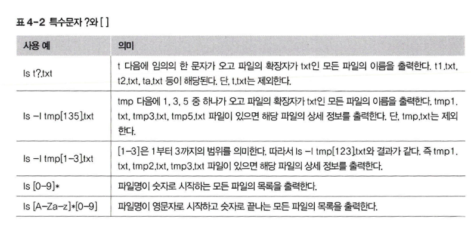
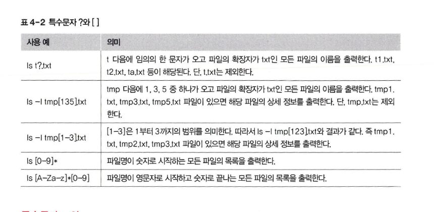
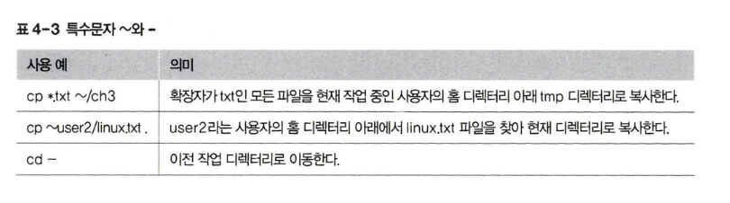

### 🔥 [최종 암기] 리눅스 명령어 & 출력 대응표

## 9번 시 그널은 강제 종료이기 때문에 무조건 종료되지만 좀비 프로세스의 경우 9번 시그널을 받아도 종료되지 않을 수 있다.

#### 1. 리다이렉션 & 파이프 (가장 헷갈림, 출제 1순위)

|**상황/문제**|**정답 명령어**|**예상 결과/동작**|
|---|---|---|
|**덮어쓰기** (화면 출력 X, 파일 저장)|`ls > file.txt`|화면엔 아무것도 안 나옴. `file.txt`에 목록이 저장됨(기존 내용 삭제).|
|**이어쓰기** (내용 추가)|`ls >> file.txt`|`file.txt`의 기존 내용 **끝에** 목록이 추가됨.|
|**에러 메시지만** 파일로 저장|`ls /없는파일 2> err.log`|표준 에러(2번)만 `err.log`에 저장됨.|
|**정상 결과 + 에러** 모두 저장|`ls > all.log 2>&1`|화면 출력 없이 정상/에러 메시지 모두 `all.log`에 저장.|
|**에러 메시지 버리기** (블랙홀)|`ls 2> /dev/null`|화면에도 안 나오고 파일로도 저장 안 됨 (삭제).|
|**파이프** (앞 결과 → 뒤 입력)|`ps -ef|grep bash`|

#### 2. 권한 설정 (`chmod`, `umask`) - 계산 문제 주의

|**상황/문제**|**정답 명령어**|**예상 결과/동작**|
|---|---|---|
|**숫자 모드** (소유자 모든 권한, 나머지 읽기/실행)|`chmod 755 file`|`-rwxr-xr-x` 로 변경됨. (7=4+2+1, 5=4+1)|
|**보안 강화** (나만 읽고 쓰기, 남은 접근 불가)|`chmod 600 file`|`-rw-------` 로 변경됨.|
|**문자 모드** (그룹에 쓰기 권한 추가)|`chmod g+w file`|그룹 권한 부분에 `w`가 생김 (`rw-rw-r--`).|
|**SetUID 설정** (실행 시 소유자 권한)|`chmod 4755 file`|`-rwsr-xr-x` (소유자 실행 권한 자리가 `s`로 바뀜).|
|**Sticky Bit 설정** (공용 디렉토리, 삭제 제한)|`chmod 1777 /tmp`|`drwxrwxrwt` (맨 끝자리가 `t`로 바뀜).|
|**기본 권한 확인**|`umask`|`0002` 또는 `0022` 출력.|
|**[계산]** umask가 022일 때 파일 생성 권한?|(명령어 아님)|**644** (`rw-r--r--`). (파일 기본 666 - 022 = 644)|

#### 3. 파일 검색 & 찾아서 실행 (`find`) - 문법 주의

|**상황/문제**|**정답 명령어**|**예상 결과/동작**|
|---|---|---|
|이름으로 찾기|`find . -name "*.txt"`|현재 디렉토리(`.`) 아래의 모든 .txt 파일 경로 출력.|
|빈 파일 찾기|`find . -empty`|크기가 0인 파일/디렉토리 출력.|
|**찾아서 지우기 (Exec)** `중요`|`find . -name "*.tmp" -exec rm {} \;`|`.tmp` 파일을 찾아 묻지 않고 삭제. (`{}`는 파일명, `\;`는 끝).|
|**찾아서 확인 후 실행 (Ok)**|`find . -name "*.tmp" -ok rm {} \;`|삭제할 때마다 `… ?` 하고 물어봄 (y 입력해야 삭제).|
|명령어 위치 찾기 (PATH 기준)|`which ls`|`/usr/bin/ls` (실제 실행 경로 출력).|

#### 4. 프로세스 제어 (`ps`, `kill`, `nohup`)

|**상황/문제**|**정답 명령어**|**예상 결과/동작**|
|---|---|---|
|**모든 프로세스 상세 확인**|`ps -ef`|UID, PID, PPID, STIME 등이 포함된 전체 목록 출력.|
|사용자별 프로세스 확인|`ps -u user1`|user1이 실행한 프로세스만 출력.|
|**강제 종료** (시그널 9번)|`kill -9 1234`|PID 1234번 프로세스가 즉시 죽음 (말 안 들을 때 씀).|
|정상 종료 (기본값 15번)|`kill 1234`|프로세스에게 "종료해줄래?" 요청 (저장 후 종료).|
|이름으로 종료 (패턴)|`pkill bash`|이름에 'bash'가 들어간 프로세스 종료.|
|이름으로 종료 (정확 일치)|`killall bash`|이름이 정확히 'bash'인 모든 프로세스 종료.|
|**백그라운드 실행 유지**|`nohup find / &`|로그아웃 해도 계속 돔. 결과는 `nohup.out`에 저장.|

#### 5. 텍스트 처리 (`grep`, `sort`, `diff`)

|**상황/문제**|**정답 명령어**|**예상 결과/동작**|
|---|---|---|
|줄 번호 포함 검색|`grep -n "Linux" file`|`10:Linux is…` 처럼 줄 번호와 함께 출력.|
|대소문자 무시 검색|`grep -i "linux" file`|Linux, linux, LINUX 모두 찾음.|
|시작하는 문자 검색 (`^`)|`grep "^A" file`|'A'로 **시작하는** 줄만 출력.|
|정렬 (역순)|`sort -r file`|ㅎ->ㄱ (z->a) 순서로 정렬되어 출력.|
|중복 제거 (연속된 것만)|`uniq file`|연속으로 중복된 줄을 하나로 합쳐서 출력.|
|파일 비교 (차이점)|`diff file1 file2`|`1c1` 처럼 어느 줄이 다른지 출력.|

#### 6. 사용자 및 환경 설정 (`/etc/*`, `alias`)

| **상황/문제**       | **정답 명령어**             | **예상 결과/동작**                     |
| --------------- | ---------------------- | -------------------------------- |
| 환경변수 파일 즉시 적용   | `source .bashrc`       | 로그아웃 없이 `.bashrc` 변경 사항이 바로 반영됨. |
| 별칭 만들기          | `alias c='clear'`      | `c`만 쳐도 `clear` 명령어가 실행됨.        |
| 별칭 확인           | `alias`                | 현재 설정된 모든 별칭 목록 출력.              |
| 사용자 정보 파일       | `cat /etc/passwd`      | 계정명:x:UID:GID… (비밀번호는 x로 보임).    |
| 비밀번호 파일 (Root만) | `sudo cat /etc/shadow` | 암호화된 비밀번호, 만료일 정보 등이 보임.         |
| 현재 접속자 확인       | `w` 또는 `who`           | 누가, 언제, 어디서(IP) 접속했는지 출력.        |
| 지난 접속 기록        | `last`                 | 시스템의 로그인/로그아웃 전체 이력 출력.          |

요청하신 대로 문제, 정답, 그리고 핵심 내용을 한 줄로 요약하여 정리해 드립니다.

---

### **[Image 1]**

**01. 로그인 셸 변경 시 `chsh -s dash user1` 오류 원인?**

- **답:** ④ 바꾸려는 셸을 절대 경로로 지정한다.
- **한줄 핵심:** `chsh` 명령어 사용 시 셸의 이름만 쓰는 것이 아니라 **절대 경로(예: `/bin/dash`)**를 입력해야 합니다.
    

**02. `ls a?.exe` 실행 시 제외되는 파일은?**

- **답:** ① `a.exe`
- **한줄 핵심:** 와일드카드 `?`는 **정확히 한 글자**에만 대응하므로, 문자 사이에 글자가 없는 `a.exe`는 매칭되지 않습니다.
    

**03. `echo '"$SHELL"'` 출력 결과는?**

- **답:** ② `"$SHELL"`
- **한줄 핵심:** **작은따옴표(`'`)**는 내부의 모든 문자(특수문자 `$` 포함)를 문자열 그대로 취급합니다.
    

**04. 셸 변수 TEST를 서브 셸에서도 사용하려면?**

- **답:** ④ `export TEST`
- **한줄 핵심:** `export` 명령어를 사용해야 지역 변수가 **환경 변수**로 전환되어 서브 셸에 상속됩니다.
    

**05. 사용자 계정의 로그인 셸을 저장하고 있는 파일은?**

- **답:** ② `/etc/passwd`
- **한줄 핵심:** `/etc/passwd`는 사용자 정보(셸 포함)를 담고 있으며, 비밀번호는 `/etc/shadow`에 저장됩니다.
    

---

### **[Image 2]**

**06. `ls /tmp >> a.txt` 실행 결과는?**

- **답:** ④ 기존 내용은 남아 있고, `/tmp` 디렉터리의 내용이 추가된다.
- **한줄 핵심:** `>>` 리다이렉션 연산자는 기존 내용을 덮어쓰지 않고 파일 끝에 내용을 **추가(Append)**합니다.
    

**07. 계정의 기본 프롬프트가 저장되는 환경 변수는?**

- **답:** ① `PS1`
- **한줄 핵심:** `PS1`은 기본 프롬프트 모양을 설정하며, `PS2`는 명령어가 길어질 때 나타나는 2차 프롬프트입니다.
    

**08. 셸의 세 가지 주요 기능?**

- **답:** 명령어 해석기 기능, 프로그래밍(스크립트) 기능, 사용자 환경 설정(세션 관리) 기능
- **한줄 핵심:** 셸은 커널과 사용자 사이에서 명령을 해석하고, 프로그램을 실행하며, 환경을 관리합니다.
    

**09. 특수문자 `*`와 `?`의 차이?**

- **답:** `*`는 길이 0 이상의 모든 문자열과 매칭, `?`는 정확히 1개의 문자와 매칭
- **한줄 핵심:** `*`는 '모두', `?`는 '한 글자'를 의미하는 와일드카드입니다.
    

**10. 특수문자 `"`, `'`, `의 차이?**

- **답:** `"`는 변수($) 해석 허용, `'`는 모든 문자 그대로 출력, ` (백틱)은 명령어 실행 결과로 치환
- **한줄 핵심:** 큰따옴표는 변수를 치환해주지만, 작은따옴표는 문자 그대로, 백틱은 명령 실행 결과를 가져옵니다.
    

**11. 표준 입출력 장치란?**

- **답:** 표준 입력(0: 키보드), 표준 출력(1: 모니터), 표준 에러(2: 모니터)
- **한줄 핵심:** 리눅스에서 프로그램이 기본적으로 데이터를 읽고(Input) 쓰는(Output/Error) 통로입니다.
    

**12. `>` 사용 시 기존 파일 덮어쓰기 방지 방법?**

- **답:** `set -o noclobber` 명령 실행
- **한줄 핵심:** `noclobber` 옵션을 켜면 리다이렉션(`>`)으로 인해 기존 파일이 실수로 덮어씌워지는 것을 막습니다.
    

**13. 상세 정보는 `ls.out`, 오류는 `ls.err`에 저장하는 명령?**

- **답:** `ls -l > ls.out 2> ls.err`
- **한줄 핵심:** 표준 출력은 `>`(또는 `1>`)로, 표준 에러는 `2>`를 사용하여 각각 다른 파일로 보냅니다.

**14. `env` 결과에서 특정 환경 변수(예: SHELL)만 골라 출력하려면?**

- **답:** `env | grep SHELL`
- **한줄 핵심:** 파이프(`|`)로 `env`의 출력을 넘기고, `grep`으로 원하는 문자열을 필터링합니다.
    

**15. 배시셸 초기화 파일의 이름과 특징?**

- **답:** `/etc/profile`(전체 사용자), `~/.bash_profile`(개인 로그인 시), `~/.bashrc`(개인 셸 실행/별칭)
- **한줄 핵심:** 시스템 전역 설정은 `/etc`에, 사용자별 설정은 홈 디렉터리(`~`)의 숨김 파일로 저장됩니다.
    

**16. 확장자가 txt인 모든 파일명 출력?**

- **답:** `ls *.txt`
- **한줄 핵심:** 와일드카드 `*`는 모든 문자열을 의미하므로 `.txt`로 끝나는 모든 파일을 매칭합니다.
    

**17. 현재 디렉터리에서 숫자로 시작하는 파일 상세 정보 출력?**

- **답:** `ls -l [0-9]*`
- **한줄 핵심:** `[0-9]`는 숫자 한 글자를 의미하며, `*`와 조합해 숫자로 시작하는 파일들을 찾습니다.
    

**18. 확장자가 c인 모든 파일을 /tmp로 복사?**

- **답:** `cp *.c /tmp`
- **한줄 핵심:** `cp` 명령어에도 와일드카드를 사용하여 여러 파일을 한 번에 지정할 수 있습니다.
    

**19. `echo`를 사용해 날짜 정보를 명령 실행 결과로 출력?**

- **답:** `echo $(date "+%Y. %m. %d. (%a) %T %Z")`
- **한줄 핵심:** `$(명령어)` 또는 `` `명령어` ``를 사용하면 명령어의 실행 결과가 그 자리에 텍스트로 치환됩니다.
    

**20. `ls` 실행 시 숨김 파일도 나오도록 앨리어스 설정?**

- **답:** `alias ls='ls -a'`
- **한줄 핵심:** `alias`를 사용하면 옵션이 포함된 명령어를 기본 명령어처럼 줄여서 쓸 수 있습니다.
    

**21. `rm` 앨리어스를 잠시 사용하지 않고 원본 명령 사용법?**

- **답:** `\rm 파일명` (또는 `/bin/rm`과 같이 절대 경로 사용)
- **한줄 핵심:** 명령어 앞에 역슬래시(`\`)를 붙이면 앨리어스 기능을 무시하고 원본 명령을 실행합니다.
    

**22. 프롬프트를 현재 디렉터리와 히스토리 번호로 설정?**

- **답:** `PS1='[\w \!]$ '`
- **한줄 핵심:** `\w`는 현재 작업 디렉터리, `\!`는 히스토리 번호를 나타내는 프롬프트 설정 기호입니다.
    

---

### **[Image 4]**

**23. 가장 최근에 사용한 `cp` 명령 재실행?**

- **답:** `!cp`
- **한줄 핵심:** `!문자열`은 히스토리에서 해당 문자열로 시작하는 가장 최근 명령을 찾아 즉시 실행합니다.
    

**24. 긴 명령 오타 수정하여 실행하는 방법?**

- **답:** 위쪽 화살표(`↑`) 키를 눌러 편집하거나, `^오타^수정` 명령 사용
- **한줄 핵심:** 히스토리 기능을 통해 이전 명령을 불러와 편집하거나, 치환(`^`) 기능을 사용합니다.
    

**25. 수정된 .bashrc 파일을 적용하는 세 가지 방법?**

- **답:** ① 재로그인, ② `source .bashrc`, ③ `. .bashrc`
- **한줄 핵심:** `source` 또는 `.` 명령어를 사용하면 재로그인 없이 설정 변경 사항을 즉시 반영할 수 있습니다.
