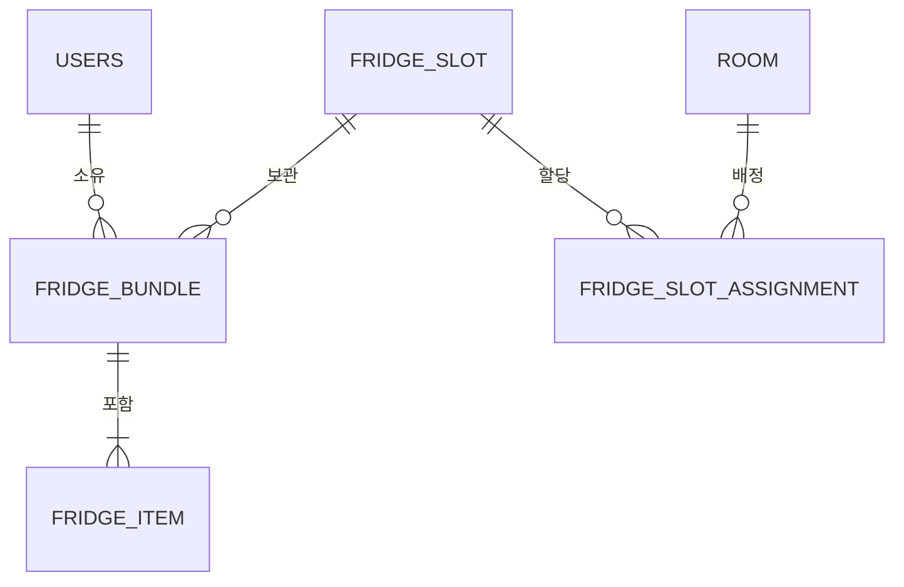

[보관하다]
- 냉장고칸은 번들이 없거나, 번들 여러 개를 보관한다.
- 번들은 단 1개의 냉장고칸에 보관된다.

[포함하다]
- 번들은 생성 완료 시 아이템이 최소 1개는 있어야 하고, 여러 개도 포함한다.
- 아이템은 단 1개의 번들에 포함된다.

[소유하다]
- 사용자는 0개 혹은 여러 개의 번들을 소유한다.
- 번들은 1명의 사용자에게 속한다.

[배정한다]
- 냉장고칸은 0개 혹은 여러 개의 호실에 배정될 수 있다.
- 호실은 0개 혹은 여러 개의 냉장고칸에 배정될 수 있다.

