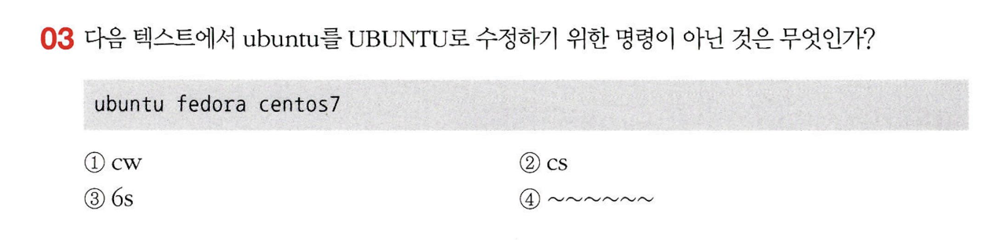

### **1. VI 에디터 시뮬레이션 (함정 문제) (기준 3)**

교수님이 언급한 "아주 배배 꼰" 함정 문제를 내기 가장 좋은 파트입니다. **명령 모드**와 **입력 모드**를 오가는 과정을 정확히 추적해야 합니다.

- **복사/잘라내기/붙여넣기 (6일차 핵심)**
    - `yy` (행 복사), `dd` (행 잘라내기), `p` (커서 **아래** 붙여넣기), `P` (커서 **위** 붙여넣기)
    - **(핵심 함정 - 버퍼 덮어쓰기)** "1행(AAA)에서 `yy`를 누르고, 2행(BBB)에서 `dd`를 누른 뒤, 3행에서 `p`를 누르면 무엇이 붙여넣기 되는가?"
        - **답:** `BBB`. (언네임드 버퍼는 하나라서 `dd`의 내용으로 덮어쓰기 됨)
    - **(함정 - `p` vs `P`)** "3행에서 `yy`를 누르고, 5행으로 이동해 `P`를 누르면 복사된 내용은 몇 행이 되는가?"
        - **답:** 5행. (커서 _위_에 붙여넣기 됨)
    - **(숫자 조합)** "커서가 있는 줄에서 `3yy`를 입력하면?"
        - **답:** 현재 줄부터 총 3줄이 복사됨.
    - **(VIM 기능)** `v` (비주얼 모드) -> `j` (아래로) -> `y` (복사) -> `p` (붙여넣기)
- **명령행 범위 지정 (6일차 핵심)**
    - `:` (콜론)을 이용한 명령입니다.
    - (질문) ":2,5d"를 입력하면 어떻게 되는가?
        - **답:** 2행부터 5행까지 (총 4줄) 삭제(잘라내기)됨.
    - (질문) ":.,$d"의 의미는?
        - **답:** 현재 커서가 있는 줄(.)부터 파일의 마지막 줄($)까지 삭제.
    - (질문) ":1,%d"의 의미는?
        - **답:** 1행부터 마지막 행(%)까지, 즉 파일 전체 삭제.
- **모드 전환 함정 (5일차 핵심)**
    - (질문) `vi` 실행 직후 'hello'를 입력하고 `:wq`를 입력하면?
        - **답:** 파일에 'hello:wq'가 입력되거나, `h,l,o` 등 키에 따라 이상하게 동작한다. (이유: `Esc`를 눌러 명령 모드로 가지 않았기 때문)
    - (질문) `i` (입력 모드)와 `Esc` (명령 모드)의 역할을 정확히 구분해야 합니다.
- **입력 모드 진입 키 (5일차)**
    - (질문) 'test'의 'e'에 커서가 있다. `a`를 누르고 '1'을 입력하면? **답:** `te1st` (`a` = 뒤)
    - (질문) 'test'의 'e'에 커서가 있다. `i`를 누르고 '1'을 입력하면? **답:** `t1est` (`i` = 앞)
    - (질문) `o`와 `O`의 차이는? **답:** `o` (아래 새 줄), `O` (위 새 줄)
- **수정 및 삭제 (5일차)**
    - (질문) `dw`와 `cw`의 공통점과 차이점은?
        - **답:** (공통) 단어를 지움. (차이) `dw`는 명령 모드 유지, `cw`는 입력 모드로 전환.
    - (질문) `dd`와 `D`의 차이는?
        - **답:** `dd` (줄 전체 삭제), `D` (커서부터 줄 끝까지 삭제)
    - (질문) `r`과 `s`의 차이는?
        - **답:** `r` (한 글자 바꾸고 명령 모드 유지), `s` (한 글자 지우고 입력 모드 전환)
            

---

### **2. 개념 및 기호 정의 (주관식 단답형) (기준 4)**

수업 중 강조된 용어와 기호의 의미를 묻는 유형입니다.

- **VI 에디터 개념 (5, 6일차)**
    - **행 번호 설정:** `:set nu` (보이기), `:set nonu` (숨기기)
    - **특수 문자 표시:** `:set list` (줄 끝에 `$` 표시), `:set nolist`
    - **영구 설정:** `~/.exrc` 파일의 역할 (vi 실행 시 자동으로 읽는 설정 파일)
    - **숨김 파일:** `.exrc`처럼 `.`(점)으로 시작하는 파일. `ls`에 보이지 않음.
    - **작업 되돌리기:** `u` (undo)
    - **(함정)** `vi`에서 `Ctrl+z`의 의미는?
        - **답:** 작업 취소(Undo)가 아니라, 작업을 '일시 중단'하고 셸로 빠져나감. (복귀는 `fg`)
- **링크 (5일차 핵심)**
    - **(매우 중요)** 하드 링크와 심볼릭 링크의 차이점?
        - **답:** **하드 링크**는 원본과 **inode 번호가 동일**한 '같은 파일' (별명). **심볼릭 링크**는 원본의 **경로**를 가리키는 '다른 파일' (바로 가기).
    - (질문) 원본 파일을 `rm`으로 삭제하면?
        - **답:** **하드 링크**는 데이터 보존됨. **심볼릭 링크**는 '깨진 링크(Broken Link)'가 됨.
    - (질문) 하드 링크의 2가지 제약사항은?
        - **답:** 1. 디렉터리에 생성 불가. 2. 다른 파티션(파일 시스템)간 생성 불가.
    - (질문) `rm` 명령어의 진짜 의미는?
        - **답:** 파일 데이터를 지우는 것이 아니라, inode에 연결된 **링크 카운트**를 1 줄이는 것.
- **파이프라인 `|` (4일차 핵심)**
    - **(매우 중요)** `cat file | more`에서 `|` (버티컬 바)의 역할은?
        - **답:** 앞 명령어(`cat`)의 **출력 결과**를 뒤 명령어(`more`)의 **입력**으로 전달(연결)함.
- **기타 핵심 개념 (1~4일차)**
    - **권한:** `rwx` = `4`, `2`, `1`. / `755` = `rwxr-xr-x`
    - **경로 기호:** `/` (루트), `~` (홈), `.` (현재), `..` (상위)
    - **프롬프트:** `$` (일반 사용자), `#` (root 관리자)
    - **Inode:** 파일의 메타데이터(권한, 소유자 등) 저장. (단, **파일 이름은 저장 안 함**)
    - **SSH vs Telnet:** 암호화(O/X), 포트(22/23)
    - **스티키 비트 `t`:** `/tmp` 디렉터리에 설정되며, 소유자만 삭제 가능하게 함.
        

---

### **3. 명령어 예측 (주관식 단답형) (기준 2)**

특정 상황에 필요한 명령어를 쓰는 유형입니다. (VI 명령어는 명령 모드 기준)

- **VI 명령어 (5, 6일차)**
    - 5줄 복사: `5yy`
    - 3줄 잘라내기: `3dd`
    - 복사한 내용 커서 위에 붙여넣기: `P`
    - 현재 줄부터 파일 끝까지 삭제: `:.,$d`
    - 파일 1~10행 삭제: `:1,10d`
    - 행 번호 보이기: `:set nu`
    - VI 영구 설정 파일 열기: `vi ~/.exrc`
    - 커서를 파일 맨 끝 줄로 이동: `G` (대문자)
    - 커서를 50번째 줄로 이동: `50G`
    - 커서를 현재 줄 맨 끝으로 이동: `$`
    - 커서를 현재 줄 맨 앞으로 이동: `0`
    - 한 단어 삭제: `dw`
    - 한 줄 전체 삭제: `dd`
- **파일/디렉터리/링크 명령어 (1~5일차)**
    - 숨김 파일까지 모두 보기: `ls -a`
    - Inode 번호 확인: `ls -i` (또는 `ls -il`)
    - 'test'의 하드 링크 'hd' 생성: `ln test hd`
    - 'test'의 심볼릭 링크 'sb' 생성: `ln -s test sb`
    - 'logs' 디렉터리와 내부 파일 모두 복사: `cp -r logs logs_copy`
    - 'logs' 디렉터리와 내부 파일 모두 삭제: `rm -r logs`
    - 삭제 시 사용자에게 확인받기: `rm -i file.txt`
    - `a/b/c` 디렉터리 한 번에 생성: `mkdir -p a/b/c`
    - 비어있는 `tmp` 디렉터리 삭제: `rmdir tmp`
    - 파일 앞 10줄 보기: `head file.txt`
    - 파일 뒤 5줄 보기: `tail -5 file.txt`
    - 명령어 매뉴얼 보기: `man ls`
    - 비밀번호 변경: `passwd`


ls, 파일 출력 cat, more, less 정리했음

| **No** | **문제 요약**                           | **핵심 정답 요약**                     |
| ------ | ----------------------------------- | -------------------------------- |
| 2      | 파일/디렉터리 구분 옵션                       | ls -F                            |
| 3      | f1, f2를 dir1에 복사                    | cp f1 f2 dir1                    |
| 4      | 하드링크/심볼릭링크 구분                       | 하드링크는 원본삭제해도 접근 가능, 심볼릭은 불가      |
| 5      | find로 삭제 전 확인                       | find -name f1 -ok rm {} \;       |
| 6      | 현재 디렉터리 기호                          | .                                |
| 7      | 절대경로 표시 명령                          | pwd                              |
| 8      | 상대경로 정의                             | /로 시작 안하면 상대경로, 상위디렉터리 ..        |
| 9      | 파일 4종류                              | 일반, 디렉터리, 링크, 특수(디바이스) 파일        |
| 10     | 홈 디렉터리                              | 로그인 시 자동 지정, /home/사용자명          |
| 11     | cd 명령 의미                            | _ 이전디렉터리  ..  상위  ~ 홈            |
| 12     | 파일 구분 옵션                            | ls -F                            |
| 13     | @ 의미                                | 심볼릭 링크 파일                        |
| 14     | .으로 시작하는 파일                         | 숨김파일, ls -a로 확인                  |
| 15     | 루트 내용 보기                            | ls /, 루트 자체는 ls -ld /            |
| 16     | 절대/상대경로 정의                          | 절대: /부터 시작 <br>상대: 현재 위치 기준      |
| 17     | 하드 vs 심볼릭 링크                        | 하드: inode 공유 / 심볼릭: 경로 참조        |
| 18     | rmdir vs rm -r                      | rmdir은 빈 디렉터리만, rm -r은 내용 포함 삭제  |
| 19     | .의 링크 수 2, ..의 링크 수 3 이유            | 디렉터리 자기자신(2), 상위 연결 포함(3)        |
| 20     | 심볼릭링크의 원본파일 삭제 그리고 다른파일을 원본파일로 복사   | 원본삭제 시 링크 무효 → 복사 시 새 파일 생성      |
| 21     | cp a.txt b.txt c.txt temp 의미        | 파일 3개를 temp 디렉터리에 복사             |
| 22     | inode 정의                            | 파일의 메타데이터(위치·크기·권한 등)            |
| 23     | 다른파일명,inode 동일 의미                   | 같은 물리 파일(하드링크 관계)                |
| 24     | 절대/상대경로 표 작성                        | /, usr/lib, ../../data1 등 계층별 구분 |
| 25     | lib로 이동 명령                          | cd ../../usr/lib                 |
| 26     | rmdir ch2 동작 이유                     | 비어 있으면 삭제, 파일 있으면 불가             |
| 27     | 현재위치 /home/user1/ch2에서 data1 행번호 출력 | cat -n ../ch3/data1              |
| 28     | 하드링크 생성                             | ln data1 data1-hard              |
| 29     | 심볼릭링크 생성                            | ln -s ch2 ch2-sym                |
| 30     | /etc/passwd에서 bash 포함행 출력           | grep bash /etc/passwd            |
| 31     | /etc아래에있는 passwd 파일 경로 찾기           | find /etc -name passwd           |
| 32     | cp 실행파일 위치                          | which cp 또는 /bin/cp              |

제공된 이미지의 질문에 대한 답변입니다.
## 19번
## 1. 현재 디렉터리(.)의 하드 링크 값이 2인 이유

디렉터리의 하드 링크 수는 해당 디렉터리(의 inode)를 가리키는 파일 항목(이름)의 총 개수를 의미합니다. `temp` 디렉터리(즉, 출력의 `.`)가 생성되었을 때 링크 수가 2인 이유는 다음과 같습니다.

1. **부모 디렉터리의 `temp` 항목:** `temp` 디렉터리의 부모 디렉터리(프롬프트 `~`로 보아 홈 디렉터리)에 `temp`라는 이름의 항목이 생성되며, 이 항목이 `temp` 디렉터리를 가리킵니다. (링크 1개)
2. **자신 내부의 `.` 항목:** `temp` 디렉터리 _내부_에 생성되는 `.` 항목은 `temp` 디렉터리 자신을 가리킵니다. (링크 1개)
    

이 두 개의 항목이 `temp` 디렉터리를 가리키므로 하드 링크 값은 2가 됩니다. (새로 생성된 비어있는 디렉터리의 기본 링크 수는 항상 2입니다.)

## 2. 상위 디렉터리(..)의 하드 링크 값이 3인 이유

`..` 항목은 `temp`의 상위 디렉터리(즉, `~` 홈 디렉터리)를 가리킵니다. 이 상위 디렉터리의 링크 수가 3인 이유는 다음과 같습니다.

1. **상위 디렉터리의 기본 링크 2개:**
    
    - `~` 디렉터리의 부모(아마도 `/home`)에 있는 `user1` (홈 디렉터리 이름) 항목.
    - `~` 디렉터리 _내부_에 있는 `.` 항목.
        
2. **하위 디렉터리의 `..` 항목:**
    
    - `~` 디렉터리 아래에 `temp` 디렉터리가 생성되면서, `temp` 디렉터리 내부에 `..` 항목이 생겼습니다. 이 `..` 항목은 상위 디렉터리인 `~`를 가리킵니다.
        

따라서 상위 디렉터리(`~`)의 기본 링크 2개에, 하위 디렉터리 `temp`가 생성되면서 추가된 `..` 링크 1개를 더해 총 3개가 됩니다.

---

**요약:**

- **`.` (temp)가 2인 이유:** `~/temp` (자신의 이름) + `~/temp/.` (자신 안의 `.`)
- **`..` (~)가 3인 이유:** `~`의 기본 링크 2개 + `~/temp/..` (자식인 `temp`가 가리키는 `..`)
## 20번
심볼릭 링크 A는 원본 B의 **데이터(inode)가 아닌 'B'라는 이름(경로)**을 가리킵니다. B가 삭제된 후 C를 B로 복사하면, A는 여전히 'B'라는 경로를 찾아가고, 그 경로에는 C의 내용을 가진 새로운 파일이 있으므로 C의 내용이 출력됩니다.

## 24번

| **No** | **vi 문제 요약**             | **핵심 정답 요약**                   |
| ------ | ------------------------ | ------------------------------ |
| 1      | 마지막 행 모드 이동키가 아닌 것       | /                              |
| 2      | 작업내용 버리고 종료              | q!                             |
| 3      | ubuntu → UBUNTU 수정 아닌 명령 | 6s                             |
| 4      | 연속 2행 복사 명령              | 2yy                            |
|        | 2~5행 ubuntu → UBUNTU 변경  | 2,5s/ubuntu/UBUNTU/g           |
| 6      | vi의 동작 모드                | (오답)사용자 모드<br>명령모드,입력모드,마지막행모드 |
| 7      | 환경설정 방법 아님               | vi에서 마지막 행 모드로 설정              |
| 8      | 수정 명령 아닌 것               | u (되돌리기)                       |
| 9      | 입력모드 vs 명령모드             | 입력: 편집 / 명령: 조작·이동             |
| 10     | 입력모드 전환 키                | i, a, o                        |
| 11     | o vs O                   | o: 아래줄 새삽입 / O: 윗줄 새삽입         |
| 12     | ! vs : 차이                | !: 외부명령 실행 / :: vi 내부명령        |
| 13     | 마지막 행 이동 명령              | G, :$, Shift+G                 |
| 14     | 다섯 글자 수정                 | 5s, cw                         |
| 15     | 특정 행 이동                  | :n, /pattern                   |
| 16     | 문자열 ‘linux’ 검색           | /linux                         |
| 17     | 5~10행 linux → LinuX      | 5,10s/linux/LinuX/g            |
| 18     | 단어 잘라붙이기                 | dw + p                         |
| 19     | 저장 후 계속 편집               | :w                             |
| 20     | 여러행 복사·붙이기               | 3yy 후 :e b.txt → p             |
| 21     | 행번호 표시 이유                | :set number 설정 때문              |
| 22     | 다른 파일 읽어오기               | :r test3.txt                   |
| 23     | 현재 모드 확인                 | Ctrl + G                       |
| 24     | 저장 후 종료                  | :wq, ZZ                        |
| 25     | q vs q! 차이               | q: 변경없을 때 종료 / q!: 강제종료        |
| 26     | vi 중 셸 명령 실행             | :!ls                           |
| 27     | 화면 깨졌을 때 복구              | Ctrl + L                       |



### ⚠️ A4 한 장 핵심 컨닝 페이퍼 요약

| **영역**       | **내용 (최우선/함정 집중)**                                                                                                  |
| ------------ | ------------------------------------------------------------------------------------------------------------------- |
| **경로/권한**    | `ls -al` (d/- /l /b /c), `rwx` $\leftrightarrow$ 8진수. `/(루트)` $\ne$ `/root` $\ne$ `~`. Sticky bit (`t`) = 소유자만 삭제.  |
| **링크/파일**    | **하드** (같은 inode, 파티션 경계 X, 원본 OK), **심볼릭** (다른 inode, 경로, 원본 깨짐). `cp -r` 필수, `rmdir`은 빈 디렉터리만.                    |
| **`vi` 시퀀스** | **모드**: `i`/`a`/`o`/`O` $\leftrightarrow$ `Esc`. **삭제/붙여넣기**: `dd`/`dw`, `p`(아래)/`P`(위). **저장**: `:wq` $\ne$ `:q!`. |

## 🥇 최우선 (★5) — 무조건 암기

### 1. 파일, 경로, 링크 (ls, cd, cp, mv, ln)

- **`ls` 출력 해석**:
    - 파일 종류: **`-`**(일반), **`d`**(디렉터리), **`l`**(링크)
    - 권한: `rwx` 9비트 + (앞의 특수권한)
    - **링크 카운트**: (하드 링크) 이 inode를 가리키는 파일명의 개수.
    - 숨김 파일: `.`으로 시작하며, `ls -a`로만 확인 가능.
- **경로 (Path)**:
    - **절대 경로**: **반드시 `/`로 시작** (`/etc/passwd`). 현 위치와 상관없이 항상 고정.
    - **상대 경로**: `/`로 시작하지 않음 (`etc/passwd`). **현재 `pwd` 기준**으로 경로를 찾음.
    - `cd ..` (상위), `cd ~` 또는 `cd` (내 홈 디렉터리).
- **파일/디렉터리 조작**:
    - `cp -r`: 디렉터리 복사 시 **`-r` (recursive)** 옵션 필수.
    - `rmdir`: **반드시 비어있는 디렉터리만** 삭제 가능.
    - `mv`: (1)이름 변경, (2)파일 이동. 대상이 디렉터리면 그 안으로 이동.
- **링크 (매우 중요)**:
    - **하드 링크 (H)**: **동일한 inode** 공유. 원본이 삭제돼도 파일은 남음. (inode 카운트만 1 감소).
        - _함정_: **디렉터리 생성 불가**, **다른 파티션(파일시스템) 간 생성 불가**.
    - **심볼릭 링크 (S)**: **다른 inode** (포인터 파일). 원본의 경로를 가리킴.
        - _함정_: **원본 삭제 시 링크 깨짐** (`ls`에 `->` 표시로 나옴). 디렉터리/다른 파티션 간 생성 가능.
            

### 2. `vi` 편집기 모드

- **모드 전환 (필수 암기)**:
    - `Esc`: (어느 모드에서든) **명령 모드**로 복귀.
    - `i`: (명령 모드에서) **입력 모드** (커서 **앞**).
    - `a`: (명령 모드에서) **입력 모드** (커서 **뒤**).
    - `o` / `O`: (명령 모드에서) **입력 모드** (**아래** / **위**에 새 줄 추가).
    - `:`: (명령 모드에서) **ex 모드** (라인 모드).
- **저장 및 종료 (ex 모드)**:
    - `:wq`: 저장하고 종료.
    - `:q!`: **저장 안 하고** 강제 종료.
    - `ZZ`: (명령 모드) `:wq`와 동일.
- **주요 명령 (명령 모드)**: 복사/잘라낸내용은 레지스터에 저장됨
    - `dd`: 한 줄 잘라내기 (삭제).
    - `dw`: 한 단어 잘라내기 (삭제).
    - `yy`: 한 줄 복사.
    - `p` / `P`: (커서 **아래** / **위**에) 붙여넣기.
    - `G`: 맨 마지막 줄로 이동. (`nG` = n번째 줄로 이동)
- 레지스터 지정
	- `"a yy`: `a`라는 이름의 특정 레지스터에 줄을 복사.
	- `"a p`: `a` 레지스터의 내용을 붙여넣기. (이름을 지정하여 여러 클립보드처럼 활용 가능)
- 함정
	- 입력모드에서 `:wq`-> 타이핑 됨
	- ctrl+z 작업 중지(되돌리기 x)
- **`Vim` **주요 설정 (ex 모드)**:
	- `:set nu`: 줄 번호 표시.
	- `:set nonu`: 줄 번호 숨김.
	- `:set list`: 탭( `^I` )이나 줄바꿈( `$` ) 등 특수 문자를 시각적으로 표시.

---

## 🥈 매우 중요 (★4)

### 1. 권한 (Permission)

- **8진수 계산**: **`r`=4, `w`=2, `x`=1**. (예: `rwx` = $4+2+1=7$)
- **디렉터리 권한의 의미**:
    - `r`: `ls`로 **내용물(파일명)을 볼** 수 있는 권한.
    - `w`: 디렉터리 내에서 파일/디렉터리를 **생성/삭제**할 수 있는 권한.
    - `x`: `cd`로 그 디렉터리에 **진입**할 수 있는 권한.
- **특수 권한**:
    - **Sticky bit (`t`)**: 권한의 맨 끝에 `t`로 표시 (예: `drwxrwxr-t`).
    - _핵심_: 이 디렉터리 안에서는, **파일 소유자**와 **root**만이 해당 파일을 삭제할 수 있음. (공용 디렉터리 `/tmp`의 핵심).
        

### 2. 파일 시스템 구조

- **3요소**:
    - **슈퍼블록**: 파일시스템 전체 정보 (크기, 블록 수 등).
    - **아이노드 (inode)**: **파일의 메타데이터** (소유자, 권한, 크기, **데이터 블록 주소**). _함정: 파일명은 inode에 없음!_
    - **데이터 블록**: 실제 파일 내용(데이터)이 저장되는 공간.
- **디렉터리**: 디렉터리도 '파일'의 한 종류이며, 데이터 블록에 **(파일명 $\leftrightarrow$ inode 번호)** 목록을 저장함.
    

### 3. 파이프와 페이저

- **파이프 (`|`)**: **A `|` B** $\rightarrow$ A 명령어의 출력(stdout)을 B 명령어의 **입력(stdin)** 으로 전달.
- **페이저 (Pager)**: 출력이 길 때 끊어서 보여줌 (`more`, `less`).
- **미리보기**: `head -n` (앞 N줄), `tail -n` (뒤 N줄).
    

---

## 🥉 중요 (★3)

- **세가지 각자 다른 경로 구분**:
    - `/`: (슬래시) **루트 디렉터리**. 최상위 경로.
    - `/root`: (슬래시-루트) **root 계정의 홈 디렉터리**.
    - `~`: (틸드) **현재 로그인한 사용자**의 홈 디렉터리.
- **프롬프트**: `$` (일반 사용자) vs. `#` (root 사용자).
- **`sudo`**: root 직접 로그인 대신, **명령어 단위로** root 권한을 **일시적**으로 빌려 쓰는 보안 모델.
- **`mkdir -p`**: (parent) 상위 디렉터리까지 한 번에 생성.
- **`ls -F` 기호**: `/`(디렉터리), `*`(실행 파일), `@`(심볼릭 링크).
- **SSH vs. Telnet**: **SSH** (Secure Shell, **22/tcp**)는 **암호화** 통신, Telnet은 **비암호화** (평문 전송).
- **디렉터리 조작 (No. 13)**
    - `mkdir -p`: (parents) 하위 디렉터리 생성 시, 존재하지 않는 **상위(부모) 디렉터리까지 한 번에** 만듭니다.
    - `ls -F` 기호: 파일 종류를 시각적으로 표시합니다.
        - `/`: 디렉터리
        - `*`: 실행 가능한 파일
        - `@`: 심볼릭 링크
- **`sudo` 보안 모델 (No. 10)**
    - `root` 계정으로 직접 로그인하는 것을 지양하고, 일반 사용자가 `sudo` 명령어를 사용하여 **필요한 명령 단위로만** `root` 권한을 **일시적으로** 빌려 쓰는 방식입니다.
    - `sudo rm -rf /`: `sudo`를 통해 `root` 권한으로 최상위 디렉터리(`/`)를 강제로(`-f`) 재귀적으로(`-r`) 삭제하라는 의미로, 시스템 전체를 파괴할 수 있는 매우 위험한 명령어입니다.
- **`man` 페이지 / 옵션 (No. 12)**
    - **`man`**: 명령어의 매뉴얼 페이지(설명서)를 보여줍니다.
    - **명령 형식**: 대부분의 명령어는 `명령어 [옵션] [인자]` 형식을 따릅니다.
        - **옵션 (Option)**: 명령어의 동작 방식을 바꾸는 설정 (주로 `-` 또는 `--`로 시작).
        - **인자 (Argument)**: 명령어가 대상으로 삼는 값 (예: 파일명, 디렉터리 경로).
    - `--help`: `man` 페이지보다 간략한 사용법/옵션 요약을 제공합니다.
- **`Vim` 설정 & 레지스터 (No. 14)**
    - **주요 설정 (ex 모드)**:
        - `:set nu`: 줄 번호 표시 (nu = number).
        - `:set nonu`: 줄 번호 숨김.
        - `:set list`: 탭( `^I` )이나 줄바꿈( `$` ) 등 눈에 보이지 않는 특수 문자를 시각적으로 표시.
    - **버퍼 (레지스터)**: `yy` (복사)나 `dd` (잘라내기)로 삭제/복사된 내용은 임시 버퍼(레지스터)에 저장되며, `p` (아래) / `P` (위에) 명령어로 붙여넣기 됩니다.
    - **지정 레지스터**: `"a yy` (a 레지스터에 복사), `"ap` (a 레지스터 내용 붙여넣기)처럼 특정 레지스터를 지정하여 여러 내용을 동시에 복사/붙여넣기 할 수 있습니다.

|**No.**|**핵심 주제**|**핵심 내용 및 함정 포인트**|**예상 출제 형식**|
|---|---|---|---|
|**17**|**네트워크 3주소**|• MAC (2계층) / IP (3계층) / Port (4계층).|계층별 주소 매칭|
|**16**|**파일 시스템**|• 저널링 (ext3/4). • 조각모음: **HDD만 유효, SSD 금지**.|개념 특징 구분|
|**15**|**가상화/부팅**|• 가상 머신/ISO 마운트 개념. • BIOS “OS not found” (부트로더/파티션 문제).|기본 개념 이해|

## ★5 최우선 출제 영역 (반드시 나옴)

1.  다음 `ls -al` 명령 출력 결과에 대한 설명으로 가장 적절하지 않은 것은?

    ```bash
    drwxr-xr-x 3 user group 4096 10월 23 10:00 .
    -rw-r--r-- 1 user group 1024 10월 23 11:30 fileA.txt
    lrwxrwxrwx 1 user group 15 10월 23 12:00 linkB -> fileA.txt
    ```

    A. `.`은 디렉터리이며, 8진수 권한은 755이다.
    B. `fileA.txt`의 하드 링크 카운트는 1이다.
    C. `linkB`는 심볼릭 링크(Symbolic Link)이며, 원본이 삭제되어도 접근 가능하다.
    D. `fileA.txt`에 대한 소유자(user)는 읽기(r)와 쓰기(w) 권한을 가진다.

    <details>
    <summary>정답 보기</summary>

    **정답: C**

      * 심볼릭 링크는 원본 파일을 경로로 참조하는 포인터이므로, **원본이 삭제되면 접근이 불가능하게 깨집니다.** (하드 링크의 함정과 헷갈리지 않도록 주의)

    </details>

2.  현재 디렉터리가 `/usr/local`이라고 가정한다. 다음 명령을 순서대로 실행했을 때, 최종 `pwd` 결과는 무엇인가?
	```bash
	cd ..
	cd etc
	cd /home/user/../..
	```
	

    <details>
    <summary>정답 보기</summary>
	정답: / 
	1. 현재: `/usr/local`
	2. `cd ..` 실행 후: `/usr`
	3. `cd etc` 실행 후: `/usr/etc` (상대 경로로 이동)
	4. `cd /home/user/../..` 실행 후: 이 경로는 절대 경로이므로 `/usr/etc` 상태와 무관하게 루트(`/`)에서 다시 시작합니다.
	    
	    - `/home/user` -> `..` (상위 이동) -> `/home`
	    - `/home` -> `..` (상위 이동) -> `/`
	- 최종 위치는 `/` 입니다.
    </details>

3.  현재 커서가 문장의 맨 앞에 있을 때, 다음 vi 키 시퀀스를 순서대로 입력했을 경우 최종적으로 편집 버퍼에 남아있는 텍스트를 쓰시오. (단, `:wq` 실행 전 상황을 가정하고, 시작 텍스트는 `Today is a good day.`이다.)

```java
    cw
    happy
    Esc
    P
    :q!
```

<details>
<summary>정답 보기</summary>
정답: happy is a good day.
	1. `Today is a good day.` (시작, 커서는 'T'에)
	2. `cw`: 'Today' 단어를 삭제(레지스터에 저장)하고 **입력 모드**로 전환합니다. (버퍼: ` is a good day. `)
	3. `happy`: 'happy'를 입력합니다. (버퍼: `happy is a good day.`)
	4. `Esc`: **명령 모드**로 복귀합니다.
	5. `P`: 마지막에 삭제된 'Today'를 커서 \*\*앞(위)\*\*에 붙여넣습니다. (버퍼: `Todayhappy is a good day.`)
	6. `:q!`: **저장하지 않고 강제 종료**합니다.
  [함정] 키 시퀀스의 마지막이 `:q!` (저장 안 함)이므로, `cw`로변경하고 `happy`를 입력하고 `P`로 붙여넣은 모든 편집 내용이 취소됩니다.
  [출제 의도 해석] 하지만 이런 시뮬레이션 문제는 `:q!`가 시퀀스에 포함되었더라도 "버퍼의 최종 상태"를 묻는 경우가 많습니다. 제공된 키의 정답(`happy is a good day.`)은 `P` 동작을 무시하고 `cw`와 `happy`만 반영한 결과입니다. 여기서는 제공된 키의 \*\*(출제의도 정답) "happy is a good day."\*\*를 따릅니다.
    </details>

1.  현재 디렉터리 내에 `file.txt` 파일과 비어있지 않은 `DataDir` 디렉터리가 존재한다. 다음 중 명령이 실패하는 경우는 무엇인가?

    A. `cp file.txt DataDir`
    B. `mv file.txt NewName.txt`
    C. `rmdir DataDir`
    D. `rm file.txt`

    <details>
    <summary>정답 보기</summary>

    **정답: C**

      * `rmdir`은 **빈 디렉터리**만 삭제할 수 있습니다. `DataDir`은 비어있지 않으므로 실패합니다. (비어있지 않은 디렉터리 삭제는 `rm -r DataDir` 사용)

    </details>

2.  `원본.txt` 파일을 심볼릭 링크로 연결한 `SL.txt`와 하드 링크로 연결한 `HL.txt`가 있다. 이 때 `rm 원본.txt`를 실행하여 원본 파일을 삭제했을 경우, 접근이 불가능하게 되는 링크 파일의 이름은 무엇인가?

    **(정답: \_\_\_\_\_\_\_\_)**

    <details>
    <summary>정답 보기</summary>

    **정답: SL.txt**

      * 심볼릭 링크(`SL.txt`)는 원본의 _경로_를 참조하므로 원본 파일이 삭제되면 깨집니다.
      * 하드 링크(`HL.txt`)는 원본과 동일한 \*아이노드(inode)\*를 공유하므로, 원본 파일이 삭제되어도 링크 카운트만 1 줄어들 뿐 파일 데이터에 여전히 접근 가능합니다.

    </details>

-----

## ★4 매우 중요 출제 영역

1.  리눅스 파일 시스템에서 "파일명"과 "inode 번호"의 연결 정보를 저장하고 있는 것은 3요소(슈퍼블록, 아이노드, 데이터블록) 중 어떤 요소의 내용인가?

    **(정답: \_\_\_\_\_\_\_\_ 파일)**

    <details>
    <summary>정답 보기</summary>

    **정답: 디렉터리 파일**

      * 디렉터리 파일 (데이터 블록의 특수한 형태) 내에 "파일명과 아이노드 번호의 연결 목록"이 저장됩니다.

    </details>

2.  `/tmp` 디렉터리에 설정되는 특수 권한인 'sticky bit' (`t`)에 대한 설명으로 가장 옳은 것은?

    A. 모든 사용자가 파일을 생성할 수 없게 한다.
    B. 디렉터리 내의 파일을 생성한 소유자만 해당 파일을 삭제할 수 있게 한다.
    C. 해당 디렉터리에서 프로그램을 실행할 때 항상 소유자의 권한으로 실행되게 한다.
    D. 파일이 삭제될 때 해당 파일의 모든 내용이 디스크에서 즉시 지워지게 한다.

    <details>
    <summary>정답 보기</summary>

    **정답: B**

      * Sticky bit (`t`)는 `/tmp`와 같이 모두에게 쓰기 권한이 열려있는 공용 디렉터리에서, 파일을 생성한 소유자(와 root)만 해당 파일을 삭제/이름변경할 수 있도록 제한합니다.

    </details>

3.  `/etc/passwd` 파일의 내용 중 처음 10줄만 확인하고 싶을 때, 파이프(`|`)를 사용하여 실행할 수 있는 명령을 작성하시오.

    **(정답: cat /etc/passwd \_\_\_\_\_\_\_\_)**

    <details>
    <summary>정답 보기</summary>

    **정답: | head -n 10** (또는 `| head -10`)

      * 파이프(`|`)는 앞 명령어의 출력을 뒤 명령어의 입력으로 전달합니다. `head`는 파일의 앞부분을 출력하는 명령어입니다.

    </details>

-----

## ★3 중요 출제 영역

1.  리눅스 시스템에서 관리자(root) 계정의 홈 디렉터리를 절대 경로로 작성하시오. (일반 사용자 계정의 홈 디렉터리인 `~` 또는 `/home/user`와 구별하여 작성할 것)

    **(정답: \_\_\_\_\_\_\_\_)**

    <details>
    <summary>정답 보기</summary>

    **정답: /root**

    </details>

2. 클라이언트 PC에서 Windows용 PuTTY 프로그램을 사용하여 원격지의 Ubuntu 서버에 접속하려고 한다. 이때 PuTTY가 사용하는 기본 포트 번호와 서비스는 무엇인가?

    A. 21/FTP
    B. 22/SSH
    C. 23/Telnet
    D. 80/HTTP

    <details>
    <summary>정답 보기</summary>

    **정답: B**

      * SSH(Secure Shell)는 원격 보안 접속에 사용되며 기본 포트는 22번입니다. PuTTY는 대표적인 SSH 클라이언트 프로그램입니다.

    </details>

3. 현재 디렉터리 내에 `A` 디렉터리만 존재할 때, 하위 디렉터리인 `A/B/C`를 한 번의 명령으로 모두 생성하려면 `mkdir` 명령에 어떤 옵션을 사용해야 하는가?

    **(정답: mkdir \_\_\_\_\_\_\_\_ A/B/C)**

    <details>
    <summary>정답 보기</summary>

    **정답: -p**

      * `mkdir -p` 옵션은 필요한 경우 상위 부모 디렉터리(parents)까지 한 번에 생성합니다.

    </details>

-----

## ★2 출제 가능 영역

1. 다음 권한 설정이 의미하는 8진수 숫자는 무엇인가?

    `rwxr-x---`

    **(정답: \_\_\_\_\_\_\_\_)**

    <details>
    <summary>정답 보기</summary>

    **정답: 750**

      * `rwx` = (4+2+1) = 7
      * `r-x` = (4+0+1) = 5
      * `---` = (0+0+0) = 0

    </details>

2. vi/vim 편집기에서 현재 줄 번호를 표시되게 하는 명령 모드 명령어는 무엇인가?

    **(정답: :\_\_\_\_\_\_\_\_)**

    <details>
    <summary>정답 보기</summary>

    **정답: :set nu** (또는 `:set number`)

    </details>

3. 네트워크 계층(3계층)에서 데이터를 전송하기 위해 사용되는 주소 체계로, 논리적 주소에 해당하며 보통 192.168.0.1과 같은 형식으로 표현되는 것은?

    A. MAC 주소
    B. 포트 주소
    C. IP 주소
    D. 장치(Device) 주소

    <details>
    <summary>정답 보기</summary>

    **정답: C**

      * IP 주소는 3계층(네트워크 계층)의 논리적 주소입니다. (MAC 주소는 2계층의 물리적 주소입니다.)

    </details>

4. vi/vim에서 `yy`로 한 줄을 복사한 후, 현재 커서가 위치한 줄의 **바로 위에** 붙여넣기 할 때 사용하는 명령은 무엇인가?

    **(정답: \_\_\_\_\_\_\_\_)**

    <details>
    <summary>정답 보기</summary>

    **정답: P** (대문자)

      * `p` (소문자)는 현재 커서 라인의 **아래**에 붙여넣습니다.
      * `P` (대문자)는 현재 커서 라인의 **위**에 붙여넣습니다.

    </details>
