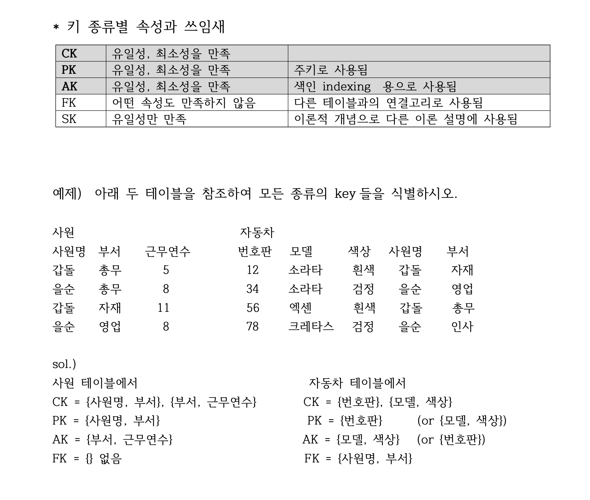

## **1) [T/F] 빠른 정답표**

1. **ERD에는 FK 개념이 없다** → **T**
2. **관계(relationship)는 속성을 가질 수 있다** → **T**
3. **관계 자체는 키를 가져야 한다** → **F**
4. **1:N은 1쪽 PK를 N쪽 FK로 내장** → **T**
5. **N:M도 내장으로 해결** → **F** (연결테이블 필수)
6. **약한 엔터티는 항상 Total 참여** → **T**
7. **약한 엔터티의 FK는 PK 구성 요소(식별관계)** → **T**
8. **PK는 NULL/중복 가능** → **F**
9. **FK는 중복·NULL 가능(부분참여), 단 참조 존재성 필수** → **T**
10. **복합·다치 속성은 RM에서 그대로 둔다** → **F** (분해/전개)
11. **SK는 유일성만, 최소성은 불필요** → **T**
12. **삼진 관계는 되도록 이진으로 분해한다** → **T**

    (+ 보너스) **엔터티가 2개면 관계는 1개만 가능** → **F**(여러 개 가능)

데이터베이스시스템(DBS)은 DBMS(관리소프트웨어)+실제데이터(DB)의 조합이다

스키마는 뼈대, 스키마에 채워진 데이터는 인스턴스

---

## **2) [서술] IC(무결성 제약조건) 4가지 이상 

데이터베이스 상태를 실세계의 사실들과 일치시키는 조건

장점: 갱신될때 DBMS가 자동으로 검사해줘서 따로 검사할 필요없다

단점: 복잡하다

- **엔터티 무결성**:릴레이션의 기본 키는 널값을 가질수없다
- 키 무결성: 릴레이션의 기본키나 UNIQUE는 중복된 값을 가질수없다
- **카디널리티 무결성**: **1:1 / 1:N / N:M** 으로 관계를 나타낸다
- **참여 제약**: 관계로의 참여 정도를 부분, 전체로 나타낸다.
- 비즈니스 룰(rule) 무결성 :사내 정책들을 DBMS 상에서 강제하기 위한 제약조건
---

## **3) [계산] 각 테이블의 Key 종류 식별**



### **절차(4스텝)**
1. 후보키(CK) 선별: **단일 → 복합컬럼** 순으로 중복없는걸 후보키로 선정
	-  외래 키로 의심되는 컬럼은 후보키 불가.
	-  이미 키인 속성을 **포함하는 더 큰 조합은 최소성 위배**로 제외
2. CK 중 **1개 PK 채택**-> **나머지는 AK가됨**

### 예시
**사원(사원명, 부서, 근무연수)**
1. 외래키 의심 컬럼 없다
2. 단일(속성1개)에서 후보키(CK) 선별
	- `사원명`, `부서`, `근무연수` 각각 모두 중복이라 불가
3. 복합키(속성2개)에서 후보키(CK) 선별
	- `{사원명, 부서}`, `{부서, 근무연수}` 중복없는 두 조합을 후보키로 선정
4. 복합키(속성3개)에서 후보키(CK) 선별
	- 속성3개의 일부인 속성 2개가 이미 후보키<- 이미 키인 속성을 **포함하는 더 큰 조합은 최소성 위배**로 제외
5. CK 중 **1개 PK 채택**-> **나머지는 AK가됨**
	- 2개의 후보키중, 사원 테이블의 의미를 고려해 PK로 `{사원명, 부서}`선정
	- 자동으로 남은 `{부서, 근무연수}`는 AK가됨

**자동차(번호판, 모델, 색상, 사원명, 부서)**
1. `{사원명, 부서}`는 자동차가 아닌 다른 테이블에서 온 외래키 같으니 제외
2.  **단일 → 복합컬럼** 순으로 **유일성** 검사
	- 단순키: 중복이 없는 `번호판` 후보키 선정
	- 복합키: 이미 후보키인 `번호판`를 포함한 조합은 후보키 불가하므로 제외, 남은 복합조합인 `{모델, 색상}` 후보키 선정
3. CK 중 **1개 PK 채택**-> **나머지는 AK가됨**
	- PK: 속성개수가 적은 `{번호판}`
	- AK: `{모델, 색상}`
> **용어 한 줄**: **CK(후보키)=유일·최소 / PK=선정된 CK / AK=pk아닌 CK / SK=유일만 / FK=참조키**. SK(슈퍼키)=유일하나 최소x
---

## **4) [역엔지니어링] 테이블 → ERD(1:N 또는 1:1) 
- 엔티티 식별(네모)
- 속성 식별 (이름에 밑줄)
- 키 지정
- 관계지정 (마름모)
- ----
- **1:N**: N쪽 테이블에 **FK**(1쪽 PK) 존재 → ERD는 1 —< N.
- **N:M**: 테이블이 **FK×2 + 복합PK + 관계속성**이면 연결테이블 → ERD는

    엔터티1 1—N 연결 —N—1 엔터티2.

- **1:1**: 한쪽에 **FK(+UNIQUE)**.
- **주의**: **ERD에는 FK를 그리지 않음**(매핑 시 생성).

**예)** Reserves(sid FK, bid FK, date, PK=(sid,bid))

⟶ Sailor 1—N Reserves N—1 Boat (관계속성: date)

---

## **5) [SQL] 기본 패턴 3개  

표준 예제:

- Sailors(sid, sname, age, rating)
- Boats(bid, bname, color), Reserves(sid, bid, date).
1. **검정색 배를 예약한 선원의 이름**

```sql
SELECT DISTINCT s.sname
FROM Reserves r
JOIN Boats    b ON b.bid = r.bid
JOIN Sailors  s ON s.sid = r.sid
WHERE b.color = 'black';
```

2. **배별 예약 건수**

```sql
SELECT b.bid, b.bname, COUNT(*) AS cnt
FROM Boats b
JOIN Reserves r ON r.bid = b.bid
GROUP BY b.bid, b.bname
ORDER BY cnt DESC;
```

3. **예약하지 않은 선원**

```sql
SELECT s.sid, s.sname
FROM Sailors s
LEFT JOIN Reserves r ON r.sid = s.sid
WHERE r.sid IS NULL;
```

---
## 6) 데이터모델링이란?

데이터 모델링이란 현실 세계의 요구사항을

DB가 다룰 수 있도록 **추상화**하는 과정으로, 먼저 요구사항을 정의하고 그후

**개념적 모델링** 단계에서 요구사항을 이해하여 **ERD**를 산출하고, 다음으로 **논리적 모델링** 단계에서 이를 RM으로 변환한다. 그리고 마지막으로 실제 DBMS에 저장하는 **물리적 모델링** 단계를 거친다

## **3단계 답안 틀**

**(1) 개념적 설계(ERD)**

1. 엔티티-> ㅁ
2. 속성-> ㅇ 
	- ERD에는없는개념인 fk-> 속성정의 x
3. key->속성이름에 밑줄
4. 약한 엔터티의 부분키: 점선
5. 

**(2) 논리적 설계(ER→RM 매핑)**

- 강한 엔터티 → **테이블**.
- **1:N**: 1쪽 PK를 **N쪽 FK로 내장**(관계속성도 보통 **N쪽**에).
- **N:M**: **교차 테이블**(두 FK **복합PK** + 관계속성).
- **약한 엔터티**: **부모 PK + 부분키 = 복합PK**.
- **복합/다치 속성**: **분해**(여러 컬럼 or 별도 테이블).

**(3) 물리적 설계**

- **PK/AK 인덱스**, 저장·파티셔닝 등 DBMS 옵션.

---

## **보너스 암기 메모**

- **DBS = DBMS + DB(데이터)**
- **스키마 = 구조(뼈대), 인스턴스 = 현재 데이터 내용**
- **ERD에서 관계는 명사형 이름을 관례로 사용**(Reserve 등)
- **PK는 자동 인덱스**, **AK는 세컨더리 인덱스 후보**

---

### **초(超)압축 구호**

- **“1 내장 / N:M 교차 / FK는 매핑!”**
- **“CK(유·최) → PK 1개, 나머지 AK / SK=유일만”**
- **“PK: 고유·NULL금지 / FK: 중복·NULL가능(참조존재)”**
- **“ERD엔 FK 그리지 마!”**

필요하면 이 요약을 **A4 한 장 프린트용**으로 재배치하거나, **빈칸 채우기 버전**(퀴즈형)으로도 만들어 줄게.