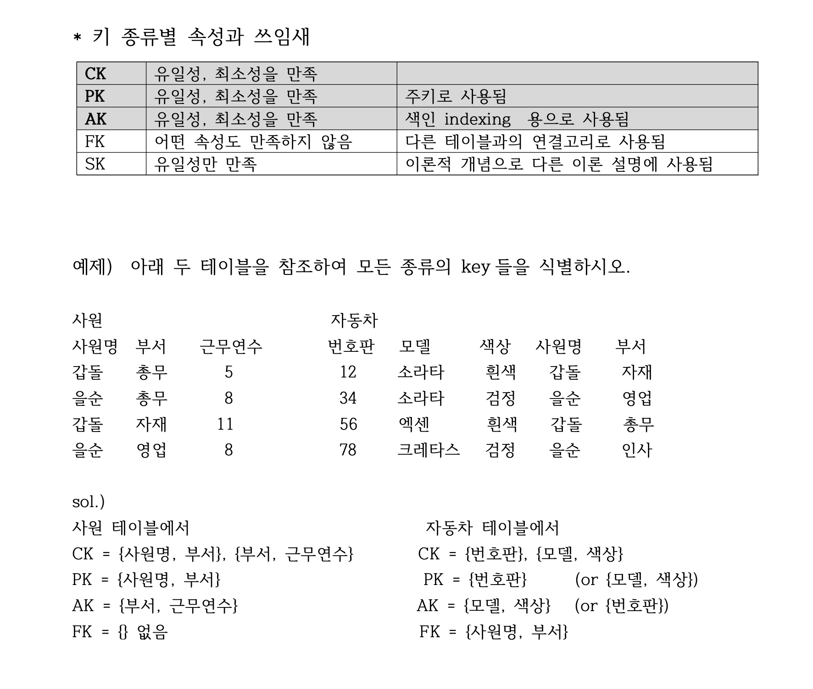

- ## 3. IC (무결성 제약조건)에 대하여 설명해시오 (4가지 정도를 써봐라)

	1. 엔터티 무결성 제약조건: 모든 엔티티는 **PK**를 가지며, PK는 **UNIQUE & NOT NULL**.
	2. Key 무결성 제약조건: 키 값은 **유일**해야한다.
	3. 외래키 무결성 제약조건: **참조 테이블의 PK에 값이 속**하거나 NULL값이 되어야한다.
	4. 카디낼리티 무결성 제약조건: 관계정도를 1:1, 1:N, N:M으로 나타낸다.
	5. 참여 무결성 제약조건: 관계로의 참여 정도를 부분, 전체로 나타낸다.
	6. 비즈니스 룰(rule) 무결성 제약조건 :사내 정책 들을 DBMS 상에서 강제하기 위한 제약조건
- ## 4. 각 테이블에서 Key 종류를 구하시오
	- CK(후보키)에서 PK(기본키)를 고르고 나머지 후보키들은 AK(대체키)로 표기
		1. 후보키 찾기
			1. **단일 속성**으로 유일 식별 가능한것
			2. **복합 속성** 조합으로 유일 식별 가능한것
			    - 유일하지만 **부분집합**으로도 유일, 즉 최소성을 만족못하는건 **슈퍼키**(후보키 아님)
			- FK는 후보키가 안되므로 제외
		2. 모든 후보키 중 **PK 1개 선택** → 나머지는 **AK**

	

	- **단계요약**:
	1) 먼저 외래 키로 의심되는 컬럼은 분석에서 제외한다.
	2) 단일 컬럼부터 시작해 유일성을 만족하는지 검사한다.
	3) 여러 컬럼의 조합을 검사하되, 이미 키로 판명된 속성을 포함하는 더 큰 조합은 최소성 위배로 즉시 제외한다.
	4) 찾아낸 모든 후보 키 중 가장 간결하고 대표적인 것을 기본 키(PK)로 선정한다.
	- **⚠️ 주의**: 키 후보를 찾을 때, 다른 테이블에서 가져온 것으로 보이는 외래 키(FK)는 반드시 먼저 제외하고 순수 속성들만으로 분석해야 합니다.
	1. **사원 테이블 (`사원명`, `부서`, `근무연수`)**
	    
	    - 단순 키(속성 1개): `사원명`, `부서`, `근무연수` 모두 데이터에 중복이 있어 단독으로 키가 될 수 없습니다.
	    - 복합 키(속성 2개):
	        - `{사원명, 부서}`: 유일성을 만족합니다. **(후보 키)**
	        - `{사원명, 근무연수}`: '을순, 8' 데이터가 중복되어 키가 될 수 없습니다.
	        - `{부서, 근무연수}`: 유일성을 만족합니다. **(후보 키)**
	    - 복합 키(속성 3개): `{사원명, 부서, 근무연수}`는 이미 그 일부인 `{사원명, 부서}`가 후보 키이므로, 최소성에 위배되어 후보 키가 될 수 없습니다. (슈퍼키는 될 수 있음)
	    - **결론**: 후보 키는 `{사원명, 부서}`와 `{부서, 근무연수}` 두 개입니다. 이 중 테이블의 의미(사원 테이블)를 고려하여 `{사원명, 부서}`를 **기본 키(PK)**로, `{부서, 근무연수}`를 **대체 키(AK)**로 선정하는 것이 합리적입니다.
	        
	2. **자동차 테이블 (`번호판`, `모델`, `색상`, `사원명`, `부서`)**
	    
	    - 먼저 `{사원명, 부서}`는 사원 테이블에서 온 외래 키로 의심되므로, 키 후보를 찾을 때는 일단 제외하고 나머지 속성으로만 판단합니다.
	    - 단순 키: `번호판`은 유일성을 만족합니다. **(후보 키)** `모델`, `색상`은 중복이 있어 키가 될 수 없습니다.
	    - 복합 키: `번호판`이 이미 후보 키이므로, `번호판`을 포함하는 다른 조합(`{번호판, 모델}` 등)은 최소성에 위배되어 후보 키가 될 수 없습니다. 남은 조합인 `{모델, 색상}`은 유일성을 만족합니다. **(후보 키)**
	    - **결론**: 후보 키는 `{번호판}`과 `{모델, 색상}` 두 개입니다. 이 경우, 속성이 하나인 `{번호판}`을 **기본 키(PK)**로 선정하는 것이 일반적입니다. `{모델, 색상}`은 **대체 키(AK)**가 됩니다.
	    - **외래 키(FK)**: 앞서 제외했던 `{사원명, 부서}`는 사원 테이블의 PK를 참조하는 외래 키입니다.
	- 이건 혹시몰라 정리 
		- **후보키(Candidate Key)**: 유일성 & **최소성** 충족하는 속성 집합
		- **기본키(PK)**: 여러 후보키 중 채택된 단하나의 키
		- **대체키(AK, Alternate Key)**: **PK가 아닌 후보키**
		- **슈퍼키(SK, Super Key)**: **유일성만** 만족하는 속성의 집합입니다. 최소성은 만족하지 않아도 됩니다 (예: PK+다른 속성 포함)
		- **외래키(FK)**: 다른 테이블의 PK/UK를 참조하는 속성 유일성, 최소성 안만족해도됨
		* Key 의 속성
			- 유일성 Uniqueness - 각 record/instance/tuple 을 유일하게 구별할 수 있어야 한다
			- 최소성 Minimality - key 의 구성에 있어 다른 key 가 포함되어서는 안된다.
- ## 5. 테이블->ERD 1:N(또는 1:1)로 출제
	- 엔티티 식별(네모)
	- 속성 식별 (이름에 밑줄)
	- 키 지정
	- 관계지정 (마름모)
- ## 6. SQL

	1. **검정색 배를 예약한 선원의 이름**
		SELECT DISTINCT s.sname
		FROM Reserves r
		JOIN Boats b ON r.bid = b.bid
		JOIN Sailors s ON r.sid = s.sid
		WHERE b.color = 'black';
- ## 7. 요구사항을 주고 데이터모델링
	- 1. 개념적설계(ERD)
	- 2. 논리적설계(ERD->RM(관계형모델))
	- 3. 물리적설계(실제 DBMS에저장)

엔터티가 두 개라면 그 사이에는 무조건 하나의 릴레이션십만 존재해야 된다.(x)

데이터베이스시스템(DBS)은 DBMS(관리소프트웨어)+실제데이터(DB)의 조합이다

스키마는 뼈대, 스키마에 채워진 데이터는 인스턴스

-  **요구사항**: 회사는 선박(Boats)과 선원(Sailors) 정보를 관리하며, 어떤 선원이 어떤 배에 승선 예약(Reserves)을 했는지 관리해야 한다.
- 1. 개념적 설계: 결과물로 ERD생성
	1.  **엔티티(Entity) 식별** 후 사각형으로 표현
	    엔티티는 구별되는 객체들의 집합으로, 데이터베이스에서 관리하고자 하는 핵심 명사에 해당합니다. 인간은 개별 객체(배 한 척, 선원 한 명)들의 공통된 특징을 묶어 '배', '선원'이라는 그룹 개념(엔티티)으로 일반화할 수 있습니다. 예제에서는 **`Boat`**와 **`Sailor`**가 엔티티가 됩니다.
	
	2.  **속성(Attribute) 식별**후 타원으로 표현
	    속성은 엔티티가 갖는 특성이나 정보를 의미합니다.
	    * `Sailor`의 속성: `SID`(선원 번호), `SName`(이름), `Age`(나이), `Rating`(등급)
	    * `Boat`의 속성: `BID`(배 번호), `BName`(이름), `Color`(색상)
	    * FK는 ER모델에 존재하지 않는개념이라 FK를 속성으로 표기하면 x
	
	3.  속성에 밑줄을 그어 키를 표현
	    키는 엔티티 집합 내에서 각 개체(인스턴스)를 유일하게 식별할 수 있는 속성입니다. `Sailor`에서는 `SID`가, `Boat`에서는 `BID`가 키가 되며, ERD에서는 보통 밑줄로 표시합니다.
		
	4.  **관계(Relationship) 마름모로 정의**
	    관계는 엔티티들 간의 연관성이나 상호작용을 나타내며, 주로 동사에 해당합니다.
	    * `Sailor`와 `Boat` 사이에는 **`Reserves`**(예약)라는 관계가 존재합니다.
	    * 관계 역시 속성을 가질 수 있습니다. '예약 날짜(`Date`)'는 선원이나 배 자체의 속성이 아니라, '예약'이라는 행위에 종속되므로 `Reserves` 관계의 속성이 됩니다.
	5. 선긋기
		* **참여 제약조건 (Participation Constraints)**: 엔티티의 모든 인스턴스가 관계에 반드시 참여해야 하는지를 나타냅니다.
			* **전체 참여 (Total Participation)**: ERD에서 이중선으로 표시하며, 모든 개체가 관계에 참여해야 함을 의미합니다. (예: "모든 선원은 반드시 배를 예약해야 한다.")
			* **부분 참여 (Partial Participation)**: 단일선으로 표시하며, 관계에 참여하지 않는 개체가 있을 수 있음을 의미합니다. (예: "어떤 선원은 아직 배를 예약하지 않았을 수 있다.")
	6. **카디널리티 (Cardinality)**:관계선 위에 `1`, `N 표기
		-  관계에 참여하는 엔티티 인스턴스의 개수를 나타내는 가장 중요한 제약조건입니다.
		* `1:1`, `1:N`, `N:1`, `N:M` (일대일, 일대다, 다대일, 다대다) 등으로 표현됩니다.
		* 예를 들어, `Boat`와 `Sailor` 관계가 `1:N`이라면, "하나의 배에는 여러 명(`N`)의 선원이 예약할 수 있지만, 한 명의 선원은 오직 하나의(`1`) 배에만 예약할 수 있다"는 의미를 가집니다.
* 2: 논리적설계: ER모델-> 관계형모델(RM)
	* 예제로 `Sailors`와 `Boats`라는 두 엔터티와, 이 둘을 잇는 `Reserves` 관계를 사용하겠습니다.
	- `Sailors` 엔터티의 속성: `sid` (키), `sname`, `age`, `rating`
	- `Boats` 엔터티의 속성: `bid` (키), `bname`, `color`
	- `Reserves` 관계의 속성: `date
	- **단계요약**:
		1) 1:N 관계는 '1' 쪽의 PK를 'N' 쪽 테이블에 FK로 내장(embed)시킨다.
		2) 관계 자체의 속성도 'N' 쪽 테이블에 함께 추가한다.
		3) M:N 관계는 양쪽 PK를 FK로 갖는 새로운 교차 테이블을 생성하고, 관계의 속성을 이 테이블에 추가한다.
		- **⚠️ 주의**: 1:N 관계에 속성이 여러 개 붙어있더라도, 원칙적으로 새 테이블을 만들지 않고 'N' 쪽 테이블에 모두 포함시키세요.`
	- 1. 엔티티-> 테이블(릴레이션)
		- 다른 엔터티에 소유되는 엔터티 즉 약한 엔티티는 소유 엔터티의 기본 키를 외래 키로 가져와, 자신의 부분 키와 결합하여 '복합 기본 키'를 구성
	- 2. 속성-> 테이블의 컬럼
	- 3. 기본키-> 테이블의 pk
	- 4. 관계:
		- m:N 관계: 양쪽의 pk을 합쳐 pk를 가지는 교차테이블 생성
			- 관계자체의 속성을 컬럼으로 가짐
		- 1:N 관계: 1쪽 pk를 N쪽 fk로 추가
			- 관계자체의 속성을 N쪽으로
		- 1:1 관계: 한쪽 pk를 다른쪽 fk로 추가
	- ER모델에선 가능하나 RM에선 불가
		- 1. 복합속성: ERD에서는 주소 아래에 하위 속성들이 달린 형태로 표현하는 주소와 같이 '시, 도, 동' 등으로 나뉠 수 있는 속성
		- 
			- RM에선 개별 컬럼으로 분해 1번표가 아니라 2번표로 그림
		- 2. 다치 속성:한 사람이 여러 개의 값을 가질 수 있는 속성입니다. ERD에서는 이중선 타원으로 표현합니다.
			- 개별컬럼으로 만들거나 별도의 테이블로 분리

1. **ERD에는 외래키(FK) 개념이 없다.** → **T**

    _FK는 ER→관계형으로 “매핑”될 때 생성됨(ERD는 개념 모델)._

2. **관계(relationship)는 속성을 가질 수 있다.** → **T**

    _예:_ _Reserves__의_ _date__._

3. **관계(relationship) 자체는 키를 가져야 한다.** → **F**

    _ERD의 관계는 키 없음. 키는 테이블에서 PK로 정의._

4. **1:N 관계는 ‘1쪽 PK를 N쪽 테이블의 FK로 내장(embedding)’한다.** → **T**
5. **N:M 관계도 내장으로 해결한다.** → **F**

    _N:M은_ **_교차(연결) 테이블_**_을 새로 만든다._

6. **약한 엔터티(weak entity)는 항상 Total 참여한다.** → **T**

    _소유 엔터티 없이는 존재 불가이므로._

7. **약한 엔터티의 FK는 PK 구성요소가 된다(식별 관계).** → **T**
8. **PK는 NULL이거나 중복될 수 있다.** → **F**

    _엔터티/키 무결성 위반._

9. **FK는 중복 가능, NULL 가능(부분참여 시), 단 참조 존재성은 필수.** → **T**
10. **복합 속성/다치 속성은 관계형으로 매핑 시 그대로 둔다.** → **F**

    _분해(정규화): 복합은 쪼개고, 다치는 별도 컬럼/테이블로 전개._

11. **SK(슈퍼키)는 유일성만 만족하고 최소성은 필수 아님.** → **T**
12. **모델링 시 삼진 관계는 되도록 이진 관계들로 분해한다.** → **T**

데이터 모델링은 **현실 세계의 정보와 규칙**을 데이터베이스가 다룰 수 있는 구조로 **추상화**하는 일련의 과정이다.

일반적으로 **개념적 → 논리적 → 물리적** 3단계를 거친다.

- **개념적 설계**: **ERD**로 엔터티·속성·관계·카디널리티·참여 제약을 기술한다.
- **논리적 설계**: ERD를 **관계형 스키마**로 **사상(mapping)**한다.
    - 1:N은 1쪽 PK를 N쪽 **FK**로 **내장**, N:M은 **연결테이블**을 만든다.
    - **약한 엔터티**는 부모 PK+부분키로 **복합PK** 구성.
    - **복합/다치 속성**은 분해하여 단일 속성들로 전개.
- **물리적 설계**:실제 DBMS에저장