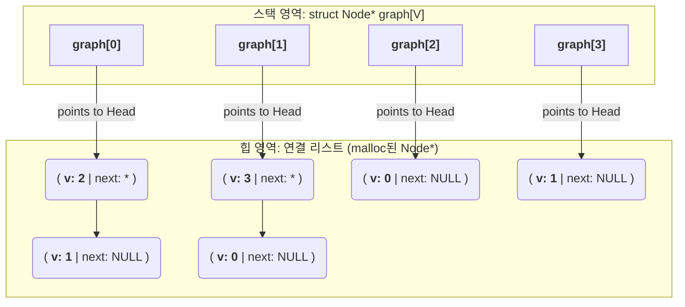
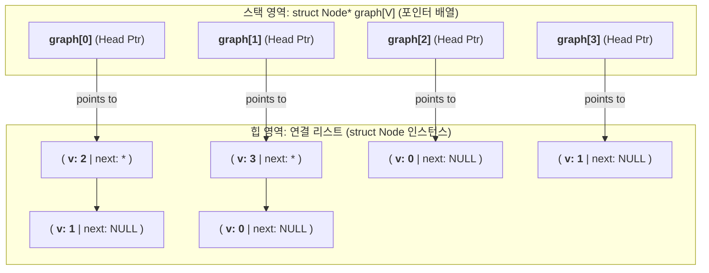

## 📜 원본 맥락
![[01_Sources/{S} 학교_알고리즘(신호진).md#^7r75e5]]

---
## 정리
바로 그거죠! C언어의 포인터 관계를 Mermaid로 시각화하는 것은 메모리 구조를 이해하는 데 정말 큰 도움이 됩니다.

이전의 C언어 예제 (정점 4개, 간선 0-1, 0-2, 1-3, 양방향)가 실행된 후의 메모리 상태, 즉 **"배열"과 "리스트"가 어떻게 포인터로 연결되어 있는지**를 Mermaid 다이어그램으로 보여드릴게요.

이 코드를 옵시디언에 붙여넣어 보세요.

코드 스니펫

---

## 📊 다이어그램 해설

이 다이어그램이 C언어 코드를 어떻게 표현하는지 설명해 드릴게요.

### 1. 스택 영역: `struct Node* graph[V]`

- `graph TD;` 아래 `subgraph "스택 영역"` 부분이 바로 `main` 함수 안에 선언된 **포인터 배열** `graph`입니다.
- `graph[0]`부터 `graph[3]`까지 4개의 "방"이 있습니다.
- 이 "방"들 자체는 `Node` 구조체가 **아니라**, `Node`를 가리킬 수 있는 **포인터(주소)를 저장하는 공간**입니다.
    

### 2. 힙 영역: `malloc`된 `Node`들

- `subgraph "힙 영역"`은 `malloc`을 통해 메모리가 동적으로 할당된 공간입니다.
- 각각의 둥근 사각형 `( )`이 `struct Node` 하나를 의미합니다.
- `v: 2`는 `int vertex` 멤버에 숫자 2가 저장되었다는 뜻입니다.
- `next: *`는 `struct Node* next` 멤버가 **다른 노드를 가리키고 있다**는 뜻입니다.
- `next: NULL`은 이 노드가 이웃 리스트의 마지막이라는 뜻입니다.
    

### 3. 포인터 연결

- **배열 → 리스트:** `G0 -- "points to Head" --> H0_1;`
    - `graph[0]`(스택)이 0번 정점의 이웃 리스트의 **첫 번째 노드**(`H0_1`)(힙)를 가리키고(포인팅) 있다는 뜻입니다.
- **리스트 → 리스트:** `H0_1 --> H0_2;`
    - `H0_1` 노드의 `next` 포인터가 `H0_2` 노드를 가리키고 있다는, 즉 **연결 리스트**를 의미합니다.

네, C언어의 **"포인터 배열" (Stack)과 "연결 리스트" (Heap)의 관계**를 Mermaid로 시각화한 코드입니다.

이전 대화에서 사용한 예제(정점 4개, 간선 0-1, 0-2, 1-3)를 기준으로, `malloc`과 포인터가 실제 메모리에서 어떻게 동작하는지 보여줍니다.

이 코드를 옵시디언에 그대로 붙여넣으면 C언어의 인접 리스트 자료구조가 다이어그램으로 그려집니다.

코드 스니펫

### 📊 다이어그램 해설

- **스택 영역 (왼쪽)**: C 코드의 `struct Node* graph[V];` 배열입니다. 이 배열은 `struct Node` 자체를 저장하는 것이 아니라, 힙 영역에 있는 `struct Node`의 **주소(포인터)**를 저장합니다.
- **힙 영역 (오른쪽)**: `malloc`으로 생성된 실제 `struct Node`들입니다.
- **`v: 2`**: `int vertex` 멤버의 값입니다.
- **`next: *`**: `struct Node* next` 포인터가 다른 노드를 가리키고 있음을 의미합니다.
- **`G0 --> H0_1`**: `graph[0]`번 포인터가 0번 정점의 이웃 리스트의 첫 번째 노드(`H0_1`)를 가리키고 있음을 시각화한 것입니다.
---
## 💭 나의 추가적 생각/질문