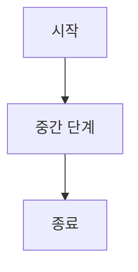

# 🔄 {{흐름명}}

---

## 🧠 한 줄 요약
- 이 흐름은 어떤 목적과 과정을 통해 작동하는가?

---

## 🔢 단계 요약

```text
1. 단계 A: 설명 (언제/왜)
2. 단계 B: ...
3. 단계 C: ...
```

---

## 📊 흐름 시각화 (Mermaid)



---

## 🔗 관련 개념
- [[핵심 개념]]
- [[사용된 기술]]
- [[대조 흐름]]

---

## ✨ 깨달음
- 전체 흐름을 정리하며 알게 된 본질적 연결이나 원리

---

## 🧠 생각 흐름 로그 (선택)
- 이 흐름은 어떤 개념/문맥/질문에서 파생되었나?
