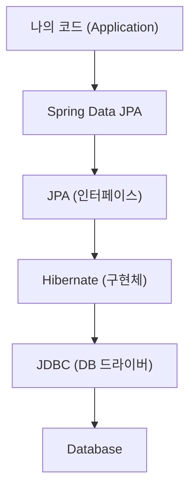

# 📚 개발 용어 맥락별 정의 및 처리 흐름

단어의 의미는 사용되는 **환경(Context)**에 따라 달라집니다.

## 1. 통신 및 인터페이스 (Communication & Interface)

### **서버(Server)와 클라이언트(Client)**

* **서버:** 기능을 제공하는 주체. 소프트웨어적으로는 **기능을 제공하는 프로그램**을, 하드웨어적으로는 이를 실행하는 **물리적 컴퓨터**를 의미합니다.
* **클라이언트:** 서버에 요청을 보내는 주체.
	* **프론트엔드 클라이언트**: 사용자에게 시각적인 UI를 제공하고, 사용자의 조작을 서버 요청으로 변환하여 전달합니다
	* **API 클라이언트**: 서버의 API를 직접 호출하여 원시 데이터(JSON 등)를 송수신하는 도구나 프로그램(개발자용)

### **API와 HTTP**

* **API (Application Programming Interface):** 특정 기능을 외부에서 사용할 수 있도록 개방해 제공하는 인터페이스
* API호출
	- 웹 개발에선: 서버의 특정 기능(URL)을 호출하는 것.
	- 프로그래밍에선: 설치된 라이브러리의 함수/메서드를 호출하는 것.
* **HTTP (HyperText Transfer Protocol):** 표준화된 전송 규약입니다.
- **웹 통신:** 우리가 웹사이트에 접속하거나 외부 API를 호출할 때는 **HTTP 요청**을 사용합니다.
- **내부 통신:** 서버 내부에서 DB와 통신할 때는 더 빠른 속도를 위해 HTTP 대신 각 시스템에 최적화된 **TCP/IP 직접 통신** 등을 사용합니다.

### **URL과 라우팅(Routing)**

* **URL:** 서버의 특정 기능, 즉 어떤 컨트롤러를 호출할지 결정하는 식별 **주소**입니다.
* **라우팅:** 요청을 적절한 곳으로 **연결**하는 행위입니다.
	* **백엔드:** URL 요청을 특정 컨트롤러 메서드로 연결합니다.
	* **네트워크:** 데이터 패킷을 목적지까지 최적의 경로로 이동시킵니다.

---

## 2. 핵심 비즈니스 설계 (Logic & Design)

### **도메인(Domain)과 엔티티(Entity)**

* **도메인:**
	* **네트워크(웹):** ip주소외우기 힘들어 만든, 인터넷 주소 범위(예`naver.com`).
	* **소프트웨어:** 애플리케이션이 다루는 **핵심 비즈니스 영역**.
* 도메인 모델: 핵심 데이터를 담는 비즈니스 객제 전체
	* **엔티티:** 식별자(ID)가 있는 도메인 모델
		* 소프트웨어에서는 데이터 객체
		* 데이터베이스에서는 **테이블의 한 행(Row)**
	* 값객체: 식별자가 없는 값 자체가 정체성인 도메인 모델
* **비즈니스 로직(Business Logic):** 데이터를 가공하고 검증하는 **규칙 및 계산**입니다. (예: 할인율 적용 함수)
* **인터페이스**는 "이런 기능이 있어야 해"가 추상적으로 정의된 기능 설계도
* **모듈**은 이를 실제 코드로 구현한 덩어리입니다.

### **계층별 역할 (Controller / Service / Repository)**

* **컨트롤러(Controller):** HTTP 요청을 받아 해석,변환한뒤 서비스로 전달하고 응답을 반환하는 **인터페이스 계층**입니다.
* **서비스(Service):** 실제 **비즈니스 로직**을 수행하는 계층입니다. (운영 환경에서는 AWS 등의 인프라를 지칭하기도 함)
* **리포지토리(Repository):** 데이터의 저장소입니다. 백엔드에서는 **DB 상호작용 계층**을, 형상 관리에서는 **Git 저장소**를 의미합니다.

---

## 3. 저장소 및 인프라 운영 (Storage & Infrastructure)

### **데이터 저장 및 상태 관리**

| 구분              | 저장 위치               | 목적 및 특징                     |
| --------------- | ------------------- | --------------------------- |
| **세션(Session)** | 서버 메모리              | 중요한 인증 정보(로그인 상태 등) 관리      |
| **쿠키(Cookie)**  | 클라이언트(브라우저)         | 사용자 설정 등 단순 데이터 저장 (보안성 낮음) |
| **캐시(Cache)**   | 브라우저, CDN, 서버 메모리 등 | 데이터 접근 속도 향상을 위한 임시 저장      |

### **빌드, 배포 및 부하 관리**

* **빌드(Build):** 코드를 실행 가능한 파일(Jar 등)로 변환하는 과정입니다.
* **배포(Deploy):** 빌드된 파일을 서버에 업로드하여 실제 실행시키는 과정입니다.
* **스케일링(서버확장):** 개수를 늘리는 **Scale-out**과 사양을 높이는 **Scale-up**으로 나뉩니다.
* **로드 밸런싱(Load Balancing):** 여러 서버에 트래픽을 균등하게 분산하여 부하를 관리합니다.

### **명세와 요청 (Spec & Query)**

* **스펙(Spec):** 문서
	* 기술 명세서(Specification)의 약자로, API가 어떤 요청을 받고 무엇을 응답하는지 정의한 문서.
* **쿼리(Query):** 시스템에 정보를 요청하는 질문
	- **SQL 쿼리:** DB에 데이터를 달라고 하는 문장 (`SELECT * FROM…`).
	- **HTTP 쿼리 스트링:** URL 뒤에 붙여서 서버에 보조 정보를 보내는 형태 (`?key=value`).

# 1. Main 메서드: 역할과 하나인 이유
main은 자바(Java)와 스프링 부트 애플리케이션의 **"시작점(Entry Point)"**입니다.

- `public static void main(String[] args)`은 자바 가상 머신(JVM)이 애플리케이션 프로세스를 시작하기 위해 가장 먼저 찾는 표준 경로입니다.
- `main`안의 `SpringApplication.run(…)` 메서드는 다음과 같은 일을 수행합니다.
    1. 내장 톰캣(웹 서버)을 독립된 스레드로 띄움.
    2. 스프링 컨테이너(Bean 공장)를 만듦.
    3. `@SpringBootApplication` 어노테이션을 통해 컴포넌트 스캔해서 우리가 작성한 Controller, Service 등을 찾아 메모리에 올리고 조립함.

### **main이 하나인 이유**

**"운전대(주도권)"를 잡을 사람은 한 명이어야 하기 때문입니다.**

- 만약 `main`이 두 개라면, JVM은 어떤 진입점을 통해서 프로그램을 시작해야 할지 알 수 없습니다.
- 하나의 애플리케이션은 **단 하나의 실행 프로세스**를 가집니다. 따라서 그 프로세스를 시작하는 버튼(Trigger)도 명확하게 하나여야 프로그램이 꼬이지 않고 의도한 대로 설정(Configuration)을 읽어오며 시작할 수 있습니다.

> jvm은 자바프로그램을 실행시키는 소프트웨어
> 스프링이 없으면 어노테이션 못쓰고 new 생명주기 관리해야하고 귀찮
---
# 전체 처리 프로세스 (Execution Flow)

1. **요청 생성:** API 클라이언트가 스펙에 맞는 HTTP 메시지 생성.
2. **연결 확립:** **DNS 조회** 후 서버와 **TCP/TLS 연결** 생성.
3. **네트워크 전송:** HTTP 패킷 전송.
4. **역직렬화:** 서버 프레임워크가 JSON 텍스트를 **DTO 객체**로 변환.
5. **라우팅:** URL을 분석해 적절한 컨트롤러 메서드로 연결.
6. **계층별 실행:**
    - 컨트롤러가 서비스를 호출.
    - 서비스가 로직을 수행하고 리포지토리에 요청.
    - 리포지토리가 DB에서 **엔티티** 조회.
7. **DTO 변환:** 서비스/컨트롤러에서 엔티티를 **응답용 DTO**로 변환.
8. **응답 및 직렬화:** DTO를 **JSON 텍스트로 직렬화**하여 HTTP 응답 반환.
9. **데이터 수신 및 렌더링:** 브라우저의 JS가 JSON 데이터를 받아 **DOM에 반영(Rendering)**.

# 🏗️ 스프링 부트 4계층 아키텍처 정리
Main 하나만으로는 아무것도 할 수 없습니다.
## 1️⃣ 프레젠테이션 계층 (Presentation Layer)

> 역할: 사용자와의 소통 담당 (요청 수신 및 응답)
> 핵심: "비즈니스 로직을 몰라야 하며, 입출력 형식과 검증에 집중한다."
### **① @RestController (진입점)** **[창구 직원]**

- **역할:** 사용자의 HTTP 요청(GET, POST 등)을 가장 먼저 받아 Service로 넘겨준다.
- **작성 주체:** 개발자
- **핵심 포인트:**
    - `@GetMapping("/url")` 등을 통해 요청 경로를 매핑.
- **🚨 이게 없다면?**
	- 클라이언트가 서버에 접속할 경로(Endpoint)가 없어 받아줄 곳이 없어, 브라우저나 앱이 아무리 요청을 보내도 `404 Not Found` 에러만 뜹니다.

### **② DTO (Data Transfer Object)** **[택배 상자]**

- **역할:** 계층 간(특히 화면 ↔ Controller ↔ Service) 데이터 교환을 위한 껍데기 객체.
- **작성 주체:** 개발자 (단순 클래스)
- **핵심 포인트:**
    - 화면에서 보낸 데이터를 받고, 화면으로 보낼 데이터를 담는 그릇.
- **🚨 이게 없다면?**
	- DB 테이블 원본(Entity)이 외부에 그대로 노출됩니다.
	- 사용자에게 불필요한 정보(비밀번호 등)가 유출되거나, 화면 디자인이 바뀔 때마다 DB 테이블 구조까지 뜯어고쳐야 하는 대참사가 일어납니다.

### **③ @ControllerAdvice** **[민원 처리반]**

- **역할:** 프로젝트 전역에서 발생하는 예외(에러)를 가로채서 처리하는 곳.
- **작성 주체:** 개발자
- **핵심 포인트:**
    - `@ExceptionHandler`를 사용해 에러 발생 시 사용자에게 친절한 메시지(JSON 등) 반환.
- **🚨 이게 없다면?**
	- 에러 발생 시 서버의 복잡한 내부 오류 메시지(Stack Trace)가 사용자에게 그대로 노출되어 **보안상 위험**하고, 사용자는 "이게 무슨 말이야?"라며 당황하게 됩니다.

## 2️⃣ 비즈니스 계층 (Business Layer)

> 역할: 시스템의 핵심 업무 로직 수행
> 핵심: "데이터가 어디에 저장되는지는 신경 쓰지 않고, 순수한 업무 규칙만 처리한다."

### **④ @Service (비즈니스 로직)** **[실무 관리자]**

- **역할:** 실제 업무(계산, 판단, 흐름 제어)를 처리하는 곳.
- **작성 주체:** 개발자가 도메인 정책에 맞게 직접 로직을 구현
- **핵심 포인트:**
    - 회원가입 시 중복 체크, 암호화, 결제 승인 등 "진짜 일"을 수행.
    - 트랜잭션(`@Transactional`) 관리의 기준점.
- **🚨 이게 없다면?**
	- Controller가 너무 비대해지거나 로직이 여기저기 흩어져(스파게티 코드), 코드가 복잡해져서 **유지보수와 테스트가 불가능**해집니다.
---

## 3️⃣ 데이터 접근 계층 (Data Access Layer)

> 역할: 데이터베이스(DB)와의 대화 담당
> 핵심: "SQL이나 저장소의 디테일을 감추고, 비즈니스 계층에 메서드를 제공한다."

### **⑤ @Repository (데이터 접근)** **[창고 관리자]**

- **역할:** DB에 직접 접근하여 데이터를 저장(C), 조회(R), 수정(U), 삭제(D)하는 역할.
- **작성 주체:** **JPA (자동 생성)**
    - 개발자는 인터페이스만 정의(`extends JpaRepository`)하면 됨.
- **핵심 포인트:**
    - SQL을 직접 짜지 않고도 DB 조작 가능.
- **🚨 이게 없다면?**
	- 데이터를 영구적으로 저장할 방법이 없습니다. 모든 데이터가 메모리에만 있다가 **서버가 꺼지면 싹 다 사라집니다.**
	- 데이터베이스 CRUD 기능을 수동으로 구현

### **⑥ @Entity** **[설계도/원본]**

- **역할:** 실제 DB 테이블과 1:1로 매핑되는 핵심 클래스.
- **작성 주체:** 개발자
- **핵심 포인트:**
    - DB 테이블의 구조(컬럼, 타입, 길이)를 결정. DTO와 다르게 **DB 저장용**으로 쓰임.
    - **🚨 이게 없다면?**
	- JPA가 DB 테이블을 인식할 수 없어, 데이터를 저장하거나 조회하는 쿼리 자체를 만들 수 없습니다.
	- 즉, 서버 안에서는 로직이 돌아도 DB에는 아무 데이터도 기록되지 않음

## 4️⃣ 인프라 계층 (Infrastructure Layer)

> 역할: 위 3개 계층이 돌아갈 수 있도록 환경과 기반을 제공
> 핵심: "앱의 설정, 실행, 외부 환경을 책임진다."

### **⑦ main 메서드 (실행 진입점)** **[시동 버튼]**

- **역할:** 애플리케이션을 시작하고 스프링 컨테이너를 가동함.
- **작성 주체:** 개발자 (프로젝트 생성 시 자동 생성됨)
- **핵심 포인트:**
	- `SpringApplication.run()`을 통해 내장 톰캣(서버)을 띄움.
- **🚨 이게 없다면?**
	- 아무리 좋은 코드를 짜도 **실행을 시킬 수가 없습니다.** (자동차가 있어도 시동 걸 키가 없는 셈)

### **⑧ application.properties / .yml** **[환경 설정 파일]**

- **역할:** 포트 번호, DB 주소, ID/PW 등 전역 설정 관리.
- **작성 주체:** 개발자
- **핵심 포인트:**
    - 코드를 수정하지 않고 설정값만 바꿔서 개발/운영 환경을 분리 가능.
- **🚨 이게 없다면?**
	- 서버가 몇 번 포트에서 켜질지, 어떤 DB에 접속해야 할지 몰라 **실행 자체가 불가능**합니다.

### **⑨ @SpringBootTest** **[모의 주행/안전 점검]**

- **역할:** 실제 서버 환경과 유사하게 테스트를 수행.
- **작성 주체:** 개발자
- **핵심 포인트:**
    - 배포 전에 코드가 망가지지 않았는지 기계가 자동으로 체크.
- **🚨 이게 없다면?**
	- 기능 하나 수정할 때마다 개발자가 일일이 다 클릭해보며 수동으로 확인해야 합니다. **버그를 놓칠 확률이 매우 높습니다.**

# 📨 DTO vs Entity: 택배 상자와 보관품

## 1. 한눈에 보는 비교 포인트: **보안**과 **유지보수**.
> **"DTO는 서로 주고받을 때 쓰는 편지봉투(택배 상자), Entity는 창고에 진짜 저장되는 물건"**

| **구분**     | **DTO (Data Transfer Object)**    | **Entity (Domain Object)**                       |
| ---------- | --------------------------------- | ------------------------------------------------ |
| **목적**     | 계층 간 데이터 **전달**용 <br>(클라이언트 ↔ 서버) | DB 테이블과 매핑되어 데이터 **저장/관리**                       |
| **설계 기준**  | **화면(View) & API 스펙**에 맞추어 구현     | **DB 테이블 & 비즈니스 도메인** 중심                         |
| **데이터 필드** | 필요한 데이터만 선택 <br>(민감 정보 제외)        | 테이블의 모든 정보 포함 <br>(비밀번호 등 내부 값 포함)               |
| **변경 빈도**  | 화면/API 요구사항에 따라 자주 바뀜             | 데이터 무결성을 위해 최대한 변경을 지양                           |
| **위치**     | Controller, Service 계층에서 사용       | Service, Repository 계층에서 사용<br>(Controller 노출 ❌) |

- DTO: 컨트롤러에서 노출이 된다는 전제로 만들어져 필드 최소화, 민감정보 절대 제외하므로 해싱처리등은 하지 않는다.
- entity: 모든정보 포함
	- 한 번 정하면 쉽게 못 바꿈 (바꾸면 DB 마이그레이션 위험)
	- 혹시라도 DB가 털리더라도, 비밀번호를 바로 알 수 없게 하기 위해서 원본 그대로가 아닌, 무조건 해싱을 거친 결과값으로만 저장한다.
	- 클라이언트에서 해싱하면, 네트워크 중간에서 해시값이 그대로 유출될수있으니 서버에서 해싱한다.

## 2. 핵심 로직: 보안과 변환

**DTO는 '전달'하고 버려지지만, Entity는 '영구 저장'됩니다.**

- **비밀번호 처리 흐름
	1. **RequestDTO:** 사용자가 입력한 **'생(Raw) 비밀번호'**를 받습니다.
		(전송 구간은 HTTPS로 암호화해서 중간탈취 막기)
	2. **Service:** DTO의 생 비밀번호를 꺼내 **'단방향 해싱(암호화)'** 합니다.
	3. **Entity:** 암호화된 **'해시 값'**만 저장합니다.
	4. **결과:** DB가 털려도 해커는 실제 비밀번호를 알 수 없습니다.
- **변환 위치 (Mapping)**
    - DTO로 데이터를 전달받아 ENTITY로 변환해 저장해야한다.
    - 주로 **Service** 계층이나 별도의 **Mapper** 클래스에서 `toEntity()`, `toDto()` 메서드를 만들어 변환합니다.
> 응답용인 `ResponseDTO`에는 비밀번호, 리프레시 토큰 등 민감 정보를 담으면 안됨
---
# 강의 내용시작

- IP주소: 컴퓨터 식별
	- 도메인: ip주소-> 문자열
- port: 프로그램 식별

# HTTP 프로토콜(통신규격) :주고받을때의 약속
HTTP 메시지는 크게 **시작 줄(Start Line)**, **헤더(Headers)**, **공백 라인(Empty Line)**, **본문(Body)**의 4단 구조로 되어 있습니다


1. **시작 줄 (Start Line):** 요청인지 응답인지에 따라 **요청 라인** 혹은 **상태 라인**이라 부릅니다.
2. **헤더 (Headers):** 메시지에 대한 메타데이터(크기, 타입, 보낸 사람 등)를 담습니다.
3. **공백 줄 (Empty Line):** 헤더가 끝났음을 알리는 필수 구분선입니다.
4. **바디 (Payload / Body):** 실제 전송하려는 데이터(JSON, 이미지 등)가 실리는 곳입니다.


> [!NOTE] 주소를 요청라인과 헤더로 분리해 저장하는 이유
> - 과거: ip주소,서버,사이트 모두 하나였다
> 	- 그래서 ip에 도착만 하면 원하는 사이트가 나왔다.
> - 가상호스팅: ip 주소가 부족해지자 하나의 ip에 여러 도메인을 연결할 필요성이 생겼다.
> - 도메인이 없는 요청라인 형식('GET /index.html')을 처리하도록 설계된 서버들이 많아 도메인까지 저장하게 요청라인을 수정하면 그 요청을 에러로 처리해 큰 혼란 발생
> - 결국 부가 정보를 적는 헤더에 HOST 항목을 추가해 도입했다

## 요청 HTTP
HTTP 요청은 서버에 "무엇을, 어떻게, 어떤 데이터를 가지고" 처리해달라고 요청하는 구조화된 문서입니다.

```markdown
`[Method] [Request-URI] [HTTP-Version]`  <1. 요청 라인 
`[Header-Name]: [Header-Value]`          <2. 헤더 (부가 정보)
`[Header-Name]: [Header-Value]`
(Empty Line)                             <3. 필수 공백
`[Message-Body]`                         <4. 바디 (실제 데이터)
```

- **실제 예시 (로그인 요청):**

```HTTP
    POST /api/login HTTP/1.1
    Host: www.example.com
    Content-Type: application/json
    
    {"id": "user01", "pw": "1234"}
```

### 첫줄: 요청 라인
**'어떤 방식(Method)으로 어디(URI)에 있는'**를 명시.

> 예시: GET /users/1?mode=dark HTTP/1.1
> 형식: `[Method]` `[요청URL]` `[HTTP-Version]`


> [!info]- **HTTP Method:** 서버가 수행해야 할 동작을 지정.
> > **💡멱등성**: 네트워크 사고로 요청을 중복되게 받아도 서버의 데이터가 꼬이지 않게 보장하는 성질
>
> |**메서드**|**주요 용도**|**멱등성(Idempotent)**|**데이터 위치**|
> |---|---|---|---|
> |**GET**|Read<br>리소스 조회|**ㅇ**<br>아무리 조회해도 데이터는 변하지 않음|URL <br>(Query String)|
> |**POST**|Create<br>리소스 생성/프로세스 실행|**x**<br>할 때마다 새로운 데이터 생성|Body|
> |**PUT**|Update<br>리소스 전체 교체/덮어쓰기|**ㅇ**<br>똑같은 데이터로 덮을시 같음 동일|Body|
> |**PATCH**|Update<br>리소스 부분 수정|**x**<br>`age = age + 1` 같은 연산은 멱등하지 않음|Body|
> |**DELETE**|Delete<br>리소스 삭제|**ㅇ**<br>지워진 걸 또 지워도 결과적으론 삭제임|URL<br>(Query String)|
>

> [!info]- 요청URL : **원하는 자원을 지정**
>
> Spring MVC는 어노테이션을 통해 자원의 위치(Path)와 전달할 데이터(Query String)를 조립하여 하나의 완성된 엔드포인트를 구축합니다.
>
> > **요청 URL** = `[기본 경로]` + `[상세 경로]` + `?[쿼리 스트링]`
>
> ## 1. 경로 매핑 (Mapping) : 자원의 위치
>  자원의 위치를 대분류와 소분류로 나누어 체계적으로 관리합니다.
>
> |**구분**|**어노테이션**|**위치**|**역할 및 특징**|
> |---|---|---|---|
> |**기본 경로**|**`@RequestMapping`**|**클래스 상단**|클래스 내 모든 메서드에 적용되는 **공통 접두사(Prefix)** 정의|
> |**상세 경로**|**`@GetMapping`** 등|**메서드 상단**|기능별 **세부 주소** 정의 및 호출할 **HTTP 메서드** 명시|
>
> - **조립 방식:** 클래스 레벨의 경로 뒤에 메서드 레벨의 경로가 이어 붙어 최종 경로가 생성됩니다.
> 
> ## 2. 쿼리 스트링 (Query String): 데이터 전달
>
> URL 경로와 별개로, 부가적인 데이터를 **Key-Value** 쌍으로 실어 보내는 방식입니다.
>
> 1. **시작 (`?`):** 주소 끝에 `?`를 붙여 쿼리 스트링의 시작을 알립니다.
> 2. **구조 (`key=value`):** 데이터의 이름(key)과 값(value)을 쌍으로 작성합니다.
> 3. **다중 데이터 (`&`):** 여러 개의 데이터를 보낼 때는 `&` 기호로 연결합니다.
> - **`@RequestParam`**: 컨트롤러 메서드 파라미터에 사용해 데이터 추출
> 
> ### **코드 예시**
>
> > `http://localhost:8080/api/members/search?name=kim`
>
> ```Java
> @RestController
> @RequestMapping("/api/members") // 1. 기본 경로
> public class MemberController {
> 
>     @GetMapping("/search") // 2. 상세 경로
>     public String searchMember(@RequestParam String name) { // 3. 쿼리 스트링 수신
>         return name + "님을 조회합니다.";
>     }
> }
> ```

> [!info] **HTTP 버전:** 통신에 사용할 규격 버전을 명시합니다.
>

> [!tip]- 요청URL은 URL의 일부
> URL의 구성-> `[프로토콜]://[도메인]:[포트]/[요청URL]`

### 두 번째 영역: 헤더 (Headers)

헤더는 메시지 전송과 본문 처리에 필요한 **부가 정보**를 담습니다.

- 필수기입
	- **Host:** 요청이 전송되는 도메인명 또는 `ip주소:포트번호
	- 요청라인에 도메인 포함해 적어도 되지만,
- 선택기입
	- **Content-Type:** 바디(Body)에 담긴 **데이터의 형식** 명시.
		- (예: `application/json`).
	- **Content-Length:** 바디 데이터의 **전체 크기(Byte 단위)**
	    - 서버가 읽을 길이를 알려주는 것
	- **Accept:** 서버로부터 **응답받기를 원하는 데이터 형식** 명시.
	    - `Content-Type`은 내가 보내는 형식, `Accept`는 내가 받고 싶은 형식
	- **Authorization:** 클라이언트의 인증 정보(Token 등).
	- **User-Agent:** 요청을 보낸 클라이언트(브라우저, 앱)의 정보.
		- 통계 수집이나 브라우저별 최적화된 화면을 제공
### **공백 줄:**
- HTTP 명세상 헤더와 바디를 구분하는 유일한 수단
- 누락되면 서버는 바디를 헤더의 일부로 잘못 해석하여 에러를 발생

### 네번째 영역: Body(바디)
> 서버에 실제로 전달하고자 하는 **핵심 데이터**가 담기는 공간.
- **데이터 형식:** 주로 **JSON** 형식을 사용하며, 헤더의 `Content-Type`과 일치해야 합니다.
- **메서드별 특징:**
    - **POST / PUT / PATCH:** 자원을 생성하거나 수정할 때 사용하므로 **바디가 반드시 존재**합니다.
    - **GET / DELETE:** 자원을 조회하거나 삭제할 때 사용하며, 관례상 **바디를 사용하지 않고** URL의 경로(Path)나 쿼리 스트링(Query String)을 통해 데이터를 전달합니다.

## 응답 HTTP
서버가 클라이언트에게 보내는 메시지입니다. 첫 줄에 **'결과 상태(Status)'**가 명시됩니다.

```markdown
`[HTTP-Version] [Status-Code] [Reason-Phrase]` 1줄: 응답 라인
`[Header-Name]:[Header-Value]`          2영역: 헤더
`[Header-Name]:[Header-Value]`
3영역: 공백
`[Message-Body]` 4영역: body
```


- **실제 예시 (성공 응답):**

```HTTP
HTTP/1.1 200 OK
Date: Mon, 27 May 2024 12:00:00 GMT
Content-Type: application/json

{"result": "success", "token": "abc12345"}
```

### 첫 번째 줄: 상태 라인 (Status Line)
> 예시: HTTP/1.1 200 OK
> 형식: `[HTTP-Version]` `[Status-Code]` `[Reason-Phrase]`

- **HTTP Version:** "이 프로토콜 버전으로 소통했어!" (예: HTTP/1.1)

> [!NOTE]- Status Code (상태 코드): 요청 처리 결과를 나타내는 3자리 숫자입니다.
> |범위|의미|대표 코드|설명|
> |---|---|---|---|
> |1xx|Informational|100 Continue|요청을 받았으며 작업을 계속 진행함|
> |2xx|Success|200 OK|요청을 성공적으로 처리함|
> |3xx|Redirection|301, 302|요청 완료를 위해 추가 동작(이동)이 필요함|
> |4xx|Client Error|400, 404|클라이언트의 요청에 오류가 있음 (잘못된 문법, 리소스 없음)|
> |5xx|Server Error|500 Internal Error|서버 내부에서 오류가 발생함|

- **Status Message (상태메세지):** 상태 코드를 사람이 이해하기 쉽게 문자로 표현한 메시지 (예: OK, Not Found)

---

### 두 번째 영역: 헤더 (Headers)

> 형식: Key: Value
> 서버의 정보나 응답 데이터의 메타데이터를 담고 있습니다.

- **기본 헤더:**
    - `Date`: 응답이 생성된 날짜와 시간.
    - `Server`: 요청을 처리한 서버 소프트웨어 정보 (예: nginx, Apache).
    - `Content-Type`: 응답 본문(Body)의 미디어 타입 (예: `application/json`, `text/html`).
    - `Content-Length`: 응답 본문의 길이(바이트 단위).

> [!NOTE]- **특수 목적 헤더 (Set-Cookie, Location, Cache)**
>
> 1. Set-Cookie (쿠키 설정)
> 서버가 클라이언트(브라우저)에게 "이 데이터를 저장해줘"라고 요청하는 헤더입니다.
> 	- **주요 속성:**
> 	    - `Path=/`: 쿠키가 유효한 경로를 설정합니다.
> 	    - `Domain=…`: 쿠키가 유효한 도메인을 지정합니다.
> 	    - `Expires=` / `Max-Age=`: 쿠키의 만료 날짜나 유효 기간(초)을 설정합니다.
> 	    - **보안 관련 속성:**
> 	        - `HttpOnly`: **자바스크립트 접근 불가** (XSS 방지, 보안 강화).
> 	        - `Secure`: **HTTPS 연결**에서만 전송 가능.
> 	        - `SameSite=Strict`: **CSRF(사이트 간 요청 위조) 방지**.
> 1. Location (리디렉션)
> 	- **역할:** 클라이언트에게 **"다른 URL로 이동해"**라고 지시합니다.
> 	- **특징:** 주로 `3xx` 상태 코드(301, 302 등)와 함께 사용됩니다.
> 1. Cache-Control (캐시 정책)
> 	- **역할:** 데이터의 유지 여부와 기간을 결정합니다.
> 	- **목적:** 불필요한 네트워크 통신을 줄여 속도를 높입니다.

> [!tip]- 캐시(Cache) vs 쿠키(Cookie) 차이점
> |구분|캐시 (Cache)|쿠키 (Cookie)|
> |---|---|---|
> |목적|성능 최적화|사용자 식별 및 상태 유지|
> |기능|리소스(이미지, HTML 등)를 임시 저장하여 재다운로드 방지|사용자 정보, 로그인 토큰 등을 저장하여 서버 요청 시 동봉|
> |보안|공개 데이터 위주 (보안 민감도 낮음)|개인정보 포함 가능 (보안 위험 있음)|

---

### 세 번째 영역: 본문 (Body)
**응답 데이터 (Payload)**
> 특징: 헤더와 본문 사이에는 반드시 **빈 줄(CRLF, 공백 줄)**이 있어야 합니다.
> 실제 클라이언트가 요청한 데이터가 담기는 곳입니다.

- **주요 데이터 유형:**
    - **HTML:** 웹페이지의 구조와 콘텐츠 (화면 렌더링용).
    - **JSON:** API 응답 데이터 (Key-Value 구조, 주로 백엔드 통신용).
    - **XML:** HTML과 유사하지만 데이터를 저장하고 전달하기 위한 구조화된 문서.
    - **바이너리 파일:** 이미지(img), 문서(pdf), 영상 파일 등.


## 요청 HTTP와 응답 HTTP에서의 쿼리 vs Body

**쿼리 (Query String)**
* **요청(Request) 전용:** 쿼리는 URL의 일부분입니다. 클라이언트가 서버에 "이런 조건으로 데이터를 줘"라고 말할 때 사용합니다.
	* 스프링: `@RequestParam`으로 데이터 추출 (JSON->객체)
- **응답(Response)에는 없음:** 서버가 응답할 때는 URL을 보내는 것이 아니라 **상태 코드와 데이터**를 보냅니다. 따라서 응답 메시지 구조에는 쿼리라는 개념이 아예 존재하지 않습니다.
- URL에 포함되므로 노출되어 보안문제가 있다.

**바디 (Body)**
- **공통 요소:** 요청과 응답 모두 데이터를 담는 바디를 가질 수 있습니다.
- **요청 바디:** 클라이언트가 서버에 보내는 데이터 (예: 회원가입 정보 JSON).
	- 스프링: `@RequestBody`로 JSON -> 객체 변환
- **응답 바디:** 서버가 클라이언트에게 주는 데이터 (예: 조회된 회원 목록 JSON, HTML 파일).
	- 스프링: `@ResponseBody`로 객체 -> JSON 변환

# REST API

## **REST API (Representational State Transfer API)란?**

API 중에서도 **HTTP 프로토콜의 장점을 최대한 살려서 만든 API 설계 스타일**입니다. 오늘날 대부분의 웹 서비스(Spring Boot 포함)가 이 규칙을 따릅니다.

REST API의 핵심은 **"URL만 보고도 무슨 데이터를 원하는지 알 수 있게 하자"**는 것입니다.

### **REST API의 3가지 핵심 요소**

1. **자원 (Resource):** 모든 데이터는 이름이 있는 '명사'로 정의합니다.
    - 예: `/users`, `/rooms`, `/laundry`
2. **행위 (Verb):** HTTP 메서드를 통해 무엇을 할지 결정합니다.
    - `GET` (조회), `POST` (생성), `PUT` (교체), `DELETE` (삭제)
3. **표현 (Representation):** 결과물을 주로 **JSON** 형태로 주고받습니다.


지금 이해할 정도는 이정도면 충분 사실 크게 둘을 구분하지 않는다
**HTTP**는 **전송 수단**이고, **REST API**는 그 수단을 사용하여 **데이터를 배치하는 방법**

> [!NOTE]- REST API와 HTTP 상세: REST API는 HTTP라는 통신 규약을 최대한 활용하여 만든 API 설계 방식
> |**구분**|**HTTP (통신 규약)**|**REST API (설계 스타일)**|
> |---|---|---|
> |**정체성**|데이터를 실어 나르는 **운송 수단**|데이터를 관리하는 **설계 철학**|
> |**관심사**|메시지의 형식, 전송 방법, 에러 처리|리소스(자원)의 이름, URL 구조, 메서드 활용|
> |**강제성**|**필수** (안 지키면 통신 불가)|**권장** (안 지키면 RESTful 하지 않음)|
> |**핵심 도구**|Header, Body, Method, Status Code|**위 요소들을 의미에 맞게 배치**하는 규칙|

## **GET API 개발 및 테스트: 두 수의 덧셈** (RESTAPI)
> 목표: Postman으로 GET API요청을 보내고 응답을 받아보자.
> 두개의 숫자를 받아 덧셈결과를 반환
### **1. API 명세 (Specification) 설계**

코딩 전, 어떤 규칙으로 대화할지 정의하는 단계입니다.

- **HTTP Method:** `GET` (리소스 조회 및 간단한 계산 요청)
- **HTTP Path:** `/add`
- **Query Parameters:**
    - `number1` (int)
    - `number2` (int)
- **API 반환 결과:** 두 수의 합 (int)
### **2. 단계별 실제 코딩**

#### **Step 1: 기본적인 구현 (@RequestParam 사용)**

가장 직관적으로 쿼리 파라미터를 개별 변수로 받는 방식입니다.

```Java
@RestController // 이 클래스를 API 진입점(Controller)으로 등록한다는 의미
public class CalculatorController {

    @GetMapping("/add") // GET /add 요청을 이 메서드에 매핑
    public int addTwoNumbers(
        @RequestParam int number1, // 쿼리의 number1 값을 변수에 할당
        @RequestParam int number2  // 쿼리의 number2 값을 변수에 할당
    ) {
        return number1 + number2;
    }
}
```

- **@RestController:** 해당 클래스를 스프링이 관리하는 빈(Bean)으로 등록하고, 메서드의 반환값을 JSON이나 단순 텍스트로 응답하게 합니다.
- **@RequestParam:** URL의 `?key=value` 형태에서 `key`와 일치하는 매개변수에 값을 넣어줍니다.

---
#### **Step 2: 리팩토링 (DTO 객체 활용)**

받아야 할 파라미터가 많아지면(`number3`, `number4` 등), 메서드의 매개변수가 너무 길어집니다. 이때 @RequestParam 대신 **DTO(Data Transfer Object)**를 사용합니다.

- **가독성:** 매개변수가 많아져도 메서드 선언부가 깔끔합니다.
- **재사용성:** 동일한 요청 데이터를 다른 메서드나 서비스 계층에서도 그대로 전달할 수 있습니다.
- **유지보수:** 전달받는 데이터 구조가 바뀌면 DTO 클래스만 수정하면 됩니다.

**[DTO 클래스 생성]**
```Java
public class CalculatorRequest {
    private int number1;
    private int number2;

    // 기본 생성자와 Getter/Setter가 반드시 필요함 (Spring의 데이터 바인딩 규칙)
    public CalculatorRequest() {}
    public int getNumber1() { return number1; }
    public void setNumber1(int number1) { this.number1 = number1; }
    public int getNumber2() { return number2; }
    public void setNumber2(int number2) { this.number2 = number2; }
}
```

**[컨트롤러 수정]**

```Java
@GetMapping("/add")
public int addTwoNumbers(CalculatorRequest request) { // @ModelAttribute 생략 가능
    return request.getNumber1() + request.getNumber2();
}
```

> **💡 핵심 인사이트: Spring의 자동 매핑 규칙**
>
> - **기본 타입(int, String 등):** 별도 설정이 없으면 `@RequestParam`으로 간주하여 쿼리 파라미터에서 찾습니다.  
> - **객체 타입(DTO):** 별도 설정이 없으면 `@ModelAttribute`가 자동으로 적용되어, 객체의 필드명과 일치하는 쿼리 파라미터를 찾아 **Setter**를 통해 값을 채워줍니다.

---

### **3. POSTMAN을 이용한 API 테스트**

작성한 서버가 정상적으로 응답하는지 확인합니다.

1. **URL 입력:** `http://localhost:8080/add`
    - `localhost`: 내 컴퓨터(로컬 환경) 주소
    - `8080`: 스프링 부트 기본 포트 번호
        
2. **Params 탭 입력:**
    - Key: `number1` / Value: `10`
    - Key: `number2` / Value: `20`
3. **최종 요청 URL 확인:** `http://localhost:8080/add?number1=10&number2=20`
4. **Send 클릭 후 결과 확인:** `30`이 출력되면 성공!
    
요청하신 형식에 맞춰 **POST API의 개념부터 JSON 문법, 그리고 스프링 어노테이션의 차이점**까지 핵심 위주로 깔끔하게 정리해 드립니다.

---

## **1_6. POST API 개발 및 테스트: HTTP Body와 JSON**

### **1. GET vs POST: 데이터 전달 방식의 차이**

- **GET API:** 데이터를 **URL**에 노출하여 전달합니다. (쿼리 파라미터, 경로 변수)
- **POST API:** 데이터를 **HTTP Body**에 숨겨서 전달합니다. 주로 데이터를 생성하거나 변경할 때 사용하지만, 복잡한 데이터를 보낼 때도 유용합니다.

---
### **2. JSON (JavaScript Object Notation) 이해하기**

POST 요청의 Body에서 데이터를 담을 때 가장 많이 사용하는 표준 문법입니다.

- **형식:** `{ "key" : "value" }` (반드시 쌍따옴표 사용)
- **특징:** * 각 속성은 **쉼표(,)**로 구분합니다.
    - **다양한 자료형:** 숫자, 문자열은 물론 **리스트(List)**나 **또 다른 JSON**을 포함할 수 있어 구조가 매우 자유롭습니다.
---

### **3. 곱셈 API 명세 (Specification) 설계**

- **HTTP Method:** `POST`
- **HTTP Path:** `/multiply`
- **HTTP Body (JSON):**
    ```JSON
    {
      "number1": 10,
      "number2": 20
    }
    ```
    
- **API 반환 결과:** 두 수의 곱 (int)

---
### **4. 실제 코딩 및 @RequestBody**

```Java
@RestController
public class CalculatorController {

    @PostMapping("/multiply") // POST /multiply 요청을 매핑
    public int multiplyTwoNumbers(@RequestBody CalculatorRequest request) {
        // HTTP Body의 JSON을 CalculatorRequest 객체로 자동 변환
        return request.getNumber1() * request.getNumber2();
    }
}
```

- **@RequestBody:** HTTP Body에 담긴 **JSON 데이터를 자바 객체(DTO)로 변환**해 주는 핵심 어노테이션입니다. 내부적으로 `HttpMessageConverter`가 작동하여 JSON 문자열을 분석합니다.

---

### **5. 어노테이션 핵심 비교: @RequestBody vs @RequestParam vs @ModelAttribute**

스프링에서 데이터를 받는 방식은 크게 세 가지로 나뉩니다. 데이터가 **어디서 오는지**와 **어떻게 변환되는지**가 핵심입니다.

#### **✅ @RequestBody: "Body에서 JSON을 가져올 때"**

- **데이터 위치:** HTTP Body
- **동작:** JSON 데이터를 DTO 객체로 변환 (Jackson 라이브러리 사용)
- **특징:** **생략 불가능.** 명시하지 않으면 스프링은 Body를 읽지 않습니다.

#### **✅ @RequestParam: "URL에서 개별 값을 가져올 때"**

- **데이터 위치:** URL의 쿼리 파라미터 (`?name=kim`)
- **동작:** URL의 값을 기본 타입(`int`, `String` 등)에 직접 할당
- **특징:** 기본 타입 매개변수에서는 **자동 적용(생략 가능)**됩니다.

#### **✅ @ModelAttribute: "URL 쿼리를 객체로 묶어서 가져올 때"**

- **데이터 위치:** URL의 쿼리 파라미터 또는 폼 데이터
- **동작:** 객체의 **Setter**를 호출하여 쿼리 값을 필드에 매핑
- **특징:** DTO 객체 타입 매개변수에서 **자동 적용(생략 가능)**됩니다.
    

---

### **📊 한눈에 보는 어노테이션 비교표**

|**어노테이션**|**데이터 위치**|**변환 결과**|**변환 방식**|**생략 가능 여부**|
|---|---|---|---|---|
|**@RequestBody**|**HTTP Body**|DTO 객체|HttpMessageConverter (JSON)|❌ 불가능|
|**@RequestParam**|**URL Query**|기본 타입|스프링 기본 타입 변환|✅ 가능 (기본 타입)|
|**@ModelAttribute**|**URL Query**|DTO 객체|Setter를 이용한 객체 매핑|✅ 가능 (객체 타입)|

---

> **💡 핵심 요약**
>
> - **URL**에 데이터가 보이면? → `@RequestParam` (개별) 또는 `@ModelAttribute` (객체)
> - **Body**에 데이터가 숨겨져(JSON) 있으면? → **`@RequestBody` (무조건 명시)**


## **1_7. 유저 생성 API 개발: 설계부터 계층화까지**

### **1. API 설계의 시작: 협업과 UI 중심**

API는 서버 개발자가 독단적으로 만드는 것이 아니라, **클라이언트(프론트엔드)와의 협의**를 통해 결정됩니다.

- **설계 원칙:** UI 화면이 이미 존재한다면, 그 화면에 필요한 데이터 구조에 맞춰 API 명세를 확정합니다.
- **REST API 활용:** HTTP 요청을 통해 자원(User)을 생성하는 표준 방식을 따릅니다.

### **2. 프로젝트 구조화: 패키지와 데이터 타입**

#### **가. 도메인 기반 패키지 구조**

기능별로 패키지를 나누면 유지보수가 훨씬 용이해집니다. 특히 **요청(Request)**과 **응답(Response)** DTO를 폴더로 구분하여 관리하는 것이 관례입니다.

> **구조 예시:** `dto/user/request/UserCreateRequest.java`

#### **나. Primitive(int) vs Wrapper(Integer)**

- **int:** 기본 타입. `null`을 가질 수 없습니다. (필수 값에 적합)
- **Integer:** 객체 타입. **`null` 저장이 가능**합니다.
- **핵심 인사이트:** 사용자의 입력이 선택적인 경우(Optional), `null` 체크가 가능한 **Wrapper 클래스(Integer)**를 사용하는 것이 안전합니다.
---
### **3. 컨트롤러 구현 및 데이터의 흐름**

**[UserController.java]**
```Java
@RestController
public class UserController {

    @PostMapping("/user")
    public void saveUser(@RequestBody UserCreateRequest request) {
        // 현재는 입구(Controller)만 만든 상태입니다.
        // 실제 DB 저장 로직이 없으므로 데이터가 영구 보관되지 않습니다.
    }
}
```

- **@PostMapping("/user"):** 유저 생성을 위한 엔드포인트를 지정합니다.
- **역할의 한계:** 컨트롤러는 오직 **"요청을 받고 응답을 넘겨주는 창구"** 역할에만 집중해야 합니다.
---

### **4. 서버에 데이터를 저장하기 위한 '3요소'**

단순히 요청을 받는 것과 '저장'하는 것은 다릅니다. 이를 위해 3가지 계층이 필요합니다.

1. **Entity (도메인 모델):** DB 테이블과 매핑되어 실제 데이터가 담길 **그릇**입니다.
2. **Repository (데이터 접근):** DB와 직접 대화하여 데이터를 저장/조회하는 **통로**입니다.
3. **Service (비즈니스 로직):** 핵심 동작을 처리하고 Repository를 조절하는 **두뇌**입니다.

---

### **5. 핵심 개념 정립: 도메인과 비즈니스 로직**

- **도메인(Domain):** 애플리케이션이 다루는 **핵심 비즈니스 개념** 그 자체입니다. (예: 사용자, 책, 주문 등)
- **비즈니스 로직(Business Logic):** 서비스의 **핵심 동작 규칙**입니다.
    - **단순 저장:** "데이터를 DB에 넣는다."
    - **비즈니스 로직 포함:** "카드가 유효한지 확인하고, 포인트를 계산하여 적용한 뒤 데이터를 저장한다."
    - **분리 이유:** 컨트롤러가 DB까지 직접 다루면 역할이 너무 비대해져 유지보수가 힘들어지기 때문에, 복잡한 로직은 반드시 **Service 계층**에서 처리해야 합니다.
        

---

### **📊 어노테이션 및 용어 요약표**

|**용어**|**정의**|**역할**|
|---|---|---|
|**DTO**|Data Transfer Object|계층 간 데이터 전달용 가방 (Request/Response 구분 권장)|
|**Entity**|Domain Model|DB 테이블과 1:1 매핑되는 객체|
|**Service**|Business Layer|비즈니스 로직 처리 및 트랜잭션 관리|
|**Repository**|Persistence Layer|DB CRUD(생성, 조회, 수정, 삭제) 담당|
|**Integer**|Wrapper Class|`null` 허용이 필요한 데이터 필드에 사용|


## **1_8. 유저 조회 API 개발: API 명세와 JSON 변환 원리**

### **1. API 명세(Specification)의 이해**

API 명세서는 클라이언트(프론트엔드)와 서버(백엔드) 사이의 **'대화 약속'**입니다.

- **정의:** API가 어떤 경로로 어떤 데이터를 주고받는지 정의한 설계 문서입니다.
- **필요성:** 협업 시 서로 어떤 데이터를 기대해야 하는지 명확히 하여 통신 오류를 방지합니다.

#### **[유저 조회 API 설계도]**

- **HTTP Method:** `GET` (리소스 조회)
- **HTTP Path:** `/user`
- **Query Parameter:** 없음 (전체 데이터를 조회하기 때문)
- **반환 결과 (JSON List):**
  
    ```JSON
    [
      {
        "id": 1,
        "name": "홍길동",
        "price": 1000
      },
      …
    ]
    ```

---

### **2. 객체가 JSON으로 변환되는 과정 (Jackson 라이브러리)**

스프링 부트에서 컨트롤러가 자바 객체를 반환하면, 클라이언트는 이를 **JSON** 형태로 받게 됩니다. 이 마법 같은 과정 뒤에는 **Jackson**이라는 라이브러리가 있습니다.

#### **변환 메커니즘 4단계**

1. **컨트롤러 반환:** 메서드가 `UserResponse` 객체(또는 List)를 반환합니다.
2. **@RestController 감지:** `@ResponseBody` 기능이 포함된 컨트롤러는 이 객체를 HTTP 응답 본문에 넣으려 시도합니다.
3. **Jackson의 개입:** 스프링 내부의 `HttpMessageConverter`가 작동하며 Jackson 라이브러리를 호출합니다.
4. **Getter 메서드 활용:** Jackson은 객체의 **Getter 메서드**를 찾아 호출하고, 그 반환값을 JSON의 `value`로 사용합니다.

> ⚠️ 주의: Getter가 없으면 어떻게 되나요?
>
> Jackson은 기본적으로 Getter를 통해 데이터에 접근합니다. Getter가 없으면 데이터를 읽을 수 없어 JSON 변환 에러가 발생하거나 빈 객체가 전달될 수 있습니다.
> - **대안:** 필드에 직접 접근하고 싶다면 `@JsonProperty`나 `@JsonAutoDetect` 설정을 추가해야 합니다.
>     

---

### **3. 실제 구현 및 응답 구조**

**[UserResponse DTO]**

```Java
public class UserResponse {
    private Long id;
    private String name;
    private int price;

    // 생성자
    public UserResponse(Long id, String name, int price) {
        this.id = id;
        this.name = name;
        this.price = price;
    }

    // Jackson이 사용할 Getter들
    public Long getId() { return id; }
    public String getName() { return name; }
    public int getPrice() { return price; }
}
```

**[UserController.java]**

```Java
@GetMapping("/user")
public List<UserResponse> getUsers() {
    // 실제로는 서비스 계층에서 데이터를 가져옵니다.
    return List.of(new UserResponse(1L, "사과", 1000));
}
```

---

### **📊 핵심 개념 및 용어 요약표**

|**용어**|**정의 및 역할**|**주요 포인트**|
|---|---|---|
|**API Spec**|API 설계 문서|입력/출력/방식의 명확한 정의|
|**Jackson**|JSON 변환 라이브러리|스프링 부트의 기본 JSON 처리기|
|**Getter**|필드 값을 반환하는 메서드|**JSON 변환을 위한 필수 요소**|
|**Long id**|유저 식별자|DB 저장 시 중복되지 않는 고유 키 값|
|**@RestController**|컨트롤러 등록 어노테이션|객체 반환 시 자동 JSON 변환 트리거|

---

### **💡 실무 인사이트**

- **Identifier(ID) 추가:** 유저 정보를 다룰 때는 이름 외에도 고유하게 식별할 수 있는 `id` 값을 포함하는 것이 REST API의 관례입니다. 그래야 특정 유저를 수정하거나 삭제할 때 정확한 대상을 지정할 수 있습니다.
- **JSON의 유연성:** JSON은 객체 안에 리스트를 넣거나 다른 객체를 중첩할 수 있어, 복잡한 유저 정보를 하나의 응답으로 깔끔하게 전달하기에 최적입니다.

---
# DB를 도입한 api 개발
## 2_1. 디스크와 메모리의 차이와 데이터베이스(DB)의 필요성

### 1. 컴퓨터의 3대 핵심 부품 (하드웨어 기초)

서버 개발자가 반드시 알아야 할 데이터의 저장 위치와 특성입니다.

| **부품**   | **역할**             | **특징**                                                               |
| -------- | ------------------ | -------------------------------------------------------------------- |
| **CPU**  | **연산 장치**          | 데이터를 실제로 계산하고 처리함.                                                   |
| **RAM**  | **메모리 (주기억장치)**    | **휘발성(Volatile).** CPU가 작업 중인 데이터를 빠르게 기록하는 임시 공간. 전기가 끊기면 데이터가 날아감. |
| **DISK** | **저장 장치 (보조기억장치)** | **비휘발성(Non-Volatile).** 속도는 느리지만 데이터를 영구적으로 보관함. (HDD, SSD)          |

### 2. 서버의 데이터 처리 흐름과 문제점

1. **실행 전:** 개발한 서버 코드는 **DISK**에 파일 형태로 저장되어 있습니다.
2. **실행 (Load):** 서버를 켜면 DISK의 코드가 **RAM**으로 복사되어 올라갑니다.
3. **동작 (Run):** API가 호출되면 CPU가 연산을 수행하고, 변수(유저 정보 등)는 **RAM**에 생성됩니다.
4. **종료 (Shutdown):** **서버를 끄면 RAM에 있던 모든 변수(유저 정보)는 즉시 삭제됩니다.**

> [!FAILURE] 파일 시스템의 한계
>
> 자바의 File 클래스로 DISK에 텍스트 파일로 저장할 수도 있지만, 동시성 문제(여러 명이 동시에 쓰기), 데이터 검색 속도, 보안 등의 문제로 인해 실제 서비스에서는 **데이터베이스(DB)**를 사용합니다.

### 3. 데이터베이스 (Database)

- **정의:** 데이터를 구조화하여 보관하고 관리하는 시스템. **"데이터의 영속성(Persistence)"**을 보장합니다.
- **RDB (Relational Database):** 관계형 데이터베이스. 데이터를 **엑셀 표(Table)**처럼 행과 열로 구조화하여 저장합니다. (예: MySQL, Oracle, PostgreSQL)
- **SQL (Structured Query Language):** DB에 "이 데이터 줘", "이거 저장해"라고 명령하는 **구조화된 언어**입니다.
    

---

## 2_2. MySQL과 SQL 조작 (DDL & DML)

### 1. DDL (Data Definition Language) - 데이터 정의어
> **"데이터를 담을 그릇(구조)을 만드는 언어"** (엑셀 파일 만들고, 시트 만들고, 헤더 적는 과정)

#### **A. 구조적 계층 (엑셀 비유)**

1. **폴더 생성** = `Create Database`
2. **엑셀 파일 생성** = `Create Table`
3. **헤더(컬럼) 작성** = `Column Definition` (이름, 타입)

#### **B. 주요 명령어와 타입**

- **데이터베이스 조작:**
    ```sql
    CREATE DATABASE [이름]; -- 생성
    SHOW DATABASES;       -- 목록 확인
    USE [이름];           -- 선택 (폴더 들어가기)
    DROP DATABASE [이름]; -- 삭제 (주의!)
    ```

- **테이블 생성 (Create Table):**
    ```sql
    CREATE TABLE users (
        id BIGINT AUTO_INCREMENT, -- 1. 식별자
        name VARCHAR(20),         -- 2. 문자열
        age INT,                  -- 3. 정수
        created_at DATETIME,      -- 4. 날짜시간
        PRIMARY KEY (id)          -- 5. 기본키 설정
    );
    ```
    - **Primary Key (PK):** 행을 구분하는 유일한 식별자 (주민번호 역할). **중복 불가, NULL 불가.**
    - **Auto_Increment:** 데이터를 넣을 때마다 ID가 1, 2, 3… 자동으로 증가함.

> [!TIP] **MySQL 핵심 데이터 타입 정리**
>
> - **정수:**
>     
>     - `INT` (4byte): 약 ±21억. (Java의 `int`)
>         
>     - `BIGINT` (8byte): 무제한급. **ID는 무조건 BIGINT를 씁니다.** (21억 건 넘기 쉬움) (Java의 `Long`)
>         
> - **실수:** `DECIMAL(전체자리, 소수점)` (정확한 연산 필요 시 사용)
>     
> - **문자열:**
>     
>     - `CHAR(10)`: 무조건 10칸 차지 (고정 길이, 빠름).
>         
>     - `VARCHAR(10)`: 글자 수만큼만 차지 (가변 길이, 공간 효율적). **대부분 `VARCHAR` 사용.**
>         
> - **날짜:** `DATETIME` (날짜+시간), `DATE` (날짜만).
>     

---

### 2. DML (Data Manipulation Language) - 데이터 조작어
> **"백엔드 개발자가 코드(Java)로 직접 다루는 SQL 문법"** (데이터를 넣고, 빼고, 고치는 행위)

#### **CRUD와 SQL 매핑 (핵심)**

| **CRUD**             | **HTTP Method** | **SQL 명령어** | **심화 / 특수 SQL**                                                                                                                         |
| -------------------- | --------------- | ----------- | --------------------------------------------------------------------------------------------------------------------------------------- |
| **C**reate<br>**생성** | POST            | `INSERT`    | • `INSERT INTO … SELECT`: 다른 테이블 데이터 복사 삽입<br>• `REPLACE INTO`: 키 중복 시 삭제 후 삽입 (MySQL 전용)<br>• `MERGE`: 조건에 따라 INSERT/UPDATE (Oracle 등) |
| **R**ead<br>**조회**   | GET             | `SELECT`    | • `JOIN`: 여러 테이블 묶어서 조회<br>• `GROUP BY`, `ORDER BY`: 그룹핑 및 정렬<br>• `EXISTS`, `IN`, `LIKE`: 조건부 필터링                                      |
| **U**pdate<br>**수정** | PUT / PATCH     | `UPDATE`    | • `UPDATE … JOIN`: 조인된 테이블 기준 수정 (MySQL)<br>• `MERGE`: 조건부 수정                                                                           |
| **D**elete<br>**삭제** | DELETE          | `DELETE`    | • `TRUNCATE`: 전체 삭제 (DDL 성격, 롤백 불가, 매우 빠름)<br>• `MERGE`: 조건부 삭제                                                                         |
- MERGE는 CREATE + UPDATE + DELETE의 복합 기능을 가진 특수 문법 (일부 DBMS에서만 지원)

#### **A. INSERT (데이터 삽입)**

```sql
-- 문법: INSERT INTO 테이블명 (필드1, 필드2) VALUES (값1, 값2);
INSERT INTO users (name, age) VALUES ('홍길동', 25);
```

- **특징:**
    - 명령어(`INSERT`, `VALUES`)는 **대소문자를 구분하지 않습니다.**
    - `id`는 `auto_increment` 설정 시 생략하면 자동으로 부여됩니다.

#### **B. SELECT (데이터 조회) - 가장 중요!**

```sql
-- 1. 전체 조회
SELECT * FROM users;

-- 2. 특정 컬럼만 조회
SELECT name, age FROM users;

-- 3. 조건부 조회 (Filtering)
SELECT * FROM users WHERE age >= 20 AND name = '홍길동';
```

- **주요 조건(WHERE) 연산자:**
    - **비교:** ` = `, `!=`, `<`, `>`, `<=`, `>=`
    - **범위:** `BETWEEN A AND B` (A부터 B까지 포함)
    - **목록 확인:** `IN (10, 20)` (값 중 하나라도 일치하면 OK, OR와 동일)
    - **목록 제외:** `NOT IN (10, 20)` (어떤 값과도 같지 않음)
    - **패턴:** `LIKE '김%'` (김으로 시작하는 모든 것)

#### **C. UPDATE (데이터 수정)**

```sql
-- 문법: UPDATE 테이블명 SET 필드=값 WHERE 조건;
UPDATE users SET age = 26 WHERE name = '홍길동';
```

> [!WARNING] WHERE 절 누락 주의!
>
> WHERE 없이 UPDATE users SET age = 0을 실행하면 모든 유저의 나이가 0살로 초기화되는 대참사가 일어납니다.

#### **D. DELETE (데이터 삭제)**

```sql
-- 문법: DELETE FROM 테이블명 WHERE 조건;
DELETE FROM users WHERE name = '홍길동';
```

- **TRUNCATE vs DELETE:**
    - `DELETE`: 데이터를 한 줄씩 지움 (느림, 복구 가능성 있음).
    - `TRUNCATE`: 테이블을 싹 비워버림 (**DDL**에 속함, 매우 빠름, **롤백 절대 불가**)

---
### 💡 정리: 백엔드 개발자의 역할 흐름

1. **DDL**을 이용해 데이터를 담을 **스키마(Database, Table)**를 설계한다.
2. **DML**을 Java 코드 내에서 사용하여 **CRUD API**를 구현한다.
    
    - _Create:_ 회원가입 (`INSERT`)
    - _Read:_ 회원정보 조회 (`SELECT … JOIN … WHERE`)
    - _Update:_ 비밀번호 변경 (`UPDATE … WHERE`)
    - _Delete:_ 회원 탈퇴 (`DELETE … WHE


## 1️⃣ 환경 설정: 스프링과 DB 연결하기

스프링 부트가 외부의 데이터베이스와 대화하기 위해서는 접속 정보와 통신 도구(Driver)가 필요합니다.

### **1. application.yml 설정**
스프링 부트가 시작될 때 자동으로 DB에 접속할 수 있도록 `src/main/resources/application.yml`에 DB 접속 정보를 기록합니다.

```yaml
spring:
  datasource:
    url: "프로토콜:DB종류://주소:포트/DB이름" 
	    #"jdbc:mysql://localhost:3306/"
    username: "root"
    password: "비밀번호"
    driver-class-name: com.mysql.cj.jdbc.Driver

```

* **JDBC (Java Database Connectivity):** 자바 앱이 DB와 통신하기 위한 표준 인터페이스입니다.
* **Driver:** 자바와 특정 DB(MySQL 등) 사이의 번역기 역할을 하는 전용 소프트웨어입니다.

### **2. JdbcTemplate 주입**
>기존 서버 종료시 데이터가 증발하던 `ArrayList`로 메모리 저장하던 방식 대신, 스프링의 `JdbcTemplate`을 사용

데이터를 영구 저장하기 위해 스프링이 제공하는 `JdbcTemplate`을 컨트롤러에 주입합니다.

```java
private final JdbcTemplate jdbcTemplate;

// 생성자 주입: 스프링 컨테이너가 미리 생성한 JdbcTemplate 빈(Bean)을 자동으로 넣어줌
public UserController(JdbcTemplate jdbcTemplate) {
    this.jdbcTemplate = jdbcTemplate; 
}

```

* **JdbcTemplate:** 복잡한 JDBC 코드를 직접 짜지 않고도 SQL을 쉽게 실행하게 돕는 도구입니다.

---

## 2️⃣ 데이터 변환 원리: DB부터 화면까지

 **"DB의 표 데이터를 어떻게 자바의 객체로 바꾸는가"
 "변환된 자바의 객체를 어떻게 사용자 화면(JSON)로 바꾸는가"

### **1단계: DB → 자바 객체 (RowMapper & ResultSet)**

DB 테이블 구조는 개발자마다 다르기 때문에, 스프링은 자동으로 객체를 생성해줄 수 없습니다. 따라서 RowMapper를 **"한 행(Row)을 어떤 객체로 변환할지"** 정의하는 오버라이딩이 필요합니다.

* **ResultSet:** DB에 있는 원본 데이터를 한 줄씩 훑는 포인터, DB와 연결이 끊기면 더이상 데이터를 읽을수없다.
* **mapRow():** `ResultSet`이 가리키는 현재 행의 데이터를 추출하여 **자바 객체**에 옮겨 담는 개발자가 구현하는 실제 로직
* **동작 순서:**
	1. `jdbcTemplate.query(sql, rowMapper)`가 실행되면, 스프링은 DB에 SQL을 던지고 결과로 **`ResultSet`**(표 데이터 전체를 가리키는 포인터)을 받습니다.
	2. **순회:** `JdbcTemplate` 내부적으로 `while(rs.next())` 루프로 한행씩 넘기며 **`mapRow`**를 호출합니다.
	3. **조립:** 개발자가 오버라이딩한 `mapRow` 내부 로직으로 객체를 생성합니다.
	4. **완성:** 변환된 객체들을 **List**에 모아 반환합니다.

### **2. 자바 객체 → JSON (Jackson & MessageConverter)**

`@RestController`에서 객체를 리턴하면 사용자의 브라우저가 이해할 수 있는 JSON으로 변환되는 과정입니다.

1. **감지:** 컨트롤러가 객체를 반환하면 `DispatcherServlet`이 이를 가로챕니다.
2. **판단:** 반환 타입과 요청 형식을 확인하여 JSON 응답이 필요한지 결정합니다.
3. **도구 선택:** `HttpMessageConverter`를 호출합니다.
4. **변환(Jackson):** **Jackson 라이브러리**가 객체의 **Getter**를 호출하여 데이터를 읽고 JSON 문자열로 변환합니다.
5. **전송:** 최종 JSON을 HTTP 응답 본문(Body)에 담아 전송합니다.

### 데이터 변환 3 종류 총정리

|**단계**|**데이터 형태**|**변환 도구**|**다음 데이터 형태**|
|---|---|---|---|
|**1. DB 조회**|**ResultSet**|`RowMapper`|**자바 객체**|
|**2. 응답 준비**|**자바 객체**|`Jackson`|**JSON 문자열**|
|**3. 클라이언트**|**JSON 문자열**|브라우저/앱|**화면 표시**|

## 3️⃣ CRUD API 구현 (INSERT, UPDATE, DELETE)

조회를 제외한 모든 데이터 변경 작업은 `jdbcTemplate.update()`를 공통적으로 사용합니다.

### **1. CRUD 로직**

|**기능**|**HTTP Method**|**SQL 예시**|**JdbcTemplate 메서드**|
|---|---|---|---|
|**생성**|`POST /user`|`INSERT INTO user…`|`update()`|
|**조회**|`GET /user`|`SELECT * FROM user`|`query()`|
|**수정**|`PUT /user`|`UPDATE user SET…`|`update()`|
|**삭제**|`DELETE /user`|`DELETE FROM user…`|`update()`|


> **💡 핵심 인사이트:** 스프링은 데이터의 삽입, 수정, 삭제를 모두 **'데이터 변경'**이라는 하나의 관점으로 보기에 메서드명을 `update()`로 통일했습니다.

## CRUD API 구현 상세(접어두기)
### **1. 유저 생성 API 구현 (INSERT)**

DB에 데이터를 삽입할 때는 **`jdbcTemplate.update()`**를 사용합니다.

- **API 스펙:**
    - **Method:** `POST` / **Path:** `/user`
    - **Body:** `{"name": "홍길동", "age": 25}`
- **구현 코드:**
    ```Java
    String sql = "INSERT INTO user(name, age) VALUES(?, ?)";
    jdbcTemplate.update(sql, request.getName(), request.getAge());
    ```

### **2. 유저 조회 API 구현 (SELECT)**

- **HTTP Method:** `GET`
- **HTTP Path:** `/user`
- **Query Parameter:** 없음 (전체 조회의 경우)
- **응답 결과:** `List<UserResponse>` (JSON 배열 형태)

```Java
@GetMapping("/user")
public List<UserResponse> getUsers() {
    String sql = "SELECT * FROM user";
    // query() 메서드는 결과가 여러 건일 때 사용하며, List로 반환함
	return jdbcTemplate.query(sql, new RowMapper<UserResponse>() {
	        @Override
	        public UserResponse mapRow(ResultSet rs, int rowNum) throws SQLException {
	            return new UserResponse(
	                rs.getLong("id"),
	                rs.getString("name"),
	                rs.getInt("age")
	            );
	        }
	    });
	}
```

### **3. 유저 업데이트 API 구현 (PUT)**

특정 사용자의 이름을 변경하기 위한 설계입니다.

- **HTTP Method:** `PUT`
- **HTTP Path:** `/user`
- **HTTP Body:** `{"id": 1, "name": "새이름"}`
- **구현 로직:**

    ```Java
    @PutMapping("/user")
    public void updateUser(@RequestBody UserUpdateRequest request) {
        String sql = "UPDATE user SET name=? WHERE id=?";
        jdbcTemplate.update(sql, request.getName(), request.getId());
    }
    ```

### **4. 유저 삭제 API 구현 (DELETE)**

이름을 기준으로 사용자를 삭제하기 위한 설계입니다.

- **HTTP Method:** `DELETE`
- **HTTP Path:** `/user`
- **Query Parameter:** `?name=삭제할이름` (`@RequestParam` 사용)
- **구현 로직:**
    
    ```Java
    @DeleteMapping("/user")
    public void deleteUser(@RequestParam String name) {
        String sql = "DELETE FROM user WHERE name=?";
        jdbcTemplate.update(sql, name);
    }
    ```

---

## 4️⃣ 핵심 메서드 및 개념 비교

### **📊 JdbcTemplate 주요 메서드 비교**

| 구분 | `query()` | `queryForObject()` | `update()` |
| --- | --- | --- | --- |
| **용도** | **다중 행** 조회 | **단일 행** 조회 | 데이터 **변경** (C, U, D) |
| **결과 수** | 0개 ~ N개 (List 반환) | **무조건 1개** (객체 반환) | 영향받은 행의 수 (int) |
| **특징** | 결과가 없으면 빈 리스트(`[]`) | 결과가 없거나 2개 이상이면 **예외 발생** | 성공 시 1 이상, 실패 시 0 반환 |

### **💡 RowMapper 구현 팁**

* **전용 객체(DTO) 사용:** 자바 메서드는 한 번에 하나의 타입만 반환할 수 있으므로, 여러 필드(id, name, age 등)를 묶은 객체 타입을 반환하도록 설계해야 합니다.
* **단축키 활용:** IntelliJ에서 `Ctrl + O`를 눌러 `mapRow()`를 빠르게 오버라이딩할 수 있습니다.
* **컬럼명 일치:** `rs.getString("name")`에서 큰따옴표 안의 이름은 반드시 SQL 조회 결과의 컬럼명과 정확히 일치해야 합니다.

# **API 예외 상황 처리: 데이터 존재 여부 검증과 예외 제어**

### **1. "정상 종료"와 "예외 발생"의 차이**

클라이언트가 존재하지 않는 유저 ID로 수정/삭제를 요청해도 서버가 에러를 내지 않으면 HTTP **200 OK**가 응답됩니다. 이는 서버 입장에서는 "SQL 실행 자체는 아무 문제 없이 마쳤다"고 판단하기 때문입니다.

- **HTTP 200 OK:** 로직이 끝까지 수행되어 정상적으로 응답을 보낸 경우. (결과가 0건이어도 과정이 성공이면 200)
- **HTTP 500 Internal Server Error:** 코드 실행 도중 처리되지 않은 **Exception**이 발생하여 서버가 비정상적으로 멈춘 경우.
- **실무의 지향점:** 데이터가 없는 경우 200을 보내기보다, **404(Not Found)**나 **400(Bad Request)** 같은 구체적인 예외를 발생시키고 이를 제어하는 것이 정석입니다

---

### **2. 데이터 존재 여부 검증 전략**

`JdbcTemplate`을 사용할 때, 수정이나 삭제를 하기 전, 해당 데이터가 실제로 DB에 있는지 먼저 확인해야 합니다. 이때 조회 결과의 유무를 판단하는 두 가지 주요 전략이 있습니다.

#### **가. `query()`를 이용한 검증 (안전한 방식)**

결과가 없으면 **빈 리스트(`[]`)**를 반환하는 특성을 이용합니다.

- **장점:** 예외(Exception)가 발생하지 않아 `try-catch` 없이 조건문으로 깔끔하게 처리가 가능합니다.
- **용도:** 검색 결과가 0건일 수 있는 '조회' 기능이나, 존재 여부만 가볍게 체크할 때 적합합니다

```Java
// 유저 존재 여부 확인 로직 예시
List<Integer> result = jdbcTemplate.query(readSql, (rs, rowNum) -> 0, id);
if (result.isEmpty()) {
    throw new IllegalArgumentException("존재하지 않는 유저입니다.");
}
```

#### **나. `queryForObject()`를 이용한 검증 (엄격한 방식)**
>이름 자체가 "무조건 객체 하나가 있어야 한다"는 설계 의도

실무에서 단일 행 조회 시 자주 쓰이지만, 매우 엄격하게 동작합니다.

- **특징:** 결과가 **정확히 1개**여야만 합니다.
- **예외 발생:** * 결과가 0개일 때: `EmptyResultDataAccessException` 발생.
    - 결과가 2개 이상일 때: `IncorrectResultSizeDataAccessException` 발생.
- **실무 표준:** 단일 ID 조회 시 이 예외를 의도적으로 발생시킨 뒤, **`@RestControllerAdvice`**에서 가로채어 클라이언트에게 공통된 에러 응답을 보내는 방식을 가장 많이 사용합니다.

---

### **3. 실제 업데이트 API 수정 적용**

단순히 `SELECT`를 먼저 하는 방식보다 더 효율적인 **"영향받은 행의 수(int)"** 활용 방식을 권장합니다.

```Java
@PutMapping("/user")
public void updateUser(@RequestBody UserUpdateRequest request) {
    // 1. 업데이트 실행과 동시에 결과(변경된 행의 수)를 받음
    String sql = "UPDATE user SET name = ? WHERE id = ?";
    int updatedRows = jdbcTemplate.update(sql, request.getName(), request.getId());

    // 2. 만약 변경된 행이 0개라면? -> 데이터가 존재하지 않았다는 증거
    if (updatedRows == 0) {
        throw new IllegalArgumentException("업데이트 대상 유저가 존재하지 않습니다.");
    }
}
```

> **실무 Insight:** 위와 같이 작성하면 `SELECT` 쿼리를 한 번 덜 날리게 되어 네트워크 비용을 절약할 수 있습니다.
---

### **📊 JdbcTemplate 주요 메서드 비교표**

| **메서드명**               | **용도**     | **특징 및 비고**                   | **실무 활용**            |
| ---------------------- | ---------- | ----------------------------- | -------------------- |
| **`update()`**         | 생성, 수정, 삭제 | **변경된 행(Row)의 수**를 반환함.       | 반환값으로 성공 여부 즉시 판단 가능 |
| **`query()`**          | 다중 행 조회    | 결과가 없으면 **빈 리스트** 반환. 가장 유연함. | 검색 기능, 유무 체크         |
| **`queryForObject()`** | 단일 행/값 조회  | 결과가 **0개거나 2개 이상이면 예외** 던짐.   | 상세 페이지 등 필수 데이터 조회   |


- ## 2장 스스로 실습해서 배운것 정리
- 값이 null이 들어올수 있는거는 int가 아닌 객체 Integer를 사용한다
- 기본생성자: 객체만 ‘비어 있는 상태’로 생성→ 나중에 setter로 값을 채움
- 매걔변수있는 생성자:  **객체 생성 시점에 값을 한 번에 주입**
	- 불변객체를 만들때 이때 final필드와 매걔변수 있는 생성자를 만들어준다
	- 개발자가 new를 사용할때(이때 생성한 객체는 스프링이 관리하려면 추가적인 과정 필요)
- spring이 요청받을때, json->객체로 자동으로 변환할때, 즉 @RequestBody로 JSON을 받을 때는
	- 기본생성자+getter만있으면 된다
	- @RequestBody는 내부적으로 **Jackson**을 사용하는데 얘는 기본생성자 호출해 객체를 만든뒤 리플렉션을 이용해 private 필드에도 값을 **직접 주입**할 수 있어서 setter없어도 private 필드에 값넣는게 가능
- spring이 응답보낼때 객체->json으로 자동변환해주고 응답다 작성해서 보내서 우리는 객체만 리턴하면되는데 스프링이 자동변환 안해주는 예외
	- @RestController 있고, 불변객체에 getter 있음->자동변환
	- **Getter가 없거나 필드가 private인 경우**
	- 무한 순환 참조 있음
	- 반환 **컬렉션 내부에 null 값이 있거나 타입이 모호할 때**
	- Jackson 누락
	- 반환객체가 Socket, Thread, FileInputStream 같이 **직렬화 불가능한 객체**면 에러 발생
		- 그런 필드는 @JsonIgnore로 제외하거나 DTO로 분리

# 📚 3장. 역할 분리와 스프링 컨테이너 (완벽 정리)

## 1️⃣ 왜 코드를 분리해야 하는가? (Layered Architecture)

### **1. 문제점: 비대한 컨트롤러 (Massive Controller)**

만약 하나의 컨트롤러 API에서 **요청 검증 + 데이터 조회 + 비즈니스 로직 + 응답 가공**을 모두 처리한다면? 코드가 3,000줄이 넘어가며 다음과 같은 문제가 발생합니다.

- **가독성 저하:** 코드를 읽고 이해하는 데 너무 많은 시간이 걸립니다.
- **유지보수 불가:** 여러 명이 동시에 수정할 수 없고, 작은 수정이 전체에 영향을 미칩니다.
- **테스트 어려움:** 너무 많은 기능이 섞여 있어 단위 테스트 코드를 짜기 힘듭니다.

### **2. 해결책: 역할에 따른 3단 분리**

**"함수와 클래스는 작아야 하며, 하나의 책임만 가져야 한다"**는 원칙에 따라 역할을 나눕니다.

| **계층 (Layer)** | **역할 (Responsibility)**  | **핵심 내용**                                    |
| -------------- | ------------------------ | -------------------------------------------- |
| **Controller** | **진입점 (Entry Point)**    | HTTP 요청을 받아 객체로 변환(Parsing)하고, 최종 결과만 응답합니다. |
| **Service**    | **비즈니스 (Business)**      | 업무 흐름 제어, 예외 처리, 데이터 가공 등 핵심 로직을 담당합니다.      |
| **Repository** | **데이터 접근 (Data Access)** | SQL을 실행하여 실제 DB(MySQL, H2 등)와 소통합니다.         |
> **💡 인사이트:** 업무 규칙이 바뀌면 **Service**만, DB 기술이 바뀌면 **Repository**만 수정하면 되므로 변화에 유연합니다.

## 2️⃣ 스프링 컨테이너와 빈 (Spring Container & Bean)

### **1. "new"를 안 했는데 어떻게 객체가 있죠?**

우리가 직접 `new Service()`를 하지 않아도 서버가 잘 돌아가는 이유는 **스프링 컨테이너** 덕분입니다.

- **스프링 컨테이너:** 서버 실행 시 생성되는 **거대한 객체 관리 상자**입니다.
- **스프링 빈 (Bean):** 이 컨테이너 안에 들어있는, 스프링이 관리하는 **자바 객체**입니다.

### **2. 빈(Bean)의 생명주기 관리**

서버가 켜지는 순간 스프링은 다음 과정을 수행합니다.

1. **스캔 (Scan):** `@Component`, `@Service`, `@Repository` 등이 붙은 클래스를 찾습니다.
2. **등록 (Register):** 해당 클래스의 객체를 **딱 하나만 생성(Singleton)**하여 컨테이너에 보관합니다. (이름, 타입, 의존성 정보 포함)
3. **조립 (Inject):** 생성자 등을 통해 빈들끼리 서로 필요한 의존 관계를 연결(주입)합니다.
- 의존성정보: 이 객체가 생성될때 어떤 다른빈들을 필요로 하는지, 생성자에 어떤 파라미터들이 필요한지
### **💡 참고: Gradle과 자동 설정 (AutoConfiguration)**
> **"왜 `JdbcTemplate`이나 `EntityManager`는 빈으로 등록 안 해도 되나요?"**

- **`build.gradle`**: 필요한 라이브러리(Jar)를 다운로드하여 프로젝트에 추가합니다.
- **`AutoConfiguration`**: 스프링 부트는 라이브러리가 추가된 것을 감지하면, 관련된 필수 객체들을 **자동으로 빈으로 등록**해 줍니다. 이것이 우리가 설정 지옥에서 벗어날 수 있는 이유입니다.

---
## 실전: 빈을 등록하고 주입받는 법

> **핵심 원칙:** 스프링은 오직 **자기 컨테이너에 등록된 객체(Bean)**만 관리하고 주입해줍니다.

#### **Q. 왜 스프링이 메모리(JVM) 전체를 스캔해서 관리해주지 않나요?**
-  자바 프로그램이 실행되면 수만 개의 `String`, `List`, `DTO` 같은 객체들이 `new`를 통해 생성되고 사라집니다. 스프링이 이 모든 사소한 객체들을 다 추적하고 기능을 붙이려 한다면 서버는 과부하로 멈출 것입니다.

### **1. 빈 등록 방법**

#### **A. 자동 등록 (주로 사용)**

- **방법:** 클래스 위에 `@Component` (또는 `@Controller`, `@Service`, `@Repository`) 붙이기.
- **용도:** 우리가 직접 작성한 클래스.
    

#### **B. 수동 등록 (특수 상황)**

- **방법:** `@Configuration` 클래스 안에서 `@Bean` 메서드 작성.
- **용도:** `Gson`, `Querydsl` 같은 **외부 라이브러리** 객체를 스프링이 관리하게 하고 싶을 때.
- 메서드가 **반환(Return)하는 객체**가 빈이 됩니다.

```Java
@Configuration
public class AppConfig {
    @Bean
    public ExternalLibraryService externalLibraryService() {
        // 1. 개발자가 직접 new로 객체를 만듭니다.
        ExternalLibraryService service = new ExternalLibraryService();
        // 2. 초기화 설정을 직접 해줍니다.
        service.setup("API_KEY");
        // 3. 반환된 객체를 스프링이 받아서 'Bean'으로 관리 시작
        return service; 
    }
}
```

### **2. 빈 주입 방법 (DI)**
>@AutoWired: 생성자에 있는 매걔변수에 스프링빈을 넣어달라

#### **🥇 1순위: 생성자 주입 (강력 추천)**

가장 안전하고 권장되는 방식입니다. 생성자가 1개라면 `@Autowired`를 생략할 수 있습니다.

```Java
@Service
public class OrderService {
    private final UserRepository userRepository;

    // 스프링이 컨테이너에서 UserRepository를 찾아 넣어줌
    public OrderService(UserRepository userRepository) {
        this.userRepository = userRepository;
    }
}
```

> **📌 왜 생성자 주입을 써야 하나요?**
>
> 1. **`NullPointerException` 방지:** 필요한 의존성이 없으면 아예 앱이 실행되지 않아 오류를 미리 잡을 수 있습니다.
> 2. **불변성 (`final`):** 한 번 주입된 의존성이 도중에 바뀌지 않음을 보장합니다.
> 3. **순환 참조 방지:** A가 B를 찾고, B가 A를 찾는 꼬리 물기 설계를 실행 시점에 막아줍니다.

#### **🥈 2순위: Setter 주입 & 3순위: 필드 주입**

- `Setter`위에 `@AutoWired`를 붙여 setter 주입:
	- 누군가 Setter를 사용하면 다른인스턴스로 교차되기 때문에 오작동할 요지가 있다.
- `private JdbcTemplate jdbcTemplate` 필드위에 `@AutoWired`를 붙여 필드주입:
	- 테스트 코드를 작성하기 어려워 **사용을 지양**해야 합니다.
### **💡 같은 타입의 빈이 여러 개라면?**

1. **`@Primary`**: "일단 헷갈리면 얘를 써!" (기본값 설정)
2. **`@Qualifier("이름")`**: "콕 집어서 얘를 가져와." (Primary보다 우선순위 높음)

## 코드상 new와 스프링 주입의 차이
### 1. 개발자가 직접 `new` 하는 경우 (수동 제어)

> **비유:** 내가 요리할 때 필요한 **프라이팬을 직접 마트에 가서 사오는 것**

#### **작동 방식**

- **호출 시점:** 코드가 실행되는 도중 `new` 문장을 만나는 그 즉시 생성자가 호출됩니다.
- **주도권:** 개발자가 객체의 생성부터 소멸(Lifecycle)까지 모두 책임집니다.
- **생성자 호출 예시:**

    ```Java
    public class OrderService {
	    // 개발자가 직접 생성자를 호출하여 의존성 객체를 만듦
        private UserRepository userRepository = new UserRepository(); 
        public void createOrder() {
            userRepository.findUser();
        }
    }
    ```
    

#### **🚨 직접 할 때의 문제점**

- **강한 결합(Tight Coupling):** 의존하는 객체의 생성자에 파라미터가 추가되거나 클래스이름이 바뀌면 모든 호출부의 코드를 찾아가서 `new` 부분을 다 수정해야 합니다.
- **관리 사각지대:** 스프링이 제공하는 **트랜잭션(@Transactional)**, **보안**, **로깅** 등의 강력한 부가 기능을 전혀 사용할 수 없습니다.

---

### 2. 스프링한테 받는 경우 (의존성 주입, DI)

> **비유:** 식당 주방장인 나는 요리만 할 뿐, **재료나 도구는 주방 보조(Spring)가 내 손에 쥐어주는 것**

#### **작동 방식**

- **호출 시점:** 애플리케이션 실행 시 스프링 컨테이너가 미리 객체(Bean)를 만들며 개발자 대신 동적으로 생성자를 호출합니다.
- **주도권:** 스프링 컨테이너가 객체를 생성하고 관리하며, 필요한 곳에 '주입'해줍니다.
- **생성자 주입 예시:**
    ```Java
    @Service
    public class OrderService {
        private final UserRepository userRepository;
        // @Autowired (스프링 4.3 이후 생성자 하나면 생략 가능)
        // 내가 new 하는 게 아니라, 스프링이 "여기UserRepository 객체 있어!" 하고 생성자로 넣어줌
        public OrderService(UserRepository userRepository) {
            this.userRepository = userRepository;
        }
    }
    ```
    

#### **🚨 스프링이 해줄 때의 이점**

- **테스트 용이성:** 가짜 객체(Mock)를 넣어 테스트하기 좋습니다.
- **강화된 기능:** 스프링이 관리하는 객체(Bean)가 되는 순간, 앞서 설명한 **자동화된 기능(Proxy, AOP 등)**이 장착됩니다.
- **유연성:** `UserRepository`가 인터페이스라면, 코드 한 줄 안 바꾸고 구현체만 다른 것으로 싹 갈아 끼울 수 있습니다.
- **단일 책임:** `OrderService`는 자기 할 일(비즈니스 로직)에만 집중하고, 객체를 어떻게 만드는지는 신경 쓰지 않아도 됩니다.

### **📊 한 눈에 비교하기**

| **구분**     | **개발자가 직접 new**           | **스프링 컨테이너 (Bean)**                |
| ---------- | ------------------------- | ---------------------------------- |
| **주체**     | **개발자** (내 코드 안에서 결정)     | **스프링** (외부에서 결정 후 주입)             |
| **생성 시점**  | 코드가 실행되는 라인 지날 때          | 서버가 켜질 때 (Startup)                 |
| **메모리**    | 호출할 때마다 계속 생성 (낭비)        | **싱글톤** (하나만 만들어 공유)               |
| **트랜잭션**   | 적용 불가 ❌                   | **적용 가능 ✅ (@Transactional)**       |
| **유지보수**   | 변경 시 코드 수정 필요 (불편)        | 설정만 변경하면 됨 (편안)                    |
| **관리 범위**  | 생성 후 가비지 컬렉터(GC)가 수거할 때까지 | 생성부터 소멸(@PreDestroy)까지 **전 과정 관리** |
| **의존성 연결** | 개발자가 직접 객체를 찾아 주입         | 스프링이 필요한 부품을 찾아 **자동 주입(DI)**      |
| **기능 강화**  | 순수한 자바 객체 기능만 수행          | **프록시(Proxy)**를 입혀 트랜잭션, 로깅 등 추가   |
| **메모리 효율** | 호출될 때마다 새 객체 생성 가능        | 기본적으로 **싱글톤** (하나만 만들어 공유)         |

> [!TIP] 핵심 인사이트
> **⚠️ 주의:** 클래스 이름으로 메서드를 부르는 `static` 메서드는 객체 생성 없이 클래스 레벨에서 실행되므로, 스프링 컨테이너의 도움(DI, AOP 등)을 전혀 받을 수 없습니다. 비즈니스 로직은 `static` 대신 **빈 주입 방식**을 사용하세요.

## 3️⃣ 제어의 역전 (IoC)과 의존성 주입 (DI)

**"객체 관리의 주도권을 개발자에게서 스프링으로 넘긴다"**는 것이 핵심입니다.

### **단계별 진화 과정 (메모리 → MySQL 교체 시나리오)**

#### **단계 1: 직접 `new` 사용 (최악 - 강한 결합)**

```Java
public class BookService {
    // 개발자가 "어떤 저장소를 쓸지" 직접 결정하고 생성함
    // 문제: DB를 바꾸려면 코드를 뜯어 고쳐야 함
    private BookRepository bookRepository = new BookMemoryRepository();
}
```

- **문제:** MySQL로 바꾸려면 이 코드를 찾아가서 `new BookMySQLRepository()`로 **직접 수정**해야 합니다.

#### **단계 2: 인터페이스 도입 (개선)**

```Java
public class BookService {
    // 1. 타입은 '인터페이스'로 선언 (추상화)
    //"어떤 기능을 쓸 것인가"를 인터페이스로 정의
    private BookRepository bookRepository;
    public BookService() {
        // 2. 하지만 "어떤 물건을 가져올 것인가"를 코드로 명시해 물리적인 의존성을 끊지 못함.
        // 만약 MySQL로 바꾸고 싶다면 이 줄을 직접 수정해야 함
        this.bookRepository = new BookMemoryRepository(); 
    }
    public void saveBook(Book book) {
        // 서비스 로직은 인터페이스의 메서드만 호출함
        bookRepository.save(book);
    }
}
``` 

- **문제:** 여전히 `new` 바로 뒤의 누가 어떤 객체를 사용할지 결정하는 주도권이 여전히 `BookService`의 코드 안에 있습니다. 즉, 개발자가 소스 코드를 열어서 직접 `new` 부분을 수정해야만 바뀝니다.

#### **단계 3: 스프링 DI 적용 (완성 - IoC)**

```Java
// 개발자는 "Repository가 필요해"라고만 말함.
// 누가 들어올지는 스프링이 결정해서 넣어줌. (코드 수정 0)
private final BookRepository repository;

public BookService(BookRepository repository) {
    this.repository = repository;
}
```

- **효과:** 코드를 한 줄도 수정하지 않고, `@Repository` 어노테이션 위치만 옮기면 DB가 교체됩니다.

---
# 문자열 SQL을 직접 사용할때의 한계를 이해하고, 해결책인 JPA, Hibernate, Spring Data JPA가 무엇인지 이해한다
## 1️⃣ 문자열 SQL을 직접 사용할 때의 한계

과거에는 Java 코드 안에 SQL을 문자열(`String`)로 직접 작성했습니다. 하지만 프로젝트가 커질수록 다음과 같은 치명적인 문제들이 발생합니다.

### **1. 컴파일 시점의 안전성 부재 (가장 큰 위험)**

문자열로 된 SQL은 컴파일러가 해석할 수 없는 '그냥 텍스트'일 뿐입니다.

- **문제 상황:**
    ```Java
    // 오타 발생: updatee (X) -> update (O)
    String sql = "UPDATEE user SET name = ?"; 
    ``` 
    
- **결과:** 코드를 짤 때(컴파일)는 에러가 안 나고, **서버를 켜고 해당 기능이 실행될 때(런타임)** 비로소 서버가 죽거나 에러가 터집니다.
- **해결책:** JPA를 쓰면 자바 코드로 쿼리를 짜므로 오타가 나면 빨간 줄(컴파일 에러)이 떠서 즉시 알 수 있습니다.
### **2. 데이터베이스 종속성**

- **문제:** MySQL을 쓰다가 Oracle이나 H2로 DB를 바꿔야 한다면?
- SQL 문법(방언, Dialect)이 DB마다 미묘하게 다르기 때문에, 작성해둔 수백 개의 문자열 쿼리를 일일이 다 수정해야 합니다.

### **3. 반복적인 CRUD 노동**

- 테이블을 하나 만들 때마다 `INSERT`, `SELECT`, `UPDATE`, `DELETE` 쿼리를 기계적으로 계속 만들어야 합니다. 필드가 하나 추가되면 모든 쿼리를 다 찾아 수정해야 합니다.
### **4. 패러다임의 불일치 (Object vs Table)** ⭐핵심

객체지향 언어(Java)와 관계형 데이터베이스(RDB)는 애초에 **설계 목적과 사상이 다릅니다.**

| **구분** | **객체 (Object)**                            | **관계형 DB (Table)**                         | **불일치 문제**                 |
| ------ | ------------------------------------------ | ------------------------------------------ | -------------------------- |
| **기능** | 데이터 + **행위(메서드)**                          | 데이터(속성)의 나열                                | DB는 추상화, 상속, 다형성 같은 개념이 없음 |
| **관계** | **참조(Reference)** 사용<br>`member.getTeam()` | **외래키(FK) + JOIN** 사용<br>`SELECT … JOIN …` | 객체는 방향성이 있지만, 테이블은 양방향임    |
| **상속** | 부모-자식 상속 관계 존재                             | 상속 개념 없음 (슈퍼타입-서브타입 모델로 흉내만 냄)             | 객체의 상속 구조를 테이블에 저장하기 복잡함   |

> **결론:** 객체를 테이블에 억지로 맞춰서 저장하려다 보니, 개발자가 SQL 매핑 작업(노가다)에 너무 많은 시간을 쏟게 됩니다.

---

## 2️⃣ 해결책: JPA와 ORM

### **1. ORM (Object-Relational Mapping)**

객체와 관계형 데이터베이스(Table)의 패러다임 불일치를 중간에서 해결해주는 기술입니다.

- **Object:** 자바 객체
- **Relational:** 관계형 DB (테이블)
- **Mapping:** 둘 사이를 연결하고 변환해줌 (통역사 역할)

### **2. JPA (Java Persistence API)**

- **정의:** 자바 진영에서 사용하는 **ORM 기술의 표준 명세(인터페이스)**입니다.
- **성격:** "JPA라는 제품"이 있는 게 아니라, **"자바에서 ORM은 이렇게 써야 해"라고 정해둔 규칙(Interface)의 모음**입니다.
- **영속성(Persistence)이란?**
    - **휘발성:** 서버가 꺼지면 RAM 안의 데이터는 모두 사라집니다.
    - **영속성:** 서버가 꺼져도 데이터가 사라지지 않고 **영구적으로 보존(DB에 저장)**되는 특성을 말합니다. JPA는 객체에 이 영속성을 부여해주는 도구입니다.
        

### **3. Hibernate (하이버네이트)**

- **정의:** JPA라는 **인터페이스(규칙)를 실제로 구현한 구현체(라이브러리)**입니다.
- **역할:** 우리가 JPA 문법에 맞춰 코드를 짜면, 내부적으로 Hibernate가 **JDBC API**를 사용하여 SQL을 생성하고 DB와 통신합니다.

### **4. Spring Data JPA**

- JPA와 Hibernate를 쓰기 편하게 한 번 더 감싼 **스프링의 모듈**입니다.
- `Repository` 인터페이스만 만들면 기본적인 CRUD 기능을 스프링이 자동으로 만들어줍니다.(자동으로 SQL 실행)
- 메서드 이름만 잘 지으면 SQL이 자동으로 생성됩니다.
---

## 3️⃣ 전체 구조 요약 (계층도)

이 구조를 이해하는 것이 중요합니다. 우리가 쓰는 건 맨 위의 `Spring Data JPA`지만, 실제 일은 밑바닥의 `JDBC`가 처리합니다.




> **💡 핵심 요약**
>
> 1. **SQL 직접 사용**은 오타 발견이 늦고(런타임 에러), DB 변경이 어려우며, 객체지향적이지 않습니다.
> 2. **JPA**는 자바 표준 **ORM 인터페이스(규칙)**이며, 이를 구현한 것이 **Hibernate**입니다.
> 3. 개발자는 SQL을 몰라도 **자바 객체를 다루듯이** DB를 조작할 수 있게 되며, 생산성과 유지보수성이 비약적으로 상승합니다.


# 📚 Spring Data JPA를 이용해 데이터를 조회, 수정, 삭제 할 수 있다.
DB의 테이블을 자바 객체로 옮기는 과정입니다.
## 단계 1: 테이블과 객체 매핑하기 (Entity)

### **1. 클래스 매핑 (`@Entity`, `@Table`)**
> 클래스는 **DB의 테이블 1개에 대응**됩니다.

```Java
@Entity // 필수: 이 클래스는 JPA가 관리하는 '엔티티'임을 명시해 관리할수있게 설정
@Table(name = "users") // 선택: 테이블 이름이 클래스 이름과 다를 때 사용
public class User { 
    // …
    // 엔티티는 JPA가 프록시 생성을 위해 '기본 생성자(protected/public)'가 필수입니다.
    protected User() {} 
}
```

### **2. 기본키(PK) 매핑 (`@Id`, `@GeneratedValue`)**
> 테이블의 기본키(PK)를 객체의 필드와 연결합니다.

```Java
@Id // PK임을 지정
@GeneratedValue(strategy = GenerationType.IDENTITY) // Auto Increment 설정
private Long id;
```

- **`@GeneratedValue` 전략:**
    - `IDENTITY`: MySQL (`AUTO_INCREMENT`)
    - `SEQUENCE`: Oracle (`SEQUENCE`)
    - `AUTO`: DB 방언에 맞춰 자동 지정 (기본값)

### **3. 컬럼 매핑 (`@Column`)**

```Java
@Column(name = "username", nullable = false, length = 20)
private String name;
```

- 생략 시 `nullable = true`, `length = 255`가 기본 적용됩니다.
---

## 단계 2: 환경 설정 (`application.yml`)

Hibernate가 어떻게 동작할지 설정하는 파일입니다.

```YAML
spring:
  jpa:
    hibernate:
      ddl-auto: none  # 하단 표 참고
    show-sql: true    # 실행되는 SQL을 콘솔에 출력
    properties:
      hibernate:
        format_sql: true  # SQL을 보기 좋게 줄바꿈/들여쓰기 적용
        dialect: org.hibernate.dialect.MySQL8Dialect # 사용하는 DB 방언 지정
```

### **💡 중요: `ddl-auto` 옵션 (테이블 자동 생성 전략)**

|**옵션**|**설명**|**주의사항**|
|---|---|---|
|**create**|기존 테이블 **삭제** 후 새로 생성|🚨 **절대 운영 서버에서 사용 금지** (데이터 다 날아감)|
|**create-drop**|시작할 때 생성, 종료할 때 삭제|테스트 코드 실행 시 주로 사용|
|**update**|변경된 스키마만 반영 (데이터 유지)|컬럼 삭제는 안 됨. 개발 서버에서 유용|
|**validate**|엔티티와 테이블이 맞는지 검사만 함|운영 서버 추천 설정|
|**none**|아무 기능 사용 안 함|운영 서버 추천 설정|

> **Dialect (방언):** DB마다 다른 SQL 문법(예: MySQL의 `LIMIT` vs Oracle의 `ROWNUM`)을 Hibernate가 알아서 번역해주도록 지정하는 것입니다.

---

## 단계 3: SQL 없이 쿼리 날리기 (Repository)

### **1. Repository 인터페이스 생성**

SQL을 작성하지 않고 **인터페이스 선언만으로** CRUD 기능을 사용할 수 있습니다.

```Java
// @Repository 생략 가능 (JpaRepository 상속 시 자동 빈 등록됨)
public interface UserRepository extends JpaRepository<User, Long> {
}
```

- **`extends JpaRepository<Entity, ID>`**:
    - `Entity`: 관리할 엔티티 클래스 (예: `User`)
    - `ID`: 엔티티의 PK 타입 (예: `Long`)
    - 이 상속 하나만으로 **스프링이 실행 시점에 구현체를 자동으로 생성**해 주입해줍니다.

### **2. 기본 제공 메서드 (CRUD)**

- **`save(entity)`**: 새로운 엔티티는 저장(`INSERT`), 이미 있는 엔티티는 수정(`UPDATE`).
- **`delete(entity)`**: 데이터 삭제.
- **`findById(id)`**: PK로 단건 조회. (`Optional<T>` 반환)
- **`findAll()`**: 테이블의 모든 데이터를 조회. (`List<T>` 반환)

#### **🔥 심화: `findAll()`과 DTO 변환 (JdbcTemplate vs JPA)**

JPA를 쓰면 유지보수가 압도적으로 편해집니다.

|**비교**|**JdbcTemplate (기존 방식)**|**Spring Data JPA (추천)**|
|---|---|---|
|**매핑 방식**|`RowMapper`를 직접 구현하여 ResultSet에서 값을 하나하나 꺼내 넣어야 함.|엔티티 객체로 바로 가져옴. (매핑 자동화)|
|**데이터 변환**|SQL 쿼리와 매핑 코드를 별도로 관리해야 함.|가져온 엔티티를 **Stream API**로 DTO로 변환만 하면 됨.|
|**유지보수**|컬럼이 추가/삭제되면 **SQL문과 RowMapper를 모두 수정**해야 함.|**엔티티 클래스 필드만 수정**하면 쿼리와 매핑이 자동 반영됨.|

**[JPA 방식의 조회 및 DTO 변환 코드 예시]**

```Java
List<UserResponse> responses = userRepository.findAll().stream() // 1. 전체 조회 & 스트림 변환
    .map(user -> new UserResponse(user)) // 2. 엔티티 -> DTO 변환 (매핑 로직)
    .collect(Collectors.toList());       // 3. 리스트로 반환
```

### **3. 쿼리 메서드 (Method Name Query)**

메서드 **이름만 규칙에 맞게 지으면** 스프링이 자동으로 SQL을 생성합니다. (암기 불필요, 규칙 이해가 중요)

#### **A. 구조: `[주제(Subject)]` + `By` + `[조건(Predicate)]`**

#### **B. 주제 키워드 (By 앞부분)**

- `find…`: 조회. 단건(`Optional`)이나 목록(`List`) 반환.
- `findAll…`: 전체 조회 (`List` 반환).
- `exists…`: 존재 여부 확인 (`boolean` 반환).
- `count…`: 개수 조회 (`long` 반환).

#### **C. 조건 키워드 (By 뒷부분)**

| **키워드**              | **설명**    | **예시**                      | **SQL 변환 (예상)**               |
| -------------------- | --------- | --------------------------- | ----------------------------- |
| **And / Or**         | 조건 결합     | `findByNameAndAge`          | `… where name=? and age=?`    |
| **GreaterThan**      | 초과 (`>`)  | `findByAgeGreaterThan`      | `… where age > ?`             |
| **GreaterThanEqual** | 이상 (`>=`) | `findByAgeGreaterThanEqual` | `… where age >= ?`            |
| **LessThan**         | 미만 (`<`)  | `findByAgeLessThan`         | `… where age < ?`             |
| **Between**          | 사이 값      | `findByAgeBetween`          | `… where age between ? and ?` |
| **StartsWith**       | ~로 시작     | `findByNameStartsWith`      | `… like '값%'`                 |

---

## 단계 4: 데이터 수정 (Dirty Checking)

JPA는 "데이터를 꺼내서 값을 바꾸면, 알아서 DB에 반영"해줍니다.

### **변경 감지 (Dirty Checking) 메커니즘**

1. **트랜잭션 시작 (`@Transactional`)**
2. `findById()`로 조회 (이때 JPA가 원본 상태인 '스냅샷'을 기억함)
3. **객체 값 변경:** `user.updateName("새이름")` (Java 객체만 수정)
4. **트랜잭션 종료:** JPA가 스냅샷과 현재 객체를 비교 → **다르면 자동으로 UPDATE SQL 실행**

> **⚠️ 주의: `save()`는 언제 쓰나요?**
>
> - **신규 저장:** `save()` 필수 (INSERT)
> - **단순 수정 (트랜잭션 내):** `save()` 호출 **불필요** (자동 감지)
> - **단순 수정 (트랜잭션 밖):** `save()` 호출 **필요** (변경 감지가 안 됨)
---

## 🚨 부록 1: `Optional<T>` 완벽 이해
`NullPointerException`을 방지하기 위한 안전한 포장지입니다. `findById`의 반환 타입입니다.

### **1. Optional 객체 생성**

```Java
Optional<String> opt = Optional.of("Hello"); // 값이 확실할 때
Optional<String> optNull = Optional.ofNullable(null); // null일 수도 있을 때
```

### **2. 값 꺼내기 및 확인 (실무 패턴)**

1. `orElseThrow()`: 값이 없으면 **예외 발생** (가장 많이 씀)
2. `orElse(기본값)`: 값이 없으면 **기본값** 반환
3. `ifPresent(람다)`: 값이 **있을 때만** 람다식 실행
4. **`isPresent()`**: 값이 있으면 `true` (if문 대용)
5. `get()`: 무조건 꺼내기 (비추천 - 없으면 에러 발생)

```Java
// 예시: ID로 유저를 찾고, 없으면 에러 던지기 (깔끔!)
User user = userRepository.findById(1L)
      .orElseThrow(() -> new IllegalArgumentException("유저가 없습니다."));
```

---

## 🚨 부록 2: 아키텍처 한 눈에 보기

**"우리는 인터페이스만 만들었는데 어떻게 코드가 실행되나요?"**

1. **`SimpleJpaRepository`**:
    
    - 스프링 부트는 내부적으로 `SimpleJpaRepository`라는 구현체 클래스를 가지고 있습니다.
    - 우리가 인터페이스를 만들면, 스프링이 이 구현체를 연결해줍니다.
    - 이 안에는 복잡한 `EntityManager` 코드가 이미 다 구현되어 있습니다.
2. **전체 흐름**:
    
    - **나의 코드** (`userRepository.save()`)
    - ⬇️ **Spring Data JPA** (`SimpleJpaRepository`가 대신 실행)
    - ⬇️ **Hibernate** (JPA 구현체로서 SQL 생성)
    - ⬇️ **JDBC** (DB 드라이버를 통해 통신)
    - ⬇️ **DB** (데이터 저장)

> **결론:** Spring Data JPA는 **Hibernate와 JDBC라는 복잡한 하부 기술을 아주 편리한 기능(인터페이스)으로 포장해둔 것**입니다.
