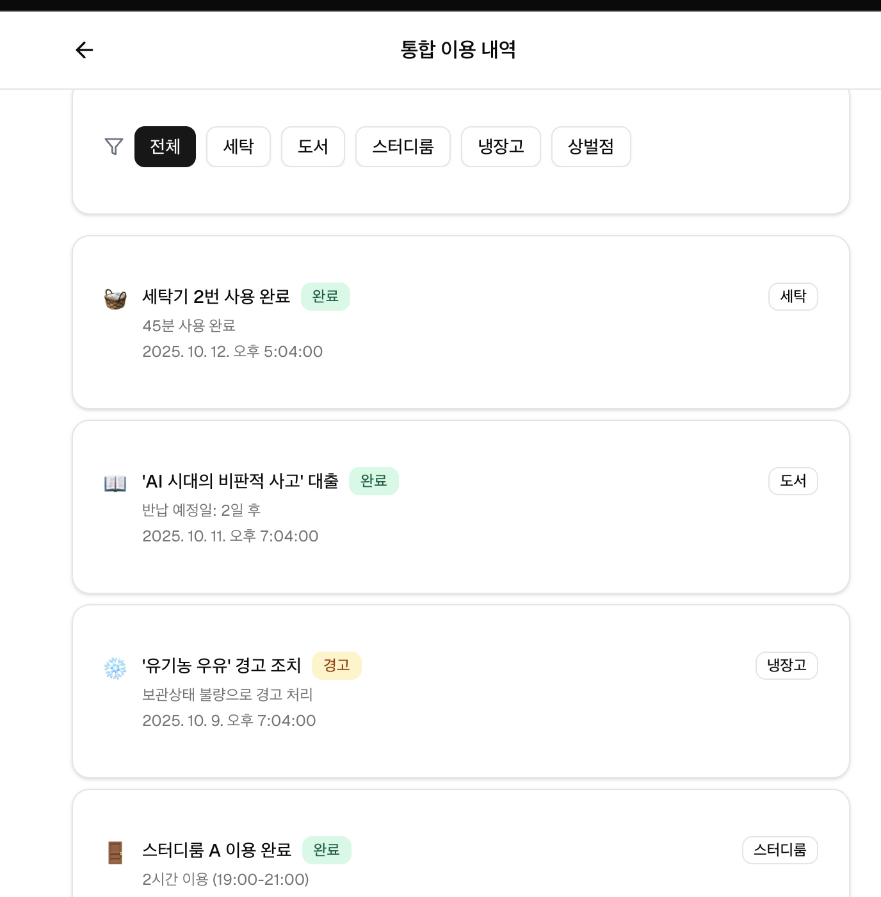

### **1. 기숙사생(RESIDENT) 전체 시나리오**

#### **1-1. 회원가입 및 최초 로그인**

**회원가입 흐름**
- DormMate 웹사이트 접속 → 회원가입 버튼 클릭
- 호실 번호 입력 (예: 201, 313, 524 등)
- 개인 번호 선택 (1~3 중 선택, 1인실은 1 고정)
- 아이디 입력
- 이메일 주소 및 비밀번호 입력
- 이용약관 동의 및 제출
- 서버에서 호실/개인번호 조합 검증 (중복 방지)
- 회원가입 완료 후 자동으로 RESIDENT 역할 부여
- 호실에 따라 사용 가능한 냉장고 칸(slot) 자동 매핑
  - 예: 201호 → 2층 냉장고 slot 1 (01~08호)
  - 예: 313호 → 3층 냉장고 slot 2 (09~16호)
  - 예: 524호 → 5층 냉장고 slot 3 (17~24호)

**로그인 흐름**
- 아이디/비밀번호 입력 → JWT 토큰 발급 (7일 유효)
- 메인 페이지 진입
- **하단 네비게이션**: 냉장고, 세탁,메인, 도서관, 스터디
- **상단**: 제목, 알림, 프로필 메뉴

#### **1-2. 냉장고 물품 등록 (묶음 시스템)**

**단일 품목 등록 (묶음 1개)**
- 냉장고 메뉴 → "물품 등록" 버튼 클릭
- 수량 입력 필드에 "1" 입력 (기본값)
- **라벨**: "물품명"
- **플레이스홀더**: "물품명을 입력하세요"
- **개별 변경 버튼**: 숨김
- 예시: 품목명 "우유", 유통기한 "2025-10-20", 메모 "저지방"
- "등록" 버튼 클릭
- 서버에서 FridgeBundle 생성 (items 1개 포함)
- 사용 가능한 라벨 번호 자동 발급 (예: 슬롯 1, 라벨 5 → 스티커 코드 "1005")
- 스티커 코드 화면 표시 (출력/저장 옵션)
- 사용자는 물리적 스티커에 "1005" 작성 후 냉장고 물품에 부착

**여러 품목 등록 (묶음 N개)**
- 냉장고 메뉴 → "물품 등록" 버튼 클릭
- 수량 증가: "3" (마카롱 3개 등록 예시)
- **라벨**: "묶음명"
- **플레이스홀더**: "묶음명을 입력하세요"
- **"묶음" 배지 표시**
- **개별 변경 버튼 표시**
- 메모입력칸 표시
- **개별 변경 화면** 클릭시
	- 기본 화면: 폼 입력 + 안내 메시지
		- 개별 변경 화면: 세부물품 목록 + 편집 기능
		- 화면 전환: 전체 화면으로 확장
		  - 품목 1: "딸기맛 마카롱", 유통기한 "2025-10-25"
		  - 품목 2: "초코맛 마카롱", 유통기한 "2025-10-25"
		  - 품목 3: "바닐라 마카롱", 유통기한 "2025-10-27"
- "일괄 등록" 버튼 클릭
- 서버에서 FridgeBundle 1개 생성 (items 3개 포함)
- 묶음당 스티커 코드 1개 발급 (예: "1006")
- 사용자는 묶음 포장 외부에 스티커에다가 코드를 기입해 "1006" 부착
- 묶음으로 관리되므로 조회/삭제 시 3개 품목이 함께 표시 (개별수정, 삭제 가능)

**칸 배정**
- 배정된 칸만 볼수있음
- 현재 시스템에서는 결국 한사람당 냉장칸 1칸, 냉동칸 1칸 배정된거라 냉동/냉장으로 현재 두가지 옵션을 제공
- 배정 불가능 시 "칸이 가득 찼습니다" 오류 메시지

#### **1-3. 내 물품 조회 및 필터링**

**기본 조회**

**필터 적용 **
- 상단 필터 버튼 클릭
- 옵션 선택:
	- 임박: 유통기한 3일 이내 (노란색 배지)
	- **만료**: 유통기한 지남 (빨간색 배지, 폐기 권장)
- 필터 적용 시 실시간 목록 업데이트

**검색 기능**
- 검색바에 품목명 입력 (예: "계란")
- 부분 일치 검색 (LIKE 쿼리)
- 스티커 코드 정확 검색 (예: "1006" 입력 시 해당 묶음만 표시)
- 검색 결과 없을 시 "등록된 물품이 없습니다" 빈목록

#### **1-4. 물품 수정 및 삭제**

**단일 품목 수정**
- 수정 가능 항목: 품목명, 유통기한, 메모
- 수정 불가 항목: 스티커 코드, 등록 일시
- 수정 완료 후 저장
- 그 칸의 제일 최근 검사일 이후 수정인경우 다음 검사 시 상단으로 분류됨

**묶음 내 개별 품목 수정**
묶음 내 개별 품목 삭제

**물품 삭제 (소프트 삭제)**
- 물품 카드에서 "삭제" 버튼 클릭
- 확인 다이얼로그: "정말 삭제하시겠습니까?"
- 확인 시 상태 REMOVED로 변경 (DB에서 물리적 삭제 X)
- 삭제된 물품은 목록에서 즉시 제거
- 개별 품목이 0개인경우나 묶음 삭제인경우, 삭제처리후 해당 스티커 코드의 라벨 번호 재사용 가능 상태로 전환
- 개별 품목 삭제 가능

**접근 제어**
- 본인이 등록한 물품만 수정/삭제 가능 (RBAC 검증)
- 다른 사용자 물품 수정 시도 시 403 Forbidden 에러
- 검사 중인 칸의 물품은 수정 불가 (락 메커니즘)

#### **1-5. 알림 수신 및 확인**

**유통기한 임박 알림**
- 매일 오전 9시 배치 작업 실행 (Spring @Scheduled)
- 유통기한 3일 이내 물품 자동 검사
- 알림 생성: "계란 외 2개 물품의 유통기한이 3일 남았습니다."
- 알림 배지: 상단 종 아이콘에 빨간 점 표시
- 알림 목록: 미읽음 상단 배치, 읽음 아래 배치
- 하루 1회 제한 (중복 알림 방지)

**검사 결과 알림**
- 층별장이 검사 제출 시 즉시 결과가 조치, 경고인 사용자에게 생성
- 알림 클릭 시 해당 물품 상세 화면으로 이동
- 물품이 삭제된 경우 검사 이력만 표시

**알림 읽음 처리**
- 냉장고 메인 화면 진입 시 관련 알림 자동 읽음 처리
- 알림 목록에서 개별 클릭 시 읽음 상태로 변경
- 읽은 알림은 회색 처리, 24시간 후 자동 만료
- 만료된 알림은 목록에서 자동 제거

**알림 설정**
- 프로필 → 알림 설정 메뉴
- 유통기한 알림 켜기/끄기
- 검사 결과 알림 켜기/끄기
- 설정 변경 즉시 반영

#### **1-6. 프로필 및 계정 관리**

**내 정보 조회**
- 프로필 메뉴 클릭
- 표시 정보: 이름, 이메일, 호실 번호, 개인 번호, 역할(RESIDENT)
- 배정된 냉장고 칸 정보 (슬롯 번호, 층)

**비밀번호 변경**
- 현재 비밀번호 입력
- 새 비밀번호 입력 (8자 이상, 영문+숫자)
- 변경 완료 시 자동 로그아웃 → 재로그인 필요

**로그아웃**
- 로그아웃 버튼 클릭
- JWT 토큰 무효화 (클라이언트 삭제)
- 로그인 화면으로 리다이렉트

---

## 2. 층별장(INSPECTOR) 전체 시나리오

### 2-1. 층별장 권한 부여

**관리자에 의한 임명**
- 관리자가 특정 기숙사생을 층별장으로 임명
- 역할이 RESIDENT → INSPECTOR로 업그레이드
- 임명 즉시 검사 권한 활성화

**층별장 해제**
- 관리자가 층별장 권한 해제
- 역할 INSPECTOR → RESIDENT로 복귀
- 진행 중인 검사 세션 강제 종료
- 검사 이력은 유지 (과거 기록 보존)

### 2-2. 검사 모드 시작

**검사 칸 선택**
- 냉장고 메뉴에서 "검사" 버튼 클릭 (INSPECTOR 전용)
- 검사 가능한 칸 목록 표시 (자기 층만)
- 칸 선택 (예: 3층 냉장고 slot 1)
- "검사 시작" 버튼 클릭

**검사 세션 생성**
- 서버에서 InspectionSession 생성
- 세션 ID 발급 (UUID)
- 검사자 등록 (최대 2명)
- 해당 칸 물품 락 활성화 (일반 사용자 수정 불가)
- SSE 연결 수립 (EventSource API)
- 검사 대상 물품 목록 조회 (해당 칸의 모든 Bundle)

**다른 검사자 합류**
- 검사중일시 검사시작 버튼이 검사합류로 바뀜
	- 클릭 시 동일 세션 ID로 연결
- 한칸에는 동시에 한 검사만이 가능
- SSE로 기존 검사 상태 동기화 (이미 조치된 물품 표시)
- 두 검사자의 화면이 실시간으로 동기화됨

## 2-3. 물품 검사 및 조치

검사 화면 구성

- 상단 헤더:
- 제목: "냉장고 검사"
- 검사 중인 칸 정보 표시
- 검사자 정보 (본인 + 상대방)
- 탭 구조:
- "검사 전" 탭: 조치되지 않은 물품 목록
- "검사 완료" 탭: 조치된 물품 목록 (본인 + 상대 검사자)
- 필터 버튼들:
- "만료" 필터: 유통기한 지난 물품만 표시
- "검사일이후 수정됨" 필터: 마지막 검사 후 변경된 물품만 표시
- 검색바: 품목명으로 검색 가능
- 물품 카드 표시:
- 단일 품목: 스티커 코드, 품목명, 유통기한, 메모
- 묶음 품목: 묶음명 + 개별 품목 목록
- 호실/개인 번호 (물품 소유자)
- 조치 버튼: 경고, 폐기, 통과

경고 조치 처리

- 물품 카드에서 "경고" 버튼 클릭
- 경고 사유 선택:
- 정보 불일치 (INFO_MISMATCH): 스티커 정보와 실제 물품 다름
- 보관 불량 (STORAGE_ISSUE): 포장 훼손, 냄새 등
- 스티커 미부착 (STICKER_MISSING_REGISTERED): 등록됐으나 스티커 없음
- 사유 메모 입력 (선택, 예: "포장이 뜯겨 있음")
- "조치 완료" 버튼 클릭
- 해당 물품이 "검사 완료" 탭으로 이동
- SSE로 다른 검사자에게 실시간 전파
- 상대방 화면에서도 "검사 완료" 탭에 표시 (조치자 이름 표시)

폐기 조치 처리

- 물품 카드에서 "폐기" 버튼 클릭
- 폐기 확인 다이얼로그: "정말 폐기하시겠습니까?"
- 확인 시 조치 완료, "검사 완료" 탭으로 이동
- 실시간 동기화

미등록 물품 즉시 등록 후 폐기

- 냉장고에서 시스템에 없는 물품 발견 시
- "미등록 물품 추가" 버튼 클릭
- 품목이름 간단입력후 검사완료탭에 미등록 폐기물품으로 등록

문제없음 처리

- 물품에 이상 없을 시 "통과" 버튼 클릭
- 조치 없이 "검사 완료" 탭으로 이동
- 통계에는 미포함 (정상 물품)

## 2-4. 실시간 동기화 (SSE)

동시 검사 시나리오

- 검사자 A가 물품 1에 "경고" 조치
- 서버에서 InspectionSession 업데이트 (메모리)
- SSE로 검사자 B에게 이벤트 전송
- 검사자 B의 화면에서 물품 1이 "검사 전"에서 "검사 완료"로 자동 이동
- UI에 "검사자 A가 조치함" 표시
- 검사자 B는 물품 2를 동시에 검사 가능 (중복 방지)

네트워크 끊김 시 재연결

- EventSource 자동 reconnection (브라우저 기본 기능)
- 재연결 시 서버에서 현재 세션 상태 전송
- 누락된 조치 내역 자동 동기화
- 검사 중단 없이 계속 진행 가능

## 2-5. 검사 결과 제출

최종 제출 조건

- 모든 물품이 "검사 완료" 탭에 있을 때 활성화
- "검사 전" 탭이 비어 있어야 함
- 두 검사자 중 누구나 제출 가능

제출 프로세스

- "최종 제출" 버튼 클릭
- 확인 다이얼로그: "검사를 종료하고 결과를 제출하시겠습니까?"
- 확인 시 서버로 검사 결과 일괄 전송
- DB에 검사 이력 저장:
- 검사자 ID(들), 검사 일시, 칸 ID
- 각 물품별 조치 내역 (사유, 메모)
- 통계 자동 집계:
- 경고 건수, 폐기 건수, 검사 물품 총 수
- 호실별 조치 건수
- 조치받은 사용자에게 알림 자동 발송
- 검사 세션 종료, 칸 락 해제
- 일반 사용자의 물품 수정 가능 상태로 복귀

**검사 취소**
- 검사 중 "취소" 버튼 클릭
- 확인 다이얼로그: "진행 중인 검사를 취소하시겠습니까? (저장되지 않습니다)"
- 확인 시 세션 삭제, 메모리 데이터 폐기
- DB 미반영, 알림 미발송
- 칸 락 즉시 해제

### 2-6. 검사 이력 조회

**검사 이력 페이지**
- 과거 검사 목록 표시 (최신순)
- 각 검사 카드:
  - 검사 일시, 칸 정보, 공동 검사자 (있을 경우)
  - 통계: 경고 N건, 폐기 M건
- 카드 클릭 시 상세 내역:
  - 조치된 물품 목록 (호실, 품목명, 사유)
  - 조치별 필터링 가능

---

## 주요 변경사항 요약

### **✅ 유지된 부분**
- **탭 구조**: "검사 전" / "검사 완료" 탭
- **필터 기능**: "만료", "검사일이후 수정됨" 필터
- **검색 기능**: 품목명으로 검색
- **물품 카드**: 스티커 코드, 품목명, 유통기한, 메모 표시
- **조치 버튼**: 경고, 폐기, 검사완료 버튼

### **🔄 수정된 부분**
- **검사 시작**: 냉장고 메뉴에서 "검사" 버튼 클릭
- **화면 구성**: 상단 헤더 + 탭 + 필터 + 검색바 구조
- **실시간 동기화**: SSE를 통한 동시 검사 지원
- **검사 결과 제출**: 최종 제출 조건 및 프로세스
- **검사 이력**: 과거 검사 목록 및 상세 조회
