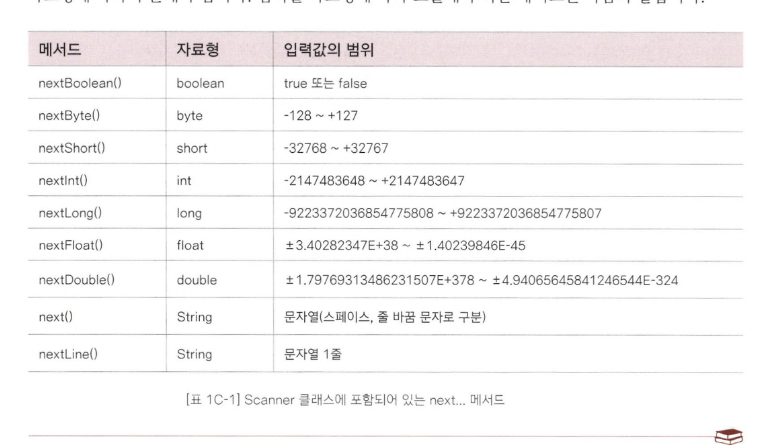

알고리즘 테스트를 자바로 준비하신다면, **어떤 자료구조를 언제 써야 하는지**가 가장 중요합니다. 다행히 자바는 강력한 **컬렉션 프레임워크(Collection Framework)**를 제공하기 때문에, 밑바닥부터 구현할 필요 없이 이미 만들어진 클래스들을 잘 가져다 쓰면 됩니다.

대부분의 필수 클래스와 메소드는 `java.util` 패키지 안에 모여있습니다.

다음은 "이것 모르면 문제 못 푼다" 싶은 필수 항목들입니다.

---

### 1. 🥇 자료구조 (Collections) - 가장 중요

이 클래스들은 어떤 데이터를 **어떻게 저장하고 꺼낼지** 결정합니다.

#### 1) List (순서가 있고 중복 허용)

- **`ArrayList`**: 가장 기본이 되는 동적 배열입니다.
    - `add(value)`: 값 추가
    - `get(index)`: 인덱스로 값 조회
    - `set(index, value)`: 값 수정
    - `remove(index)`: 값 삭제
    - `size()`: 리스트 크기
    - `isEmpty()`: 비었는지 확인
        

#### 2) Map (Key-Value 쌍, 순서 없음)

- **`HashMap`**: 해시 테이블 기반. (Key, Value) 쌍을 저장합니다. 검색 속도가 매우 빠릅니다.
    - `put(key, value)`: 값 저장
    - `get(key)`: Key로 Value 조회
    - `containsKey(key)`: Key가 존재하는지 확인
    - `getOrDefault(key, defaultValue)`: **[필수 암기]** Key가 없으면 기본값(defaultValue) 반환. (카운팅 문제 등에서 매우 유용)
    - `keySet()`: 모든 Key 목록 반환
    - `size()`: 맵 크기
        

#### 3) Set (순서 없고 중복 비허용)

- **`HashSet`**: 해시 테이블 기반. 값의 **중복을 자동으로 제거**해 주거나, 특정 값이 **존재하는지** 빠르게 체크할 때 사용합니다.
    - `add(value)`: 값 추가 (이미 있으면 무시됨)
    - `contains(value)`: 값이 존재하는지 확인 (매우 빠름)
    - `remove(value)`: 값 삭제
    - `size()`: Set 크기
        

#### 4) Stack (LIFO: 후입선출)

- **`Stack`**: DFS(깊이 우선 탐색), 괄호 짝 맞추기 등에 사용합니다.
    - `push(value)`: 값 삽입
    - `pop()`: 맨 위 값 꺼내기 (반환 및 삭제)
    - `peek()`: 맨 위 값 확인 (삭제 안 함)
    - `isEmpty()`: 비었는지 확인
        

#### 5) Queue (FIFO: 선입선출)

- **`Queue` (인터페이스)** / **`LinkedList` (구현체)**: BFS(너비 우선 탐색)에서 필수입니다.
    - `Queue<Integer> q = new LinkedList<>();` 형태로 선언합니다.
    - `offer(value)`: 값 추가 (또는 `add`)
    - `poll()`: 맨 앞 값 꺼내기 (반환 및 삭제)
    - `peek()`: 맨 앞 값 확인 (삭제 안 함)
    - `isEmpty()`: 비었는지 확인
        

#### 6) PriorityQueue (우선순위 큐)

- **`PriorityQueue`**: **힙(Heap)** 자료구조입니다. 기본값은 **최소 힙(Min Heap)**입니다.
    - 다익스트라(Dijkstra) 알고리즘이나 "K번째 큰 수" 등을 찾을 때 필수입니다.
    - `offer(value)`: 값 추가 (자동으로 정렬 위치를 찾음)
    - `poll()`: **가장 작은 값** (우선순위가 가장 높은 값) 꺼내기
    - `peek()`: 가장 작은 값 확인
        

---

### 2. 🥈 정렬 및 유틸리티

데이터를 조작하는 데 필요한 도우미 클래스들입니다.

#### 1) Arrays

- **`java.util.Arrays`**: **배열(`int[]`, `String[]` 등)**을 다룰 때 사용합니다.
    - `Arrays.sort(arr)`: 배열 정렬 (가장 중요)
    - `Arrays.sort(arr, Collections.reverseOrder())`: **[참고]** 기본형(int) 배열은 안되지만, Wrapper(Integer) 배열은 내림차순 정렬 가능
    - `Arrays.binarySearch(arr, key)`: 이진 탐색 (반드시 정렬 후 사용)
    - `Arrays.fill(arr, value)`: 배열을 특정 값으로 채우기
    - `Arrays.toString(arr)`: 배열 내용 출력용
        

#### 2) Collections

- **`java.util.Collections`**: **리스트(`ArrayList` 등)**를 다룰 때 사용합니다.
    - `Collections.sort(list)`: 리스트 정렬
    - `Collections.reverse(list)`: 리스트 순서 뒤집기
    - `Collections.max(list)` / `Collections.min(list)`: 최대/최소값 찾기
        

---

### 3. 🥉 문자열 처리

문자열 문제는 단골 출제 유형입니다.

#### 1) String

- **`String`** (불변)
    - `s.length()`: 문자열 길이
    - `s.charAt(index)`: 특정 인덱스의 문자(char) 반환
    - `s.substring(begin, end)`: 문자열 자르기 (end 인덱스 직전까지)
    - `s.equals(other)`: 문자열 내용 비교 (절대 `==` 쓰지 말 것)
    - `s.split(regex)`: 특정 기준으로 문자열 쪼개기 (배열 반환)
    - `s.toCharArray()`: 문자열을 `char[]` 배열로 변환
        

#### 2) StringBuilder

- **`StringBuilder`** (가변)
    - **[중요]** 루프 안에서 문자열을 계속 합칠 때 `String`의 `+` 연산을 쓰면 매우 느립니다. 그때 `StringBuilder`를 써야 합니다.
    - `append(str)`: 문자열 뒤에 붙이기
    - `toString()`: 최종 결과물 `String`으로 반환
        

---

### 4. 🤓 기타 유용한 클래스

- **`Math`**:
    - `Math.max(a, b)`, `Math.min(a, b)`: 두 수 중 최대/최소
    - `Math.abs(n)`: 절대값
    - `Math.sqrt(n)`: 제곱근
- **Wrapper Classes** (형변환):
    - `Integer.parseInt(s)`: `String` -> `int`
    - `String.valueOf(n)`: `int` -> `String`
    - `Character.isDigit(c)`, `Character.isLetter(c)`: 문자가 숫자인지, 문자인지 확인
        

### 요약

|**용도**|**필수 클래스**|**핵심 메소드**|
|---|---|---|
|**동적 배열**|`ArrayList`|`add`, `get`, `size`|
|**Key-Value**|`HashMap`|`put`, `get`, `getOrDefault`|
|**중복 제거**|`HashSet`|`add`, `contains`|
|**BFS (큐)**|`LinkedList`|`offer`, `poll`, `isEmpty`|
|**DFS (스택)**|`Stack`|`push`, `pop`, `isEmpty`|
|**힙 / 우선순위**|`PriorityQueue`|`offer`, `poll`|
|**배열 정렬**|`Arrays`|`sort`, `binarySearch`|
|**리스트 정렬**|`Collections`|`sort`, `reverse`|
|**문자열 조합**|`StringBuilder`|`append`, `toString`|

이 정도만 확실히 손에 익혀두셔도 웬만한 알고리즘 문제는 데이터 처리에서 막히는 일은 없을 겁니다.

이 중에서 특정 클래스의 사용법이 헷갈리거나 예시 코드가 필요하면 바로 알려주세요.
제공해주신 정리본은 자바(Java)를 이용한 알고리즘 문제 해결(PS/Competitive Programming)의 핵심을 정말 잘 요약한 '필수 암기 노트'입니다.
단순히 '무엇을 하는지'를 넘어, 왜 알고리즘 문제 풀이에서 이 메서드들이 중요한지 그 맥락과 전략을 중심으로 더 자세히 설명해 드릴게요.
A. 빠른 I/O (입출력)
핵심 전략: 기본 I/O의 병목 현상 피하기
알고리즘 문제에서는 100만 개 이상의 데이터를 입출력해야 하는 경우가 많습니다.
 * Scanner는 사용하기 편하지만, 입력을 분석(parsing)하고 정규식을 확인하는 과정에서 매우 느립니다.
 * System.out.println()은 호출될 때마다 즉시 화면(콘솔)에 데이터를 전송(Flush)하려고 시도하는데, 이 과정이 매우 비싼 작업입니다.
해결책 (정리본의 내용):
 * BufferedReader (입력): 데이터를 '한 줄 통째로' 일단 메모리(버퍼)에 최대한 빨리 읽어옵니다. 그 후, 프로그램은 느린 콘솔이 아닌 빠른 메모리에서 데이터를 처리합니다.
 * StringTokenizer (파싱): br.readLine()으로 읽어온 한 줄의 문자열을 쪼갤 때 사용합니다. String.split()은 정규식(regex) 기반이라 강력하지만 느립니다. StringTokenizer는 단순히 지정된 구분자(기본: 공백)로 문자열을 자르기 때문에 비교도 안 되게 빠릅니다.
 * StringBuilder (출력): 모든 출력 내용을 하나의 큰 문자열로 합치는 '장바구니'입니다. String + String 연산은 루프 안에서 매번 새로운 문자열 객체를 생성하여 메모리와 시간을 낭비합니다. StringBuilder는 하나의 객체 내부에서 문자열을 효율적으로 이어붙인 뒤, System.out.print(sb)로 단 한 번만 출력하여 시스템 호출을 최소화합니다.
B. 문자열(String) & 문자(Character)
핵심 전략: 자바 String의 '불변성(Immutability)' 이해하기
자바에서 String 객체는 한 번 생성되면 절대 변하지 않습니다.
 * s = s + "a";나 s.substring() 같은 작업은 기존 문자열을 바꾸는 게 아니라, 새로운 String 객체를 만들어 s에 다시 할당하는 것입니다.
 * 만약 100만 글자를 루프 돌며 String을 조작하면, 100만 개의 중간 객체가 생성될 수 있어 끔찍한 성능 저하가 발생합니다.
해결책 (정리본의 내용):
 * StringBuilder 활용 (팁 참조): 문자열을 '변경'해야 할 때는 String 대신 StringBuilder를 사용해야 합니다. sb.append(), sb.deleteCharAt() 등은 객체를 새로 만들지 않고 내부 버퍼를 직접 수정합니다.
 * toCharArray(): 문자열을 문자 배열로 바꾸면, 인덱스를 통해 문자를 직접 비교하거나(투 포인터 등) 빈도수를 셀 때(예: int[] count = new int[26];) 훨씬 효율적입니다.
 * equals() vs == (팁 참조): ==는 두 객체가 '같은 메모리 주소'를 가리키는지(동일성) 비교합니다. equals()는 '내용'이 같은지(동등성) 비교합니다. 문자열 비교는 **반드시 equals()**를 써야 합니다.
 * Character.isDigit() 등: c >= '0' && c <= '9'처럼 아스키코드로 비교할 수도 있지만, Character 유틸리티 클래스를 쓰는 것이 더 명확하고 안전합니다.
C. 배열·정렬·탐색(Arrays / Collections / Comparator)
핵심 전략: '정렬'을 빠르고 정확하게 수행하기
문제 해결의 70%는 데이터를 올바르게 '정렬'하는 것에서 시작합니다.
 * Arrays.sort(): 기본 타입(int, long 등) 배열은 퀵 정렬 기반(Dual-Pivot QuickSort)으로, 객체(Integer[] 등) 배열은 TimSort(합병+삽입 정렬) 기반으로 동작합니다.
 * Comparator (Java 8 람다):
   * 과거에는 복잡한 정렬을 위해 new Comparator<…>() { … }처럼 익명 클래스를 만들어야 했습니다.
   * 지금은 Comparator.comparingInt(MyObject::getScore).reversed().thenComparing(MyObject::getName)처럼, SQL의 ORDER BY 구문처럼 직관적으로 정렬 기준을 조합할 수 있습니다. 이게 정리본에 있는 comparingInt, reversed, thenComparing의 핵심입니다.
 * Arrays.binarySearch() (이진 탐색):
   * 반드시 정렬된 상태에서만 사용해야 합니다.
   * 팁 해설: binarySearch는 값을 찾지 못하면 음수를 반환합니다. 이 값은 -(삽입되어야 할 위치) - 1입니다. 예를 들어, [10, 20, 30]에서 25를 찾으면, 25는 2번 인덱스(30)에 삽입되어야 하므로 -(2) - 1 = -3이 반환됩니다. 이는 'Lower Bound / Upper Bound'를 찾는 데 응용할 수 있습니다.
D. 컬렉션 (자료구조)
핵심 전략: 문제 상황에 맞는 최적의 '도구' 선택하기
 * List → ArrayList: 왜 LinkedList가 아닐까요? LinkedList는 중간 삽입/삭제는 빠르지만, list.get(i)처럼 특정 인덱스를 조회하는 데 O(N)이 걸립니다. 알고리즘에서는 인덱스 조회가 빈번하므로, O(1) 조회가 가능한 ArrayList가 거의 항상 정답입니다.
 * Deque → ArrayDeque:
   * 큐(Queue): BFS(너비 우선 탐색)에서 필수. offer (넣기), poll (빼기).
   * 스택(Stack): DFS(깊이 우선 탐색)나 괄호 문제. push (넣기), pop (빼기).
   * ArrayDeque는 이 두 가지 기능을 모두 제공하며, LinkedList 기반 큐나 구식 Stack 클래스보다 훨씬 빠릅니다. (내부가 배열 기반이라 메모리 효율이 좋음)
 * PriorityQueue (힙):
   * '가장 작은 값' 또는 '가장 큰 값'을 빠르게(O(1)) 조회하고, 삽입/삭제를 적당히 빠르게(O(logN)) 해야 할 때 사용합니다.
   * (예: 다익스트라 알고리즘, K번째 큰 수 찾기, 여러 회의실 배정하기)
   * 기본은 '최소 힙'이므로, '최대 힙'은 Comparator.reverseOrder()를 사용합니다.
 * Map / Set:
   * HashMap / HashSet: 해시 기반. 삽입, 삭제, 조회가 평균 **O(1)**입니다. 순서가 필요 없고, '존재 여부'나 '키-값 매핑'만 빠르면 될 때 사용합니다.
   * TreeMap / TreeSet: 트리 기반. 모든 연산이 **O(logN)**입니다. HashMap보다 느리지만, 데이터가 항상 정렬된 상태를 유지합니다.
   * TreeMap/TreeSet의 핵심 (팁 해설): floorKey(x) (x보다 작거나 같은 값 중 최대)나 ceilingKey(x) (x보다 크거나 같은 값 중 최소)처럼, '나와 가장 가까운 값'을 빠르게(O(logN)) 찾는 강력한 기능이 필요할 때 사용합니다.
E. 수학/수치/큰수(Math / BigInteger)
핵심 전략: '오버플로'와 '음수' 함정 피하기
 * Math.xxxExact: int의 최댓값은 약 21억입니다. 10억 + 10억 + 10억을 계산하면 int 범위를 넘어 쓰레깃값(오버플로)이 나옵니다. Math.addExact 같은 메서드는 오버플로가 발생하면 즉시 예외(Exception)를 발생시켜, "이 계산은 long이 필요하다"고 알려줍니다.
 * Math.floorMod(a, m) (팁 해설):
   * 자바의 % 연산은 나머지가 아니라 'remainder(남은 값)'입니다.
   * (-3) % 2의 결과는 -1입니다.
   * 하지만 수학이나 알고리즘(예: 좌표 순환)에서는 (-3) mod 2가 1이 되어야 합니다. (즉, 0, 1, 0, 1… 순환)
   * Math.floorMod(-3, 2)는 수학적으로 올바른 1을 반환해 줍니다. 음수 인덱스 처리가 꼬일 때 이 메서드가 구세주입니다.
 * BigInteger: long (약 900경) 범위를 초과하는 숫자가 필요할 때만 사용합니다. (예: 팩토리얼, RSA 암호화, 초장거리 DP). 이 클래스는 내부적으로 숫자를 int[] 배열로 관리하며, 모든 연산이 매우 느리므로 최후의 수단으로 사용합니다.
이 정리본은 결국 **'성능(Performance)', '안정성(Safety)', '정확성(Correctness)'**이라는 세 가지 기준으로 엄선된, 자바 알고리즘 문제 해결을 위한 최고의 무기 목록이라고 할 수 있습니다.
이 중에서 특히 더 자세한 설명이나 예시 코드가 필요한 부분이 있을까요? 예를 들어 'Comparator 조합하는 법'이나 'TreeMap의 활용 사례' 등이 궁금하시면 말씀해 주세요.

알고리즘 테스트를 자바로 준비하신다면, **어떤 자료구조를 언제 써야 하는지**가 가장 중요합니다. 다행히 자바는 강력한 **컬렉션 프레임워크(Collection Framework)**를 제공하기 때문에, 밑바닥부터 구현할 필요 없이 이미 만들어진 클래스들을 잘 가져다 쓰면 됩니다.

대부분의 필수 클래스와 메소드는 `java.util` 패키지 안에 모여있습니다.

다음은 "이것 모르면 문제 못 푼다" 싶은 필수 항목들입니다.
[인출]
Scanner stdIn = new Scanner(System.in);  
stdIn.nextInt();

---

### 1. 🥇 자료구조 (Collections) - 가장 중요

이 클래스들은 어떤 데이터를 **어떻게 저장하고 꺼낼지** 결정합니다.

#### 1) List (순서가 있고 중복 허용)

- **`ArrayList`**: 가장 기본이 되는 동적 배열입니다.
    - `add(value)`: 값 추가
    - `get(index)`: 인덱스로 값 조회
    - `set(index, value)`: 값 수정
    - `remove(index)`: 값 삭제
    - `size()`: 리스트 크기
    - `isEmpty()`: 비었는지 확인
        

#### 2) Map (Key-Value 쌍, 순서 없음)

- **`HashMap`**: 해시 테이블 기반. (Key, Value) 쌍을 저장합니다. 검색 속도가 매우 빠릅니다.
    - `put(key, value)`: 값 저장
    - `get(key)`: Key로 Value 조회
    - `containsKey(key)`: Key가 존재하는지 확인
    - `getOrDefault(key, defaultValue)`: **[필수 암기]** Key가 없으면 기본값(defaultValue) 반환. (카운팅 문제 등에서 매우 유용)
    - `keySet()`: 모든 Key 목록 반환
    - `size()`: 맵 크기
        

#### 3) Set (순서 없고 중복 비허용)

- **`HashSet`**: 해시 테이블 기반. 값의 **중복을 자동으로 제거**해 주거나, 특정 값이 **존재하는지** 빠르게 체크할 때 사용합니다.
    - `add(value)`: 값 추가 (이미 있으면 무시됨)
    - `contains(value)`: 값이 존재하는지 확인 (매우 빠름)
    - `remove(value)`: 값 삭제
    - `size()`: Set 크기
        

#### 4) Stack (LIFO: 후입선출)

- **`Stack`**: DFS(깊이 우선 탐색), 괄호 짝 맞추기 등에 사용합니다.
    - `push(value)`: 값 삽입
    - `pop()`: 맨 위 값 꺼내기 (반환 및 삭제)
    - `peek()`: 맨 위 값 확인 (삭제 안 함)
    - `isEmpty()`: 비었는지 확인
        

#### 5) Queue (FIFO: 선입선출)

- **`Queue` (인터페이스)** / **`LinkedList` (구현체)**: BFS(너비 우선 탐색)에서 필수입니다.
    - `Queue<Integer> q = new LinkedList<>();` 형태로 선언합니다.
    - `offer(value)`: 값 추가 (또는 `add`)
    - `poll()`: 맨 앞 값 꺼내기 (반환 및 삭제)
    - `peek()`: 맨 앞 값 확인 (삭제 안 함)
    - `isEmpty()`: 비었는지 확인
        

#### 6) PriorityQueue (우선순위 큐)

- **`PriorityQueue`**: **힙(Heap)** 자료구조입니다. 기본값은 **최소 힙(Min Heap)**입니다.
    - 다익스트라(Dijkstra) 알고리즘이나 "K번째 큰 수" 등을 찾을 때 필수입니다.
    - `offer(value)`: 값 추가 (자동으로 정렬 위치를 찾음)
    - `poll()`: **가장 작은 값** (우선순위가 가장 높은 값) 꺼내기
    - `peek()`: 가장 작은 값 확인
        

---

### 2. 🥈 정렬 및 유틸리티

데이터를 조작하는 데 필요한 도우미 클래스들입니다.

#### 1) Arrays

- **`java.util.Arrays`**: **배열(`int[]`, `String[]` 등)**을 다룰 때 사용합니다.
    - `Arrays.sort(arr)`: 배열 정렬 (가장 중요)
    - `Arrays.sort(arr, Collections.reverseOrder())`: **[참고]** 기본형(int) 배열은 안되지만, Wrapper(Integer) 배열은 내림차순 정렬 가능
    - `Arrays.binarySearch(arr, key)`: 이진 탐색 (반드시 정렬 후 사용)
    - `Arrays.fill(arr, value)`: 배열을 특정 값으로 채우기
    - `Arrays.toString(arr)`: 배열 내용 출력용
        

#### 2) Collections

- **`java.util.Collections`**: **리스트(`ArrayList` 등)**를 다룰 때 사용합니다.
    - `Collections.sort(list)`: 리스트 정렬
    - `Collections.reverse(list)`: 리스트 순서 뒤집기
    - `Collections.max(list)` / `Collections.min(list)`: 최대/최소값 찾기
        

---

### 3. 🥉 문자열 처리

문자열 문제는 단골 출제 유형입니다.

#### 1) String

- **`String`** (불변)
    - `s.length()`: 문자열 길이
    - `s.charAt(index)`: 특정 인덱스의 문자(char) 반환
    - `s.substring(begin, end)`: 문자열 자르기 (end 인덱스 직전까지)
    - `s.equals(other)`: 문자열 내용 비교 (절대 == 쓰지 말 것)
    - `s.split(regex)`: 특정 기준으로 문자열 쪼개기 (배열 반환)
    - `s.toCharArray()`: 문자열을 `char[]` 배열로 변환
        

#### 2) StringBuilder

- **`StringBuilder`** (가변)
    - **[중요]** 루프 안에서 문자열을 계속 합칠 때 `String`의 `+` 연산을 쓰면 매우 느립니다. 그때 `StringBuilder`를 써야 합니다.
    - `append(str)`: 문자열 뒤에 붙이기
    - `toString()`: 최종 결과물 `String`으로 반환
        

---

### 4. 🤓 기타 유용한 클래스

- **`Math`**:
    - `Math.max(a, b)`, `Math.min(a, b)`: 두 수 중 최대/최소
    - `Math.abs(n)`: 절대값
    - `Math.sqrt(n)`: 제곱근
- **Wrapper Classes** (형변환):
    - `Integer.parseInt(s)`: `String` -> `int`
    - `String.valueOf(n)`: `int` -> `String`
    - `Character.isDigit(c)`, `Character.isLetter(c)`: 문자가 숫자인지, 문자인지 확인
        

### 요약

|**용도**|**필수 클래스**|**핵심 메소드**|
|---|---|---|
|**동적 배열**|`ArrayList`|`add`, `get`, `size`|
|**Key-Value**|`HashMap`|`put`, `get`, `getOrDefault`|
|**중복 제거**|`HashSet`|`add`, `contains`|
|**BFS (큐)**|`LinkedList`|`offer`, `poll`, `isEmpty`|
|**DFS (스택)**|`Stack`|`push`, `pop`, `isEmpty`|
|**힙 / 우선순위**|`PriorityQueue`|`offer`, `poll`|
|**배열 정렬**|`Arrays`|`sort`, `binarySearch`|
|**리스트 정렬**|`Collections`|`sort`, `reverse`|
|**문자열 조합**|`StringBuilder`|`append`, `toString`|

이 정도만 확실히 손에 익혀두셔도 웬만한 알고리즘 문제는 데이터 처리에서 막히는 일은 없을 겁니다.

이 중에서 특정 클래스의 사용법이 헷갈리거나 예시 코드가 필요하면 바로 알려주세요.