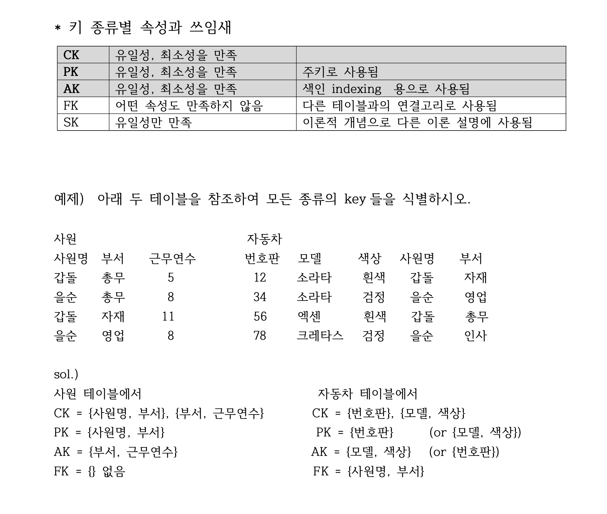

- ## 1. 데이터 모델링에 대해 설명하시오
- ## 2. 5개의 T/F 문제
- ## 3. IC (무결성 제약조건)에 대하여 설명해시오 (4가지 정도를 써봐라)

	데이터베이스 상태를 실세계의 사실들과 일치시키는 조건

	장점: 갱신될때 DBMS가 자동으로 검사해줘서 따로 검사할 필요없다

	단점: 복잡하다

	1. 엔터티 무결성 제약조건: 기본키는 유일해야하고, null이 불가능하다. 왜냐면 엔터티라는 실세계 개체를 식별해야하므로
	2. Key 무결성 제약조건: 키 값은 **유일**해야한다.
	3. 외래키 무결성 제약조건: **참조 테이블의 PK에 값이 속**하거나 NULL값이 되어야한다.
	4. 카디낼리티 무결성 제약조건: 관계정도를 1:1, 1:N, N:M으로 나타낸다.
	5. 참여 무결성 제약조건: 관계로의 참여 정도를 부분, 전체로 나타낸다.
	6. 비즈니스 룰(rule) 무결성 제약조건 :사내 정책 들을 DBMS 상에서 강제하기 위한 제약조건
- ## 4. 각 테이블에서 Key 종류를 구하시오
	- CK(후보키)에서 PK(기본키)를 고르고 나머지 후보키들은 AK(대체키)로 표기
	- 지피티는 교수님이 이렇게 말했나봐
		1. **단일 속성**으로 유일 식별 가능한지 확인 → 가능하면 **후보키**
		2. **복합 속성** 조합으로 유일 식별 가능한지 확인
		    
		    - 유일하지만 **부분집합**으로도 유일하면 **슈퍼키**(후보키 아님)
		
		3. 모든 후보키 중 **PK 1개 선택** → 나머지는 **AK**
		4. 스키마/명세의 **참조선언/명명(FK_…)·도메인**으로 **FK 식별**
		5. 인덱스 참고: **PK는 기본 인덱스 자동 부여**, **후보키(UNIQUE)**에 인덱스 부여 가능(선택)

	

	- 이건 혹시몰라 정리 
		- **후보키(Candidate Key)**: 유일 식별 & **최소성** 충족하는 속성 집합
		- **기본키(PK)**: 후보키 중 채택된 키
		- **대체키(AK, Alternate Key)**: **PK가 아닌 후보키**
		- **슈퍼키(SK, Super Key)**: 유일 식별 가능하나 **최소성 미충족** 가능(예: PK+다른 속성 포함)
		- **외래키(FK)**: 다른 테이블의 PK/UK를 참조하는 속성
		* Key 의 속성
			- 유일성 Uniqueness - 각 record/instance/tuple 을 유일하게 구별할 수 있어야 한다
			- 최소성 Minimality - key 의 구성에 있어 다른 key 가 포함되어서는 안된다.
- ## 5. 테이블->ERD 1:N(또는 1:1)로 출제
- ## 6. SQL
- ## 7. 요구사항을 주고 데이터모델링
	- 1. ERD 작성
	- 2. 설계