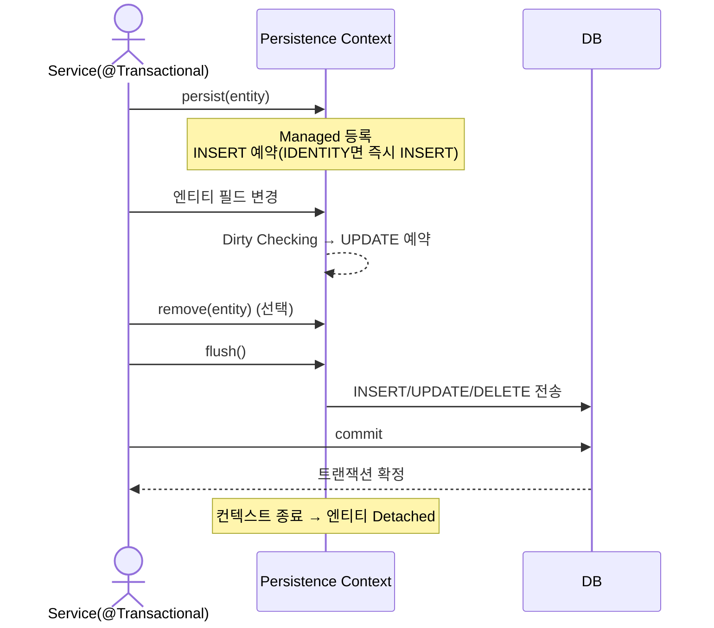

## **전제: 트랜잭션 시작 시 무엇이 생기나**

- @Transactional 진입 → **영속성 컨텍스트(1차 캐시)** 열림.
- 이 컨텍스트 안에서 엔티티는 **상태 전이**를 겪음:
    비영속(new) → 영속(managed) → (변경감지로 UPDATE 예약) / 제거(removed)
- **SQL은 즉시 나가지 않을 수 있음**(쓰기 지연). 실제 DB 반영 시점은 **flush/commit**.

---

## **1)** **persist(entity)— “영속 등록(INSERT 예약)”**

**흐름**

1. 엔티티 상태: new(비영속)
2. em.persist(e) 호출
3. e가 **영속(managed)** 으로 전이, 1차 캐시에 올라감
4. **INSERT가 예약**됨(쓰기 지연).
    
    - **ID 생성 전략별 예외**
        - IDENTITY(AUTO_INCREMENT): **ID를 받기 위해 즉시 INSERT** 1건이 실행됨(로컬 flush). 커밋은 아님.
        - SEQUENCE/TABLE: 보통 **즉시 INSERT 안 함**(시퀀스 nextval만 미리 당길 수 있음). 실제 INSERT는 flush 시.
5. 아직 트랜잭션 안이므로 롤백 가능.

> 요약: persist는 **영속화 + INSERT 예약**(ID 전략에 따라 즉시 INSERT 가능), **DB 커밋은 아님**.

---

## **2)** remove(entity) — “삭제 예약(DELETE)”**

**흐름**

1. 엔티티 상태: **영속(managed)** 여야 함(준영속이면 먼저 다시 조회/병합 필요)
2. em.remove(e) 호출
3. 상태가 **removed** 로 전이, **DELETE 예약**
4. 연관에 cascade = REMOVE / orphanRemoval=true면 **전파/고아 삭제** 예약도 함께 걸림
5. 실제 DELETE SQL은 **flush/commit** 때 실행

> 요약: remove는 **삭제 예약**. SQL은 flush 때, 트랜잭션 커밋이 되어야 확정.

## **3) flush() — “영속성 컨텍스트 → DB 동기화(전송만, 확정 아님)”**

**무엇을 하나?**

- **Dirty Checking 실행**: 스냅샷/더티 트래커를 비교하여 **변경된 엔티티·컬렉션**을 계산
- **Action 정렬**: INSERT/UPDATE/DELETE 및 컬렉션 작업을 **제약조건(FK) 고려 순서로 정렬**
- **SQL 전송**: 계산된 변경을 **JDBC로 전송**(배치가 켜져 있으면 배치로 모아 보냄)
- **스냅샷/버전 갱신**: 전송된 결과를 기준으로 **1차 캐시의 스냅샷/버전 값을 갱신**
- **트랜잭션·1차 캐시는 유지**, **커밋은 하지 않음**

**언제 일어나나?**

- 명시적 호출: em.flush()
- 자동(FlushMode.AUTO):
    - **커밋 직전**
    - JPQL/Criteria **실행 전**(현재 변경이 쿼리 결과에 영향 가능하면)
- FlushModeType.COMMIT: **커밋 직전**에만(쿼리 전 자동 flush 생략)

> **요약:** flush는 **Dirty Checking을 수행하고 SQL을 전송**할 뿐, **확정은 하지 않는다**. 확정은 commit.

---

### **흐름(수정본)**

1. findById로 **영속 엔티티** 확보
2. 도메인 메서드로 **값 변경** → 엔티티가 **‘더티’로 표시**(스냅샷/트래커 기준)
3. **flush 시점에 Dirty Checking 계산**(스냅샷 비교/트래커 확인)
4. 변경이 있으면 **SQL 생성·전송**(배치 가능) **→ 스냅샷/버전 갱신**

> **요약:** 영속 상태에서 **값만 바꾸면**, **flush 때 자동으로 UPDATE가 생성·전송**된다. 별도 save()는 필요 없다.

---

## **5)** commit() — “트랜잭션 확정”

**흐름**

1. 커밋 시도 → **자동으로 flush**(아직 안 했다면)
2. DB가 **트랜잭션을 확정**(ACID 보장)
3. 트랜잭션-스코프 영속성 컨텍스트는 **종료**
    
    - 해당 컨텍스트가 관리하던 엔티티들은 **준영속(detached)** 로 바뀜(더 이상 변경감지 안 됨)

> 요약: commit은 **최종 확정 + 컨텍스트 종료**. 이후 엔티티는 **준영속**.

---

## **상황별 타임라인 예시**

### **A) 신규 저장**

```sql
new → persist → (IDENTITY면 즉시 INSERT) → flush(INSERT 전송) → commit(확정)
```

### **B) 값 변경**

```sql
find(영속) → 필드 변경(Dirty) → flush(UPDATE 전송) → commit(확정)
```

### **C) 삭제**

```sql
find(영속) → remove(삭제 예약) → flush(DELETE 전송) → commit(확정)
```


---

---

## **자주 헷갈리는 포인트**

- **flush != commit** : flush는 “보내기”, commit은 “확정”.
- **save 호출 불필요** : 영속 상태에서 값만 바꾸면 **변경감지**가 UPDATE 예약을 만든다.
- **벌크 쿼리(JPQL update/delete)** 는 **영속성 컨텍스트를 건너뛰어 DB만 변경** → 직후 **em.clear()** 로 캐시를 비워 불일치 방지.
- **ID 전략 차이** : IDENTITY는 persist 시점에 **즉시 INSERT** 로 키 획득, 나머지는 보통 flush 때 INSERT.

---

## **한 줄 정리**

> persist/remove는 **예약**, flush는 **전송**, commit은 **확정**.
> 모든 실무 흐름은 이 타임라인 위에서 이해하면 깔끔합니다.
