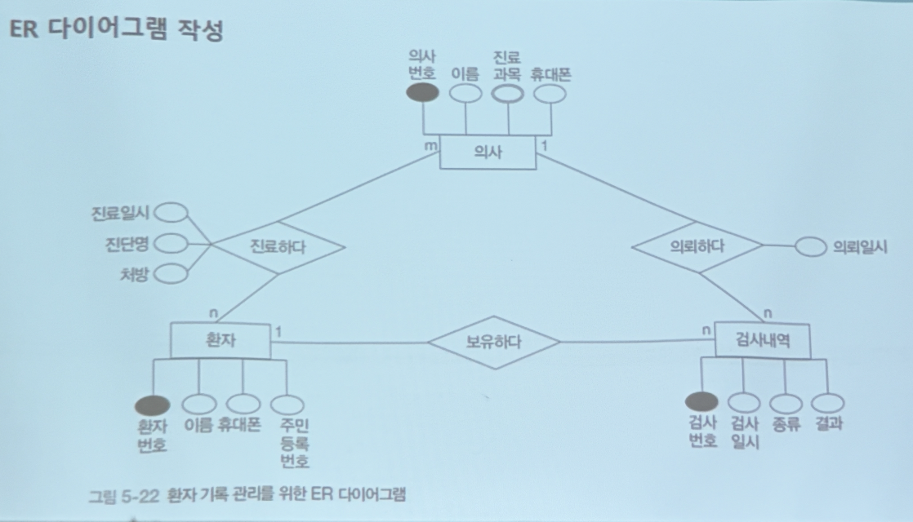

> [!info] 용어 혼동 주의보
>
> |파일 시스템|**DB**|**관계형 모델 (이론)**|
> |---|---|---|
> |파일 |**테이블**|릴레이션 (Relation)|
> |레코드|**행 (Row)**|튜플 (Tuple)|
> |필드 |**열 (Column)**|속성 (Attribute)|

- 튜플은 행이고 그 개수는 카디널리티
- 속성(attribute)는 열이고 그 개수는 차수 (차원으로 비유)
- 속성에 들어갈수있는 값의 범위는 도메인
	- ex) 성별의 도메인은 여자와 남자이다
정의 암기
- 데이터모델링: 현실의 요구사항을 데이터베이스 구조로 표현
- 트랜잭션: 논리적 작업 단위
- 개체 후보를 식별할때, 추후 업무처리과정이 달라질수있으므로, 데이터에 맞추어 설계한다
- DB에서의 PK가 왜 중요할까? 시험 백퍼
	- PK는 인덱스를 형성하기 때문이다.
- 인덱스가 작아야하는이유는?
	- 검색성능을 높이기 위해

> [!tip]- PK 설계 시 반드시 기억할 것
> - NULL, 중복 불가, 가능하면 최소화
> 1. **Not Null**: 비어 있으면 안 됨.
>     
> 2. **Unique**: 중복되면 안 됨.
>     
> 3. **Minimal**: 가능하면 짧고 간단해야 함 (성능 및 저장 공간 최적화).
>

모델링 순서
- 1. 요구사항분석: 요구사항 명세서
- 2. 개념적 모델링: ERD
- 3. 논리적 모델링: 관계형 스키마 , 정규화 수행
- 4. 물리적 모델링: 물리적 스키마(인덱스 등)
- 5. 구현: DBMS에 DB 구축

DB설계시 고려사항
- 무결성: 데이터값은 제약조건을 항상 만족해야한다
- 일관성: 같은 질의에 대해선 일관적인 응답이 나와야한다
- 복구: 문제발생시, 발생전의 정상상태로 되돌릴수있어야한다
- 보안: 불법적인 접근으로부터 보호해야한다
- 효율성: 응답시간 단축 등도 고려해야한다
- 확장성: 새로운 데이터 추가는 시스템에 영향을 주지 않아야한다

### 1. ERD 주요 도형 요약

| **사각형**   | **엔터티 (Entity)**      | 관리해야 할 **'대상'** (테이블이 될 녀석) |
| --------- | --------------------- | --------------------------- |
| **마름모**   | **관계 (Relationship)** | 엔터티 간의 **'상호작용'** (동사)      |
| **타원**    | **속성 (Attribute)**    | 엔터티가 가진 **'세부 정보'** (컬럼)    |
| **밑줄 타원** | **기본키 (PK)**          | 데이터를 유일하게 구분하는 **'식별자'**    |
| **실선**    | **연결 (Link)**         | 엔터티와 속성, 엔터티와 관계를 **연결**    |
| 선위 숫자     | 카디널리티                 |                             |

- **이중 타원 (Double Ellipse)**: **다중값 속성**. 한 칸에 값이 여러 개 들어갈 수 있는 것 (예: 취미로 피아노, 달리기)

---

| **번호** | **요구 분석 내용**                              |
| ------ | ----------------------------------------- |
| **1**  | 의사는 의사 번호, 이름, 진료 과목, 휴대폰 정보를 관리한다.       |
| **2**  | 환자는 환자 번호, 이름, 휴대폰, 주민등록번호를 관리한다.         |
| **3**  | 의사가 환자를 **진료한 일시와 진단명, 처방**을 기록한다.        |
| **4**  | 환자의 **검사 내역(검사 일시, 검사 종류, 검사 결과)**을 기록한다. |
| **5**  | 환자의 검사를 어떤 의사가 언제 **의뢰**했는지 기록한다.         |
| **6**  | 의사의 담당 진료 과목은 1개 이상이다.                    |

### 1. 명사 및 동사 선별 (요구 분석 명세서 기반)

가장 먼저 요구 사항에서 **명사(개체 및 속성 후보)**와 **동사(관계 후보)**를 골라내는 작업입니다.

| **구분** | **항목**                                                                           |
| ------ | -------------------------------------------------------------------------------- |
| **명사** | 의사, 의사번호, 이름, 진료과목, 휴대폰, 환자, 환자번호, 주민등록번호, 진료일시, 진단명, 처방, 검사내역, 검사종류, 검사결과, 의뢰일시 |
| **동사** | 관리한다, 진료하다, 기록한다, 의뢰하다, 보유하다(속해있다)                                               |

---

### 2. 개체 후보 검토 (선정 및 제외 사유)

어떤 것을 개체(Entity)로 만들고 어떤 것을 제외할지 결정하는 단계입니다.

| **개체 후보** | **데이터 수** | **대표 속성**             | **비고**                       | **선정 여부** |
| --------- | --------- | --------------------- | ---------------------------- | --------- |
| **의사**    | n         | 의사번호, 이름, 진료과목, 휴대폰   | 핵심 관리 대상                     | **O**     |
| **환자**    | n         | 환자번호, 이름, 휴대폰, 주민등록번호 | 핵심 관리 대상                     | **O**     |
| **검사내역**  | n         | 검사일시, 검사종류, 검사결과      | 환자와의 관계에서 발생                 | **O**     |
| 검사        | n         | -                     | 검사내역과 중복됨                    | **X**     |
| 담당진료과목    | n         | 진료과목                  | 의사의 다중치 속성(1개 이상)이므로 속성으로 처리 | **X**     |

> **💡 선정 제외 이유:** '검사'는 '검사내역'이라는 더 구체적인 정보가 있으므로 중복을 피하기 위해 제외합니다.

---

### 3. 개체 타입 선정 (개체명 및 속성)

선정된 개체들을 테이블 구조로 구체화합니다. (밑줄은 기본키인 PK입니다.)

- **의사**(<u>의사번호</u>, 이름, 진료과목, 휴대폰)
- **환자**: (<u>환자번호</u>, 이름, 휴대폰, 주민등록번호)
- **검사내역**: (<u>검사번호</u>, 검사일시, 검사종류, 검사결과)
    - _(주의: 명세서에는 없지만 각 내역을 구분할 검사번호가 PK로 추가되는 것이 좋습니다.)_
        

---

### 4. 관계 식별 (관계명, 개체 목록, 차수, 속성)

개체들 사이의 연결 고리를 정의합니다.

| **관계명**  | **관련된 개체 목록** | **카다널리티(차수)** | **포함된 속성**    |
| -------- | ------------- | ------------- | ------------- |
| **진료하다** | 의사, 환자        | **M : N**     | 진료일시, 진단명, 처방 |
| **의뢰하다** | 의사, 검사내역      | **1 : N**     | 의뢰일시          |
| **보유하다** | 환자, 검사내역      | **1 : N**     | -             |
|          |               |               |               |

### 3. 최종 ERD 구조 표현 (Text-based Diagram)
- m:N테이블 분리 안한다
- fk에 해당하는 속성은 이미 선으로 관계 표현을 했으므로 생략

### 4. 논리적 모델링

**1. 의사** ( <u>의사번호</u>, 이름, 진료과목, 휴대폰 )
**2. 환자** ( <u>환자번호</u>, 이름, 휴대폰, 주민등록번호 )
**3. 검사내역** ( <u>검사번호</u>, 검사일시, 검사종류, 결과, 의사번호, 환자번호, 의뢰일시 )
**4. 진료 (IAE)** ( <u>의사번호</u>, <u>환자번호</u>, <u>진료일시</u>, 진단명, 처방 )

---
