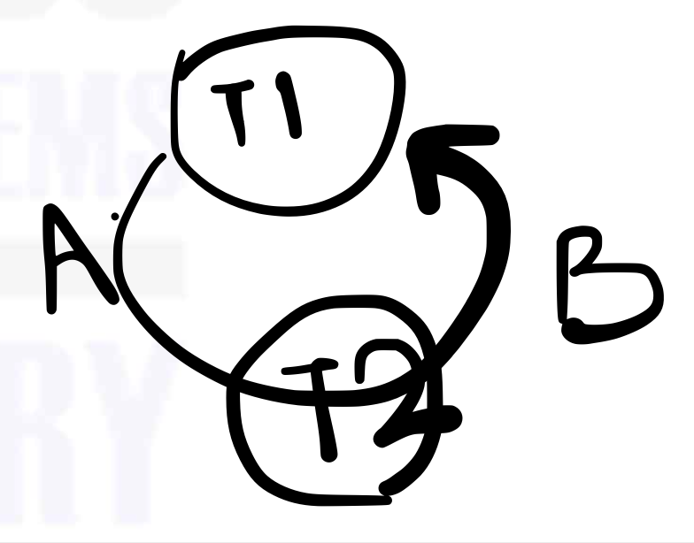

## 문제 5번: RSA방식(필수)와 MAC/RBAC를 설명하시오

> [!NOTE]- RSA방식
> ### RSA방식
> 문서: 수신자의 공개키->수신자 개인키
> 전자서명: 송신자의 개인키-> 송신자의 공개키
>
> RSA는 누구나 알수있는 공개키와 소유자만 알고있는 개인키 쌍으로 구성된다. 수신자의 공개키로 암호화하고, 수신자는 자신의 개인키로 복호화한다. 송신자가 보냄을 증명하기 위한 전자 서명시에는 송신자의 개인키로 잠그고(서명) 송신자의 공개키로 푼다(확인)

> [!NOTE]- MAC/RBAC
> ### MAC/RBAC
> Subject와 Object 등급을 나누고 매핑한다
> 자신보다 높은 등급의 문서를 읽을 수 없는 **Simple Security Property(no read up)** 와 낮은 등급의 문서에 쓸수없는 **Star Property(no write down)** 를 지킨다. 여기서 **권한을 '사람'이 아닌 '직책(역할)'에 부여**하고, 사람을 그 역할에 배정하는 방식이 추가되면 RBAC다
>

## 문제 4번 주어진 스케줄(Schedule)에 대해 직렬 가능성(Serializability) 판단 및 비직렬인경우 다시 그리시오
- **스케줄:**
	- $T1$: $W(a)$ [ ] $R(b)$
	- $T2$:[ ] $R(a)$ $W(b)$
- **연산 순서:**
1. $T1$이 $W(a)$ 수행
2. $T2$가 $R(a)$ 수행
3. $T2$가 $W(b)$ 수행
4. $T1$이 $R(b)$ 수행  
- ### **문제점 (아래 손그림 그래프 참조):**
	1. $T1$이 $W(a)$ 수행
    1. $T2$가 $R(a)$ 수행 $\rightarrow$ **충돌 1:** $T1 \rightarrow T2$ (데이터 a에 대해)
    2. $T2$가 $W(b)$ 수행
    3. $T1$이 $R(b)$ 수행 $\rightarrow$ **충돌 2:** $T2 \rightarrow T1$ (데이터 b에 대해)

	- 
    - $T1$에서 $T2$로 가는 화살표(A)와 $T2$에서 $T1$으로 가는 화살표(B)가 동시에 존재합니다.
    - 이로 인해 **사이클(Cycle, 순환)이 형성됩니다. ($T1 \rightarrow T2 \rightarrow T1$)
    - **결론:** 사이클이 존재하므로 **충돌 직렬화 불가능(Not Conflict Serializable)**한 스케줄입니다.
### 해결
- 원래 $T2$의 $W(b)$가 3번이었는데, 이를 4번으로 **뒤로 미루었습니다.**
    - 이렇게 되면 데이터 $b$에 대한 충돌 순서가 $R(b)[T1] \rightarrow W(b)[T2]$가 되어, 방향이 $T1 \rightarrow T2$가 됩니다.
    - 결과적으로 모든 충돌 방향이 $T1 \rightarrow T2$로 통일되어 **사이클이 사라지고 직렬화가 가능**해집니다.
        

> 💡 핵심 팁 (필기 내용):
> "앞쪽으로 땡기는 건 불가능하고 이렇게 뒤로 미는 게 가능 (연산 순서 유지)"
> - 트랜잭션 내부의 로직상 필요한 연산을 무리하게 앞으로 당길 수는 없지만, 충돌을 피하기 위해 실행을 잠시 지연(Wait)시켜 뒤로 미루는 것은 가능하다는 의미입니다.
## [문제 3] 몇 정규형인지 분석하고, 위반시 분해하시오
- **상황:** `계약(계약번호, 공급자번호, 과제번호, 부서번호, 부품번호, 수량, 가격)`라는 복잡한 테이블이 있습니다.
    - `계약번호` C 가 키(Key)입니다
    - 부서는 한 공급자로부터 많아야 한 부품만 구매
    - 과제는 각 부품을 단일 계약으로 일괄 구매

> [!NOTE]- 풀이
> - FD(함수 종속) 찾기
>     1. `SD -> P`: 하나의 공급자로부터 하나만 구입하므로 (공급자 $S$, 부서 $D$)만 알면 부품($P$)을 찾을수있다
>     2. `JP -> C`: (과제 $J$, 부품 $P$)를 알면 계약을 알수있다 즉 식별인 계약번호($C$)을 찾을수있다
> - **FD가 정규형 위반인지 찾는다:**
> 	- fd1확인: `SD -> P`
> 		- 왼쪽이 슈퍼키가 아니다
> 		- 오른쪽이 프라임속성이 아니다.
> 		- 왼쪽이 프라임속성이 아니다.
> 		- 결과: 3NF위반, 즉 현재테이블은 2NF이다
> 	- fd2확인 : `JP -> C`
> 		- $JP \rightarrow C \rightarrow \text{All}$. 즉, $JP$만 있어도 다 알 수 있으므로 **$JP$도 슈퍼키(후보키) 자격이 있습니다.**
> 		- 결과 BCNF이다
> - 위반이라면 새 테이블 생성
> 	1. 새 테이블 생성 $R1(\underline{S, D}, P)$
> 	2. **헌 테이블 ($R2$):** 원래 테이블에서 $P$를 지웁니다.
> 	    - $R2(\underline{C}, S, J, D, Q, V)$ $\rightarrow$ **(계약) 테이블**

## 문제 2번
박스 안에 요구사항(Requirements)을 쭉 주고, 그에 따라 **ER 모델링(ERD)**을 그리고, 다시 **관계형 모델(RM)**로 변환하는 설계 문제입니다.

> [!NOTE]- 개념적설계
>**)

> [!NOTE]- 논리적설계
> **)

## **[문제 1] O/X 퀴즈 및 오답 수정 (약 20점)**

세마포(Semaphore)의 2가지 기본(Primitive) 연산에 대해 설명하라.

P(s): 세마포 s를 기다리는 연산 (wait and hold)

V(s): 세마포 s를 풀어주는 연산 (release)

제공해주신 텍스트에서 **주석(숫자)과 부정문, 보조적인 설명**을 모두 제거하고, **핵심 이론만을 긍정문(A는 B다) 형식으로 재구성**했습니다.

이대로 암기하시어 시험에 대비하시길 바랍니다.

---

## 🚀 데이터베이스 및 병행 제어 핵심 공식 (긍정문 요약)

### 1. 정규화 (Normalization) 핵심 원칙

- 정규화 단계가 상승하면 중복이 감소합니다.
- 정규화 단계가 상승하면 테이블 개수가 증가하여 조인(Join) 비용이 증가합니다.
- 결정자($X$)가 **슈퍼 키(Super Key)** 인 함수적 종속(FD)은 제거 대상이 아닙니다.
- 제2정규형(2NF)의 목표는 **부분 함수 종속**을 제거하는 것입니다.부분밖에 안되냐
- 제3정규형(3NF)의 목표는 **이행 함수 종속**을 제거하는 것입니다.
- 3NF의 허용 조건은 결정자가 슈퍼 키가 아니어도, 우변이 **프라임 속성**이면 통과입니다.
- BCNF의 필수 조건은 **모든 결정자**가 **무조건 슈퍼 키**여야 합니다.
- 테이블 분해(Decomposition) 단계에서는 외래 키를 명시적으로 고려하지 않습니다.
    

### 2. 병행 제어 (Concurrency Control) & 세마포어

- 병행 제어의 대상은 **공유 자원(Shared Data)**에 대한 동시 접근 제어입니다.
- 상호 배제(Mutual Exclusion) 구현 시 세마포어의 초기값은 **1**입니다.
- 순서 동기화(Ordering) 구현 시 세마포어의 초기값은 **0**입니다.
- P 연산의 역할은 자원 **사용 전 검사 및 대기**입니다.
- V 연산의 역할은 자원 **사용 후 반납 및 해제**입니다.
    

### 3. 트랜잭션 & 직렬화 (Serializability)

- ACID의 **원자성(Atomicity)**은 **All or Nothing** (전부 실행되거나, 아예 실행되지 않거나)입니다.
- **직렬 스케줄(Serial Schedule)** 은 순차 실행하며 데이터 오류가 없습니다.
- **직렬화 가능 스케줄(Serializable Schedule)**은 인터리빙을 하더라도 직렬 스케줄과 결과가 동일한 스케줄입니다.
- 연산 충돌(Conflict)은 **Write(쓰기)** 가 하나라도 포함될 때 발생합니다.
- 연산 충돌 그래프에 **사이클(Cycle)** 이 존재하면 해당 스케줄은 **비직렬화 가능(Non-serializable)** 스케줄입니다.
- **충돌 직렬화 가능 스케줄**의 조건은 모든 충돌 연산의 **순서(Order)** 가 트랜잭션 간에 일정하게 유지되는 것입니다.

5
RSA방식은
- 비대칭키(공개키, 개인키)
- 문서암호,복호화(수신자개인키,공개키)
- 서명,확인(송신자개인키,송신자)  
MSA
- subject, object 등급화 매핑
- simple security property 높은문서 읽지x
- star property 낮은등급 쓸수x
- 권한->직책 사람-역할배정하면 RBAC

4
다른트랜잭션이 같은데이터건들때
먼저 수행-> 나중에 수행한 쪽
사이클생겨 충돌, 직렬화 불가능

3 FD찾기(함수종속)
슈퍼키 [ ] BCNF
프라임(x) [ ] 2NF
슈퍼키 or 프라임키 3NF

왼 슈퍼키 BCNF
왼 프라임X 2NF
왼 슈퍼키 or 오 프라임

2nf(부분 종속 발생) 부분밖에안되냐
3nf(이행 함수 종속 발생) 다리건너 아는사이

2 모델링
