# 개념
> [!NOTE]- 최종 요약
> ## 최종 요약 - 알고리즘 2025.10.30
>
> ### 1) 오늘의 TOPIC (Pattern Link)
>
> 오늘 수업은 **'효율적인 정렬'**을 관통하는 핵심 기법인 **분할 정복(Divide and Conquer)**에서 시작하여, 이를 구현한 대표적인 두 알고리즘(**합병 정렬, 퀵 정렬**)을 비교하고, 자료구조의 특성을 이용한 **힙 정렬**로 확장되었습니다.
>
> 1. **분할 정복의 기초 (Divide and Conquer)**
>     - 거대한 문제를 해결 가능한 단위(Atomic level)까지 쪼갠 뒤(Divide), 다시 합치며(Conquer) 해결하는 나폴레옹 전술과 같은 전략입니다.
>         
> 2. **합병 정렬 (Merge Sort)**
>     - **위치(Size)** 를 기준으로 물리적인 반을 쪼갭니다.
>     - 쪼개는 건 쉽지만, 다시 합칠 때(Merge) 정렬 로직이 필요합니다.
>     - **특징**: 항상 $O(N \log N)$을 보장하지만, $O(N)$의 추가 메모리가 필요한 것이 단점입니다.
>         
> 3. **퀵 정렬 (Quick Sort)**
>     - **값(Pivot)** 을 기준으로 논리적인 반(작은 그룹, 큰 그룹)을 쪼갭니다.
>     - 쪼갤 때(Partition) 이미 정렬 로직이 수행되므로, 별도의 합병 과정이 필요 없습니다.
>     - **특징**: 추가 메모리가 거의 필요 없으며(In-place), 참조 지역성 덕분에 가장 빠르지만, **이미 정렬된 데이터**에서는 $O(N^2)$로 성능이 급락합니다.
> 4. **힙 정렬 (Heap Sort)**
>     - '우선순위 큐' 개념을 도입하여, 가장 큰 값(Root)을 효율적으로 뽑아내는 **힙(Heap)** 자료구조를 활용합니다.
>     - 배열을 완전 이진 트리로 해석하여 정렬을 수행하며, 퀵 정렬의 최악의 경우를 방지할 수 있는 안정적인 $O(N \log N)$ 알고리즘입니다.
>         
> 
> ### 2) 강조 포인트
>
> - **알고리즘의 재귀적 흐름**: 합병 정렬과 퀵 정렬 모두 재귀 호출(Recursive Call)을 사용하지만, **'쪼개고 호출하느냐(Merge)'** vs **'정리하고 호출하느냐(Quick)'**의 순서 차이를 명확히 이해해야 합니다.
> - **코드 구현의 디테일 (Implementation Detail)**
>     - **퀵 정렬의 `do-while`**: `low`와 `high` 포인터를 이동시킬 때, 피벗 자신과의 비교를 건너뛰고 인덱스 처리를 원활하게 하기 위해 전위 증가(`++low`) 형태의 루프 구조를 사용합니다.
>     - **힙의 인덱스**: 완전 이진 트리의 수식(`i*2`, `i/2`)을 단순화하기 위해 배열의 0번을 비우고 **1번 인덱스부터 루트로 사용**합니다.
>     - **힙의 삭제 메커니즘**: 루트(최댓값)를 삭제한 뒤, **가장 마지막 노드를 루트로 올리고** 자식들과 경쟁하며 내려가는 방식이 완전 이진 트리의 형태를 유지하는 가장 효율적인 방법임을 강조했습니다.
> - **최악의 시나리오 (Worst Case)**
>     - 퀵 정렬에서 이미 정렬된 데이터(오름차순/내림차순)에 대해 첫 번째 원소를 피벗으로 잡으면, 분할이 `1 : N-1`로 일어나 트리의 높이가 $N$이 되어버리는 비효율성을 강조했습니다.
> 
> ## 최종 요약 - 알고리즘 2025-11-06
>
> ### 1) 오늘의 TOPIC (Pattern Link)
>
> 오늘 수업은 **'정렬(Sorting)의 끝'**에서 **'그래프(Graph)의 시작'**으로 데이터 구조의 관점이 확장되는 분기점이었습니다.
>
> 1. **비교의 한계를 넘어서 (Radix Sort):** 데이터를 직접 비교하는 기존 정렬($O(N \log N)$)의 한계를 깨고, 데이터의 속성(자릿수)을 이용해 **선형 시간($O(N)$)** 내에 정렬하는 기수 정렬을 배웠습니다.
> 2. **컴퓨터의 한계 인식 (Floating Point):** 기수 정렬이 실수(Float)에 적용하기 힘든 이유를 설명하며, **IEEE 754 부동소수점** 표준과 컴퓨터의 연산 오차(Precision Error)라는 CS의 근본적 한계를 짚었습니다.
> 3. **선형에서 비선형으로 (Graph):** 순서나 계층(Tree)만으로는 설명할 수 없는 현실의 복잡한 관계(N:M)를 표현하기 위해 **그래프 모델링**의 세계로 진입했습니다. '어떻게 정렬할 것인가'에서 '어떻게 연결하고 해결할 것인가'로 사고의 틀이 전환되었습니다.
>     
> 
> ### 2) 강조포인트
>
> - **기수 정렬 (Radix Sort):**
>     - **핵심:** 비교 연산(Comparison)이 없음. 낮은 자릿수부터 정렬해야함
>     - **구조:** 데이터의 입력 순서를 보장하기 위해 반드시 **큐(Queue)** 버킷을 사용(Stable Sort).
>     - **복잡도:** $O(dN)$ (단, $d$는 자릿수). 정수 등 길이가 고정된 데이터에 유리하며 메모리를 추가로 소비함.
> - **CS 기초 (Floating Point):**
>     - $0.1 + 0.2 \neq 0.3$: 무한 이진 소수를 유한한 비트(Mantissa)로 잘라내 저장하므로 발생하는 **근사치 오차**를 이해해야 함.
> - **그래프(Graph)의 본질:**
>     - **정의:** $G = (V, E)$. 객체(Vertex)와 그들의 관계(Edge)의 집합.
>     - **모델링:** 내비게이션, 선수과목, 회로 등 현실 문제를 수학적 모델로 추상화하는 것이 핵심.
>     - **오일러 정리:** 모든 간선을 한 번씩만 지나는 경로는 **정점의 차수(Degree)가 짝수**일 때만 존재함.
> - **그래프의 종류:**
>     - 방향성 유무(Directed/Undirected)와 연결 강도(Weight)에 따라 해결할 수 있는 문제(최단 거리 vs 최소 비용)가 달라짐.
> 
> ## 최종 요약 - 알고리즘 2025.11.13
>
> ### 1) 오늘의 TOPIC (Pattern Link)
>
> 오늘 수업은 **"그래프(Graph)의 정의부터 메모리 구현, 그리고 탐색(DFS)까지"** 이어지는 논리적 흐름을 다루었습니다.
>
> 1. **그래프의 기초 (Theory)**
>     
>     - 단순한 연결을 넘어 가중치(비용, 거리)를 포함한 **현실 세계의 모델링**(통신망, 회로 등) 도구로서 그래프를 정의했습니다.
>     - 핵심 속성인 **차수(Degree)**, 특히 방향 그래프에서의 **진입/진출 차수** 구분이 구현의 기초가 됨을 학습했습니다.
>         
> 2. **그래프의 표현 (Representation: Memory Mapping)**
>     
>     - **인접 행렬 (Adjacency Matrix)**: $N \times N$ 2차원 배열. 구현이 쉽고 접근이 빠르나($O(1)$), 희소 그래프에서 메모리 낭비($O(V^2)$)가 심합니다.
>     - **인접 리스트 (Adjacency List)**: 포인터 배열 + 연결 리스트. 메모리를 효율적($O(V+E)$)으로 쓰지만, 구현 난이도가 높습니다.
>     - **🔑 연결 흐름**: 상황(밀집 vs 희소)에 따라 적절한 자료구조를 선택하는 안목이 필요합니다.
>         
> 3. **그래프의 탐색 (Action: DFS)**
>     
>     - 정적인 그래프 구조를 돌아다니기 위한 첫 번째 방법으로 **깊이 우선 탐색(DFS)**을 배웠습니다.
>     - "한 우물만 파다 막히면 돌아온다"는 **Backtracking** 원리를 **스택(Stack)** 또는 **재귀(Recursion)**로 구현했습니다.
>     - 앞서 배운 표현 방식(행렬/리스트)에 따라 DFS 알고리즘의 시간 복잡도 구현 디테일이 달라짐을 확인했습니다.
>         
> 
> ### 2) 강조포인트
>
> - **방향성의 유무**: 무방향 그래프는 대칭(Symmetric)이지만, 방향 그래프는 비대칭이며 진출 차수(Out-degree) 기준으로 리스트/행렬을 구성해야 함을 명심해야 합니다.
> - **인접 리스트의 오개념 주의**: $A \to B \to C$ 형태의 리스트는 $A$에서 $B$를 거쳐 $C$로 가는 경로가 아니라, **$A$에 $B$도 연결되어 있고 $C$도 연결되어 있다**는 병렬적 연결 정보를 의미합니다.
> - **DFS의 핵심 로직**: `visited` 배열을 통해 무한 루프를 방지하고, 더 이상 갈 곳이 없을 때 **이전 갈림길로 되돌아오는 과정(함수 리턴)**이 DFS의 본질입니다.
> - **자료구조 선택 기준**:
>     - **밀집 그래프(Dense Graph)** $\to$ **인접 행렬** (구현 용이, 접근 빠름)
>     - **희소 그래프(Sparse Graph)** $\to$ **인접 리스트** (메모리 절약, 탐색 효율)
> ## 최종 요약 - 알고리즘 11.20
>
> ### 1) 오늘의 TOPIC (Pattern Link)
>
> 오늘 수업은 **그래프를 탐색하는 방법(How)**에서 시작하여 **그래프를 최적화하는 구조(Structure)**로 사고를 확장했습니다.
>
> 1. **Graph Traversal (기초)**: 그래프의 모든 정점을 방문하는 두 가지 핵심 패턴인 **DFS(깊이 우선)**와 **BFS(너비 우선)**의 원리와 구현 차이(Stack vs Queue)를 확립했습니다.
> 2. **Spanning Tree (구조화)**: 탐색 원리를 응용하여, 모든 정점을 연결하되 사이클이 없는 **신장 트리** 개념을 도출했습니다.
> 3. **MST (최적화)**: 현실 세계의 비용(거리, 돈) 문제를 해결하기 위해, 신장 트리 중 가중치 합이 최소가 되는 **MST(최소 비용 신장 트리)** 를 구하는 두 가지 그리디 알고리즘(**Kruskal, Prim**)을 심층 분석했습니다.
>     
> 
> ---
>
> ### 2) 강조포인트
>
> #### 🌟 **Algorithm & Tech**
>
> - **DFS vs BFS 구현 표준**:
>     - **DFS**: 재귀/스택 사용, 인접 노드 방문 시 **오름차순** 방문 규칙 준수 (채점/디버깅 용이성).
>     - **BFS**: 큐(Queue) 사용, 시작점에서 가까운 순서(Level-order)로 동심원처럼 확산. **중간 노드(E, F 등) 출발 시** 방문 순서 함정에 주의.
> - **MST (Minimum Spanning Tree)**:
>     - **핵심 원리**: 탐욕적(Greedy) 기법을 사용하되, 전체 최적해가 수학적으로 보장됨.
>     - **Kruskal 알고리즘**: **[간선 중심]** 간선 정렬($O(E \log E)$) $\rightarrow$ 사이클 검사(Union-Find) $\rightarrow$ 선택. **희소 그래프**에 유리.
>     - **Prim 알고리즘**: **[정점 중심]** 시작점에서 트리를 조금씩 확장. 간선이 매우 많은 **밀집 그래프**에 유리.
> - **시험 및 면접 대비**:
>     - "주어진 그래프에서 Kruskal과 Prim 알고리즘의 진행 순서를 각각 쓰시오." (특히 Prim은 시작 노드가 주어졌을 때의 순서 주의)
>     - "왜 사이클이 생기면 안 되는가?" (최소 비용 조건 위배)
> 	    - 트리(Tree)'의 정의 자체가 **사이클이 없는 연결 그래프**이기 때문입니다.
> 	    - 사이클이 존재한다는 것은 두 정점을 잇는 경로가 2개 이상이라는 뜻이고 이는 최소비용 조건이 성립하지 않습니다(간선 하나만있어도 연결상태 유지됨)
>     - "어떤 상황에서 어떤 알고리즘을 선택할 것인가?" (Sparse vs Dense)
> ---
>
> ## 최종 요약 - 알고리즘 11.27
>
> 이 문서는 **11월 27일 알고리즘 강의(1~3교시)**의 핵심 논리 흐름과 시험/면접 대비 중요 포인트를 통합한 SSOT(Single Source of Truth) 노트입니다.
>
> ---
>
> ### 1) 오늘의 TOPIC (Pattern Link)
>
> 오늘의 수업은 **'최적화 문제(Optimization)'**와 **'순서 결정 문제'**를 해결하는 그래프 알고리즘의 심화 과정을 다루었습니다.
>
> 1. **Greedy의 한계와 확신 (Build-up)**
>     
>     - 지난 시간 배운 MST(Kruskal, Prim)는 탐욕 기법(Greedy)이 최적해를 보장하지만, **동전 거스름돈 문제**의 반례(예: 400원 단위 화폐 등장)를 통해 그리디가 만능이 아님을 확인했습니다.
>     - 그러나 **최단 경로(Shortest Path)** 문제 중, 음수 가중치가 없는 경우 **다익스트라(Dijkstra)** 알고리즘이 그리디 방식으로 최적해를 보장함을 배웠습니다.
>         
> 2. **One-to-All: 다익스트라(Dijkstra)**
>     
>     - **"어떻게 가장 빠른 길을 확정 짓는가?"**
>     - 시작점에서 가장 가까운 정점을 **확정(Fix)** 짓고, 그 정점을 **경유지**로 삼아 더 먼 정점들의 거리를 갱신(Relaxation)해 나가는 논리입니다.
>     - $Distance[w] = \min(Existing, \ NewPath)$
>         
> 3. **All-to-All: 플로이드-워셜(Floyd-Warshall)**
>     
>     - **"모든 도시 간의 거리를 표로 만들고 싶다면?"**
>     - 다익스트라를 N번 돌리는 대신, **동적 계획법(DP)**을 이용해 3중 반복문($O(N^3)$)으로 해결합니다.
>     - 핵심은 **'경유지 $k$'**를 기준으로 경로를 점진적으로 업데이트하는 것입니다.
>         
> 4. **Order: 위상 정렬(Topological Sort)**
>     
>     - **"순서가 정해진 작업(선수과목)을 나열하려면?"**
>     - 가중치가 아닌 **방향성**과 **진입 차수(In-degree)**가 핵심입니다. 사이클이 없는 그래프(DAG)에서만 가능함을 명시했습니다.
>         
> 
> ---
>
> ### 2) 핵심 강조 포인트 (Must-Know)
>
> #### A. 데이터 표현의 차이 (초기화)
>
> - **일반 그래프:** 연결 없음 = `0`
> - **가중치 그래프(최단 경로용):** 연결 없음 = **$\infty$ (INF)**
>     - _이유:_ `min` 연산 시 `0`이 있으면 최단 거리로 오인되어 알고리즘이 망가짐. 자기 자신만 `0`으로 설정.
>         
> 
> #### B. 다익스트라 vs 플로이드-워셜 비교
>
> |**구분**|**다익스트라 (Dijkstra)**|**플로이드-워셜 (Floyd-Warshall)**|
> |---|---|---|
> |**목적**|**단일 시작점** $\to$ 모든 정점|**모든 정점 쌍** 간 최단 거리|
> |**기반 원리**|**Greedy** (가장 가까운 놈 선택 후 확정)|**DP** ($k$번 노드까지 경유했을 때 최적해)|
> |**시간복잡도**|$O(N^2)$ (배열) / $O(E \log V)$ (Heap)|$O(N^3)$ (3중 for문)|
> |**핵심 코드**|`choose()` 함수로 최소값 탐색|`for(k) { for(i) { for(j) … } }`|
>
> #### C. 플로이드-워셜 구현의 '절대 규칙'
>
> - 3중 반복문 구현 시, **반드시 경유지 $k$가 가장 바깥쪽 루프**여야 합니다.
> 
>     ```sql
>     for(k=0; k<n; k++) {       // 1. 경유지 (Outer)
>         for(i=0; i<n; i++) {   // 2. 출발지
>             for(j=0; j<n; j++) // 3. 도착지
>                 A[i][j] = min(A[i][j], A[i][k] + A[k][j]);
>     ```
>     - $k$가 안쪽으로 들어가면, 이전 단계($k-1$)의 최적해가 완성되지 않은 상태에서 참조하게 되어 결과가 틀립니다.
>         
> 
> #### D. 위상 정렬과 사이클
>
> - **진입 차수(In-degree)가 0**인 정점을 큐에 넣고 제거하는 방식.
> - 만약 모든 정점을 방문하기 전에 큐가 빈다면? $\rightarrow$ **사이클(Cycle)**이 존재한다는 강력한 증거. (순서 정하기 불가능)
>     
> 
> ---
>
> ### 3) 교수님의 Tip & Advice
>
> - **학습 태도:** AI(Gemini, ChatGPT)가 코드를 잘 짜주지만, 그 코드를 본인이 완벽히 설명할 수 있어야 합니다. (예: `scanf("%[^\n]s")`, `wb` 모드 등)
> - **시험 대비:** 최단 경로 알고리즘은 눈으로만 보면 쉽지만 막상 풀면 틀리기 쉽습니다. 반드시 **손으로 직접(Hand-tracing)** 테이블을 갱신하며 풀어보세요.
> - **진로:** 개발자의 길은 넓습니다. 서비스직(네카라쿠배)만 고집하지 말고 금융권(은행), 스마트팩토리(현대차) 등 다양한 도메인을 고려하세요. (졸업 유예 비추천)
> ---
> ## 최종 요약 - 알고리즘 2025.12.04
>
> ### 1) 오늘의 TOPIC (Pattern Link)
>
> > **"하드웨어가 아무리 발전해도, 효율적인 알고리즘(Logic)은 대체할 수 없다."**
>
> 오늘 강의는 **개발자의 태도 $\rightarrow$ 이론(성능 분석) $\rightarrow$ 구현(재귀 vs 반복) $\rightarrow$ 심화 응용**으로 이어지는 알고리즘 학습의 전체적인 로드맵을 완성했습니다.
>
> 1. **Why (필요성):** 슈퍼컴퓨터도 $O(N^2)$의 비효율을 커버할 수 없습니다. "눈으로만 보는 코딩(Eye-Coding)"을 멈추고, 직접 구조를 설계하며 **시간 복잡도($O$)**를 고려하는 습관을 강조했습니다.
> 2. **How (분석 도구):** 절대적인 시간(초)이 아닌, 입력 $N$에 따른 **연산 횟수의 증가 추세(Big-O)**로 성능을 객관화했습니다.
> 3. **Optimization (최적화 전략):**
>     
>     - 단순 반복($O(N)$)보다 **분할 정복 재귀($O(\log N)$)**가 유리한 경우(거듭제곱 $x^n$)를 통해 알고리즘 선택의 중요성을 배웠습니다.
>     - 반대로 피보나치처럼 중복 연산이 많은 경우 재귀의 위험성(Stack Overflow, $O(2^n)$)을 인지하고 반복문이나 메모이제이션을 선택해야 함을 확인했습니다.
>         
> 4. **Application (응용):** **하노이의 탑**을 통해 재귀적 문제 해결 능력을, **작업 스케줄링(LPT)**을 통해 그리디 알고리즘의 근사해 접근 방식을 다루며 학기를 마무리했습니다.
> 
> - **재귀의 양면성**: **하노이 탑**처럼 논리적 분해가 명확한 문제에서는 구현이 압도적으로 유리하지만, **피보나치**처럼 중복 호출이 많은 문제에서는 **동적 계획법**이나 **반복문**을 써야 함을 명심해야 합니다.
> - **그리디의 활용**: 머신 **스케줄링**에서 작업 시간이 긴 것부터 배치하는 **LPT(Longest Processing Time)** 방식이 전체 작업 시간을 균형 있게 줄이는 근사해임을 이해했습니다.
> 
> ---
>
> ### 2) 강조포인트
>
> #### 📌 1. 기말고사 핵심 가이드 (Final Check)
>
> - **단순 암기 지양:** 코드를 외우는 것이 아니라, 조건이 바뀌었을 때 대응할 수 있어야 함.
> - **필수 대비 유형:**
>     - **Graph:** 시작 노드(Start Node)가 변경되었을 때의 DFS/BFS 탐색 순서 및 트리 형태.
>     - **Shortest Path:** 다익스트라(Dijkstra) vs 플로이드(Floyd) 과정 서술 및 결과값 비교.
>     - **Logic:** 주어진 알고리즘의 슈도 코드(Pseudo-code) 작성 및 실행 결과 추적.
>         
> 
> #### 📌 2. 시간 복잡도와 Big-O Rules
>
> - **상한(Upper Bound):** 최악의 경우를 대비하는 지표.
> - **계산의 직관화:**
>     - 단일 Loop $\rightarrow O(N)$
>     - 중첩 Loop $\rightarrow O(N^2)$
>     - 탐색 범위 절반 감소 $\rightarrow O(\log N)$ (이상적인 목표)
> - **하드웨어의 한계:** 클럭 속도(GHz)가 빨라도 알고리즘 등급($N$ vs $N^2$)을 뒤집을 수는 없음.
>     
> 
> #### 📌 3. 재귀(Recursion)의 양면성 (Trade-off)
>
> | **구분** | **재귀 (Recursion)**                         | **반복 (Iteration)**           |
> | ------ | ------------------------------------------ | ---------------------------- |
> | **장점** | 논리적 간결함, 가독성 (하노이 탑)                       | 성능 우수, 메모리 효율적               |
> | **단점** | 스택 오버헤드, Stack Overflow 위험                 | 코드가 복잡해질 수 있음                |
> | **전략** | **분할 정복($x^n$)**이나 **구조적 재귀(트리, 하노이)**에 유리 | **단순 연산 누적(피보나치, 팩토리얼)**에 유리 |
> ## Topic 4. 최단 경로 (Shortest Path) - 다익스트라 도입
>
> ### 1. 🏗️ 빌드업 (Difference)
>
> - **MST와의 차이:** MST는 '모든 노드 연결'이 목적이지만, 최단 경로는 **'두 정점 사이의 비용 최소화'**가 목적이다. 경우에 따라 MST에 포함되지 않은 간선이 최단 경로에는 사용될 수 있다.
> 
> ---
>
> ## Topic 4. 위상 정렬 (Topological Sort)
>
> ### 1. 🏗️ 빌드업 (Application)
>
> > "선수 과목(Prerequisite) 구조: C언어를 들어야 자료구조를 듣고, 그래야 알고리즘을 듣는다."
>
> - **정의:** **방향성 그래프(DAG)**에서 간선으로 주어진 정점 간의 선후 관계를 위배하지 않도록 나열하는 것.
> - **제약 조건:** **사이클(Cycle)**이 존재하면 위상 정렬을 수행할 수 없다. (닭이 먼저냐 알이 먼저냐 모순 발생)
>     
> 
> ### 2. 알고리즘 프로세스 (Indegree 방식)
>
> 1. **진입 차수(Indegree) 계산:** 모든 정점의 진입 차수(들어오는 간선 수)를 계산한다.
> 2. **큐 삽입:** 진입 차수가 **0**인(선행 조건이 없는) 정점을 모두 큐에 넣는다.
> 3. **반복:**
>     
>     - 큐에서 정점 $u$를 꺼내 출력한다 (정렬 결과 추가).
>     - $u$에서 나가는 간선을 모두 제거한다 (연결된 정점 $v$의 진입 차수를 1 감소).
>     - 새롭게 진입 차수가 0이 된 정점 $v$를 큐에 넣는다.
>         
> 4. **종료:** 큐가 비었을 때 모든 정점을 방문했다면 정렬 성공, 못 했다면 사이클 존재.
>     
> ==========
## 기초 정렬 알고리즘 (Basic Sorts)

효율적인 정렬($O(N \log N)$)을 배우기 전, 가장 직관적이고 구현이 쉬운 **기초 정렬($O(N^2)$)** 3대장과 이를 개선한 쉘 정렬을 먼저 이해해야 합니다.

| **알고리즘**           | **핵심 전략**             | **평균 시간**    | **최악 시간** | **공간 복잡도** | **비고**                       |
| ------------------ | --------------------- | ------------ | --------- | ---------- | ---------------------------- |
| **선택 (Selection)** | **최솟값 선택** 후 맨 앞과 교환  | $O(N^2)$     | $O(N^2)$  | $O(1)$     | 교환 횟수가 가장 적음                 |
| **삽입 (Insertion)** | 적절한 위치를 찾아 **끼워 넣기**  | $O(N^2)$     | $O(N^2)$  | $O(1)$     | **거의 정렬된 데이터에서 최강 ($O(N)$)** |
| **버블 (Bubble)**    | **인접 요소 비교** 및 교환     | $O(N^2)$     | $O(N^2)$  | $O(1)$     | 구현 단순, 성능 저조                 |
| **쉘 (Shell)**      | **간격(Gap)**을 두고 삽입 정렬 | $O(N^{1.5})$ | $O(N^2)$  | $O(1)$     | 삽입 정렬의 역순 이동 문제 보완           |

---
### 1. 선택 정렬 (Selection Sort)

> **"가장 작은 놈을 찾아 맨 앞으로 보낸다."**

- **원리:**
    
    1. 리스트 전체를 훑어 **최솟값(Min)** 을 찾는다.
    2. 그 최솟값을 리스트의 **맨 앞(Current)** 값과 교환(Swap)한다.
    3. 맨 앞을 제외한 나머지 영역에서 이를 반복한다.
        
- **특징:**
    - 비교 횟수는 많지만, **교환(Swap) 횟수가 $N-1$번으로 고정**되어 있다.
    - 데이터 이동 비용이 매우 비싼 시스템에서 유용할 수 있다.
        

```C
void selection_sort(int list[], int n) {
    int i, j, least, temp;
    
    // 마지막 원소 하나 남을 때까지 반복 (n-1)
    for (i = 0; i < n - 1; i++) {
        least = i; // 현재 위치를 최솟값 인덱스로 가정
        
        // i+1부터 끝까지 훑으며 진짜 최솟값 탐색
        for (j = i + 1; j < n; j++) {
            if (list[j] < list[least]) least = j;
        }
        
        // 최솟값과 현재 위치(i) 교환
        if (i != least) { // 자기 자신이 최솟값이 아닐 때만
            SWAP(list[i], list[least], temp);
        }
    }
}
```

---

### 2. 삽입 정렬 (Insertion Sort)

> **"카드 게임할 때 손에 쥔 카드를 정리하는 방법."**

- **원리:**
    
    1. 두 번째 원소부터 시작하여, 그 앞(왼쪽)의 정렬된 부분과 비교한다.
    2. 자신이 들어갈 위치를 찾을 때까지 앞의 원소들을 **뒤로 한 칸씩 민다(Shift).**
    3. 빈 자리에 자신을 꽂아 넣는다.
        
- **특징:**
    - **Best Case ($O(N)$):** 이미 정렬되어 있다면 `while`문이 돌지 않고 지나간다.
    - 데이터가 **'거의 정렬된 상태'**일 때 퀵 정렬보다 빠를 수 있다.
        

```C
void insertion_sort(int list[], int n) {
    int i, j, key;
    
    // 1번 인덱스(두 번째)부터 시작
    for (i = 1; i < n; i++) {
        key = list[i]; // 현재 삽입할 값 복사
        
        // 정렬된 앞부분(i-1)부터 역순으로 비교하며 밀어내기
        for (j = i - 1; j >= 0 && list[j] > key; j--) {
            list[j + 1] = list[j]; // 오른쪽으로 한 칸 이동
        }
        
        list[j + 1] = key; // 빈 자리에 삽입
    }
}
```

---

### 3. 버블 정렬 (Bubble Sort)

> **"인접한 두 놈끼리 싸워서 큰 놈이 뒤로 간다."**

- **원리:**
    
    1. 인접한 두 원소를 비교하여, 앞의 원소가 크다면 교환한다.
    2. 한 번의 스캔(Pass)이 끝나면 **가장 큰 원소가 맨 뒤**에 고정된다 (거품이 수면 위로 올라오듯).
        
- **특징:**
    - 구현이 가장 단순하다.
    - 자리 교환(Swap)이 너무 빈번하게 일어나 성능이 가장 좋지 않다.
        

```C
void bubble_sort(int list[], int n) {
    int i, j, temp;
    
    // i: 고정될 뒷부분의 시작 인덱스 (n-1부터 1까지)
    for (i = n - 1; i > 0; i--) {
        // j: 처음부터 i 전까지 비교
        for (j = 0; j < i; j++) {
            // 인접 요소 비교 및 교환
            if (list[j] > list[j + 1]) {
                SWAP(list[j], list[j + 1], temp);
            }
        }
    }
}
```

---

### 4. 쉘 정렬 (Shell Sort)

> **"삽입 정렬의 업그레이드 버전: 멀리 있는 것부터 정리하자."**

- **빌드업 (Why?):** 삽입 정렬은 작은 값이 맨 뒤에 있으면, 맨 앞까지 오기 위해 $N$번의 이동(Shift)을 해야 하는 치명적 단점이 있다.
- **원리:**
    
    1. **간격(Gap)**을 설정하여 리스트를 듬성듬성 나눈다. (예: Gap = N/2)
    2. 나눠진 부분 리스트들에 대해 **삽입 정렬**을 수행한다.
    3. 간격을 절반으로 줄여가며 반복하다가, Gap=1이 되면 일반 삽입 정렬로 마무리한다.
        
- **효과:** Gap=1이 되었을 때, 데이터는 이미 **'거의 정렬된 상태'**가 되어 있으므로 삽입 정렬의 효율이 극대화된다.
    

```C
// 간격(gap)만큼 떨어진 요소들을 삽입 정렬하는 함수
void inc_insertion_sort(int list[], int first, int last, int gap) {
    int i, j, key;
    for (i = first + gap; i <= last; i = i + gap) {
        key = list[i];
        // gap만큼 점프하며 비교 및 이동
        for (j = i - gap; j >= first && list[j] > key; j = j - gap) {
            list[j + gap] = list[j];
        }
        list[j + gap] = key;
    }
}

void shell_sort(int list[], int n) {
    int i, gap;
    // 간격을 절반씩 줄여가며 수행
    for (gap = n / 2; gap > 0; gap = gap / 2) {
        if ((gap % 2) == 0) gap++; // 간격은 홀수가 좋다는 경험적 법칙
        
        // 각 부분 리스트에 대해 삽입 정렬 수행
        for (i = 0; i < gap; i++) {
            inc_insertion_sort(list, i, n - 1, gap);
        }
    }
}
```

---

### 💡 Interview (기초 정렬 편)

> [!faq]- Q. 삽입 정렬(Insertion Sort)이 가장 효율적인 경우는 언제인가?
>
> 🗣️ 핵심 답변
>
> 데이터가 **이미 거의 정렬되어 있을 때(Nearly Sorted)** 입니다. 이때는 비교만 하고 이동(Shift) 연산이 거의 발생하지 않아 시간 복잡도가 **$O(N)$**에 가까워집니다. 따라서 데이터 개수가 적거나 정렬 상태가 좋을 때는 퀵 정렬보다 빠를 수 있습니다.

> [!faq]- Q. 선택 정렬(Selection Sort)과 버블 정렬(Bubble Sort) 중 실제 성능이 더 좋은 것은?
>
> 🗣️ 핵심 답변
>
> 둘 다 $O(N^2)$이지만, 일반적으로 선택 정렬이 더 좋습니다.
>
> 버블 정렬은 매번 자료 교환(Swap)이 발생하지만, 선택 정렬은 최솟값을 찾은 후 한 번만 교환하기 때문입니다. 쓰기(Write) 동작이 읽기(Read)보다 비용이 큰 시스템(예: Flash Memory)에서는 선택 정렬이 선호됩니다.


## Topic 1. 분할 정복의 메커니즘 (Divide & Conquer)

$O(N^2)$의 한계를 넘기 위해 도입된 핵심 전략입니다. 거대한 문제를 쪼개서 해결하는 방식입니다.

### 1. 🏗️ 빌드업 (Context)

> **"거대한 문제는 작게 쪼개서 각개격파한다."**

- **개념:** 문제를 더 이상 쪼갤 수 없는 단위까지 나누어 해결한 뒤, 다시 합쳐서 답을 구하는 전략입니다.
- **유래:** 나폴레옹이 대규모 적을 소규모로 분산시킨 뒤 각개격파(Divide)하고 정복(Conquer) 했던 전술에서 유래했습니다.
    

### 2. 🔄 3단계 메커니즘 및 실행 흐름 (The "V" Shape Flow)

이 알고리즘은 **DFS(깊이 우선 탐색)** 순서로 작동하며, **"위에서 호출하고(Call), 아래에서 결과를 Return하는"** 흐름을 가집니다.

#### ① 분할 (Divide) : 📉 내려가는 흐름 (Top-down)

- **주어:** **함수의 호출 (Command)**
- **행위:** 문제를 해결하기 쉽도록 반으로 쪼개라는 **명령**이 위에서 아래로 전달됩니다.
- **상태:** 이 단계에서는 아직 **데이터가 정렬되지 않은 상태**로 쪼개지기만 합니다.
    

#### ② 정복 (Conquer) : 🛑 바닥 찍기 (Base Case)

- **시점:** 더 이상 쪼개지지 않는 원자 단위(Size=1)에 도달했을 때입니다.
- **역할:** 재귀 호출이 멈추고(Stop), **반환(Return)의 기점**이 됩니다.
    

#### ③ 결합 (Combine) : 📈 올라오는 흐름 (Bottom-up)

- **주어:** **실제 데이터의 처리 (Execution)**
- **행위:** 바닥에서 처리된 **결과물(데이터)**이 정렬/병합되어 위로 보고됩니다.
- **핵심:** **"호출 순서는 위에서 아래로 내려왔지만, 실제 정렬(해결)은 바닥에서부터 올라오며 완성됩니다."**

## Topic 2. 대표적인 분할 정복 알고리즘들

이 분할 논리(**Divide** $\leftrightarrow$ **Combine**)를 사용하는 대표적인 알고리즘 목록입니다.

### 1. 분할 정복 정렬의 두 가지 전략

**"어디에 힘을 주는가?"**에 따라 합병 정렬과 퀵 정렬로 나뉩니다.

| **알고리즘**                        | **핵심 전략 (어디에 힘을 주는가?)**                                                                                                                                          |
| ------------------------------- | ---------------------------------------------------------------------------------------------------------------------------------------------------------------- |
| **1. 합병 정렬**(Merge Sort)        | **Combine이 핵심:** 일단 끝까지 쪼갠 뒤, **올라오면서(Combine)** 작은값을 먼저 넣는 정렬을 수행함.                                                                                             |
| **2. 퀵 정렬**  <br>(Quick Sort)   | **Divide가 핵심:** 미리 기준(Pivot)을 잡아 **나누고(Divide)** 들어감. (이미 정리되어 내려가므로 Combine 과정이 거의 없음) pivot의 왼쪽은 피벗보다 작은집합, 오른쪽은 피벗보다 큰 집단이 된다. 이로서 pivot만 정렬된 정확한 위치에 자리잡게 된다 |
### 2. 효율적 정렬 핵심 요약표

> **핵심:** 각 정렬의 시간 복잡도(최악 포함)와 동작 원리를 비교할 수 있어야 함.

- 불안정정렬: 같은 값을 가진 요소들의 순서가 변할 수 있는 정렬

| **알고리즘**       | **평균 시간**     | **최악 시간**         | **공간 복잡도**  | **핵심 메커니즘**            | **비고**                   |
| -------------- | ------------- | ----------------- | ----------- | ---------------------- | ------------------------ |
| **합병 (Merge)** | $O(N \log N)$ | **$O(N \log N)$** | $O(N)$      | **분할 정복** (물리적 절반 분할)  | **Stable**, 추가 메모리 필요    |
| **퀵 (Quick)**  | $O(N \log N)$ | **$O(N^2)$**      | $O(\log N)$ | **피벗(Pivot)** 기준 분할    | 이미 정렬된 경우 최악, 불안정정렬      |
| **힙 (Heap)**   | $O(N \log N)$ | $O(N \log N)$     | $O(1)$      | **완전 이진 트리** (Heapify) | 추가 메모리 X, 불안정정렬          |
| **기수 (Radix)** | **$O(dN)$**   | $O(dN)$           | $O(N+R)$    | **자릿수(Digit)** 기준 버킷   | **비교 연산 X**, 큐(Queue) 사용 |

- **퀵 정렬 (Quick Sort)**
    - **최악의 경우:** 피벗이 데이터를 반으로 가르지 못하고, 한쪽으로만 데이터가 쏠리게(Skewed) 만들어 재귀 호출의 깊이가 $N$까지 깊어지기 때문입니다. (예: 이미 정렬된 데이터에서 첫 번째 원소를 피벗으로 선택)
- **합병 정렬 (Merge Sort)**
    - **단점:** 임시 배열로 복사했다가 다시 가져오는 과정에서 이동 연산 오버헤드가 발생하여, 일반 배열에서는 퀵 정렬보다 느린 경우가 많습니다.
    - **장점:** **연결 리스트(Linked List)** 정렬 시에는 인덱스 접근 없이 링크만 바꾸면 되므로 퀵 정렬보다 효율적일 수 있습니다.
- **힙 정렬 (Heap Sort)**
    - **삭제 Tip:** 루트(최댓값)를 빼고 **맨 마지막 노드를 루트로 올린 뒤** 자식과 비교하며 내려가는 과정(Down-Heap/Re-heapify)을 기억해야 합니다.
- **재귀 vs 반복**
    - **재귀(Recursion):** 코드가 간결(하노이 탑, 퀵/합병)하지만 **스택 오버헤드** 발생.
    - **반복(Iteration):** 성능이 좋고 메모리 효율적이지만 구현이 복잡할 수 있음.

## Topic 3. 합병 정렬 (Merge Sort) 상세 구현

### 1. 🏗️ 빌드업 (Logic)

> **"이미 정렬된 두 개의 그룹을 합치는 것은 쉽다."**

- **전략:** 데이터가 1개가 될 때까지 쪼개면(Divide) 그 1개 자체로 '정렬된 상태'가 됩니다. 이 상태에서 두 그룹을 합치며(Merge/Combine) 올라오면 전체가 정렬됩니다.

### 2. 코드 구현 (C Language)

**Step 1. 분할 및 제어 (`merge_sort` 함수)**

- **역할 (Manager):** 전체 숲을 보며 나무를 쪼개는 관리자입니다.
- **흐름:** `Left`(📉) $\rightarrow$ `Right`(📉) $\rightarrow$ 정렬된 좌우 `Merge`(📈).

```C
//분할 함수 ("left ~ right 범위"를 반으로 쪼개라)
void merge_sort(int list[], int left, int right) {//list는 원본의 전체 배열
    int mid; //분할 기준점
    
//데이터가 2개이상일때만 진행,(left==right면 1개이므로 쪼개지 않고 리턴)
    if (left < right) {
	    // 1. 중간 지점 계산(Divide 기준점)
        mid = (left + right) / 2;
        
        // 2. 왼쪽을 바닥 끝까지 쪼개고 올라와! (재귀호출)
        merge_sort(list, left, mid);

        // 3. 오른쪽을 바닥 끝까지 쪼개고 올라와! (재귀호출)
        merge_sort(list, mid + 1, right);

        // 4. 둘 다 바닥을 찍고 정렬된채 올라오면 병합하라! (실제 작업)
        merge(list, left, mid, right);
    }
}
```

**Step 2. 병합 및 정렬 (`merge` 함수)**

- **역할 (Worker):** 정렬된 두 리스트를 합칩니다.
- **메모리:** 배열 내부에서 직접 위치를 바꾸는 것은 복잡하므로 `sorted`라는 추가 공간(임시 배열)이 반드시 필요합니다.
- **과정:**
    
    1. **비교(Two Pointers):** `i`(왼쪽팀), `j`(오른쪽팀) 값을 비교해 작은 것을 `sorted`에 넣음.
    2. **잔여 처리:** 먼저 끝난 팀을 놔두고, 남은 팀의 데이터를 몽땅 옮김.
    3. **반영:** `sorted`의 내용을 원본 `list`에 덮어씌움.

```C
#include <stdio.h>
#define MAX_SIZE 100

// 지역 변수로 선언하면 재귀 호출마다 배열이 생성됨(스택 오버플로우)
int sorted[MAX_SIZE]; 

// 병합함수(mid를 기준으로 나뉜 "left ~ right 범위"를 정렬하며 합쳐라)
// - 왼쪽 덩어리: left ~ mid 
// - 오른쪽 덩어리: mid+1 ~ right
// int list[]는 원본의 전체 배열
void merge(int list[], int left, int mid, int right) {
    int i = left;     //i: 시작인덱스 (왼쪽덩어리)
    int j = mid + 1;  //j: 시작인덱스 (오른쪽덩어리)
    int k = left;     //k: 저장할 인덱스 (임시배열)
    int l; // l: 복사 For문용 변수
    
// 1. 왼쪽, 오른쪽 덩어리 중 작은 값을 임시 배열에 넣음 (한쪽이 바닥날 때까지)

	// 증가하는 i, j가 각자 끝을 넘지 않도록
    while (i <= mid && j <= right) {
	    //i가 가리키는게 작다면, 그값을 넣고 i, k 포인터 전진
        if (list[i] <= list[j]) sorted[k++] = list[i++];
        //j가 가리키는게 작다면, 그값을 넣고 j, k 포인터 전진
        else sorted[k++] = list[j++];
    }
    
//2. 한 덩어리가 먼저 바닥났으니, 다른 덩어리의 남은 값들을 일괄 복사
	
	//왼쪽 덩어리의 인덱스 i가 끝(mid)을 넘었을 때 (왼쪽이 바닥남)
    if (i > mid) {
	    // 끝까지 못 간 인덱스 j부터 끝(right)까지 복사
        for (l = j; l <= right; l++) sorted[k++] = list[l];
    } else {
	    // 끝까지 못 간 인덱스(i)부터 끝(쪼갠 기준 mid)까지 복사
        for (l = i; l <= mid; l++) sorted[k++] = list[l];
    }

    // 정렬된 임시 배열 내용을 원본범위(left~right)에 반영 (Update)
    for (l = left; l <= right; l++) list[l] = sorted[l];
}
```

---

### 💡 Interview

> [!faq]- Q. 퀵 정렬(Quick Sort)과 합병 정렬(Merge Sort)의 결정적 차이는 무엇인가?
>
> 🗣️ 핵심 답변
>
> 퀵 정렬은 최악의 경우 $O(N^2)$이 될 수 있지만 추가 메모리가 거의 필요 없고(In-place), 합병 정렬은 항상 $O(N \log N)$을 보장하지만 $O(N)$의 추가 메모리가 필요합니다.
>
> **📚 꼬리질문 대비 / 심화**
>
> - **Q. 그렇다면 합병 정렬은 언제 사용하는 게 좋은가?**
>     
>     - 데이터의 정렬 상태에 상관없이 안정적인 성능이 필요할 때, 혹은 배열이 아닌 **Linked List**를 정렬할 때(임의 접근 오버헤드가 없고 링크 조작만으로 병합 가능) 유리합니다. Stable Sort(안정 정렬) 성질을 유지해야 할 때도 사용합니다.
>         

> [!faq]- Q. 합병 정렬에서 재귀 호출의 순서를 설명하시오.
>
> 🗣️ 핵심 답변
>
> 합병 정렬은 Depth-First(깊이 우선) 방식으로 동작합니다. 왼쪽 자식 노드(left ~ mid)에 대한 분할과 병합이 완전히 끝난 후에야 오른쪽 자식 노드(mid+1 ~ right)의 분할이 시작됩니다.
>
> **📚 꼬리질문 대비 / 심화**
>
> - **Q. 왜 이런 순서가 중요한가?**
>     
>     - 병합(`merge`) 함수가 호출되는 시점에는 반드시 병합 대상인 두 개의 하위 리스트가 이미 정렬되어 있어야 하기 때문입니다.
>         

> [!faq]- Q. 합병 정렬의 시간 복잡도가 최악의 경우에도 $O(N \log N)$인 이유는?
>
> 🗣️ 핵심 답변
>
> 합병 정렬은 피벗(Pivot) 같은 특정 요소에 의존하지 않고, 리스트를 무조건 물리적 절반으로 나누기 때문입니다.
>
> **📚 논리적 근거**
>
> - 데이터가 정렬되어 있든 역순이든 상관없이 항상 트리 높이가 $\log_2 N$으로 유지되며, 각 단계에서의 병합 비용은 $N$이므로 전체 연산량은 항상 $N \log N$이 됩니다.
>

## Topic 1. 퀵 정렬 (Quick Sort)의 핵심 논리  
### 1. 🏗️ 빌드업 (Why & Context)  

> **"합병 정렬은 '물리적인 위치(크기의 절반)'로 쪼개지만, 퀵 정렬은 '값'으로 쪼갠다."**  

- **비교 분석**:  
	- **합병 정렬 (Merge Sort)**: 무조건 리스트의 정중앙을 잘라 반반씩(Size) 나눈다. 분할은 단순하지만, 나중에 합칠 때(Merge) 정렬 연산이 일어난다.  
	- **퀵 정렬 (Quick Sort)**: 리스트 내의 특정 **값(Pivot)** 을 기준으로, 이보다 작은 그룹과 큰 그룹으로 나눈다.  
	- 퀵 정렬의 분할 과정은 단순한 쪼개기가 아니라, 내부에서 **자리 바꿈(Swap)과 정렬**이 일어나기 때문에 **'파티셔닝(Partitioning)'** 이라는 고유 명사를 붙여서 부른다.
### Concept

- **핵심 메커니즘**:
    1. **Pivot 선정**: 리스트에서 기준이 될 원소 하나를 선택한다. (강의에서는 주로 '첫 번째 원소' 또는 '중간값' 사용)
    2. 분할(파티션):
        - Pivot보다 작은 값은 정렬된 부분의 왼쪽 그룹 끝으로, 큰 값은 정렬된 부분의 오른쪽 그룹 끝으로 몰아넣는다.
        - 이 과정이 끝나면 Pivot을 두그룹 가운데에 넣는다.
        - 결과: pivot의 왼쪽은 피벗보다 작은집합, 오른쪽은 피벗보다 큰 집단이 된다. 이로서 pivot만 정렬된 정확한 위치에 자리잡게 된다
    3. **재귀 (Recursion)**: Pivot을 제외한 왼쪽 부분 집합과 오른쪽 부분 집합에 대해 동일한 과정을 반복한다.

---

## Topic 1. 퀵정렬의 분할: 파티션(Partition) 상세

### 1. 🏗️ 빌드업 (Why & Context)

> **"어떻게 피벗을 기준으로 작은 놈과 큰 놈을 가를 것인가?"**

- **동기**: 단순히 새로운 배열을 만들어 담는다면 쉽겠지만, 퀵 정렬의 장점인 **제자리 정렬(In-place sort)** 을 살리기 위해 기존 배열 내에서 자리를 교환(Swap)하는 방식을 사용해야 한다. 이를 위해 두 개의 포인터(`low`, `high`)가 필요하다.

### Concept (Low & High Pointer)
- **동작 원리**:
    - **Pivot**: 왼쪽 첫 번째 원소(`List[Left]`)라고 가정.
    - **`low` (Left → Right)**: 배열 시작에서 출발하여 Pivot보다 **큰 값**을 찾을 때까지 오른쪽으로 이동한다.
    - **`high` (Right → Left)**: 베열 끝에서 출발하여 Pivot보다 **작은 값**을 찾을 때까지 왼쪽으로 이동한다.
    - **교환 (Swap)**:
        - `low`와 `high`가 멈췄을 때, 아직 서로 교차하지 않았다면(`low < high`) 두 값을 맞바꾼다.
        - `low`와 `high`가 교차했다면(`low > high`), 분할이 끝난 것이다. 이때 **Pivot과 `high`가 가리키는 값을 교환**한다. (Pivot이 중앙으로 이동하며 고정됨)

## Topic 2. C언어 구현 및 코드 분석

**Step 1. 재귀 호출 및 제어 (`quick_sort` 함수)**
>
> - **핵심:** `partition` 함수가 끝나면 반환값 `q`(피벗의 위치)는 **이미 정렬이 끝난 상태(Fixed)** 입니다. 따라서 재귀 호출 시 `q`는 포함하지 않습니다.
> 
```C
//퀵정렬 재귀(정렬된 피벗이 제외된 "left ~ right 범위"를 반으로 쪼개라)
void quick_sort(int list[], int left, int right) {
//데이터가 2개 이상일때만 진행,(left==right면 1개이니 쪼개지 않고 리턴)
    if (left < right) {
	    
	//1. 영구적으로 자리가 확정된 피벗의 인덱스를 파티션이 반환.
        int q = partition(list, left, right); 
        
	//2. 피벗기준 왼쪽 덩어리 정렬(재귀) 
        quick_sort(list, left, q - 1);
        
	//3. 피벗기준 왼쪽 덩어리 정렬(재귀) 
        quick_sort(list, q + 1, right);
    }
}
```

**Step 2. 파티션 (`partition` 함수)**

### ⚠️ 중요 분석 (Professor's Emphasis)

- **Q. 왜 `low`를 비교하기 전에 먼저 증가(`low++`)시키는가?**
    - **A:** 피벗을 `list[left]`(첫 번째 원소)로 잡았기 때문이다. `low`를 `left`로 초기화했으므로, 자기 자신(피벗)과의 비교를 건너뛰고 바로 다음 원소(`left + 1`)부터 비교해야한다.
    - 그래서 do-while로 선증가 방식을 쓴다.
	- high도 do-while로 맞춰주기 위해서, 초기값을 right+1로 설정한다.
    - 하지 않으면 피벗 값과 피벗 값을 비교하는 불필요한 연산이 발생하거나, 루프 조건 설정이 까다로워진다.
- **재귀 호출 순서의 이해:** 위에 서술한 분할의 매커니즘이다
    - `partition`이 실행되면 피벗 하나가 제자리를 찾는다.
    - 그 후 `quick_sort(left)`가 먼저 호출되므로, 트리의 왼쪽 가지를 끝까지 타고 내려가며 정렬을 수행한 뒤에야 오른쪽 가지(`quick_sort(right)`)로 넘어온다. 이 순서를 놓치지 말 것.

```C
#include <stdio.h>
//값 교환 함수
void swap(int *a, int *b) {
    int temp = *a;
    *a = *b;
    *b = temp;
}

// 분할 함수 ()
int partition(int list[], int left, int right) {
    int pivot, temp;
    int low, high;
    
    low = left;      //low는 왼쪽 시작점
    high = right + 1;//high는 오른쪽 끝 (do-while 감소때문에 +1)
	pivot = list[left]; // 피벗이 첫번째 요소가 기준인 경우
	
	
	//목적: 피벗보다 작은놈들이 왼쪽부분, 큰놈들이 오른쪽부분에 있어야함
	// 교차하기 전까지 반복 (low와 high가 엇갈리면 종료)
    do { 
        do { //1. 범위 제한안에서 low 증가한뒤, low위치에 큰놈 확인
            low++; 
        } while (list[low] < pivot && low <= right); 
        
		/*low가 큰놈을 발견해서 while의 반복 중단, 다음 코드 실행*/
		
        do {//2. 범위 제한안에서 high 감소한뒤, high위치에 작은놈확인
            high--; 
        } while (list[high] > pivot);
        //끝까지가기전 pivot과의 크기 비교로 종료되니 범위 제한 안함

        if (low < high) {//3.low,high 잘못된놈 찾았으니 자리서로 바꿔(서로 바꾸기만하면 위치는 부정확해도 범주일치하게됨)
            swap(&list[low], &list[high]);
        }
    } while (low < high); //low와 high가 교차된다면 반복하지 않음
    //반복하지 않는거지 중간에 break;하는게 아님 끝까지 수행함 그래서 3번에 조건을 low<high로 한것. 
    
    // 4. 교차했다면, pivot을 자신의 올바른 위치(high)로 보냄
	    // 현재 low: 오른쪽 범위의 시작 high: 왼쪽 구역의 끝
	    // 피벗은 작은값의 바로 뒤에 와야하므로, high와 바꾸어야함
    swap(&list[left], &list[high]); 

    return high; // pivot의 확정된 위치 반환
}
```

### 💡 Interview

> [!faq]- Q. 퀵 정렬이 최악의 성능 $O(N^2)$을 내는 경우는 언제이며, 해결책은?
>
> 🗣️ 핵심 답변
>
> 이미 정렬된 배열(오름차순 또는 내림차순)에서 첫 번째 원소를 피벗으로 잡을 때 최악의 성능이 나옵니다. 이 경우 분할이 1:N-1로 극단적으로 일어나 트리 높이가 $N$이 되기 때문입니다.
>
> **📚 꼬리질문 대비 / 심화**
>
> - **Q. 이를 방지하기 위한 방법은?**
>     
>     - 피벗을 **중간값(Median)**으로 잡거나, **난수(Random)** 인덱스로 잡아서 확률적으로 분할의 불균형을 막는 방법을 사용합니다. (Median-of-three 기법 등)
>         

> [!faq]- Q. 퀵 정렬이 합병 정렬보다 일반적으로 빠른 이유는? (추가 메모리 관점 제외)
>
> 🗣️ 핵심 답변
>
> 퀵 정렬은 **참조 지역성(Locality of Reference)**이 좋기 때문입니다. 배열 내에서 인접한 데이터를 교환하며 처리하므로 CPU 캐시 히트율이 높아, 물리적인 수행 시간이 더 빠릅니다. 반면 합병 정렬은 임시 배열로 데이터를 복사하고 이동하는 과정이 많습니다.

---

## Topic 2. 힙 (Heap) 자료구조의 이해

### 1. 🏗️ 빌드업 (Why & Context)

> **"우선순위가 높은 데이터를 먼저 처리하자."**

- **동기**: 일반적인 큐(Queue)는 선입선출(FIFO)이지만, 현실 세계(응급실, VIP 서비스 등)에서는 **우선순위(Priority)가** 높은 순서대로 처리해야 하는 경우가 많다. 이를 효율적으로 구현하기 위한 자료구조가 힙(Heap)이다.

### Concept: 완전 이진 트리 (Complete Binary Tree)

- **정의**: 우선순위 큐를 위해 만들어진 **완전 이진 트리** 형태의 자료구조.
    - **최대 힙 (Max Heap)**: 루트가 큼
    - **최소 힙 (Min Heap)**: 루트가 작음
- **특징**:
    - **중복 허용**: 이진 탐색 트리(BST)와 달리 중복된 값을 허용한다.
    - **배열 구현**: 1번 인덱스를 루트로 사용하면 수식으로 자식/부모 접근이 가능하다.
		- **부모 인덱스:** `i / 2`
		- **왼쪽 자식:** `i * 2`
		- **오른쪽 자식:** `i * 2 + 1`
---

## Topic 3. 힙 정렬 (Heap Sort)과 삭제 알고리즘

### 1. 🏗️ 빌드업 (Why & Context)

> 힙에서는 가장 큰 값(Max Heap 기준)이 항상 **루트(Root)** 에 있다. 이 루트를 계속 꺼내서 배열의 뒤쪽으로 보내면 자연스럽게 정렬이 된다.


- 루트(최댓값)가 빠져나가면 트리가 끊어진다. 2인자(자식들) 중 큰놈을 올린다
- **개념적 삭제 구현**:빈자리를 채우기 위해 자식들을 한 칸씩 당기는 방식은 복잡하다. 대신
	1. **Move Last to Root:** 힙의 가장 마지막 노드(트리의 우측 하단 말단)를 루트 자리로 옮긴다.
	2. **Compare Children:** 현재 노드와 왼쪽/오른쪽 자식 중 **더 큰 자식**을 찾는다.
	3. **Swap & Descent:** 자식이 나보다 크다면 교환(Swap)하고 그 위치로 내려간다.
	4. **Terminate:** 자식이 나보다 작거나, 리프 노드에 도달하면 멈춘다.
- 결론 최종적인 배열은 오름차순으로 나옴(점점커지는)
```C
// 힙 정렬 메인 로직
void heap_sort(int a[], int n) {
    int i, temp;

    // 1. 초기 최대 힙 구성 (Build Heap)
    // 배열을 정렬되지 않은 상태에서 '힙 성질'을 만족하도록 재배치합니다.
    for (i = n / 2; i >= 1; i--) { //부모모드 공식인 n/2사용해 단말 제외부분부터시작
    //n/2 이후는 이미 힙인 단말노드이다, 자식이 있는 마지막 부모 노드(n/2)부터 루트(1)까지를 재배치
        make_heap(a, i, n); 
    }

    // 2. 정렬 과정 (Extract Max & Re-heapify)
    for (i = n; i > 1; i--) { //마지막 노드부터 시작하기위해 끝에서 시작
        // 루트(최댓값)와 마지막 노드 교환(즉 최대힙의을 배열맨뒤로 저장)
        SWAP(a[1], a[i], temp);
        
        // -> 정렬이 완료된 i번째 요소는 제외하고(i-1), 다시 힙을 만듦.
        make_heap(a, 1, i - 1);
    }
}
```
### 힙 삭제 및 재구조화

```C
// 특정 노드(root)를 기준으로 하위 트리들이 힙 성질을 만족하도록 수선하는 함수
void make_heap(int a[], int root, int n) {
    int child, temp;
    temp = a[root]; // 루트 값을 임시 저장
    child = root * 2; // 왼쪽 자식

    while (child <= n) {// 자식 노드가 힙의 범위(n) 안에 있는 동안 반복

//child < n: 오른쪽 자식이 존재하는지 확인 (child가 n이면 왼쪽만 있는 것)
		//왼쪽 자식보다 오른쪽 자식이 더 큰지 확인 
        if (child < n && a[child] < a[child + 1]) {
            child++; //오른쪽이 더 크다면 인덱스 증가시켜 오른쪽 자식을 선택
        }

        // 부모가 자식보다 크면 중단 (힙 속성 만족)
        if (temp >= a[child]) break;

        // 자식이 더 크면 부모 위치로 올림
        a[child / 2] = a[child];
        
        // 아래 레벨로 이동
        child *= 2;
    }
    
    // 최종 위치에 저장해둔 값 삽입
    a[child / 2] = temp;
}
```

- **⚠️ 주의사항:** 코딩 시 인덱스 계산(`child * 2`)과 경계 조건(`child <= n`)을 꼼꼼히 확인해야 한다. 이 로직이 힙 정렬의 핵심 엔진이다.

> [!faq]- Q. 이진 탐색 트리(BST)와 힙(Heap)의 차이점은 무엇인가?
>
> 🗣️ 핵심 답변
>
> 목적과 느슨함의 차이입니다. BST는 탐색을 위해 모든 왼쪽 자식은 부모보다 작고 오른쪽은 커야 하는 엄격한 정렬 상태를 유지하며 중복을 허용하지 않습니다. 반면, 힙은 최대/최소값을 빠르게 찾기 위해 부모가 자식보다 크기만 하면 되는 느슨한 정렬(반정렬) 상태를 가지며 중복 값을 허용합니다.

> [!faq]- Q. 힙 정렬 구현 시 배열의 0번 인덱스를 비우고 1번부터 사용하는 이유는?
>
> 🗣️ 핵심 답변
>
> 완전 이진 트리의 인덱스 연산을 단순화하기 위해서입니다. 1번을 루트로 두면 왼쪽 자식 = i * 2, 부모 = i / 2로 비트 연산 등을 통해 매우 빠르게 접근 위치를 계산할 수 있습니다. 0번부터 시작하면 수식이 복잡해집니다.

> [!faq]- Q. 힙 정렬과 퀵 정렬의 결정적인 차이는 무엇인가? (안정성 및 최악의 경우 관점)
>
> 🗣️ 핵심 답변
>
> 퀵 정렬은 최악의 경우 $O(N^2)$까지 성능이 저하될 수 있지만, 힙 정렬은 데이터 상태와 무관하게 항상 **$O(N \log N)$**을 보장합니다.
>
> **📚 추가 비교**
>
> - 하지만 일반적인 무작위 데이터에서는 퀵 정렬이 더 빠릅니다. 힙 정렬은 배열의 인덱스를 2배씩 건너뛰며 접근하므로 **참조 지역성(Locality of Reference)**이 떨어지기 때문입니다. 두 정렬 모두 **Unstable Sort(불안정 정렬)**입니다.

## Topic 1. 기수 정렬 (Radix Sort) 개요

### 1. 🏗️ 빌드업 (Why & Context)

> "모든 상황에 쓸 수 있는 범용 정렬은 아니지만, 조건만 맞으면 가장 빠른 정렬"

- **기존 방식의 한계:** 퀵 정렬, 합병 정렬 등은 **비교 연산(Comparison)** 을 필수로 하며, 이론적 하한선이 $O(N \log N)$이다.
- **발상의 전환:** "비교하지 않고 정렬할 수는 없을까?" → 데이터의 **자릿수(Digit)** 값을 그대로 활용하여 버킷에 담았다 빼는 방식 고안.

### Concept

- **정의:** 레코드 키의 값(자릿수)을 이용하여 해당 버킷에 원소를 분배(Distribute)하고 순서대로 수집(Collect)하는 과정을 반복하는 정렬 기법.
- **시간 복잡도:** $O(dN)$ (d: 자릿수, n: 데이터 개수).
    - 자릿수가 작다면 사실상 선형 시간($O(N)$)에 가까운 매우 빠른 속도를 자랑한다.
- **제약 조건 (Trade-off):**
    1. **키의 길이가 동일해야 함:** 자릿수가 일정하지 않으면 적용이 어렵다.
    2. **특정 데이터 타입:** 정수나 문자열처럼 자릿수/문자 위치가 명확한 경우에만 사용 가능하다. (실수는 적용 난해)
    3. **추가 메모리 필요:** 각 자릿수 값을 담을 **버킷(Bucket)** 공간이 추가로 필요하다. (공간 복잡도 증가)

---

## Topic 2. 기수 정렬 메커니즘 (LSD & Buckets)
- **순서의 중요성 (LSD vs MSD):**
    - **가장 낮은 자릿수(1의 자리)** 부터 정렬하고, 점차 높은 자릿수로 이동해야 한다.
    - _이유:_ 높은 자릿수(예: 10의 자리)를 먼저 정렬하면, 나중에 1의 자리를 정렬할 때 이미 정렬된 10의 자리 순서가 섞여버린다.
- **핵심 질문:** 왜 버킷을 **큐(Queue)** 로 구현해야 하는가?
	- **이유:** **이전 단계(더 낮은 자릿수)에서 정렬된 순서**가 유지되야 하기 때문에
- 컴퓨터가 자릿수 1비트씩(버킷 2개)로 32비트 정수(`int`)를 처리하면 **32번의 루프(Pass)** 를 돌아야 한다.
- **8비트 단위 처리 (256 Buckets):**
    - 32비트= 8비트($2^8 = 256$) x 4덩어리
    - 버킷을 **256개** 만들면, 루프를 **4번** 만 돌면 정렬이 완료된다.
### Concept & Process (예시: 10진수)

1. **준비:** 0부터 9까지 인덱스를 가진 10개의 **버킷(Queue)** 준비.
2. **1단계 (1의 자리):** 각 숫자의 1의 자리를 보고 해당 버킷에 넣음(Enqueue) → 버킷 순서대로 뺌(Dequeue).
3. **2단계 (10의 자리):** 1단계 결과 리스트에서 10의 자리를 보고 해당 버킷에 넣음 → 버킷 순서대로 뺌.
4. **반복:** 최대 자릿수($d$)만큼 반복하면 최종 정렬 완료.

## Topic 3.기수 정렬 메커니즘 구현

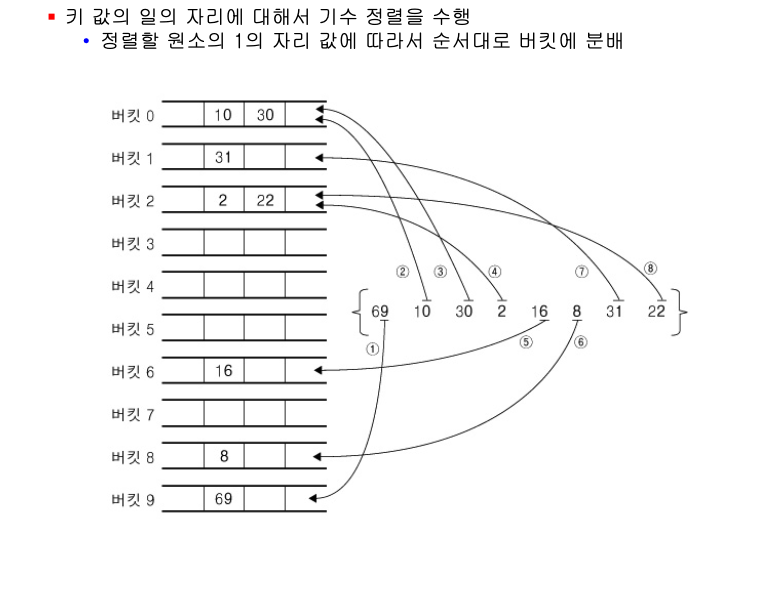
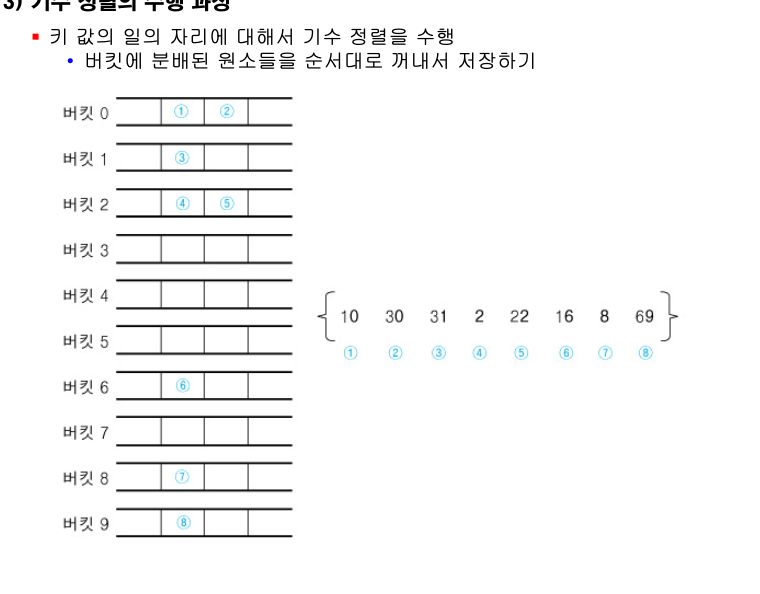
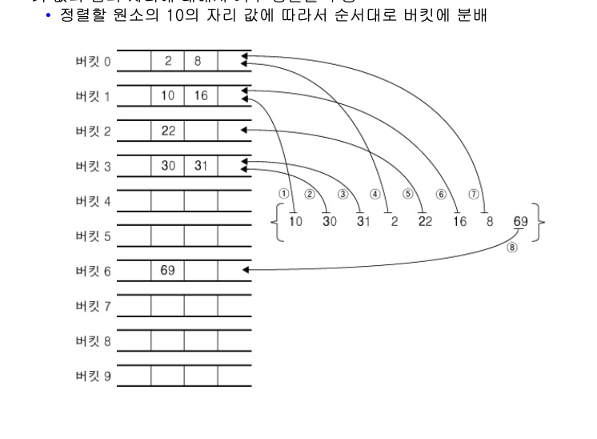
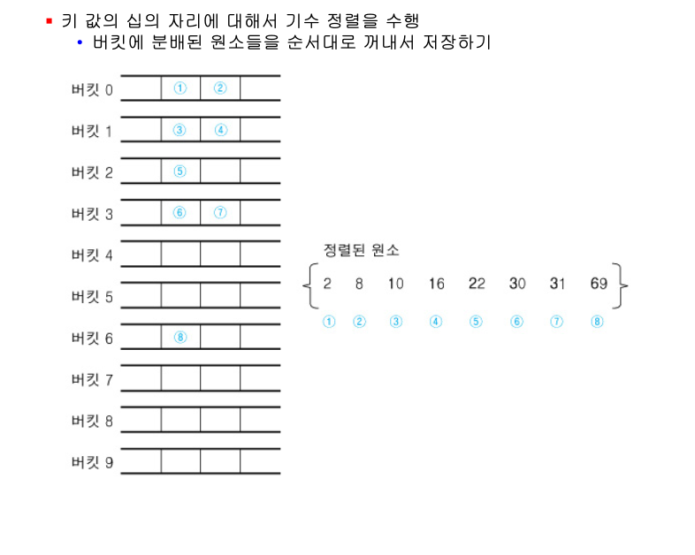
```C
#define BUCKETS 10 // 10진수의 경우
#define DIGITS 4   // 최대 자릿수
// 큐 쓰는이유: 같은 자릿수 값일 때 먼저 들어온 숫자가 먼저 나가야 이전 단계의 정렬 상태가 유지됩니다.
// 기수 정렬 의사 코드 (LSD 방식)
void radix_sort(int list[], int n) {
    Queue buckets[BUCKETS]; // 큐 배열 생성
    int factor = 1; // 자릿수 계산을 위한 변수 (1 -> 10 -> 100 -> 1000 순으로 증가)
	
    // 1의 자리부터 시작해서 가장 높은 자릿수(DIGITS)까지 반복합니다.
    for (int d = 0; d < DIGITS; d++) { //자릿수만큼 반복
        // 1. 분배 (Distribute)
        for (int i = 0; i < n; i++) {
	        // 현재 자릿수의 값을 추출
            int digit = (list[i] / factor) % 10;
            // 계산된 자릿수(0~9)에 해당하는 큐에 데이터를 넣습니다.
	        // 아무순서로 넣어도 우선순위큐라서 정렬
            enqueue(&buckets[digit], list[i]);
        }
			
        // 2. 수집 (Collect)
        int i = 0; // 원본 배열 0번 인덱스부터 다시 덮어쓰기 위해 초기화
        for (int b = 0; b < BUCKETS; b++) { // 0번 버킷부터 끝까지 순서대로 방문
            while (!is_empty(&buckets[b])) {
            // 큐에서 꺼낸 값을 list 배열에 차례대로 저장
                list[i++] = dequeue(&buckets[b]);
            }
        }
        // 다음 자릿수로 넘어가기 위해 factor를 10배 증가시킴
        factor *= 10; 
    }
}
```


> "기수 정렬은 왜 실수(Float)에는 적용하기 어려운가? 컴퓨터는 실수를 어떻게 저장하는가?"

부동소수점은 비트 전체를 단순 정수처럼 해석해서 정렬하기 어렵다 (지수부와 가수부의 가중치가 다름)

- **저장 방식 (IEEE 754):** `부호(1bit)` + `지수(8bit/11bit)` + `가수(23bit/52bit)`
- **정밀도 문제 (Precision):**
    - $0.1$을 2진수로 표현하면 무한 소수(순환 소수)가 된다. ($0.00011001100…$)
    - 컴퓨터는 이를 유한한 비트에 욱여넣으면서 잘라내므로, $0.1 + 1.1 \neq 1.2$와 같은 오차가 발생한다.
### 💡 Interview

> [!faq]- Q 기수 정렬(Radix Sort)이 $O(N)$의 시간 복잡도를 가짐에도 불구하고 퀵 정렬보다 범용적으로 쓰이지 않는 이유는?
>
> 🗣️ 핵심 답변
>
> - 기수 정렬은 데이터 타입이 자릿수가 있는 정수나 문자열로 한정적이고 기수크기만큼의 추가 메모리가 필요하기 때문입니다.
>
> **📚 꼬리질문 대비**
> - **범용성 부족:** 퀵 정렬은 비교 연산만 가능하다면 실수, 객체 등 모든 타입에 적용 가능하지만, 기수 정렬은 자릿수가 있는 정수나 문자열 등 특정 타입에만 적용 가능합니다.
>     
> - **공간 복잡도:** 기수 정렬은 버킷을 위한 추가 메모리가 필수적인 반면, 퀵 정렬은 제자리 정렬(In-place Sort)이 가능하여 메모리 효율이 좋습니다.
> 
> - **Q. 버킷 내부 자료구조로 Stack을 쓰면 안 되는 이유는?**
>     
>     - 스택(LIFO)을 사용하면 입력 순서가 역순이 되어 **정렬의 안정성(Stability)** 이 깨지기 때문입니다. 이전 자릿수에서 정렬된 순서를 유지하려면 반드시 큐(FIFO)를 써야 합니다.
>         

> [!faq]- Q 컴퓨터에서 $0.1 + 0.2 == 0.3$ 이 False인 이유는 무엇인가? (카카오 기술면접 기출)
>
> 🗣️ 핵심 답변
>
> 10진수 0.1과 0.2는 2진수로 변환 시 무한 순환 소수가 됩니다. 컴퓨터의 부동소수점(Floating Point) 방식은 가수부(Mantissa)의 비트 수 제한(32bit 기준 23bit)으로 인해 값을 잘라내어 근사치로 저장하므로, 이를 더한 결과가 정확히 0.3과 일치하지 않는 미세한 오차가 발생하기 때문입니다.
>
> **📚 꼬리질문 대비**
>
> - **Q. 그럼 이 문제를 코딩에서 어떻게 해결해야 하는가?**
>     
>     - `Epsilon`이라는 아주 작은 임계값을 정의하여, 두 수의 차이가 엡실론보다 작은지 비교하는 방식을 사용하거나, 금융권 등 정밀도가 중요한 분야에서는 `BigDecimal`(Java) 같은 고정 소수점 라이브러리를 사용합니다.
>


## Topic 1. 그래프의 정의와 모델링 (Why & What)

### 1. 🏗️ 빌드업 (Why?)

> **"선형 리스트나 트리(Tree)만으로는 표현할 수 없는 복잡한 관계는 어떻게 다룰 것인가?"**

- **현실의 복잡성:** 단순한 계층(Hierarchy)이나 순서(Linear)가 아닌, 복잡하게 얽힌 망(Network) 구조를 표현해야 합니다.
    - _예: 지하철 노선도, 선수 과목(Prerequisite), SNS 친구 관계, 전력망 등._
- **모델링(Modeling):** 현실 세계의 **객체(Object)**와 그들 간의 **관계(Relationship)**를 컴퓨터가 이해할 수 있도록 추상화하는 과정입니다.
    
### 2. 그래프란?

- **구조적 특징:** 정점(Vertex)과 간선(Edge)으로 구성되며, 오일러 경로 등의 수학적 배경을 가짐.
- **유형 분류:** 방향성 유무(무방향/방향), 연결 상태(완전), 가중치 유무(네트워크)에 따라 나뉨.
- **구현 방식:** 인접 행렬(2차원 배열)과 인접 리스트(연결 리스트)의 장단점 비교.
- **트리(Tree)와의 관계:** 트리는 그래프의 특수한 형태(부분 집합)입니다.
    - **트리의 조건:** 사이클(Cycle)이 없음, 계층 구조, $N$개 노드일 때 항상 $N-1$개의 간선 존재.

---

## Topic 2. 그래프의 구조와 핵심 용어

### 1. 구성 요소

- **정점 (Vertex, Node):** 객체 그 자체를 표현 ($V_i$).
- **간선 (Edge, Link):** 정점들 사이의 연결 관계.
    - **인접 (Adjacency):** 정점이 간선으로 연결됨 (예: 정점 A와 B는 인접하다)
    - **부속 (Incidence):** **간선**이 특정 정점에 연결된 상태. (예: 간선 e는 정점 A에 부속된다)
	- **차수 (degree):** 해당 정점의 간선의수
	- **최대 간선 수:** n개의 정점으로 이루어진 그래프가 가질수있는 최대 간선 수
### 2. 경로와 연결성

- **경로 (Path):** 간선을 따라 갈 수 있는 길(정점들의 나열).
	- 경로길이: 간선수
- **단순 경로 (Simple Path):** 중복 방문 없이 진행하는 경로.
- **사이클 (Cycle):** 시작점과 도착점이 동일한 단순 경로.
- **연결 그래프 (Connected Graph):** 모든 정점 쌍 사이에 경로가 존재하는(끊어지지 않은) 그래프.

---

## Topic 3. 그래프의 유형 및 차수 (Degree)

그래프의 형태에 따라 **간선의 최대 개수**와 **차수(Degree)** 계산법이 달라집니다.

### 1. 무방향 그래프 (Undirected Graph)

- **정의:** 간선에 방향이 없음 (양방향 통행). $(A, B) = (B, A)$.
- **차수 (Degree):** 정점에 연결된 간선의 총개수.
- **최대 간선 수:** (양방향 중복을 2로 나눔) $\frac{n(n-1)}{2}$개
> 인접행렬로 구현시 대각선 기준 대칭 행렬이며, 차수는 행+열의 합

### 2. 방향 그래프 (Directed Graph)

- **정의:** 간선에 화살표 방향 존재 (일방통행). $<A, B> \neq <B, A>$
- **구조:** 진출(Tail) $\to$ 진입(Head).
- **차수 (Degree):** 진출차수 + 진입차수
- **최대 간선 수:** $n(n-1)$개.
>인접행렬로 구현시 비대칭행렬 진출: 행, 진입: 열
### 3. 완전 그래프 (Complete Graph)
- **정의:** 모든 정점이 서로 빠짐없이 연결된 그래프.
- **특징:** 가능한 최대 간선 수를 가짐. (네트워크의 **Mesh형** 구조)
### 4. 가중치 그래프 (Weighted Graph / Network)
- **정의:** 간선에 비용(Cost), 거리(Distance) 등의 **가중치(Weight)** 가 할당된 그래프.
- **활용:** 내비게이션(최단 경로), 다익스트라(Dijkstra) 알고리즘 등.
    
> [!faq]- Q 그래프(Graph)와 트리(Tree)의 결정적인 차이점은 무엇인가?
>
> 🗣️ 핵심 답변
>
> 트리는 **사이클(Cycle)이 없는** 연결 그래프이며, 부모-자식의 **계층(Hierarchical)** 구조를 가지고 루트(Root)가 존재합니다.
> 반면 그래프는 사이클이 존재할 수 있고 계층이나 루트 개념이 없는 망(Network) 구조입니다.
>

> [!faq]- Q 방향 그래프에서 최대 간선 수가 $n(n-1)$인 이유는?
>
> 🗣️ 핵심 답변
>
> 한 정점이 자기 자신을 제외한 나머지 $n-1$개 정점에 화살표를 쏠 수 있고, 정점이 총 $n$개이므로 $n(n-1)$입니다. 무방향과 달리 왕복($A \to B, B \to A$)을 별개로 치므로 2로 나누지 않습니다.
---

## Topic 1. 인접 행렬(Adjacency Matrix)의 구현

### 1. 🏗️ 빌드업 (Why & Context)
> **"사람은 그림으로 이해하지만, 컴퓨터 메모리는 주소와 공간만 존재한다. 화살표 개념이 없는 메모리에 어떻게 저장할 것인가?"**
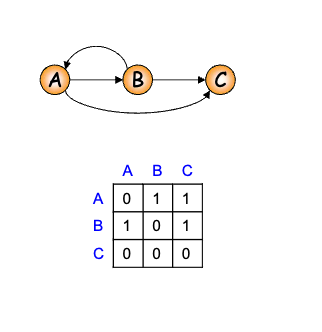
- **구조:** $N$개의 정점을 $N \times N$ 크기의 **2차원 배열**로 표현.
- **값의 의미:** `1` (연결됨), `0` (연결 안 됨),
	- 가중치 인접행렬의 경우 간선이 없으면 `0` 대신 **`무한대`** 로 표시.
- **장점:**
    - **간선 조회:** 두 정점 $u, v$가 연결되었는지 확인하려면 `M[u][v]`만 보면 되므로 **$O(1)$** 로 매우 빠르다.
    - **차수 계산:** 특정 행(또는 열) 전체를 더하면 되므로 $O(N)$이다.
- **단점:**
    - **전체 간선 탐색:** 모든 간선을 찾으려면 행렬 전체를 훑어야 하므로 **$O(N^2)$** 의 시간이 걸린다.
	- **희소 행렬(Sparse Matrix)**: 정점 수에 비해 간선이 매우 적은 경우, 행렬의 대부분이 `0`으로 채워져 메모리가 심각하게 낭비된다.
### Code 구현(다른것 본다음에 확인)

배열을 이용한 그래프 초기화 및 정점/간선 삽입 로직이다.

```C
#define MAX_VERTICES 50

typedef struct GraphType {
    int n; // 정점의 개수
    int adj_mat[MAX_VERTICES][MAX_VERTICES];
} GraphType;

// 그래프 초기화
void init(GraphType* g) {
    int r, c;
    g->n = 0; // 정점 개수 0으로 초기화
    for (r = 0; r < MAX_VERTICES; r++)
        for (c = 0; c < MAX_VERTICES; c++)
            g->adj_mat[r][c] = 0; // 모든 값을 0으로 채움
}

// 정점 삽입 (Vertex Insertion)
void insert_vertex(GraphType* g, int v) {
    if (((g->n) + 1) > MAX_VERTICES) {
        printf("Graph: 정점 개수 초과\n");
        return;
    }
    g->n++; // 단순히 카운트만 증가시킴 (배열 인덱스 확장 개념)
}

// 간선 삽입 (Edge Insertion)
void insert_edge(GraphType* g, int start, int end) {
    if (start >= g->n || end >= g->n) {
        printf("Graph: 정점 번호 오류\n");
        return;
    }
    // 무방향 그래프 가정 (대칭)
    g->adj_mat[start][end] = 1;
    g->adj_mat[end][start] = 1;
}
```

- **⚠️ 주의사항**: `insert_vertex` 호출 시 실제로 메모리를 할당하는 것이 아니라, `g->n` 카운터를 늘려 배열의 유효 범위를 확장하는 개념이다. 50개를 넘어가는 51번째 정점이 들어오면 배열 크기 제한(Static allocation)으로 인해 오버플로우 처리를 해야 한다.
    

---

## Topic 2. 인접 리스트(Adjacency List)의 핵심 개념

### 1. 🏗️ 빌드업 (Why & Context)
> "정점은 100개인데 간선은 5개뿐이라면, $100 \times 100$ 행렬을 만드는 것은 낭비 아닌가?" ( $10,000 \times 4$Byte = 40KB)가 필요하다.
> "연결된 놈들만 리스트로 엮자"

- **헤더 노드 배열 :** 정점의 개수($N$)만큼의 **포인터 배열**을 만듭니다. 각 칸은 정점연결리스트의 **주소**를 가리킵니다.
- **정점 연결 리스트:** 각 정점 포인터 뒤에, 해당 정점과 **실제로 연결된(인접한) 정점들만** 노드로 만들어 연결합니다.


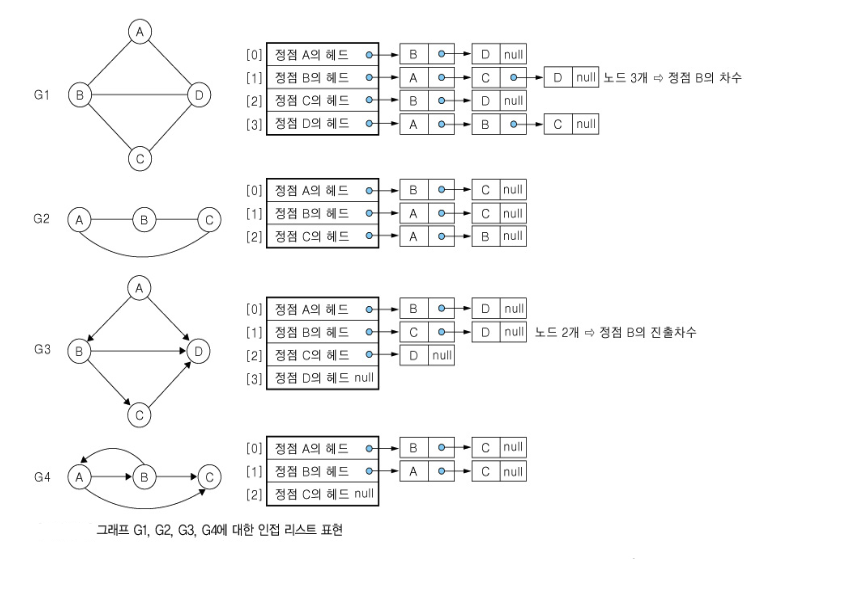
### 2. ⚠️ 핵심 오개념 교정 (Crucial Misconception)

> [!warning] **학생들이 많이 틀림** 리스트 $A \to B \to C$
> - **잘못된 해석:**"A에서 B로 가고, B에서 C로 가는구나"라고 **경로(Path)**로 해석하면 절대 안 된다.
> - **올바른 해석**: "A는 B와 연결되어 있고, A는 (또한) C와도 연결되어 있다." 즉, 순서는 구현 편의상 오름차순 정렬할 뿐이다.
>     

### 3. 그래프 종류별 인접리스트 특징

- **무방향 그래프**: 간선 하나당 노드가 2개씩 생성된다
	- 간선 $(A, B)$가 있으면, $A$의 리스트에 $B$가 있어야 하고, $B$의 리스트에도 반드시 $A$가 있어야 한다. (중복 저장됨)
- **방향 그래프:** 총 노드 수 = 간선 수.
	- $A \rightarrow B$라면, $A$의 리스트(진출 차수 기준)에만 $B$가 저장된다. $B$의 리스트에는 $A$가 없다.

## 인접 리스트 구현 다른거 본다음에 확인

### 1. 자료구조 정의

```C
// 연결 리스트의 노드 구조체
typedef struct GraphNode {
    int vertex;             // 연결된 정점 번호
    int weight; // 가중치 필요 시 추가
    struct GraphNode* next; // 다음 노드 포인터
} GraphNode;

// 그래프 구조체 (포인터 배열 사용)
typedef struct GraphType {
    int n; // 정점의 개수
    GraphNode* adj_list[MAX_VERTICES]; // 헤드 노드 포인터 배열
} GraphType;
```

### 2. 포인터 배열에 대한 이해 (Professor's Emphasis)

- `GraphNode* adj_list[MAX_VERTICES]`의 의미:
    - 각 칸에 저장되는 값이 **`GraphNode`형 데이터의 주소값(포인터)** 인 배열이다.
    - 즉, `adj_list[0]`은 0번 정점에 연결된 첫 번째 노드의 주소를 담고 있다.
    - 포인터 변수 자체의 크기는 무조건 **4바이트(32bit) 또는 8바이트(64bit)** 이다. 가리키는 데이터가 아무리 커도 포인터 변수의 크기는 일정하다는 점을 명심할 것.
 
### Code 구현 (초기화 및 간선 삽입)

```C
// 초기화
void init(GraphType* g) {
    int v;
    g->n = 0;
    for (v = 0; v < MAX_VERTICES; v++) {
        g->adj_list[v] = NULL; // 모든 헤드 포인터를 NULL로 초기화
    }
}

// 간선 삽입 (방향 그래프: u -> v)
// 무방향일 경우 insert_edge(g, u, v); insert_edge(g, v, u); 두 번 호출
void insert_edge(GraphType* g, int u, int v) {
    if (u >= g->n || v >= g->n) return;
    
    // 1. 새로운 노드 생성(동적할당)
    GraphNode* node;
    node = (GraphNode*)malloc(sizeof(GraphNode));
    node->vertex = v;
    
    // 2. 리스트의 맨 앞에 삽입 (가장 쉬운 방법)
    // 기존 헤드가 가리키던 놈을 새 노드의 뒤에 붙임
    node->link = g->adj_list[u];
    // 새 노드를 헤드로 설정
    g->adj_list[u] = node;
    
    // ※ 주의: 위 코드는 역순으로 저장됨 (나중에 넣은게 앞에 옴).
    // 오름차순 유지를 원한다면 순회하여 위치를 찾는 로직이 추가로 필요함.
}
```

---


### 💡 Interview
> [!faq]- Q 인접 행렬 vs 인접 리스트, 언제 무엇을 쓰는가?**
>
> 🗣️ 핵심 답변
>
> 간선이 많은 **밀집 그래프(Dense Graph)**라면 인접 행렬이 구현이 쉽고 간선 조회($O(1)$)가 빨라 유리합니다.
> 반면, 간선이 적은 **희소 그래프(Sparse Graph)** 라면 인접 리스트가 메모리를 훨씬 적게 차지하므로 효율적입니다. 인접리스트의 단점은 연결 여부를 확인할때 리스트를 모두 탐색해야합니다.
>
> **📚 공간 복잡도 비교**
>
> - 인접 행렬: $O(V^2)$ (무조건 $N \times N$ 할당)
> - 인접 리스트: $O(V + E)$ (실제 존재하는 간선만큼만 할당)
>

> [!faq]- Q 인접 행렬에서 방향/무방향 그래프의 차이는?
>
> 🗣️ 핵심 답변
>
> 가장 큰 차이는 **대칭보장**입니다.
>
> 무방향 그래프는 $A \to B$와 $B \to A$가 같으므로 행렬이 **대칭(Symmetric)**입니다. 방향 그래프는 대칭이 보장되지 않으며, 행의 합은 나가는 간선(Out-degree), 열의 합은 들어오는 간선(In-degree)을 의미합니다.
>
> **📚 꼬리질문 대비**
>
> - **Q. 방향 그래프의 인접 행렬에서 행(Row)의 합과 열(Column)의 합은 각각 무엇을 의미하는가?**
>     
>     - 행의 합은 해당 정점에서 나가는 간선의 수인 **진출 차수(Out-degree)**를, 열의 합은 해당 정점으로 들어오는 간선의 수인 **진입 차수(In-degree)**를 의미합니다.

> [!faq]- Q 인접 리스트(Adjacency List)에서 $A$ 정점의 리스트가 $B \to C$ 순서로 되어 있다면, 이것은 $A$에서 $B$를 거쳐 $C$로 간다는 뜻인가?
>
> 🗣️ 핵심 답변
>
> 아닙니다. 인접 리스트의 순서는 경로(Path)가 아니라 **단순한 인접 집합(Neighbor Set)**의 저장 순서일 뿐입니다.
>
> 즉, $A$는 $B$와 연결되어 있고, $A$는 $C$와도 연결되어 있다는 뜻이며, $B$와 $C$ 사이의 연결 관계는 이 리스트만으로는 알 수 없습니다.
>
> **📚 꼬리질문 대비**
>
> - **Q. 그렇다면 인접 리스트 방식은 언제 유리한가?**
>     
>     - 정점의 개수($V$)에 비해 간선의 개수($E$)가 적은 **희소 그래프(Sparse Graph)**일 때 메모리를 $O(V+E)$만큼만 사용하여 효율적입니다. 또한 특정 정점에 연결된 모든 이웃을 탐색할 때 행렬($O(V)$)보다 빠른 실제 간선 수($O(Degree(v))$)만큼의 시간이 소요됩니다.
>         

> [!faq]- Q 인접 리스트 구현 시 GraphNode* list[MAX]와 같은 포인터 배열을 사용하는 이유는?
>
> 🗣️ 핵심 답변
>
> 각 정점마다 연결된 리스트의 **시작 주소(Head Pointer)**를 관리하기 위함입니다. 배열의 인덱스를 정점 번호로 사용하여 $O(1)$에 해당 정점의 리스트에 접근할 수 있습니다.
---

## Topic 1. 그래프 탐색(Graph Traversal)의 개요

- **그래프 탐색 정의**: 하나의 시작 정점에서 출발하여, 연결된 모든 정점들을 **빠짐없이, 중복 없이 한 번씩 방문**하는 연산.
### 2. 탐색의 두 가지 전략

1. **깊이 우선 탐색 (DFS, Depth First Search):** 한 방향으로 갈 수 있을 때까지 깊게 파고들다가 막히면 처음 갈림길로 돌아온다. (스택 사용)
2. **너비 우선 탐색 (BFS, Breadth First Search):** 시작점 주변부터 얕고 넓게 훑으며 퍼져나간다. (큐 사용)
---

## Topic 2. 깊이 우선 탐색 (DFS: Depth First Search)

### Concept

#### 1) 동작 메커니즘

1. 시작 정점 $V$를 방문하고, **방문 표시(Visited Mark)**를 남긴다.
2. $V$에 인접한 정점 중 **방문하지 않은 정점 $W$**가 있다면:
    - 현재 정점 $V$를 스택에 저장(나중에 돌아오기 위해).
    - $W$로 이동하여 방문. (이제 $W$가 새로운 $V$가 됨).
3. 인접한 모든 정점을 이미 방문했다면:
    - 스택에서 하나를 꺼내(Pop) 이전 위치로 되돌아감.
4. 스택이 빌 때까지 반복.
## Topic 3. DFS의 구현 (Code Implementation)

- **구현 방식**:
    1. **재귀(Recursion)**: 함수 호출 자체가 스택 프레임에 쌓이는 원리를 이용 (코드가 간결함).
    2. **반복문 + 스택**: 명시적으로 스택 자료구조를 사용하여 구현.
- **방문 배열 (`visited[]`)**: 무한 루프(사이클)에 빠지지 않기 위해 반드시 방문 여부를 기록해야 한다 (`True/False` or `1/0`).
    

### Code 구현 (C언어 - 재귀 방식)

#### 1) 인접 행렬(Adjacency Matrix) 기반

- **특징**: `adj_mat[v][w]`가 1인지 확인하기 위해 $W$를 0부터 $N$까지 모두 훑어야 한다.
- **시간복잡도**: $O(V^2)$ (모든 정점에서 모든 정점을 스캔하므로).

```C
#define TRUE 1
#define FALSE 0

// visited 배열: 방문했으면 1(TRUE), 아니면 0(FALSE)
int visited[MAX_VERTICES];

// 인접 행렬용 DFS(g: 그래프 포인터, v: 현재 방문 중인 정점)
void dfs_mat(GraphType* g, int v) {
    visited[v] = TRUE;      // 1. 현재 정점 방문 표시
    printf("%d -> ", v);   // 2. 정점 처리 (출력)

    // 3. 인접 정점 탐색 (0부터 N-1까지 순회)
    for (int w = 0; w < g->n; w++) {
		// g->adj_mat[v][w]: 간선이 존재하고
        // !visited[w]: 아직 방문하지 않은 정점이라면
        if (g->adj_mat[v][w] && !visited[w]) {
            dfs_mat(g, w);// 4. 재귀 호출 (깊이 우선 탐색)
        }
    }
}
```

#### 2) 인접 리스트(Adjacency List) 기반

- **특징**: `g->adj_list[v]`에 연결된 노드만 따라가면 된다. 0인(연결 안 된) 구간을 검사할 필요가 없다.
- **시간복잡도**: $O(V + E)$ (모든 정점 방문 + 모든 간선 확인).

```C
// 인접 리스트용 DFS
void dfs_list(GraphType* g, int v) {
    GraphNode* w;
    visited[v] = TRUE;      // 1. 방문 처리
    printf("%d -> ", v);

    // 2. 연결 리스트 순회 (해당 정점에 연결된 것만 봄)
    for (w = g->adj_list[v]; w; w = w->link) {
        // 방문하지 않은 정점이라면
        if (!visited[w->vertex]) {
            dfs_list(g, w->vertex); // 3. 재귀 호출
        }
    }
}
```

### ⚠️ (놓치기 쉬운 포인트)

- **논리적 동치성**: 인접 행렬로 짜든 인접 리스트로 짜든, 그래프의 모양이 같다면 **DFS 탐색 결과(방문 순서)**는 동일하게 나와야 한다. (단, 인접 리스트가 오름차순 정렬되어 있다는 가정하에).
- **재귀의 흐름**: `dfs(v)` 함수가 끝나서 리턴된다는 것은, "더 이상 갈 곳이 없어서 이전 갈림길로 돌아간다의 백트래킹"는 의미와 같다.

### 💡 Interview

> [!faq]- Q DFS와 BFS의 가장 큰 차이점과 각각의 사용 사례는?
>
> 🗣️ 핵심 답변
>
> 가장 큰 차이는 탐색 순서와 사용하는 자료구조입니다.
>
> DFS는 '깊이'를 우선하여 한 경로를 끝까지 탐색하며 **스택(Stack)**을 사용하고, BFS는 '너비'를 우선하여 인접한 노드를 모두 방문한 뒤 나아가며 **큐(Queue)**를 사용합니다.
>
> DFS는 미로 찾기나 위상 정렬 등에 주로 쓰이고, BFS는 최단 경로(Shortest Path) 보장이 필요한 문제(가중치 없는 그래프)에 주로 사용됩니다.

> [!faq]- Q 인접 행렬과 인접 리스트로 DFS를 구현할 때의 시간 복잡도 차이는?
>
> 🗣️ 핵심 답변
>
> 정점의 수를 $V$, 간선의 수를 $E$라고 할 때,
>
> 인접 행렬은 연결 여부와 상관없이 모든 정점을 확인해야 하므로 **$O(V^2)$**의 시간이 소요됩니다.
>
> 반면 인접 리스트는 실제로 연결된 간선만 확인하면 되므로 **$O(V + E)$**의 시간이 소요됩니다. 따라서 **희소 그래프(Sparse Graph)**에서는 인접 리스트가 훨씬 효율적입니다.

> [!faq]- Q DFS를 재귀(Recursion)로 구현할 때 발생할 수 있는 잠재적 문제점은?
>
> 🗣️ 핵심 답변
>
> 그래프의 깊이가 매우 깊을 경우(노드가 많을 경우), 시스템 스택(System Stack) 영역을 과도하게 사용하여 **스택 오버플로우(Stack Overflow)**가 발생할 수 있습니다.
>
> **📚 해결 방안**
>
> - 재귀 대신 명시적인 스택 자료구조(`std::stack` 등)를 사용하여 반복문(Iterative) 형태로 구현하면 힙 메모리를 쓰므로 오버플로우 위험을 줄일 수 있습니다.


## Topic 2. BFS (Breadth First Search) 개념 & 원리

### Concept

- **핵심 자료구조:** **큐 (Queue)** (FIFO - 먼저 들어온 놈이 먼저 나간다).
- **작동 원리:**
    
    1. 시작 노드를 큐에 넣고(Enqueue), 방문 표시.
    2. 큐에서 노드를 하나 꺼냄(Dequeue) -> `V`.
    3. `V`와 인접한 노드 중 방문하지 않은 **모든** 노드를 큐에 넣고 방문했다고 표시.
    4. 큐가 빌 때까지(Empty) 반복.
        
- **특징:** 깊게 들어가는 것이 아니라 옆으로(너비로) 먼저 퍼짐.
## Topic 3. BFS 순회 시뮬레이션 (함정 주의)

### 1. 🏗️ 빌드업 (Why & Context)

> "시험 문제 내면 다 틀리는 포인트: 시작점이 A가 아닐 때"

- **경고:** 시작점이 루트(A)일 때는 직관적으로 풀기 쉽지만, 중간 노드(예: E, F)에서 시작하면 DFS와 혼동하여 순서를 틀리는 경우가 많음.
- **오개념 경계:** 방금 큐에 넣은 노드에서 바로 다시 출발하려 하면 안 됨(이건 DFS임). 반드시 **큐에서 Dequeue한 노드**를 기준으로 인접 노드를 찾아야 함.
    

### Concept: Node 'E' 시작 시뮬레이션

- **그래프 상황 가정:** (구두 설명 기반 재구성)
    - E와 인접한 노드: B, C, G
    - B와 인접: A, D … 등등
- **Trace (추적 과정):**
    
    1. **Start E:** `Queue: [E]`, `Visited: {E}`
    2. **Dequeue E:** E의 인접 노드(B, C, G) 확인.
        
        - `Queue: [B, C, G]`, `Visited: {E, B, C, G}`
            
    3. **Dequeue B:** B의 인접 노드 중 안 가본 곳(A, D) 확인.
        
        - `Queue: [C, G, A, D]`, `Visited: {…, A, D}` (⚠️ 중요: C나 G로 바로 점프하는 게 아니라 B의 이웃을 큐 뒤에 붙임)
            
    4. **Dequeue C:** C의 인접 노드 확인 (이미 다 갔다면 패스).
    5. **Dequeue G:** G의 인접 노드(F) 확인.
        
        - `Queue: […, F]`, `Visited: {…, F}`
    - **최종 순서:** E -> B -> C -> G -> A -> D -> F (그래프 연결 상태에 따라 달라지나, 핵심은 **레벨 단위 방문**)
        

### Code 구현

```C
void bfs_mat(GraphType* g, int v) {
    int w;
    QueueType q;
    init_queue(&q);     // 큐 초기화
    
    visited[v] = TRUE;  // 1. 시작점 방문
    printf("%d ", v);
    enqueue(&q, v);     // 2. 큐에 삽입
    
    while (!is_empty(&q)) {
        v = dequeue(&q); // 3. 큐에서 기준점 꺼냄
        
        // 4. 꺼낸 정점(v)의 모든 인접 정점(w) 탐색
        for (w = 0; w < g->n; w++) {
            if (g->adj_mat[v][w] && !visited[w]) {
                visited[w] = TRUE; // 방문 표시
                printf("%d ", w);
                enqueue(&q, w);    // 큐에 삽입
            }
        }
    }
}
```

## Topic 4. 그래프 구현과 시간 복잡도

### 1. 🏗️ 빌드업 (Why & Context)

> "인접 행렬로 짤래? 인접 리스트로 짤래?"

- **Context:** 그래프를 코드로 표현하는 방식에 따라 알고리즘의 성능($O$)이 달라진다.
    

### Concept: 시간 복잡도 비교

- **인접 행렬:** $O(N^2)$ (모든 정점 $N$ $\times$ 행 검사 $N$)
	- 정점 $V$ 하나에 대해 모든 정점($N$개)을 다 찔러봐야 연결 여부를 알 수 있음.
- **인접 리스트:** $O(N + E)$ (모든 정점 $N$ + 모든 간선 $E$)
	- 정점 $V$에 연결된 간선($E$)만큼만 확인하면 됨.
    - 희소 그래프(Sparse Graph)일수록 인접 리스트가 유리하다.

### 💡 Interview

> [!faq]- Q DFS와 BFS의 결정적 차이와 각각의 적합한 사용처는?
>
> 🗣️ 핵심 답변
>
> DFS는 **스택(또는 재귀)**을 사용하여 깊이 우선으로 탐색하며, 미로 찾기나 모든 경로를 탐색해야 할 때 적합합니다.
>
> 반면, BFS는 큐를 사용하여 너비 우선으로 탐색하며, 가중치가 없는 그래프에서 최단 경로를 찾을 때 필수적으로 사용됩니다.
>
> **📚 꼬리질문 대비 / 심화**
>
> - **Q: 왜 BFS가 최단 경로를 보장하는가?**
>     
> - A: BFS는 시작점에서 간선 1개 거리의 노드를 모두 방문한 뒤 간선 2개 거리로 넘어가므로, 목적지에 처음 도달했을 때가 가장 적은 간선을 거친 상태임이 보장됩니다.
>     

> [!faq]- Q 인접 행렬과 인접 리스트 중 어떤 것이 효율적인가?
>
> 🗣️ 핵심 답변
>
> 그래프의 간선 밀도(Density)에 따라 다릅니다. 간선이 적은 **희소 그래프(Sparse Graph)**에서는 메모리와 탐색 속도 면에서 $O(N+E)$인 인접 리스트가 훨씬 효율적입니다. 반면, 모든 노드가 연결된 밀집 그래프에서는 구현이 간단한 인접 행렬($O(N^2)$)을 고려할 수 있습니다.

> [!faq]- Q 그래프 탐색 시 방문 여부(visited 배열)를 체크하지 않으면 어떤 문제가 발생하는가?
>
> 🗣️ 핵심 답변
>
> 그래프에 **사이클(Cycle)**이 존재할 경우, 이미 방문한 노드를 계속해서 다시 방문하게 되어 **무한 루프(Infinite Loop)**에 빠지게 됩니다. 이는 프로그램의 종료를 막고 스택 오버플로우(DFS)나 메모리 초과(BFS)를 유발합니다.


# 이걸로 넘어가
> [!NOTE]- ### **🚨 교수님 피셜: "이건 꼭 나온다/틀리지 마라" (강조 사항)**
>
>
> **1. 그래프 탐색 (DFS / BFS) - ★가장 중요★**
>
> - **출제 예고:** "그래프 노드 7~10개 정도 주고, **1번에서 시작하는 DFS, 4번에서 시작하는 BFS…** 이런 식으로만 내도 벌써 4~5문제다."
> - **함정 주의:** 항상 'A'나 '0번' 노드에서 시작하는 것만 연습하지 마세요. **중간 노드(예: E, 4번 등)에서 출발**할 때의 방문 순서를 정확히 쓸 줄 알아야 합니다. (이 부분에서 오답률이 매우 높다고 하셨습니다.)
> - **그리기:** 탐색 결과로 만들어지는 **신장 트리(Spanning Tree)**를 그릴 수 있어야 합니다.
> 
> **2. 최단 경로 (Dijkstra) - ★필수★**
>
> - **출제 예고:** 다익스트라 알고리즘의 단계별 진행 과정을 묻습니다.
> - **핵심:** **`Distance` 배열이 갱신(Relaxation)되는 과정**을 표로 그려가며 손으로 추적(Tracing)할 수 있어야 합니다.
> - 특히 **`D[w] = min(D[w], D[u] + W[u][w])`**라는 갱신 공식이 핵심입니다.
> - **주의:** "눈으로 풀면 무조건 틀린다. 직접 표를 그리고 값을 지워가며 풀어라."
> 
> **3. 최소 비용 신장 트리 (MST - Kruskal & Prim)**
>
> - **비교:** 같은 그래프를 두고 Kruskal로 풀 때와 Prim으로 풀 때의 **진행 순서 차이**를 명확히 알아야 합니다.
> - **Kruskal:** 간선 가중치 **정렬(Sorting)**이 먼저라는 점, 사이클 확인 과정.
> - **Prim:** **시작 정점**이 주어졌을 때 확장해 나가는 순서.
>     
> **4. 힙 (Heap) 자료구조**
>
> - **삭제/삽입 로직:** 힙에서 원소(루트)가 삭제될 때, **맨 마지막 노드가 루트로 올라가서** 자식들과 비교하며 제자리를 찾아가는 과정(Re-heapify)을 이해해야 합니다.
> 
> **5. 정렬 (Sorting)**
>
> - **퀵 정렬:** 피벗(Pivot)을 기준으로 분할되는 과정.
> - **합병 정렬:** 분할 정복의 순서 (쪼개고 나서 합친다).
>     
> 
> **6. 시간 복잡도 (Time Complexity)**
>
> - **비중:** "나와봐야 한 문제 아니면 안 나옴."
> - **내용:** 주어진 코드(반복문 중첩 등)를 보고 $O(N)$, $O(N^2)$, $O(\log N)$ 등을 판별하는 기본 개념.

# 시험
## Topic 2. 신장 트리 (MST): 그래프의 모든 정점을 간선수를 최소화해 포함하고, 사이클이 없다 이걸 DFS, BFS 탐색
다음과 같이 연결된 무방향 그래프가 있습니다.
그래프 연결 상태 (인접 리스트)

- 0번: 1, 2
- 1번: 0, 3, 4
- 2번: 0, 5, 6
- 3번: 1, 7
- 4번: 1, 7
- 5번: 2, 7
- 6번: 2
- 7번: 3, 4, 5
---
### **🚀 [심화 분석] 4번 노드 시작 DFS 추적 (Code Tracing)**

```C
// DFS를 이용한 신장 트리 간선 표시
void DFS_SpanningTree(int v) {
    visited[v] = TRUE;
    
    for (node w = start; w < end; w++) {
        if (is_connected(v, w) && !visited[w]) {
            // v와 w를 연결하는 간선은 신장 트리의 구성 요소임
            printf("Tree Edge: (%d, %d)\n", v, w); 
            DFS_SpanningTree(w);
        }
    }
}
```
---
- **자료구조:** **시스템 스택 (재귀 호출 스택)**
- **원리:** 한 놈만 팬다 (깊게 들어감). 막히면 돌아온다(Backtracking).
- **표기:** `Bottom [ … ] Top` (오른쪽이 현재 실행 중인 노드)

| **현재 실행 함수**    | **동작 설명**                             | **Visited (방문확정)**    | **스택(Stack) 상태**        |
| --------------- | ------------------------------------- | --------------------- | ----------------------- |
| -               | 초기 상태                                 | -                     | `[]`                    |
| **DFS(4)**      | 4번 방문. 인접(1, 7) 중 작은 **1**로 이동        | {4}                   | `[4]`                   |
| **DFS(1)**      | 1번 방문. 인접(0, 3, 4) 중 안 간 **0**으로 이동   | {4, 1}                | `[4, 1]`                |
| **DFS(0)**      | 0번 방문. 인접(1, 2) 중 안 간 **2**로 이동       | {4, 1, 0}             | `[4, 1, 0]`             |
| **DFS(2)**      | 2번 방문. 인접(0, 5, 6) 중 안 간 **5**로 이동    | {4, 1, 0, 2}          | `[4, 1, 0, 2]`          |
| **DFS(5)**      | 5번 방문. 인접(2, 7) 중 안 간 **7**로 이동       | {4, 1, 0, 2, 5}       | `[4, 1, 0, 2, 5]`       |
| **DFS(7)**      | 7번 방문. 인접(3, 4, 5) 중 안 간 **3**으로 이동   | {4, 1, 0, 2, 5, 7}    | `[4, 1, 0, 2, 5, 7]`    |
| **DFS(3)**      | 3번 방문. 인접(1, 7) 모두 방문함. **Back**      | {4, 1, 0, 2, 5, 7, 3} | `[4, 1, 0, 2, 5, 7, 3]` |
| **DFS(7)** (복귀) | 7번으로 복귀. 남은 인접(4, 5) 모두 방문함. **Back** | (변화 없음)               | `[4, 1, 0, 2, 5, 7]`    |
| **DFS(5)** (복귀) | 5번으로 복귀. 남은 인접(2) 방문함. **Back**       | (변화 없음)               | `[4, 1, 0, 2, 5]`       |
| **DFS(2)** (복귀) | 2번으로 복귀. 남은 인접(6) 안 갔음. **6**으로 이동    | (변화 없음)               | `[4, 1, 0, 2]`          |
| **DFS(6)**      | 6번 방문. 인접(2) 모두 방문함. **Back**         | {…, 7, 3, **6**}      | `[4, 1, 0, 2, 6]`       |
| 복귀… DFS(2)      | 2번으로 복귀. 할 일 끝. **Back**              | (변화 없음)               | `[4, 1, 0, 2]`          |
| 복귀… DFS(0)      | 0번으로 복귀. 할 일 끝. **Back**              | (변화 없음)               | `[4, 1, 0]`             |
| 복귀… DFS(1)      | 1번으로 복귀. 할 일 끝. **Back**              | (변화 없음)               | `[4, 1]`                |
| 복귀… DFS(4)      | 4번으로 복귀. 할 일 끝. **Back**              | (변화 없음)               | `[4]`                   |
| -               | 스택 비움. 종료.                            | (변화 없음)               | `[]`                    |

👉 **DFS 최종 방문 순서:** `4 -> 1 -> 0 -> 2 -> 5 -> 7 -> 3 -> 6`
1. **3번에서 멈추지 않았는가?**
    - 3번까지 갔다가 막혔을 때, 그냥 끝내버리는 학생들이 많습니다.
    - **Backtracking(되돌아가기)**을 통해 `DFS(7)` -> `DFS(5)` -> `DFS(2)`로 돌아와서, 아까 `DFS(2)`에서 처리하지 못한 **6번**을 챙겨가는지 봅니다.
2. **visited 배열 체크:**
    - 이미 방문한 노드(예: 4번에서 1번 갔다가 나중에 1번이 4번을 다시 부를 때)를 다시 방문 목록에 적으면 틀립니다. `visited`가 1이면 함수 호출 자체를 안 합니다.
---

### **🚀 [심화 분석] 너비우선탐색 BFS 추적(4번노드 시작)**
    
- **핵심 코드 (C언어 스타일):**
 
```C
int visited[8] = {0, }; 
Queue q; 

void BFS(int v) {
    // (1) 시작점 처리
    visited[v] = 1;      
    enqueue(&q, v);      

    while(!is_empty(&q)) {   // 큐가 빌 때까지 반복
        v = dequeue(&q);     // (2) 큐에서 꺼냄 (방문 순서 확정)
        printf("%d ", v);

        // (3) 인접 노드 스캔
        for (node in adj[v]) {
            if (visited[node] == 0) {  // 안 가본 곳이면
                visited[node] = 1;     // ★미리 찜(방문체크)★ 하고
                enqueue(&q, node);     // 줄 세우기
            }
        }
    }
}
```

---
BFS는 재귀(함수 호출)가 아니라 \*\*큐(Queue)\*\*를 사용하므로, **"현재 실행 함수"** 열을 \*\*"현재 처리 노드 (Dequeue)"\*\*로 변경하여 작성했습니다.
### 2. BFS (너비 우선 탐색) 추적

- **자료구조:** **큐 (Queue)**
- **원리:** 줄 서기 (먼저 발견된 놈이 먼저 나감). **큐에 넣을 때 방문 체크**를 합니다.
- **표기:** `Front [ … ] Rear` (왼쪽에서 나가고, 오른쪽으로 들어옴)
    

| **현재 처리 노드 (Dequeue)** | **동작 설명**                                   | **큐 (Queue) 상태** | **visited 배열 상태 [0 1 2 3 4 5 6 7]**   |
| :--------------------- | ------------------------------------------- | ---------------- | :------------------------------------ |
| **초기화 (Start)**        | 시작 노드 4 방문 체크 및 큐 삽입                        | `[4]`            | `0 0 0 0` **`1`** `0 0 0`             |
| **4번 꺼냄**              | 4 꺼냄. 인접 1, 7 발견. 체크 후 삽입.                  | `[1, 7]`         | `0` **`1`** `0 0` `1` `0 0` **`1`**   |
| **1번 꺼냄**              | 1 꺼냄. 인접 0, 3, 4.<br>(4는 갔음). 0, 3 체크 후 삽입. | `[7, 0, 3]`      | `1` **`1`** `0` **`1`** `1` `0 0` `1` |
| **7번 꺼냄**              | 7 꺼냄. 인접 3, 4, 5.<br>(3, 4는 갔음). 5 체크 후 삽입. | `[0, 3, 5]`      | `1 1 0 1 1` **`1`** `0 1`             |
| **0번 꺼냄**              | 0 꺼냄. 인접 1, 2.<br>(1은 갔음). 2 체크 후 삽입.       | `[3, 5, 2]`      | `1 1` **`1`** `1 1 1 0 1`             |
| **3번 꺼냄**              | 3 꺼냄. 인접 1, 7.<br>모두 방문함. (삽입 없음)           | `[5, 2]`         | (변화 없음)                               |
| **5번 꺼냄**              | 5 꺼냄. 인접 2, 7.<br>모두 방문함. (삽입 없음)           | `[2]`            | (변화 없음)                               |
| **2번 꺼냄**              | 2 꺼냄. 인접 0, 5, 6.<br>(0, 5는 갔음). 6 체크 후 삽입. | `[6]`            | **`1 1 1 1 1 1 1 1`**                 |
| **6번 꺼냄**              | 6 꺼냄. 인접 2.<br>방문함. (큐가 빔)                  | `[]`             | (변화 없음)                               |

👉 **BFS 최종 방문 순서:** `4 -> 1 -> 7 -> 0 -> 3 -> 5 -> 2 -> 6` (DFS와 결과 다름)
- **중복 삽입 방지:**
    - `visited` 체크를 **큐에서 뺄 때** 한다고 착각하면, 큐에 중복된 노드가 들어갈 수 있습니다. (예: 3번 노드는 1번에서도 보이고 7번에서도 보임. 미리 체크 안 하면 큐에 3이 두 번 들어감).
    - 반드시 **"발견 즉시 체크하고 큐에 넣는다"**는 원칙을 지키세요.
- **Backtracking 여부:**
      * DFS 표에는 "복귀(Return)" 행이 존재하지만, BFS 표에는 복귀 없이 **큐에서 꺼내는(Dequeue) 행위**만 존재합니다.
---
- **DFS**는 `4 -> 1 -> 0 …` 처럼 1번 라인을 타고 끝까지(6번까지) 갔다가 막히면 돌아옵니다.
- **BFS**는 `4`의 친구 `1, 7`을 먼저 챙기고, 그 다음 `1`의 친구와 `7`의 친구를 챙기는 식으로 **거리순(계층순)**으로 퍼져나갑니다.
## 최소 비용 신장 트리 (MST, Minimum Spanning Tree): 간선들의 가중치합 가장 싸게+ 그래프의 모든 정점을 간선수를 최소화해 포함하고, 사이클이 없다
- **Kruskal:** 반드시 **정렬**이 선행되어야 함. 정렬 비용이 전체 성능을 좌우함.
- **Prim:** 정점이 많고 간선이 매우 많은 경우(Complete Graph 등)에는 정렬 비용이 없는 Prim이 유리할 수 있음 ($O(N^2)$ 구현 시).
> [!faq]Q 그리디 알고리즘(Greedy Algorithm)이란 무엇이며, MST에서 어떻게 적용되는가?
>
> 🗣️ 핵심 답변
>
> 그리디 알고리즘은 매 순간 최적이라고 생각되는 선택을 하는 방식입니다. MST를 구하는 Kruskal 알고리즘의 경우, 전체 간선 중 가중치가 가장 작은 간선부터 차례대로 선택(사이클이 생기지 않는다면)하는 방식으로 작동하며, Prim 알고리즘은 현재 연결된 트리에 인접한 간선 중 가장 비용이 적은 것을 선택하며 트리를 확장해 나갑니다.
### 최소비용신장트리- 크루스칼(간선 정렬 동작)
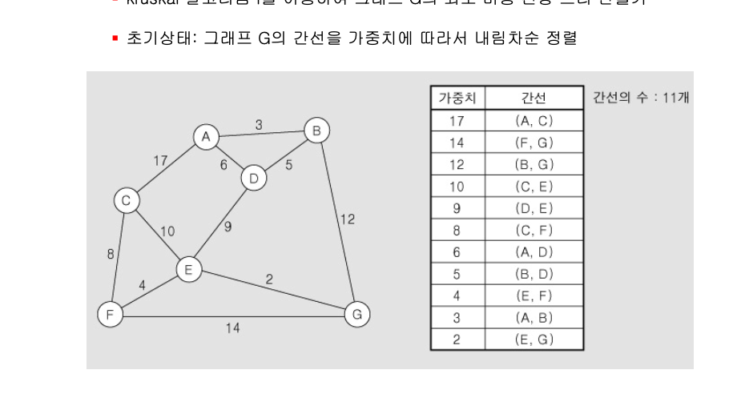
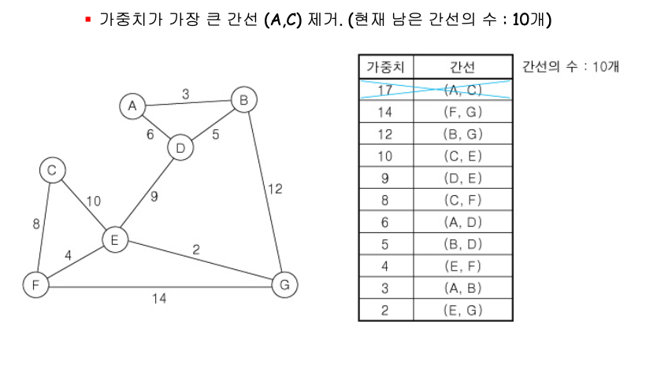
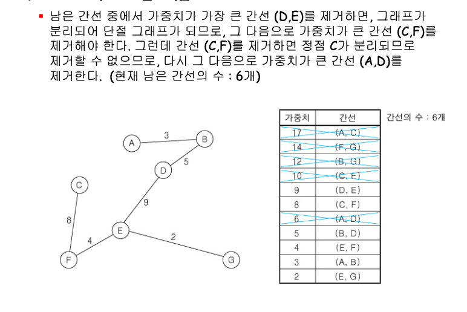
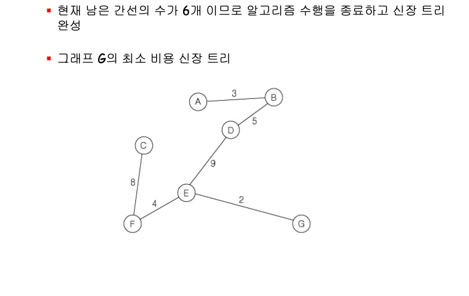
### 최소비용신장트리- 크루스칼 알고리즘 2
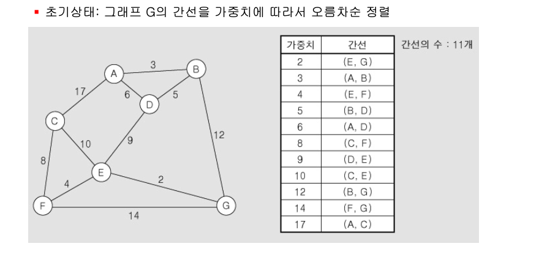
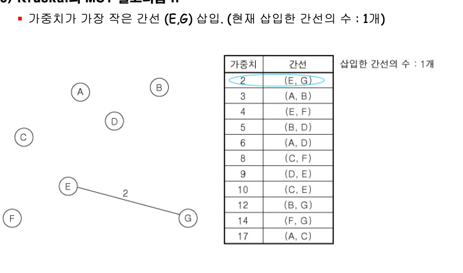
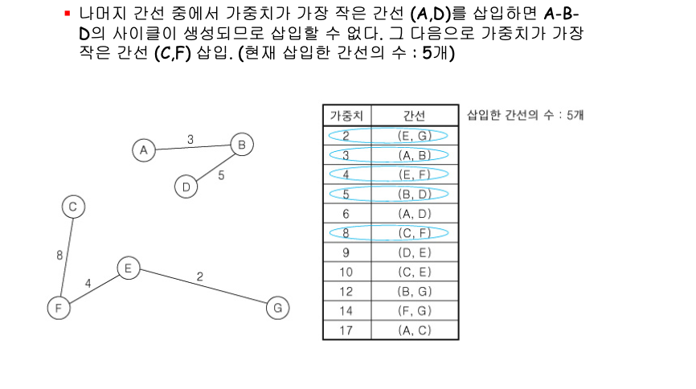
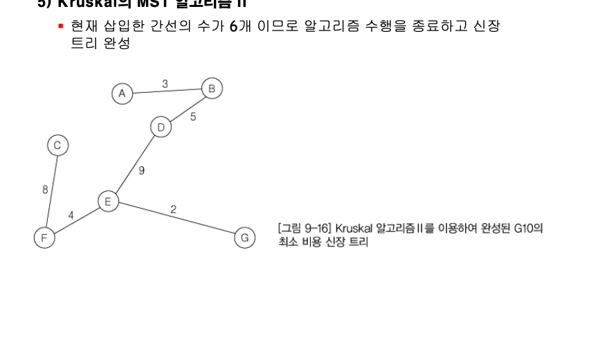
### 정점기반의 PRIM의 최소비용신장트리
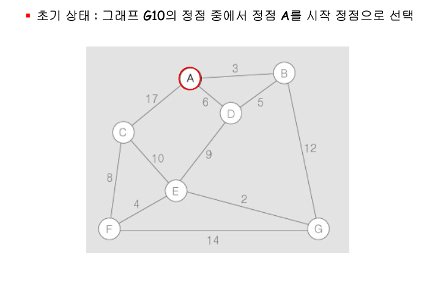
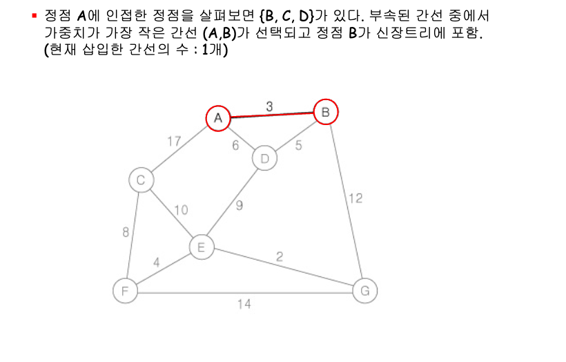
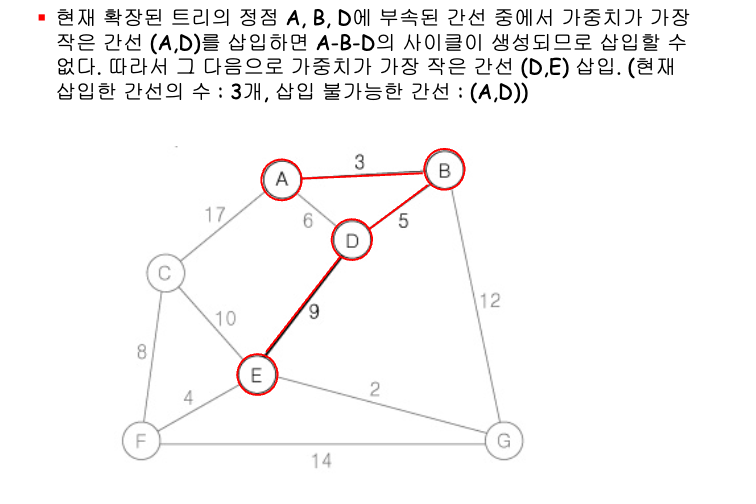
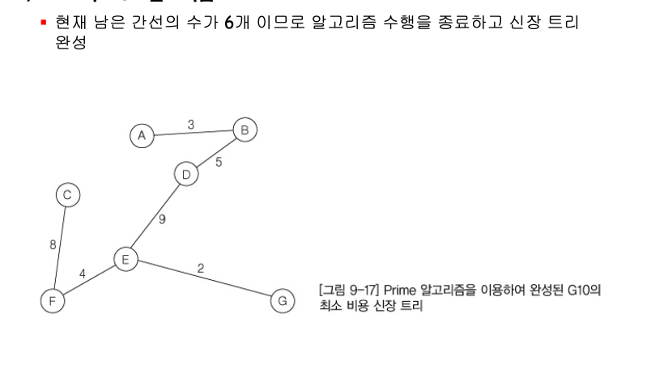
# 최단경로: 다른정점까지의 최단경로(다익스트라, 플로이드)
## 플로이드는 다익스트라를 맨 바깥쪽에 for문을 하나더 감싼것(경유지)
```C
// 핵심 변수
// distance[]: 시작점으로부터의 최단 거리 저장
// found[]: 방문한 정점 표시 (집합 S)
// weight[][]: 가중치 인접 행렬 (초기 그래프 정보)

void dijkstra(int start, int n) {
    // 1. 초기화: 시작점과 연결된 간선 비용으로 distance 배열 세팅
    for(int i=0; i<n; i++) {
        distance[i] = weight[start][i];
        found[i] = FALSE;
    }
    found[start] = TRUE;
    distance[start] = 0;

    // 2. 루프: 시작점을 제외한 n-1개 정점에 대해 반복
    for(int i=0; i<n-1; i++) {
        
        // [Greedy Step]
        // 방문하지 않은 정점 중 distance가 가장 작은 정점 u 반환
        int u = choose(distance, n, found);
        
        found[u] = TRUE; // 집합 S에 추가
		//플로이드이면 바깥 for문
		//for (k = 0; k < n; k++) {// k: 경유지 (반드시 가장 바깥쪽 루프)
        // [Relaxation Step]
        // 새로 추가된 정점 u를 거쳐서 가는 거리가 더 짧으면 갱신
        for(int w=0; w<n; w++) {
            if(!found[w]) { // 아직 방문 안 한 정점에 대해
                // 기존 거리 vs (u까지 거리 + u에서 w로 가는 거리)
                if(distance[u] + weight[u][w] < distance[w]) {
                    distance[w] = distance[u] + weight[u][w];
                }
            }
        }
    }
}
```
### **📝 [실전 모의고사] 문제 2. 다익스트라 (Dijkstra)**

**0번 정점(시작점)**에서 출발하여 다른 모든 정점까지 가는 최단 거리를 구하려고 합니다. 다익스트라 알고리즘의 각 단계별 distance 배열의 변화를 작성하시오. (무한대는 INF로 표기)

---
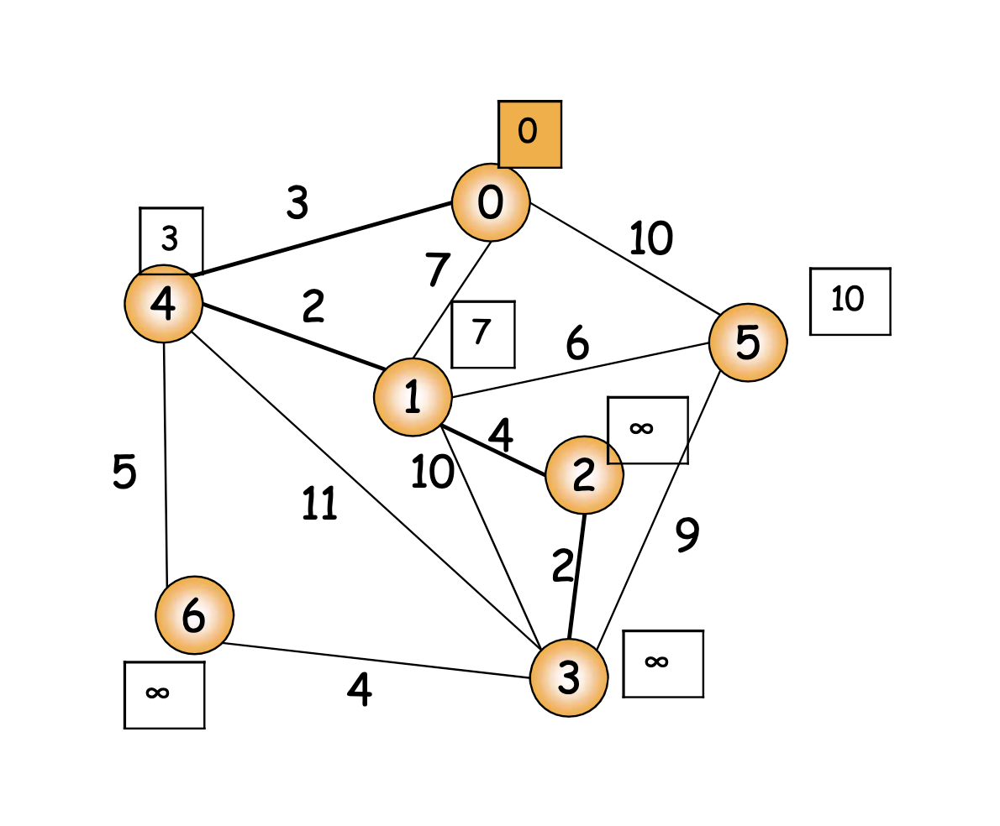
### 🏁 초기화 단계 (Initialization)

코드의 `shortest_path` 함수 초반부 로직입니다.

- **Start Node:** 0번
- **Found(방문여부):** 0번 노드 `TRUE` 설정
- **Distance(거리배열):** 0번 노드와 직접 연결된 간선 가중치로 초기화 (연결 없으면 `INF`)
	- **`distance[i]`의 의미:** **"시작 정점(0번)에서 $i$번 정점까지 가는 최단 거리"**

|**Index**|**0**|**1**|**2**|**3**|**4**|**5**|**6**|
|---|---|---|---|---|---|---|---|
|**Distance**|0|7|INF|INF|3|10|INF|
|**Found**|T|F|F|F|F|F|F|

---

### 🚀 단계별 실행 (Step-by-Step Execution)

알고리즘은 `방문하지 않은 노드(found==FALSE)` 중 `distance`가 **가장 작은 노드(Choose 함수)**를 선택하여 진행합니다.

#### **STEP 1: 노드 4번 선택 (거리 3)**

- **선택 이유:** 남은 노드(1,2,3,4,5,6) 중 `distance[4]=3`이 가장 작음. (`choose` 함수)
- **갱신 로직:** `distance[4] + weight[4][w] < distance[w]` 인지 확인.
- **$S = \{0, 4\}$**

|**대상(w)**|**계산식 (u=4)**|**기존값**|**갱신여부**|**설명**|
|---|---|---|---|---|
|**1번**|3 (거리) + 2 (4→1) = **5**|7|**갱신**|더 빠른 길 발견|
|**3번**|3 (거리) + 11 (4→3) = **14**|INF|**갱신**|첫 경로 발견|
|**6번**|3 (거리) + 5 (4→6) = **8**|INF|**갱신**|첫 경로 발견|

👉 **결과 Distance:** `[0, 5, INF, 14, 3, 10, 8]`

---

#### **STEP 2: 노드 1번 선택 (거리 5)**

- **선택 이유:** 남은 노드(1,2,3,5,6) 중 `distance[1]=5`가 가장 작음. (초기 7에서 5로 줄어든 상태)
 - **$S = \{0, 4, 1\}$**

|**대상(w)**|**계산식 (u=1)**|**기존값**|**갱신여부**|**설명**|
|---|---|---|---|---|
|**2번**|5 (거리) + 4 (1→2) = **9**|INF|**갱신**|첫 경로 발견|
|**3번**|5 (거리) + 10 (1→3) = 15|14|유지|기존(4 경유)이 더 빠름|
|**5번**|5 (거리) + 6 (1→5) = 11|10|유지|기존(0→5 직통)이 더 빠름|

👉 **결과 Distance:** `[0, 5, 9, 14, 3, 10, 8]`

---

#### **STEP 3: 노드 6번 선택 (거리 8)**

- **선택 이유:** 남은 노드(2,3,5,6) 중 값 비교 `[2:9, 3:14, 5:10, 6:8]` → **6번**이 최소.
- **$S = \{0, 4, 1, 6\}$

|**대상(w)**|**계산식 (u=6)**|**기존값**|**갱신여부**|**설명**|
|---|---|---|---|---|
|**3번**|8 (거리) + 4 (6→3) = **12**|14|**갱신**|0→4→6→3 경로가 더 빠름|

👉 **결과 Distance:** `[0, 5, 9, 12, 3, 10, 8]`

---

#### **STEP 4: 노드 2번 선택 (거리 9)**

- **선택 이유:** 남은 노드(2,3,5) 중 값 비교 `[2:9, 3:12, 5:10]` → **2번**이 최소.
- **$S = \{0, 4, 1, 6, 2\}$

|**대상(w)**|**계산식 (u=2)**|**기존값**|**갱신여부**|**설명**|
|---|---|---|---|---|
|**3번**|9 (거리) + 2 (2→3) = **11**|12|**갱신**|0→4→1→2→3 경로가 더 빠름|

> **💡 중요:** 3번 노드까지의 거리는 `INF` → `14` → `12` → `11` 순으로 계속 줄어듭니다.

👉 **결과 Distance:** `[0, 5, 9, 11, 3, 10, 8]`

---

#### **STEP 5: 노드 5번 선택 (거리 10)**

- **선택 이유:** 남은 노드(3,5) 중 `[3:11, 5:10]` → **5번**이 최소.
- **$S = \{0, 4, 1, 6, 2, 5\}$

|**대상(w)**|**계산식 (u=5)**|**기존값**|**갱신여부**|**설명**|
|---|---|---|---|---|
|**3번**|10 (거리) + 9 (5→3) = 19|11|유지|기존 경로가 훨씬 빠름|

👉 **결과 Distance:** `[0, 5, 9, 11, 3, 10, 8]`

---

### ✅ 최종 결과 (Final Result)

모든 과정이 끝난 후 `distance` 배열의 최종 상태는 다음과 같습니다.

| **노드 (Index)** | **0** | **1** | **2** | **3**  | **4** | **5**  | **6** |
| -------------- | ----- | ----- | ----- | ------ | ----- | ------ | ----- |
| **최단 거리**      | **0** | **5** | **9** | **11** | **3** | **10** | **8** |
$$D = [0, \ 5, \ 9, \ 11, \ 3, \ 10, \ 8]$$

**[코드 분석 요약]**

1. **시작:** 0번 노드에서 시작합니다.
2. **4번 노드(3) 선택:** 가장 가까운 4번으로 가서 1번, 6번, 3번의 거리를 단축시킵니다.
3. **1번 노드(5) 선택:** 4번을 거쳐 1번으로 온 뒤, 2번 노드를 발견합니다.
4. **6번 노드(8) 선택:** 4번을 거쳐 6번으로 온 뒤, 3번 가는 길을 `14`에서 `12`로 줄입니다.
5. **2번 노드(9) 선택:** 1번을 거쳐 2번으로 온 뒤, 3번 가는 길을 `12`에서 `11`로 최종 단축시킵니다.
## 1. 정렬 알고리즘 (Sorting Algorithms)

정렬 알고리즘의 **동작 원리**와 **시간 복잡도**를 비교하는 것이 중요합니다.

|   알고리즘    |      분류      |                           핵심 원리                           |   최악 시간 복잡도   |                   비고                   |
| :-------: | :----------: | :-------------------------------------------------------: | :-----------: | :------------------------------------: |
| **퀵 정렬**  |    분할 정복     |                 피벗(Pivot)을 기준으로 분할하여 정렬.                  |   $O(n^2)$    | **최악의 경우(이미 정렬된 상태)** $O(n^2)$이 되므로 주의 |
| **합병 정렬** |    분할 정복     |                 데이터를 반으로 쪼갠 후 다시 병합하며 정렬                  | $O(n \log n)$ |          추가적인 메모리(임시 배열)가 필요함          |
| **힙 정렬**  |      선택      |         최대 힙 또는 최소 힙을 구성하여 루트 노드(최대/최소값)를 추출하며 정렬         | $O(n \log n)$ |        추가 메모리 불필요, **불안정 정렬**.         |
| **기수 정렬** | 비교연산을 하지 않음, | 자릿수별로 버킷(Queue)에 넣고 빼는 연산으로 정렬<br>**LSD** 순서, 큐(Queue) 사용 |  $O(n)$ (선형)  |     정렬할 키 값이 정수로 한정되고 키의 길이가 동일해야함     |
### **2. 핵심 포인트**

- **퀵 정렬 최악의 경우**: 이미 정렬된 데이터에서 첫 번째 원소를 피벗으로 잡을 때 ($N^2$).
- **힙 정렬 삭제 로직**: 루트(최댓값) 삭제 $\to$ **맨 마지막 노드를 루트로 이동** $\to$ 자식과 비교하며 내려감 (Re-heapify).
- **부동소수점 (IEEE 754)**:
    - **Hidden Bit**: 정규화 시 맨 앞 '1'을 생략하여 정밀도 확보.
    - **Bias (바이어스)**: 지수부에 특정 값(127)을 더해 양수화하여 대소 비교 용이.

---

## 2. 그래프 기초 및 탐색 (Graph Basics & Traversal)

그래프의 표현 방식과 **DFS/BFS의 추적 과정**을 이해해야 합니다.

### 2.1. 그래프 표현

|     구분      |          인접 행렬 (Adjacency Matrix)          |                    인접 리스트 (Adjacency List)                    |
| :---------: | :----------------------------------------: | :-----------------------------------------------------------: |
|   **구조**    |            2차원 배열 (`adj[N][N]`)            |                        포인터 배열 + 연결 리스트                        |
| **공간 복잡도**  |            $O(V^2)$ (정점 수의 제곱)             |                    $O(V + E)$ (정점 + 간선 수)                     |
|  **접근 속도**  |           **$O(1)$** (바로 인덱스 접근)           |                  $O(degree(v))$ (리스트 순회 필요)                   |
| **방향성 특징**  | **무방향:** 대칭 행렬  <br>**방향:** 행합(진출), 열합(진입) | **무방향:** 노드 2개 생성 ($u \to v, v \to u$)<br>**방향:** 진출 차수 기준 연결 |
| **적합한 상황**  |         간선이 많은 **밀집 그래프 (Dense)**          |                  간선이 적은 **희소 그래프 (Sparse)**                   |

### 2.2. 깊이/너비 우선 탐색 (DFS/BFS)
> **⚠️ 중요:** 시험에서 **시작 정점**이 0번(A)이 아닌 경우(예: 3번, F 등)의 순서를 반드시 손으로 그려볼 것.

- **DFS (깊이 우선 탐색)**
    - **자료구조**: **스택 (Stack)** 또는 **재귀 (Recursion)**.
    - **원리**: 한 우물만 파고들다 막히면 돌아옴 (**Backtracking**).
    - **순서**: 방문하지 않은 인접 노드 중 (주로 오름차순) 선택하여 깊게 이동.
- **BFS (너비 우선 탐색)**
    - **자료구조**: **큐 (Queue)**.
    - **원리**: 시작점에서 가까운 **거리(Level)** 순으로 넓게 탐색.
    - **활용**: 가중치 없는 그래프의 **최단 경로**.

## 3. 최소 비용 신장 트리 (MST) & 최단 경로

이 파트는 **과정 서술(Tracing)** 문제가 다수 출제됩니다.
### 신장트리: 그래프의 모든 정점을 포함하고, 사이클이 없다

### 3.1. 최소 비용 신장 트리 (MST)
* **정의:** 그래프의 모든 정점을 포함하고, 사이클이 없으며, 간선의 비용 합이 최소인 트리. (간선 수는 정점 수 $n$에 대해 $n-1$개 ).
* **그리디 알고리즘:** 매 순간 최적인 선택을 하지만, 항상 전역 최적해를 보장하지는 않음. Kruskal과 Prim은 최적해를 주는 것으로 증명됨.

| **알고리즘**   | **Kruskal (크루스칼)**                          | **Prim (프림)**                       |
| ---------- | ------------------------------------------- | ----------------------------------- |
| **중심**     | **간선 (Edge)** 중심                            | **정점 (Vertex)** 중심                  |
| **핵심 로직**  | 전체 간선 **가중치 오름차순정렬** $\to$ 싼것부터 선택(사이클 형성x) | **시작 정점** $\to$ 인접한 가장 싼 간선 확장      |
| **사이클 판별** | **Union-Find** (Find로 루트 확인)                | `visited` 배열로 이미 방문한 정점 제외          |
| 적합         | **희소 그래프** (간선 적을 때)                        | **밀집 그래프** (간선 많을 때)                |
|            | **필수:** Union-Find 자료구조 (사이클 검사).           | 정렬 과정이 필요 없고, 시작점이 어디든 결과 비용은 동일하다. |

### **2. 최단 경로 (Shortest Path)**
최소 신장 트리는 모든 노드를 연결하는 것이 목적이었다면, **최단 경로**는 두 정점 사이의 **가중치 합이 최소**가 되는 경로를 찾는 것이 목적이다.
> 가중치 그래프에서 `연결 안 됨`은 `0`이 아닌 **`무한대(INF)`**로 초기화.

|   알고리즘    |                적용 범위                |                   핵심 원리                    |  시간 복잡도   |
| :-------: | :---------------------------------: | :----------------------------------------: | :-------: |
| **다익스트라** |    **단일 시작점**에서 모든 정점까지의 최단 경로.     |      현재까지 발견된 최단 거리를 기준으로 경로를 갱신해 나감.      |           |
| **플로이드**  | **모든 쌍**의 정점 사이의 최단 경로 (All-Pairs). | 거쳐가는 노드($k$)를 반복하며 행렬 전체를 한 번에 갱신 (3중 반복). | $O(n^3)$  |

- **알고리즘 선택 가이드**:
    - **1:N 경로** & **양수 가중치**: 다익스트라 (우선순위 큐 활용 시 희소 그래프에 유리).
		- **목표**: **하나의 시작점** $\to$ 다른 모든 정점 (One-to-All).
	    - **원리 (Relaxation)**: `D[w] = min(D[w], D[u] + weight[u][w])`.
        - "지금 아는 길보다, $u$를 거쳐 가는 게 빠르면 갱신한다."
    - **특징**: **그리디** 기법, 음수 간선 처리 불가.
    - **N:N 경로** & **구현 편의성**: 플로이드-워셜 (정점 개수가 적을 때).
	    - **목표**: **모든 정점 쌍** 간의 최단 경로 (All-to-All).
	    - **원리**: 3중 반복문 ($k$: 거쳐가는 노드, $i$: 출발, $j$: 도착).
	    - **시간 복잡도**: $O(N^3)$. 구현이 매우 간단함.
    - **순서 정렬**: 위상 정렬
	    - 사이클이 없어야 함.
	    - **방법**: **진입 차수(Indegree)가 0**인 노드를 큐에 넣고 제거하며 진행.
---
##
## 4. 재귀 호출 및 복잡도 (Recursion & Complexity)

### 4.1. 재귀 호출 (Recursion)
* **정의:** 함수가 수행 도중 자기 자신을 다시 호출하여 문제를 해결하는 방식.
* **문제 해결:** 순환 호출을 멈추는 **종료 조건**과 **순환 호출 부분**으로 구성됨.
* **단점:** 함수 호출마다 **시스템 스택(Stack) 메모리**에 복귀 주소 및 지역 변수 등을 저장해야 하므로, 반복문(Iteration)에 비해 수행 시간과 메모리 사용에 **오버헤드**가 발생할 수 있음.
* **예제:** **하노이 탑(Tower of Hanoi)** 문제는 재귀 호출로 풀어야 가장 효율적이고 간결함.

### 4.2. 시간 복잡도 (Big-O Notation)
* **목적:** 입력 크기($n$)가 증가함에 따라 알고리즘의 **연산 횟수(수행 시간)**가 증가하는 추세를 분석.
* **표현:** 함수에서 **최고차 항**의 계수와 낮은 차수의 항을 무시하고 표현함.
    * 예: $T(n) = 2n^2 + 5n + 1$은 $O(n^2)$로 표현됨.
* **복잡도 순서:** $O(1)$ (상수) $\lt O(\log n)$ (로그) $\lt O(n)$ (선형) $\lt O(n \log n)$ (로그 선형) $\lt O(n^2)$ (다항) 순으로 빠름
- **분석 방법**:
    - 반복문 1개 $\to O(N)$
    - 이중 반복문 $\to O(N^2)$
    - 반씩 쪼개기 (이진 탐색) $\to O(\log N)$

### **3. 응용 알고리즘**

- **하노이 탑**: $N$개 이동 $= 2 \times (N-1 \text{개 이동}) + 1$. 복잡도 $O(2^N)$.
- **머신 스케줄링 (LPT)**: 작업 시간이 **가장 긴 것부터** 배치하는 그리디 방식이 최적해에 근사함.
```C
#include <stdio.h>

// n: 원판 개수, from: 시작점, temp: 임시공간, to: 도착점
void hanoi_tower(int n, char from, char temp, char to) {
    // Base Case: 원판이 1개면 바로 목적지로 이동
    if (n == 1) {
        printf("원판 1을 %c에서 %c로 이동\n", from, to);
    } 
    else {
        // 1. 맨 밑 원판을 제외한 n-1개를 '임시 공간(temp)'으로 이동
        // 이때 '도착점(to)'을 임시 버퍼로 사용
        hanoi_tower(n - 1, from, to, temp);
        
        // 2. 맨 밑의 가장 큰 원판을 '도착점(to)'으로 이동
        printf("원판 %d을(를) %c에서 %c로 이동\n", n, from, to);
        
        // 3. '임시 공간(temp)'에 있던 n-1개를 다시 '도착점(to)'으로 이동
        // 이때 '시작점(from)'을 임시 버퍼로 사용
        hanoi_tower(n - 1, temp, from, to);
    }
}

int main() {
    // 3개의 원판을 A -> C 로 이동 (B를 임시 공간 활용)
    hanoi_tower(3, 'A', 'B', 'C');
    return 0;
}
```
[알고리즘 기말시험정리(AI)](알고리즘%20기말시험정리(AI).md)
