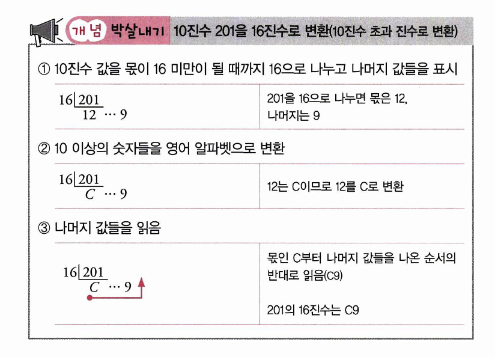

## 정리본
### N진수 : N개수의 숫자만 이용해 수를 나타낸다.


- 10진수로 변환:$N^{\text{자릿수}}$를 각각 곱하고 모두 더한다.


아스키코드: 미국 ANSI가 표준화, 한국말x
유니코드:
 - 한국어 가능
 - UTF`유니코드 변환방식`-8`8비트 단위로 글자를 바꿈`

진수표현
- 2진수 : `0b`로 시작
- 8진수 : `0`로 시작
- 16진수 : `0x`로 시작

### C언어 구성: 전처리부분(본문전에 처리)+ 본문
- 전처리기: 실행파일생성단계중 전처리 지시문을 처리하는 작업
	- `#include` 헤더파일 포함시키는 전처리기 작업
	- `#define` 매크로나 상수값을 정의하는 전처리기 작업

### C언어 자료형: 문자형, 정수형, 부동소수점형
- `CHAR` 문자로, 메모리에는 숫자로 저장된다
- `short` `int` 등 정수값 저장
- `float` `double` 소숫점을 포함하는 실수값 저장


- 그냥 unsigned, long, float만 표현한다고 생각

`unsinged` (0~255): 양수만 저장함, 그래서 `signed`(-128~127)보다 **정확히 2배 더 큰 양수** 저장 가능
- 이때 가장 큰수 255를 저장했는데 +1하면 가장 작은수 0이 되버림: 오버플로우
float는 6자리까지, double는 15자리


### 예시 코드
- `#define A 5` 코드내의 모든 A는 컴파일 과정에서 5로 대체
```c
#include <stdio.h> //stdio.h 헤더파일을 읽어옴
int main(){ //프로그램의 실행이 시작되는 가장 기본적인 메인 함수의 시작 부분
	int a=10; //정수형 변수 a에 10진수로 10을 대입
	int b=010; // 정수형 변수 b에 8진수 10을 대입 (10진수론 8임)
	int c=0x10;// 정수형 변수c에 16진수 10을 대입 (10진수론 16임)
	int d=10u;// d변수에 unsigned int형 10를 대입
	float e=3.14f; //e변수에 float형 3.14를 대입
	printf("%d %d %d %d\n", a, b, c, d);
	//2진수 형태로 저장된 값들을 출력서식지정자 %d 10진수형식대로 출력
	printf("%f", e);
	//2진수 형태로 저장된 값들을 출력서식지정자 %f 소숫점 두자리까지형식대로 출력
	return 0;
}//메인 함수의 끝을 나타내는 닫는 중괄호입니다.

```

- **개발자가 입력:** 개발자가 소스 코드에 어떤 진수(10진수, 8진수, 16진수)로 표현하든, 이는 인간이 작성하기 편하게 고른 껍데기일 뿐이다.
- **컴퓨터가 저장:** 컴퓨터는 입력된 숫자의 진수 종류와 상관없이 내부 메모리에 무조건 **0과 1로 이루어진 '2진수' 패턴**으로만 저장한다.
- **출력:** 메모리에 저장된 2진수를 화면에 보여줄 때, `printf`의 서식 지정자(`%d`, `%x` 등)대로 출력한다.

### C언어 자료형 변환 우선순위(역으로 가면 손실)
- `char` 1byte -> `int` 4byte ->`float` 4byte -> `double` 8byte
- `int`와 `float`는 크기가 같지만 역으로 가면 소숫점 아래 데이터가 손실된다.
### C언어 자동형변환
---
## 책 원본

