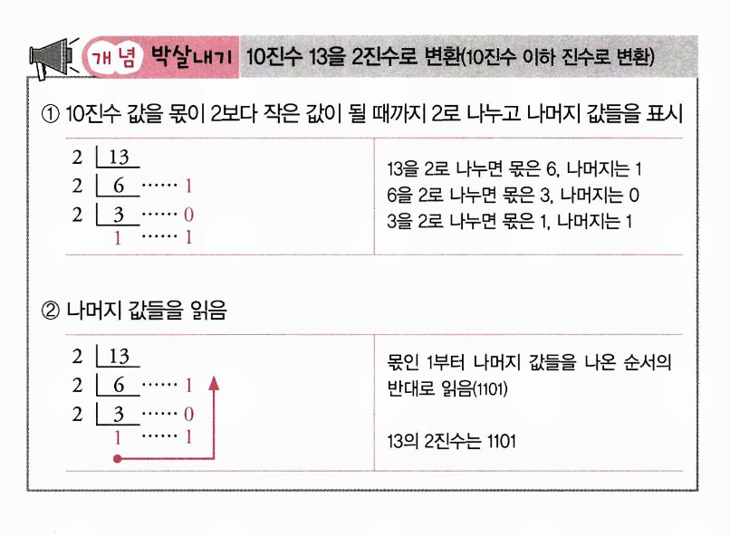

## 정리본
### N진수 : N개수의 숫자만 이용해 수를 나타낸다.

- 10진수로 변환:$N^{\text{자릿수}}$를 각각 곱하고 모두 더한다.

아스키코드: 미국 ANSI가 표준화, 한국말x
유니코드:
 - 한국말 표현
 - UTF`유니코드 변환방식`-8`8비트 단위로 글자를 바꿈`

### C언어 구성: 전처리부분(본문전에 처리)+ 본문
- 전처리기: 실행파일생성단계중 전처리 지시문을 처리하는 작업
	- `#include` 헤더파일 포함시키는 전처리기 작업
	- `#define` 매크로나 상수값을 정의하는 전처리기 작업
- `#define A 5` 코드내의 모든 A는 컴파일 과정에서 5로 대체
- ``
### C언어 자료형

---
## 책 원본

