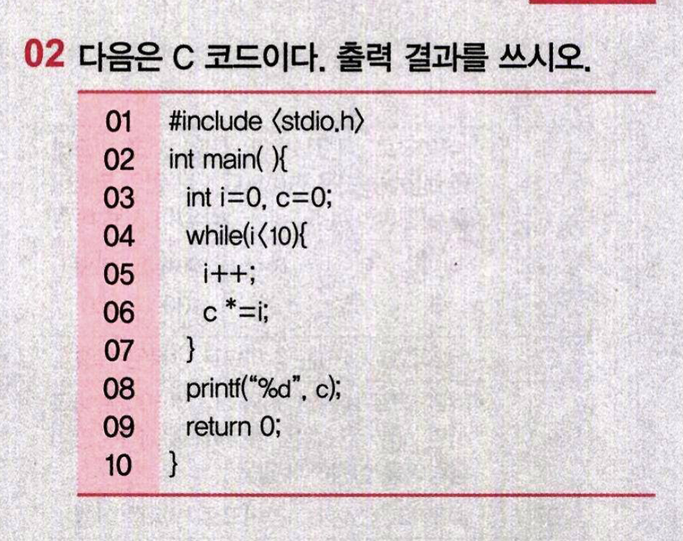
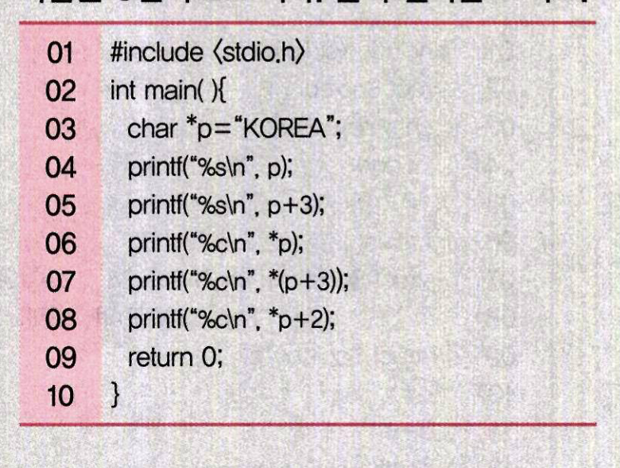

## C언어
반복문을 끝까지 머리속으로 추적하지 말고
- 1,2바퀴와 마지막 바퀴만 추척
- 가장 안쪽 루프 조건식보고 확인
	- 1. 바깥쪽 반복변수가 안쪽 루프에 영향을 어떻게 주는지
	- 2. 가장 안쪽 루프가 수행하는 역할 확인

- 답은 0 (초기값을 반드시 확인할것)
	- 1. 첫번째, 두번째 바퀴 확인해서 패턴 발견
	- 2. printf 출력문의 위치 확인-> 끝나고 마지막에 출력

### 헝가리언 표기법이란?
- 접두어에 자료형을 붙임 i(nt)age 이런식으로
- 카멜: 각단어 첫글자는 첫단어만 소문자 & 나머진 대문자
- 파스칼: 각단어 첫글자는 대문자
- 스네이크: 언더바 __ 사용

답: KOREA, EA, K, E, M
- \*p = 'KOREA' : p는 'k'의 주소 \*p는 값 K
- Printf의 %s은 문자열의 주소만 받는다
	- 그래서 p로 주소를 넘겨주고
- Printf의 %C은 출력할 실제 값을 받는다.
	- 그래서 \*p로 실제값을 넘겨준것이다, (p가 저장한 주소에 저장되어있는 실제값)

답: Lee, 38
- `struct Soojebi s[ ] = {"Kim", 28, "Lee", 38, "Seo", 50, "Park", 35};`
	- 구조체 크기만큼 알아서 구분 저장하기에 {} 하나만 사용해도됨
- `struct Soojebi *p;` 선언의 이유
	- **전제 1 (포인터의 본질):** 포인터 변수는 무조건 **주소 딱 한 개만** 담는 주머니이다.
	- **전제 2 (배열 이름의 비밀):** C언어 규칙상 배열의 이름은 배열의 첫 번째 요소 주소(딱 1개)를 뜻한다.
	- **결론 (선언의 형태):** 배열 이름이 주는 주소가 '딱 한 개'이므로, 이를 받을 포인터 역시 주소 한 개만 담으면 된다. 따라서 `[]`를 붙이지 않고 단수형 변수로 선언한다.
	- `struct Soojebi *p[];`은 구조체들의 시작 주소를 하나씩 따로따로 저장하는 배열

답: 8 (배열이 1,3,4 이므로)
- 선언 `int ary[3]` 은 3번째 요소가 아니라 배열의 크기를 뜻한다
- 배열을 초기화하는 경우, 배열의 크기보다 적게 값을 적으면, 나머지는 모두 0으로 채워진다
	- 그러므로 `int ary[]={1,0,0}` 로 초기화 된것이다

답: >, %, /
그냥 자주 나오는 패턴이라길래 한번 더 보면 좋을듯

답: 29
- 소수(1과 자신으로만 나눠짐)이면서 +number의 인수(어떤수의 나눠지는 수)인 소인수를 찾는 문제
	- `isPrime(i) == 1` ➔ `i`가 **소수**이면서,
		- 2부터 시작해서 자기 자신 직전까지의 숫자로 나눠보면서, 중간에 나누어떨어지는 숫자가 하나라도 있으면 소수가 아니므로, 소수가 아니라고(`return 0`) 판정하는 코드
	- `number % i == 0` ➔ 동시에 `number`(`13195`)의 **약수**인 것!
- 결국 소인수를 찾아야하므로, 5로끝나니 5로 나누고 나눠지는 수로 나누다보면, `13195= 5*7*13*29`이므로 답은 29
---

### 1. 굳이 배열이름을 두고 포인터 `b`로 굳이 받아서 쓰는 이유 🏃‍♂️

- **이동성의 차이:** 배열의 이름 `a`는 위치가 고정된 **상수 주소**라 `a++`를 할 수 없지만, 포인터 `b`는 **변수**이므로 `b++`를 통해 화살표를 다음 칸으로 자유롭게 이동시킬 수 있습니다.
- **효율적인 전달:** 함수에 배열을 넘길 때 뚱뚱한 배열 전체를 복사하는 낭비를 막고, 가벼운 시작 주소 주머니(`b`)만 던져서 처리하기 위해 포인터로 받습니다.

### 2. `struct Data *b = &a;`가 안 되는 이유 ❌

- **타입의 불일치:** 포인터 `b`는 **구조체 낱개 1개**의 주소를 담는 주머니입니다.
- 반면, 배열 이름 `a`는 이미 첫 번째 칸의 주소인데 여기에 `&`를 또 붙인 `&a`는 **배열 전체(구조체 2개 덩어리)의 주소**가 되어버려 주머니의 격(타입)이 맞지 않아 컴파일 에러가 발생합니다.

### 3. 올바른 주소 대입 방법 2가지 ⭕

- **방법 ①:** `struct Data *b = a;` (배열 이름 자체가 주소이므로 가장 추천!)
- **방법 ②:** `struct Data *b = &a[0];` (첫 번째 칸의 주소를 명시적으로 구해서 대입)

답 10
- P1, p2는 문자열 첫 문자의 주소 저장
- len 함수의 매걔변수 p는 별도의 변수로 전달받은 p1, p2의 값 즉 첫문자의 주소를 복사해 저장한다. 그래서 p의 영구적 증가는 p1,p2에 영향을 주지 않는다.

답: 필드를 그려서 점수내기
1 1 3 2
3 4 5 3
3 5 6 4
3 5 5 3
- 현재 내 좌표가 `l`과 `k`로 고정되어 있으니,
- 왼쪽/위 가기위해 `-1`을 해준 것이고,
- 오른쪽/아래까지 가기 위해 조건식을 `<= 내좌표 + 1`로 꽉 닫아준 것입니다

|                | **j-1 (왼쪽)** | **j (나)**          | **j+1 (오른쪽)** |
| -------------- | ------------ | ------------------ | ------------- |
| **`i-1` (위)**  | `(1, 1)`     | `(1, 2)`           | `(1, 3)`      |
| **`i` (나)**    | `(2, 1)`     | **`(2, 2)` 지뢰 위치** | `(2, 3)`      |
| **`i+1` (아래)** | `(3, 1)`     | `(3, 2)`           | `(3, 3)`      |
> **한 줄 요약 💡** 기준점인 지뢰 위치 `(l, k)`에서 **위아래로 한 칸씩(`l-1` ~ `l+1`), 좌우로 한 칸씩(`k-1` ~ `k+1`) 범위**를 넓혀서 주변 8칸과 나 자신을 포함한 3x3 정사각형 박스를 훑으려고

110쪽 18번부터 시작 (현재 5분의 1함)
