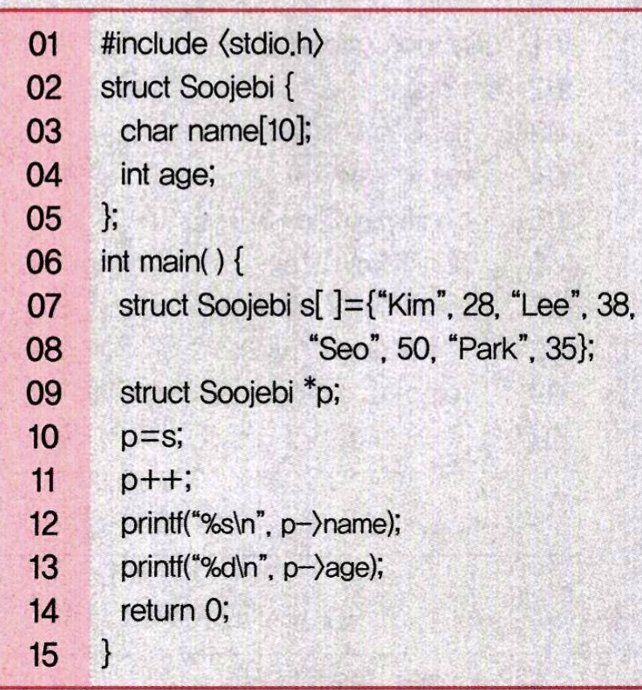
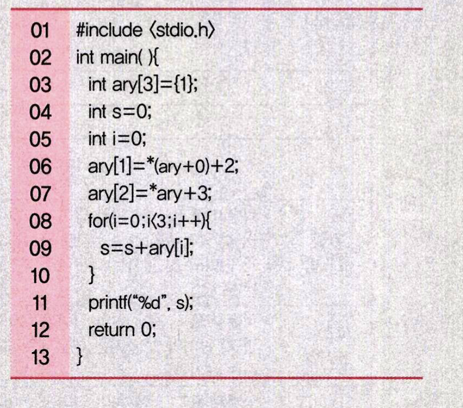

## C언어
반복문을 끝까지 머리속으로 추적하지 말고
- 1,2바퀴와 마지막 바퀴만 추척
- 가장 안쪽 루프 조건식보고 확인
	- 1. 바깥쪽 반복변수가 안쪽 루프에 영향을 어떻게 주는지
	- 2. 가장 안쪽 루프가 수행하는 역할 확인

- 답은 0 (초기값을 반드시 확인할것)
	- 1. 첫번째, 두번째 바퀴 확인해서 패턴 발견
	- 2. printf 출력문의 위치 확인-> 끝나고 마지막에 출력

### 헝가리언 표기법이란?
- 접두어에 자료형을 붙임 i(nt)age 이런식으로
- 카멜: 각단어 첫글자는 첫단어만 소문자 & 나머진 대문자
- 파스칼: 각단어 첫글자는 대문자
- 스네이크: 언더바 __ 사용

답: KOREA, EA, K, E, M
- \*p = 'KOREA' : p는 문자열의 시작주소를 저장한다
- Printf의 %s은 문자열의 주소만 받는다
	- 그래서 p로 주소를 넘겨주고
- Printf의 %C은 출력할 실제 값을 받는다.
	- 그래서 \*p로 실제값을 넘겨준것이다, (p가 저장한 주소에 저장되어있는 실제값)

답: Lee, 38
- `struct Soojebi s[ ] = {"Kim", 28, "Lee", 38, "Seo", 50, "Park", 35};`
	- 구조체 크기만큼 알아서 구분 저장하기에 {} 하나만 사용해도됨
- `struct Soojebi *p;` 선언의 이유
	- **전제 1 (포인터의 본질):** 포인터 변수는 무조건 **주소 딱 한 개만** 담는 주머니이다.
	- **전제 2 (배열 이름의 비밀):** C언어 규칙상 배열의 이름은 배열의 첫 번째 요소 주소(딱 1개)를 뜻한다.
	- **결론 (선언의 형태):** 배열 이름이 주는 주소가 '딱 한 개'이므로, 이를 받을 포인터 역시 주소 한 개만 담으면 된다. 따라서 `[]`를 붙이지 않고 단수형 변수로 선언한다.
	- `struct Soojebi *p[];`은 구조체들의 시작 주소를 하나씩 따로따로 저장하는 배열

답: 8 (배열이 1,3,4 이므로)
- 선언 `int ary[3]` 은 3번째 요소가 아니라 배열의 크기를 뜻한다
- 배열을 초기화하는 경우, 배열의 크기보다 적게 값을 적으면, 나머지는 모두 0으로 채워진다
	- 그러므로 `int ary[]={1,0,0}` 로 초기화 된것이다
