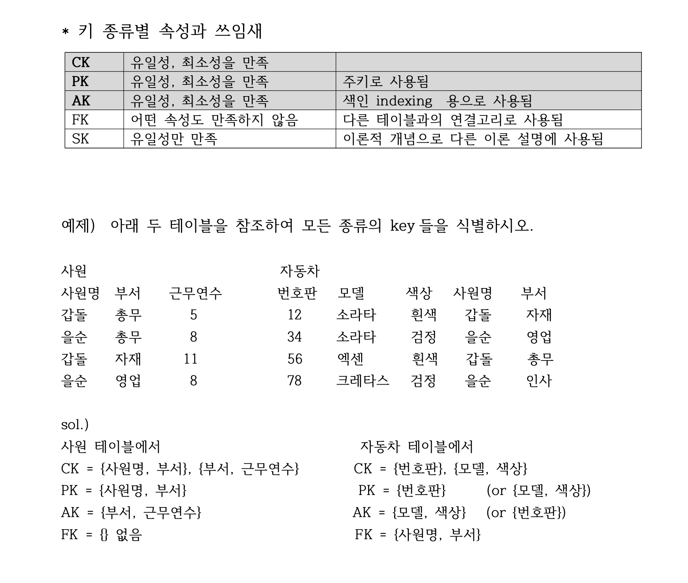
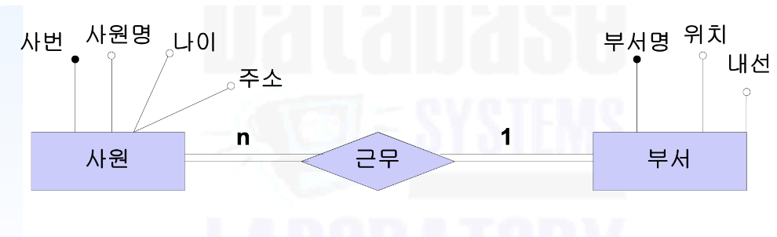
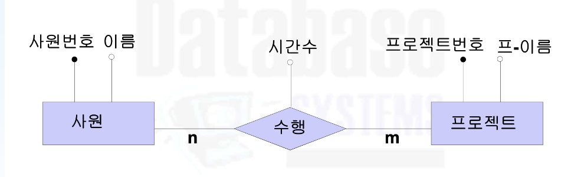
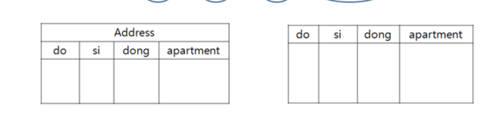
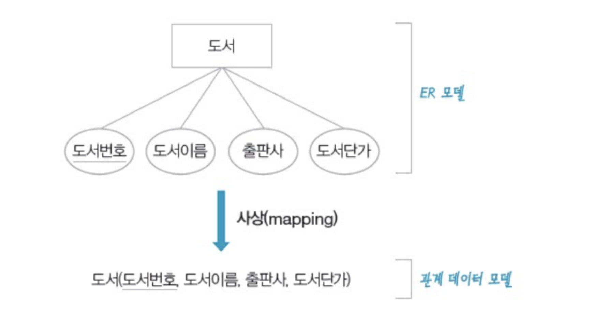

## **1) [T/F] 빠른 정답표**

**1. ERD에는 FK 개념이 없다**

<details>

<summary>정답 보기</summary>

**T**

</details>

**2. 관계(relationship)는 속성을 가질 수 있다**

<details>

<summary>정답 보기</summary>

**T**

</details>

**3. 관계 자체는 키를 가져야 한다**

<details>

<summary>정답 보기</summary>

**F**

</details>

**4. 1:N은 1쪽 PK를 N쪽 FK로 내장**

<details>

<summary>정답 보기</summary>

**T**

</details>

**5. N:M도 내장으로 해결**

<details>

<summary>정답 보기</summary>

**F** (연결테이블 필수)

</details>

**6. 약한 엔터티는 항상 Total 참여**

<details>

<summary>정답 보기</summary>

**T**

</details>

**7. 약한 엔터티의 FK는 PK 구성 요소(식별관계)**

<details>

<summary>정답 보기</summary>

**T**

</details>

**8. PK는 NULL/중복 가능**

<details>

<summary>정답 보기</summary>

**F**

</details>

**9. FK는 중복·NULL 가능(부분참여), 단 참조 존재성 필수**

<details>

<summary>정답 보기</summary>

**T**

</details>

**10. 복합·다치 속성은 RM에서 그대로 둔다**

<details>

<summary>정답 보기</summary>

**F** (분해/전개)

</details>

**11. SK는 유일성만, 최소성은 불필요**

<details>

<summary>정답 보기</summary>

**T**

</details>

**12. 삼진 관계는 되도록 이진으로 분해한다**

<details>

<summary>정답 보기</summary>

**T**

</details>

**13. 엔터티가 2개면 관계는 1개만 가능**

<details>

<summary>정답 보기</summary>

**F** (여러 개 가능)

</details>

- 데이터베이스시스템(DBS)은 DBMS(관리소프트웨어)+실제데이터(DB)의 조합이다
- **PK는 자동 인덱스**, **AK는 세컨더리 인덱스 후보**
- 스키마는 뼈대, 스키마에 채워진 데이터는 인스턴스

---

## **2) [서술] IC(무결성 제약조건) 4가지 이상 

- 데이터베이스 상태를 실세계의 사실들과 일치시키는 조건
- 장점: 갱신될때 DBMS가 자동검사-> 따로 검사할 필요없다
- 단점: 복잡하다
------
<details> <summary>정답 보기</summary>
- **엔터티 무결성**:릴레이션의 기본 키는 널값을 가질수없다
</details>
<details> <summary>정답 보기</summary>
- 키 무결성: 릴레이션의 기본키나 UNIQUE는 중복된 값을 가질수없다
</details>
<details> <summary>정답 보기</summary>
- **카디널리티 무결성**: **1:1 / 1:N / N:M** 으로 관계를 나타낸다
</details>
<details> <summary>정답 보기</summary>
- **참여 제약**: 관계로의 참여 정도를 부분, 전체로 나타낸다.
</details>
<details> <summary>정답 보기</summary>
- 비즈니스 룰(rule) 무결성 :사내 정책들을 DBMS 상에서 강제하기 위한 제약조건
</details>
---

## **3) [계산] 각 테이블의 Key 종류 식별**



### **절차(4스텝)**

<details> <summary>절차확인</summary
1. 후보키(CK) 선별: **단일 → 복합컬럼** 순으로 중복없는걸 후보키로 선정
	- 외래 키로 의심되는 컬럼은 후보키 불가.
	- 이미 키인 속성을 **포함하는 더 큰 조합은 최소성 위배**로 제외
2. CK 중 **1개 PK 채택**-> **나머지는 AK가됨**
</details>
### 예시
**사원(사원명, 부서, 근무연수)**
1. 외래키 의심 컬럼 없다
2. 단일(속성1개)에서 후보키(CK) 선별
	- `사원명`, `부서`, `근무연수` 각각 모두 중복이라 불가
3. 복합키(속성2개)에서 후보키(CK) 선별
	- `{사원명, 부서}`, `{부서, 근무연수}` 중복없는 두 조합을 후보키로 선정
4. 복합키(속성3개)에서 후보키(CK) 선별
	- 속성3개의 일부인 속성 2개가 이미 후보키<- 이미 키인 속성을 **포함하는 더 큰 조합은 최소성 위배**로 제외
5. CK 중 **1개 PK 채택**-> **나머지는 AK가됨**
	- 2개의 후보키중, 사원 테이블의 의미를 고려해 PK로 `{사원명, 부서}`선정
	- 자동으로 남은 `{부서, 근무연수}`는 AK가됨

**자동차(번호판, 모델, 색상, 사원명, 부서)**
1. `{사원명, 부서}`는 자동차가 아닌 다른 테이블에서 온 외래키 같으니 제외
2.  **단일 → 복합컬럼** 순으로 **유일성** 검사
	- 단순키: 중복이 없는 `번호판` 후보키 선정
	- 복합키: 이미 후보키인 `번호판`를 포함한 조합은 후보키 불가하므로 제외, 남은 복합조합인 `{모델, 색상}` 후보키 선정
3. CK 중 **1개 PK 채택**-> **나머지는 AK가됨**
	- PK: 속성개수가 적은 `{번호판}`
	- AK: `{모델, 색상}`
> **용어 한 줄**: **CK(후보키)=유일·최소 / PK=선정된 CK / AK=pk아닌 CK / SK=유일만 / FK=참조키**. SK(슈퍼키)=유일하나 최소x
---

## **4) [역엔지니어링] 테이블 → ERD(1:N 또는 1:1) 
### 절차
<details> <summary> 절차확인</summary>
1. 엔티티-> ㅁ
2. 엔티티간의 관계(상호작용) =>🔸
3. 속성-> ㅇ
	- fk을 속성으로 추가 금지(ERD에는 없는속성)
4. 속성이름에 키표시
	- pk:선
	- 약한 엔터티의 부분키:점선
5. 관계선긋기
	1. 이중선 긋기: 모든개쳬가 관계참여
	2. 단일선 긋기: 관계에 참여하지 않는 개체 존재할때
6. 관계선위에 1, N, M 적기 : 카디널리티
	- '하나'의 배에는 '여러'의 선원이 예약
		- 이러면 1:N
</details>


## **5) [SQL] 기본 패턴 3개  

표준 예제:

- Sailors(sid, sname, age, rating)
- Boats(bid, bname, color), Reserves(sid, bid, date).
1. **검정색 배를 예약한 선원의 이름**<details> <summary>정답 보기</summary>
	```sql
	SELECT DISTINCT s.sname
	FROM Reserves r
	JOIN Boats    b ON b.bid = r.bid
	JOIN Sailors  s ON s.sid = r.sid
	WHERE b.color = 'black';
	```
	</details>
2. **배별 예약 건수**
<details> <summary>정답 보기</summary>
```sql
SELECT b.bid, b.bname, COUNT(*) AS cnt
FROM Boats b
JOIN Reserves r ON r.bid = b.bid
GROUP BY b.bid, b.bname
ORDER BY cnt DESC;
```
</details>
3. **예약하지 않은 선원**
<details> <summary>정답 보기</summary>
```sql
SELECT s.sid, s.sname
FROM Sailors s
LEFT JOIN Reserves r ON r.sid = s.sid
WHERE r.sid IS NULL;
```
</details>

## 6) 데이터모델링이란?
<details> <summary>정답 보기</summary>
데이터 모델링이란 현실 세계의 요구사항을

DB가 다룰 수 있도록 **추상화**하는 과정으로, 먼저 요구사항을 정의하고 그후

**개념적 모델링** 단계에서 요구사항을 이해하여 **ERD**를 산출하고, 다음으로 **논리적 모델링** 단계에서 이를 RM으로 변환한다. 그리고 마지막으로 실제 DMS에 저장하는 **물리적 모델링** 단계를 거친다
</details>

## 7) 요구사항->데이터모델링
### 문제
- **사원(Employee):** 회사의 사원 정보를 관리해야 한다. 각 사원은 **'사번'**으로 유일하게 식별된다. 그 외 **'사원명'**, **'나이'**, **'주소'** 정보를 저장해야 한다.
- **부서(Department):** 회사의 부서 정보를 관리해야 한다. 각 부서는 **'부서명'**으로 유일하게 식별된다. 그 외 부서의 **'위치'**와 **'내선'** 번호를 저장해야 한다.
- **근무(Works In) 관계:** 사원은 부서에 소속되어 근무한다.
- **수행(Works On) 관계:** 사원은 여러 프로젝트를 수행하는 업무를 한다.


### **개념적 설계(ERD)**
1. 엔티티(ㅁ) 속성(ㅇ)
2. M:N 관계 별도(🔸)로 분리
	- 관계 자체가 가진 속성(예: `등록일`)은 이 매핑 테이블의 속성이됨
	- fk을 속성으로 추가 금지(ERD에는 없는속성)
3. pk에다가 실선긋기
4. 관계선긋기
	1. 이중선 긋기: 모든개쳬가 관계참여
	2. 단일선 긋기: 관계에 참여하지 않는 개체 존재할때
5. 카디널리티 관계선 위에 1, N, M 적기
	 - 사원-부서
	    - **사원 입장:** 한 명의 사원은 **반드시 하나의 부서**에만 소속된다 (또는 소속되어야 한다).
	    - **부서 입장:** 하나의 부서에는 **여러 명의 사원**이 소속될 수 있다.
	- 사원-프로젝트
	    - **사원 입장:** 한 명의 사원은 **여러 개의 프로젝트**에 동시에 참여(수행)할 수 있다.
	    - **프로젝트 입장:** 하나의 프로젝트에는 **여러 명의 사원**이 투입되어 수행할 수 있다.


### **논리적 설계(ER→RM 매핑)**
1. 엔터티(속성1, 속성2, 속성3)형식으로 표현
2. 관계테이블의 경우 양쪽 pk를 추가하고 그 조합을 복합pk로 설정
3. pk실선 fk점선
결론
- 사원(사번(실선), 사원명, 나이,주소, 부서명(점선))
- 부서(부서명(실선), 위치, 내선)
- 수행(사원명(점선),프젝번호(점선), 시간수)
	- 그리고 사원명,프젝번호(실선)
- **약한 엔터티(Weak Entity) 매핑**
	- 약한 엔터티는 자신을 소유하는 **강한 엔터티(부모)의 PK**를 **FK**로 가져옵니다.
	- 가져온 **FK**와 자신의 **부분 키(Partial Key)를 결합**한 복합키를 PK로 설정
- **복합/다치 속성**: **분해**(여러 컬럼 or 별도 테이블).
	1. 복합속성: ERD에서는 주소 아래에 하위 속성들이 달린 형태로 표현하는 주소와 같이 '시, 도, 동' 등으로 나뉠 수 있는 속성
	- 
		- RM에선 개별 컬럼으로 분해 1번표가 아니라 2번표로 그림
	- 2. 다치 속성:한 사람이 여러 개의 값을 가질 수 있는 속성입니다. ERD에서는 이중선 타원으로 표현합니다.
		- 개별컬럼으로 만들거나 별도의 테이블로 분리

결론
책은 도서이름, 출판사, 도서단가가 있다 이걸 이렇게 하면됨

---

[개고생해서 정리한 예제](데이터%20모델링_모델링%20예제%20(ER다이어그램,관계%20데이터%20모델).md)
