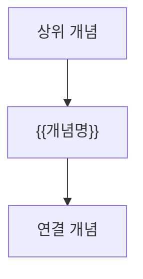

# 📘 {{VALUE개념명}}

---

## 🧠 한줄 요약
- 이 개념을 한 문장으로 요약하면?

---

## 💬 내 언어로 설명 (예시 포함)
- 내가 이해한 방식으로 설명  
- 간단한 예시와 함께 정리

---

## ❓ 왜 중요한가?
- 실전에서 어떻게 등장하는가?
- 이 개념이 해결하려는 문제는?
du
---

## ✨ 깨달음
- 정리하며 느낀 통찰이나 연결, 구조적 패턴

---

## 🔗 관련 개념
- [[관련개념1]], [[관련개념2]]
- [[비교대상개념]]

---

## 🧠 생각 흐름 로그 (선택)
- 어떤 맥락, 흐름, 질문 중 등장했는가?

---

## 🧩 시각화 (선택)

