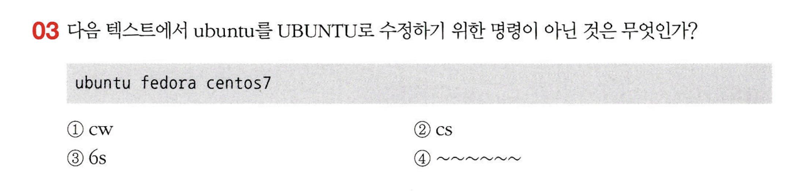

ls, 파일 출력 cat, more, less 정리했음

| **No** | **문제 요약**                           | **핵심 정답 요약**                     |
| ------ | ----------------------------------- | -------------------------------- |
| 1      | 절대경로 찾기                             | ../../usr/bin/ls                 |
| 2      | 파일/디렉터리 구분 옵션                       | ls -F                            |
| 3      | f1, f2를 dir1에 복사                    | cp f1 f2 dir1                    |
| 4      | 하드링크/심볼릭링크 구분                       | 하드링크는 원본삭제해도 접근 가능, 심볼릭은 불가      |
| 5      | find로 삭제 전 확인                       | find -name f1 -ok rm {} \;       |
| 6      | 현재 디렉터리 기호                          | .                                |
| 7      | 절대경로 표시 명령                          | pwd                              |
| 8      | 상대경로 정의                             | /로 시작 안하면 상대경로, 상위디렉터리 ..        |
| 9      | 파일 4종류                              | 일반, 디렉터리, 링크, 특수(디바이스) 파일        |
| 10     | 홈 디렉터리                              | 로그인 시 자동 지정, /home/사용자명          |
| 11     | cd 명령 의미                            | _ 이전디렉터리  ..  상위  ~ 홈            |
| 12     | 파일 구분 옵션                            | ls -F                            |
| 13     | @ 의미                                | 심볼릭 링크 파일                        |
| 14     | .으로 시작하는 파일                         | 숨김파일, ls -a로 확인                  |
| 15     | 루트 내용 보기                            | ls /, 루트 자체는 ls -ld /            |
| 16     | 절대/상대경로 정의                          | 절대: /부터 시작  상대: 현재 위치 기준      |
| 17     | 하드 vs 심볼릭 링크                        | 하드: inode 공유 / 심볼릭: 경로 참조        |
| 18     | rmdir vs rm -r                      | rmdir은 빈 디렉터리만, rm -r은 내용 포함 삭제  |
| 19     | .의 링크 수 2, ..의 링크 수 3 이유            | 디렉터리 자기자신(2), 상위 연결 포함(3)        |
| 20     | 심볼릭링크의 원본파일 삭제 그리고 다른파일을 원본파일로 복사   | 원본삭제 시 링크 무효 → 복사 시 새 파일 생성      |
| 21     | cp a.txt b.txt c.txt temp 의미        | 파일 3개를 temp 디렉터리에 복사             |
| 22     | inode 정의                            | 파일의 메타데이터(위치·크기·권한 등)            |
| 23     | 다른파일명,inode 동일 의미                   | 같은 물리 파일(하드링크 관계)                |
| 24     | 절대/상대경로 표 작성                        | /, usr/lib, ../../data1 등 계층별 구분 |
| 25     | lib로 이동 명령                          | cd ../../usr/lib                 |
| 26     | rmdir ch2 동작 이유                     | 비어 있으면 삭제, 파일 있으면 불가             |
| 27     | 현재위치 /home/user1/ch2에서 data1 행번호 출력 | cat -n ../ch3/data1              |
| 28     | 하드링크 생성                             | ln data1 data1-hard              |
| 29     | 심볼릭링크 생성                            | ln -s ch2 ch2-sym                |
| 30     | /etc/passwd에서 bash 포함행 출력           | grep bash /etc/passwd            |
| 31     | /etc아래에있는 passwd 파일 경로 찾기           | find /etc -name passwd           |
| 32     | cp 실행파일 위치                          | which cp 또는 /bin/cp              |

제공된 이미지의 질문에 대한 답변입니다.
## 19번
## 1. 현재 디렉터리(.)의 하드 링크 값이 2인 이유

디렉터리의 하드 링크 수는 해당 디렉터리(의 inode)를 가리키는 파일 항목(이름)의 총 개수를 의미합니다. `temp` 디렉터리(즉, 출력의 `.`)가 생성되었을 때 링크 수가 2인 이유는 다음과 같습니다.

1. **부모 디렉터리의 `temp` 항목:** `temp` 디렉터리의 부모 디렉터리(프롬프트 `~`로 보아 홈 디렉터리)에 `temp`라는 이름의 항목이 생성되며, 이 항목이 `temp` 디렉터리를 가리킵니다. (링크 1개)
2. **자신 내부의 `.` 항목:** `temp` 디렉터리 _내부_에 생성되는 `.` 항목은 `temp` 디렉터리 자신을 가리킵니다. (링크 1개)
    

이 두 개의 항목이 `temp` 디렉터리를 가리키므로 하드 링크 값은 2가 됩니다. (새로 생성된 비어있는 디렉터리의 기본 링크 수는 항상 2입니다.)

## 2. 상위 디렉터리(..)의 하드 링크 값이 3인 이유

`..` 항목은 `temp`의 상위 디렉터리(즉, `~` 홈 디렉터리)를 가리킵니다. 이 상위 디렉터리의 링크 수가 3인 이유는 다음과 같습니다.

1. **상위 디렉터리의 기본 링크 2개:**
    
    - `~` 디렉터리의 부모(아마도 `/home`)에 있는 `user1` (홈 디렉터리 이름) 항목.
    - `~` 디렉터리 _내부_에 있는 `.` 항목.
        
2. **하위 디렉터리의 `..` 항목:**
    
    - `~` 디렉터리 아래에 `temp` 디렉터리가 생성되면서, `temp` 디렉터리 내부에 `..` 항목이 생겼습니다. 이 `..` 항목은 상위 디렉터리인 `~`를 가리킵니다.
        

따라서 상위 디렉터리(`~`)의 기본 링크 2개에, 하위 디렉터리 `temp`가 생성되면서 추가된 `..` 링크 1개를 더해 총 3개가 됩니다.

---

**요약:**

- **`.` (temp)가 2인 이유:** `~/temp` (자신의 이름) + `~/temp/.` (자신 안의 `.`)
- **`..` (~)가 3인 이유:** `~`의 기본 링크 2개 + `~/temp/..` (자식인 `temp`가 가리키는 `..`)
## 20번
심볼릭 링크 A는 원본 B의 **데이터(inode)가 아닌 'B'라는 이름(경로)**을 가리킵니다. B가 삭제된 후 C를 B로 복사하면, A는 여전히 'B'라는 경로를 찾아가고, 그 경로에는 C의 내용을 가진 새로운 파일이 있으므로 C의 내용이 출력됩니다.

## 24번

| **No** | **vi 문제 요약**             | **핵심 정답 요약**                   |
| ------ | ------------------------ | ------------------------------ |
| 1      | 마지막 행 모드 이동키가 아닌 것       | /                              |
| 2      | 작업내용 버리고 종료              | q!                             |
| 3      | ubuntu → UBUNTU 수정 아닌 명령 | 6s                             |
| 4      | 연속 2행 복사 명령              | 2yy                            |
|        | 2~5행 ubuntu → UBUNTU 변경  | 2,5s/ubuntu/UBUNTU/g           |
| 6      | vi의 동작 모드                | (오답)사용자 모드 명령모드,입력모드,마지막행모드 |
| 7      | 환경설정 방법 아님               | vi에서 마지막 행 모드로 설정              |
| 8      | 수정 명령 아닌 것               | u (되돌리기)                       |
| 9      | 입력모드 vs 명령모드             | 입력: 편집 / 명령: 조작·이동             |
| 10     | 입력모드 전환 키                | i, a, o                        |
| 11     | o vs O                   | o: 아래줄 새삽입 / O: 윗줄 새삽입         |
| 12     | ! vs : 차이                | !: 외부명령 실행 / :: vi 내부명령        |
| 13     | 마지막 행 이동 명령              | G, :$, Shift+G                 |
| 14     | 다섯 글자 수정                 | 5s, cw                         |
| 15     | 특정 행 이동                  | :n, /pattern                   |
| 16     | 문자열 ‘linux’ 검색           | /linux                         |
| 17     | 5~10행 linux → LinuX      | 5,10s/linux/LinuX/g            |
| 18     | 단어 잘라붙이기                 | dw + p                         |
| 19     | 저장 후 계속 편집               | :w                             |
| 20     | 여러행 복사·붙이기               | 3yy 후 :e b.txt → p             |
| 21     | 행번호 표시 이유                | :set number 설정 때문              |
| 22     | 다른 파일 읽어오기               | :r test3.txt                   |
| 23     | 현재 모드 확인                 | Ctrl + G                       |
| 24     | 저장 후 종료                  | :wq, ZZ                        |
| 25     | q vs q! 차이               | q: 변경없을 때 종료 / q!: 강제종료        |
| 26     | vi 중 셸 명령 실행             | :!ls                           |
| 27     | 화면 깨졌을 때 복구              | Ctrl + L                       |

| **문제 요약**                        | **핵심 정답 요약**                                     |
| -------------------------------- | ------------------------------------------------ |
| 리눅스의 세 가지 구성요소                   | 커널(Kernel), 쉘(Shell), 유틸리티(Utility).             |
| 가상머신(VM) 정의                      | 실제 하드웨어를 소프트웨어로 모방한 환경.                          |
| 호스트 OS vs 게스트 OS                 | 호스트: 실제 OS, 게스트: 가상머신 내 실행되는 OS.                 |
| Swap 파일·파티션 역할                   | 메모리 부족 시 임시 저장 공간으로 사용(가상메모리).                   |
| 명령어 기능: date, clear, man, passwd | date: 날짜표시/설정clear: 화면지움man: 매뉴얼 보기passwd: 암호 변경 |
| date 명령 도움말 확인                   | man date 또는 date --help 사용.                      |
| 응용프로그램 실행 과정                     | GUI 또는 명령행으로 실행(예: gedit 실행 시 GUI/명령 둘 다 가능).    |
| gedit 실행 방법                      | 명령행에서 gedit 입력 또는 메뉴 클릭 실행.                      |
| 터미널 종료 명령 2가지                    | exit, logout.                                    |
