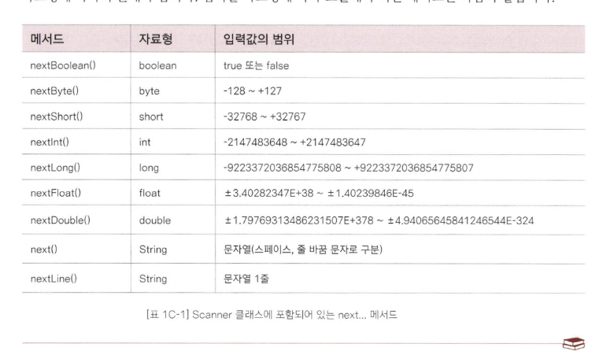

### 1. 🥇 자료구조 (Collections) - 가장 중요

이 클래스들은 어떤 데이터를 **어떻게 저장하고 꺼낼지** 결정합니다.

#### 1) List (순서가 있고 중복 허용)

- **`ArrayList`**: 가장 기본이 되는 동적 배열입니다.
    - `add(value)`: 값 추가
    - `get(index)`: 인덱스로 값 조회
    - `set(index, value)`: 값 수정
    - `remove(index)`: 값 삭제
    - `size()`: 리스트 크기
    - `isEmpty()`: 비었는지 확인
        

#### 2) Map (Key-Value 쌍, 순서 없음)

- **`HashMap`**: 해시 테이블 기반. (Key, Value) 쌍을 저장합니다. 검색 속도가 매우 빠릅니다.
    - `put(key, value)`: 값 저장
    - `get(key)`: Key로 Value 조회
    - `containsKey(key)`: Key가 존재하는지 확인
    - `getOrDefault(key, defaultValue)`: **[필수 암기]** Key가 없으면 기본값(defaultValue) 반환. (카운팅 문제 등에서 매우 유용)
    - `keySet()`: 모든 Key 목록 반환
    - `size()`: 맵 크기
        

#### 3) Set (순서 없고 중복 비허용)

- **`HashSet`**: 해시 테이블 기반. 값의 **중복을 자동으로 제거**해 주거나, 특정 값이 **존재하는지** 빠르게 체크할 때 사용합니다.
    - `add(value)`: 값 추가 (이미 있으면 무시됨)
    - `contains(value)`: 값이 존재하는지 확인 (매우 빠름)
    - `remove(value)`: 값 삭제
    - `size()`: Set 크기
        

#### 4) Stack (LIFO: 후입선출)

- **`Stack`**: DFS(깊이 우선 탐색), 괄호 짝 맞추기 등에 사용합니다.
    - `push(value)`: 값 삽입
    - `pop()`: 맨 위 값 꺼내기 (반환 및 삭제)
    - `peek()`: 맨 위 값 확인 (삭제 안 함)
    - `isEmpty()`: 비었는지 확인
        

#### 5) Queue (FIFO: 선입선출)

- **`Queue` (인터페이스)** / **`LinkedList` (구현체)**: BFS(너비 우선 탐색)에서 필수입니다.
    - `Queue<Integer> q = new LinkedList<>();` 형태로 선언합니다.
    - `offer(value)`: 값 추가 (또는 `add`)
    - `poll()`: 맨 앞 값 꺼내기 (반환 및 삭제)
    - `peek()`: 맨 앞 값 확인 (삭제 안 함)
    - `isEmpty()`: 비었는지 확인
        

#### 6) PriorityQueue (우선순위 큐)

- **`PriorityQueue`**: **힙(Heap)** 자료구조입니다. 기본값은 **최소 힙(Min Heap)**입니다.
    - 다익스트라(Dijkstra) 알고리즘이나 "K번째 큰 수" 등을 찾을 때 필수입니다.
    - `offer(value)`: 값 추가 (자동으로 정렬 위치를 찾음)
    - `poll()`: **가장 작은 값** (우선순위가 가장 높은 값) 꺼내기
    - `peek()`: 가장 작은 값 확인
        

---

### 2. 🥈 정렬 및 유틸리티

데이터를 조작하는 데 필요한 도우미 클래스들입니다.

#### 1) Arrays

- **`java.util.Arrays`**: **배열(`int[]`, `String[]` 등)**을 다룰 때 사용합니다.
    - `Arrays.sort(arr)`: 배열 정렬 (가장 중요)
    - `Arrays.sort(arr, Collections.reverseOrder())`: **[참고]** 기본형(int) 배열은 안되지만, Wrapper(Integer) 배열은 내림차순 정렬 가능
    - `Arrays.binarySearch(arr, key)`: 이진 탐색 (반드시 정렬 후 사용)
    - `Arrays.fill(arr, value)`: 배열을 특정 값으로 채우기
    - `Arrays.toString(arr)`: 배열 내용 출력용
        

#### 2) Collections

- **`java.util.Collections`**: **리스트(`ArrayList` 등)**를 다룰 때 사용합니다.
    - `Collections.sort(list)`: 리스트 정렬
    - `Collections.reverse(list)`: 리스트 순서 뒤집기
    - `Collections.max(list)` / `Collections.min(list)`: 최대/최소값 찾기
        

---

### 3. 🥉 문자열 처리

문자열 문제는 단골 출제 유형입니다.

#### 1) String

- **`String`** (불변)
    - `s.length()`: 문자열 길이
    - `s.charAt(index)`: 특정 인덱스의 문자(char) 반환
    - `s.substring(begin, end)`: 문자열 자르기 (end 인덱스 직전까지)
    - `s.equals(other)`: 문자열 내용 비교 (절대 `==` 쓰지 말 것)
    - `s.split(regex)`: 특정 기준으로 문자열 쪼개기 (배열 반환)
    - `s.toCharArray()`: 문자열을 `char[]` 배열로 변환
        

#### 2) StringBuilder

- **`StringBuilder`** (가변)
    - **[중요]** 루프 안에서 문자열을 계속 합칠 때 `String`의 `+` 연산을 쓰면 매우 느립니다. 그때 `StringBuilder`를 써야 합니다.
    - `append(str)`: 문자열 뒤에 붙이기
    - `toString()`: 최종 결과물 `String`으로 반환
        

---

### 4. 🤓 기타 유용한 클래스

- **`Math`**:
    - `Math.max(a, b)`, `Math.min(a, b)`: 두 수 중 최대/최소
    - `Math.abs(n)`: 절대값
    - `Math.sqrt(n)`: 제곱근
- **Wrapper Classes** (형변환):
    - `Integer.parseInt(s)`: `String` -> `int`
    - `String.valueOf(n)`: `int` -> `String`
    - `Character.isDigit(c)`, `Character.isLetter(c)`: 문자가 숫자인지, 문자인지 확인
        

### 요약

|**용도**|**필수 클래스**|**핵심 메소드**|
|---|---|---|
|**동적 배열**|`ArrayList`|`add`, `get`, `size`|
|**Key-Value**|`HashMap`|`put`, `get`, `getOrDefault`|
|**중복 제거**|`HashSet`|`add`, `contains`|
|**BFS (큐)**|`LinkedList`|`offer`, `poll`, `isEmpty`|
|**DFS (스택)**|`Stack`|`push`, `pop`, `isEmpty`|
|**힙 / 우선순위**|`PriorityQueue`|`offer`, `poll`|
|**배열 정렬**|`Arrays`|`sort`, `binarySearch`|
|**리스트 정렬**|`Collections`|`sort`, `reverse`|
|**문자열 조합**|`StringBuilder`|`append`, `toString`|

이 정도만 확실히 손에 익혀두셔도 웬만한 알고리즘 문제는 데이터 처리에서 막히는 일은 없을 겁니다.

이 중에서 특정 클래스의 사용법이 헷갈리거나 예시 코드가 필요하면 바로 알려주세요.
제공해주신 정리본은 자바(Java)를 이용한 알고리즘 문제 해결(PS/Competitive Programming)의 핵심을 정말 잘 요약한 '필수 암기 노트'입니다.
단순히 '무엇을 하는지'를 넘어, 왜 알고리즘 문제 풀이에서 이 메서드들이 중요한지 그 맥락과 전략을 중심으로 더 자세히 설명해 드릴게요.
A. 빠른 I/O (입출력)
핵심 전략: 기본 I/O의 병목 현상 피하기
알고리즘 문제에서는 100만 개 이상의 데이터를 입출력해야 하는 경우가 많습니다.
 * Scanner는 사용하기 편하지만, 입력을 분석(parsing)하고 정규식을 확인하는 과정에서 매우 느립니다.
 * System.out.println()은 호출될 때마다 즉시 화면(콘솔)에 데이터를 전송(Flush)하려고 시도하는데, 이 과정이 매우 비싼 작업입니다.
해결책 (정리본의 내용):
 * BufferedReader (입력): 데이터를 '한 줄 통째로' 일단 메모리(버퍼)에 최대한 빨리 읽어옵니다. 그 후, 프로그램은 느린 콘솔이 아닌 빠른 메모리에서 데이터를 처리합니다.
 * StringTokenizer (파싱): br.readLine()으로 읽어온 한 줄의 문자열을 쪼갤 때 사용합니다. String.split()은 정규식(regex) 기반이라 강력하지만 느립니다. StringTokenizer는 단순히 지정된 구분자(기본: 공백)로 문자열을 자르기 때문에 비교도 안 되게 빠릅니다.
 * StringBuilder (출력): 모든 출력 내용을 하나의 큰 문자열로 합치는 '장바구니'입니다. String + String 연산은 루프 안에서 매번 새로운 문자열 객체를 생성하여 메모리와 시간을 낭비합니다. StringBuilder는 하나의 객체 내부에서 문자열을 효율적으로 이어붙인 뒤, System.out.print(sb)로 단 한 번만 출력하여 시스템 호출을 최소화합니다.
B. 문자열(String) & 문자(Character)
핵심 전략: 자바 String의 '불변성(Immutability)' 이해하기
자바에서 String 객체는 한 번 생성되면 절대 변하지 않습니다.
 * s = s + "a";나 s.substring() 같은 작업은 기존 문자열을 바꾸는 게 아니라, 새로운 String 객체를 만들어 s에 다시 할당하는 것입니다.
 * 만약 100만 글자를 루프 돌며 String을 조작하면, 100만 개의 중간 객체가 생성될 수 있어 끔찍한 성능 저하가 발생합니다.
해결책 (정리본의 내용):
 * StringBuilder 활용 (팁 참조): 문자열을 '변경'해야 할 때는 String 대신 StringBuilder를 사용해야 합니다. sb.append(), sb.deleteCharAt() 등은 객체를 새로 만들지 않고 내부 버퍼를 직접 수정합니다.
 * toCharArray(): 문자열을 문자 배열로 바꾸면, 인덱스를 통해 문자를 직접 비교하거나(투 포인터 등) 빈도수를 셀 때(예: int[] count = new int[26];) 훨씬 효율적입니다.
 * equals() vs == (팁 참조): ==는 두 객체가 '같은 메모리 주소'를 가리키는지(동일성) 비교합니다. equals()는 '내용'이 같은지(동등성) 비교합니다. 문자열 비교는 **반드시 equals()**를 써야 합니다.
 * Character.isDigit() 등: c >= '0' && c <= '9'처럼 아스키코드로 비교할 수도 있지만, Character 유틸리티 클래스를 쓰는 것이 더 명확하고 안전합니다.
C. 배열·정렬·탐색(Arrays / Collections / Comparator)
핵심 전략: '정렬'을 빠르고 정확하게 수행하기
문제 해결의 70%는 데이터를 올바르게 '정렬'하는 것에서 시작합니다.
 * Arrays.sort(): 기본 타입(int, long 등) 배열은 퀵 정렬 기반(Dual-Pivot QuickSort)으로, 객체(Integer[] 등) 배열은 TimSort(합병+삽입 정렬) 기반으로 동작합니다.
 * Comparator (Java 8 람다):
   * 과거에는 복잡한 정렬을 위해 new Comparator<…>() { … }처럼 익명 클래스를 만들어야 했습니다.
   * 지금은 Comparator.comparingInt(MyObject::getScore).reversed().thenComparing(MyObject::getName)처럼, SQL의 ORDER BY 구문처럼 직관적으로 정렬 기준을 조합할 수 있습니다. 이게 정리본에 있는 comparingInt, reversed, thenComparing의 핵심입니다.
 * Arrays.binarySearch() (이진 탐색):
   * 반드시 정렬된 상태에서만 사용해야 합니다.
   * 팁 해설: binarySearch는 값을 찾지 못하면 음수를 반환합니다. 이 값은 -(삽입되어야 할 위치) - 1입니다. 예를 들어, [10, 20, 30]에서 25를 찾으면, 25는 2번 인덱스(30)에 삽입되어야 하므로 -(2) - 1 = -3이 반환됩니다. 이는 'Lower Bound / Upper Bound'를 찾는 데 응용할 수 있습니다.
D. 컬렉션 (자료구조)
핵심 전략: 문제 상황에 맞는 최적의 '도구' 선택하기
 * List → ArrayList: 왜 LinkedList가 아닐까요? LinkedList는 중간 삽입/삭제는 빠르지만, list.get(i)처럼 특정 인덱스를 조회하는 데 O(N)이 걸립니다. 알고리즘에서는 인덱스 조회가 빈번하므로, O(1) 조회가 가능한 ArrayList가 거의 항상 정답입니다.
 * Deque → ArrayDeque:
   * 큐(Queue): BFS(너비 우선 탐색)에서 필수. offer (넣기), poll (빼기).
   * 스택(Stack): DFS(깊이 우선 탐색)나 괄호 문제. push (넣기), pop (빼기).
   * ArrayDeque는 이 두 가지 기능을 모두 제공하며, LinkedList 기반 큐나 구식 Stack 클래스보다 훨씬 빠릅니다. (내부가 배열 기반이라 메모리 효율이 좋음)
 * PriorityQueue (힙):
   * '가장 작은 값' 또는 '가장 큰 값'을 빠르게(O(1)) 조회하고, 삽입/삭제를 적당히 빠르게(O(logN)) 해야 할 때 사용합니다.
   * (예: 다익스트라 알고리즘, K번째 큰 수 찾기, 여러 회의실 배정하기)
   * 기본은 '최소 힙'이므로, '최대 힙'은 Comparator.reverseOrder()를 사용합니다.
 * Map / Set:
   * HashMap / HashSet: 해시 기반. 삽입, 삭제, 조회가 평균 **O(1)**입니다. 순서가 필요 없고, '존재 여부'나 '키-값 매핑'만 빠르면 될 때 사용합니다.
   * TreeMap / TreeSet: 트리 기반. 모든 연산이 **O(logN)**입니다. HashMap보다 느리지만, 데이터가 항상 정렬된 상태를 유지합니다.
   * TreeMap/TreeSet의 핵심 (팁 해설): floorKey(x) (x보다 작거나 같은 값 중 최대)나 ceilingKey(x) (x보다 크거나 같은 값 중 최소)처럼, '나와 가장 가까운 값'을 빠르게(O(logN)) 찾는 강력한 기능이 필요할 때 사용합니다.
E. 수학/수치/큰수(Math / BigInteger)
핵심 전략: '오버플로'와 '음수' 함정 피하기
 * Math.xxxExact: int의 최댓값은 약 21억입니다. 10억 + 10억 + 10억을 계산하면 int 범위를 넘어 쓰레깃값(오버플로)이 나옵니다. Math.addExact 같은 메서드는 오버플로가 발생하면 즉시 예외(Exception)를 발생시켜, "이 계산은 long이 필요하다"고 알려줍니다.
 * Math.floorMod(a, m) (팁 해설):
   * 자바의 % 연산은 나머지가 아니라 'remainder(남은 값)'입니다.
   * (-3) % 2의 결과는 -1입니다.
   * 하지만 수학이나 알고리즘(예: 좌표 순환)에서는 (-3) mod 2가 1이 되어야 합니다. (즉, 0, 1, 0, 1… 순환)
   * Math.floorMod(-3, 2)는 수학적으로 올바른 1을 반환해 줍니다. 음수 인덱스 처리가 꼬일 때 이 메서드가 구세주입니다.
 * BigInteger: long (약 900경) 범위를 초과하는 숫자가 필요할 때만 사용합니다. (예: 팩토리얼, RSA 암호화, 초장거리 DP). 이 클래스는 내부적으로 숫자를 int[] 배열로 관리하며, 모든 연산이 매우 느리므로 최후의 수단으로 사용합니다.
이 정리본은 결국 **'성능(Performance)', '안정성(Safety)', '정확성(Correctness)'**이라는 세 가지 기준으로 엄선된, 자바 알고리즘 문제 해결을 위한 최고의 무기 목록이라고 할 수 있습니다.
이 중에서 특히 더 자세한 설명이나 예시 코드가 필요한 부분이 있을까요? 예를 들어 'Comparator 조합하는 법'이나 'TreeMap의 활용 사례' 등이 궁금하시면 말씀해 주세요.


알고리즘 테스트를 자바로 준비하신다면, **어떤 자료구조를 언제 써야 하는지**가 가장 중요합니다. 다행히 자바는 강력한 **컬렉션 프레임워크(Collection Framework)**를 제공하기 때문에, 밑바닥부터 구현할 필요 없이 이미 만들어진 클래스들을 잘 가져다 쓰면 됩니다.

대부분의 필수 클래스와 메소드는 `java.util` 패키지 안에 모여있습니다.

다음은 "이것 모르면 문제 못 푼다" 싶은 필수 항목들입니다.
[인출]
Scanner stdIn = new Scanner(System.in);  
stdIn.nextInt();


---

### 1. 🥇 자료구조 (Collections) - 가장 중요

이 클래스들은 어떤 데이터를 **어떻게 저장하고 꺼낼지** 결정합니다.

#### 1) List (순서가 있고 중복 허용)

- **`ArrayList`**: 가장 기본이 되는 동적 배열입니다.
    - `add(value)`: 값 추가
    - `get(index)`: 인덱스로 값 조회
    - `set(index, value)`: 값 수정
    - `remove(index)`: 값 삭제
    - `size()`: 리스트 크기
    - `isEmpty()`: 비었는지 확인
        

#### 2) Map (Key-Value 쌍, 순서 없음)

- **`HashMap`**: 해시 테이블 기반. (Key, Value) 쌍을 저장합니다. 검색 속도가 매우 빠릅니다.
    - `put(key, value)`: 값 저장
    - `get(key)`: Key로 Value 조회
    - `containsKey(key)`: Key가 존재하는지 확인
    - `getOrDefault(key, defaultValue)`: **[필수 암기]** Key가 없으면 기본값(defaultValue) 반환. (카운팅 문제 등에서 매우 유용)
    - `keySet()`: 모든 Key 목록 반환
    - `size()`: 맵 크기
        

#### 3) Set (순서 없고 중복 비허용)

- **`HashSet`**: 해시 테이블 기반. 값의 **중복을 자동으로 제거**해 주거나, 특정 값이 **존재하는지** 빠르게 체크할 때 사용합니다.
    - `add(value)`: 값 추가 (이미 있으면 무시됨)
    - `contains(value)`: 값이 존재하는지 확인 (매우 빠름)
    - `remove(value)`: 값 삭제
    - `size()`: Set 크기
        

#### 4) Stack (LIFO: 후입선출)

- **`Stack`**: DFS(깊이 우선 탐색), 괄호 짝 맞추기 등에 사용합니다.
    - `push(value)`: 값 삽입
    - `pop()`: 맨 위 값 꺼내기 (반환 및 삭제)
    - `peek()`: 맨 위 값 확인 (삭제 안 함)
    - `isEmpty()`: 비었는지 확인
        

#### 5) Queue (FIFO: 선입선출)

- **`Queue` (인터페이스)** / **`LinkedList` (구현체)**: BFS(너비 우선 탐색)에서 필수입니다.
    - `Queue<Integer> q = new LinkedList<>();` 형태로 선언합니다.
    - `offer(value)`: 값 추가 (또는 `add`)
    - `poll()`: 맨 앞 값 꺼내기 (반환 및 삭제)
    - `peek()`: 맨 앞 값 확인 (삭제 안 함)
    - `isEmpty()`: 비었는지 확인
        

#### 6) PriorityQueue (우선순위 큐)

- **`PriorityQueue`**: **힙(Heap)** 자료구조입니다. 기본값은 **최소 힙(Min Heap)**입니다.
    - 다익스트라(Dijkstra) 알고리즘이나 "K번째 큰 수" 등을 찾을 때 필수입니다.
    - `offer(value)`: 값 추가 (자동으로 정렬 위치를 찾음)
    - `poll()`: **가장 작은 값** (우선순위가 가장 높은 값) 꺼내기
    - `peek()`: 가장 작은 값 확인
        

---

### 2. 🥈 정렬 및 유틸리티

데이터를 조작하는 데 필요한 도우미 클래스들입니다.

#### 1) Arrays

- **`java.util.Arrays`**: **배열(`int[]`, `String[]` 등)**을 다룰 때 사용합니다.
    - `Arrays.sort(arr)`: 배열 정렬 (가장 중요)
    - `Arrays.sort(arr, Collections.reverseOrder())`: **[참고]** 기본형(int) 배열은 안되지만, Wrapper(Integer) 배열은 내림차순 정렬 가능
    - `Arrays.binarySearch(arr, key)`: 이진 탐색 (반드시 정렬 후 사용)
    - `Arrays.fill(arr, value)`: 배열을 특정 값으로 채우기
    - `Arrays.toString(arr)`: 배열 내용 출력용
        

#### 2) Collections

- **`java.util.Collections`**: **리스트(`ArrayList` 등)**를 다룰 때 사용합니다.
    - `Collections.sort(list)`: 리스트 정렬
    - `Collections.reverse(list)`: 리스트 순서 뒤집기
    - `Collections.max(list)` / `Collections.min(list)`: 최대/최소값 찾기
        

---

### 3. 🥉 문자열 처리

문자열 문제는 단골 출제 유형입니다.

#### 1) String

- **`String`** (불변)
    - `s.length()`: 문자열 길이
    - `s.charAt(index)`: 특정 인덱스의 문자(char) 반환
    - `s.substring(begin, end)`: 문자열 자르기 (end 인덱스 직전까지)
    - `s.equals(other)`: 문자열 내용 비교 (절대 == 쓰지 말 것)
    - `s.split(regex)`: 특정 기준으로 문자열 쪼개기 (배열 반환)
    - `s.toCharArray()`: 문자열을 `char[]` 배열로 변환
        

#### 2) StringBuilder

- **`StringBuilder`** (가변)
    - **[중요]** 루프 안에서 문자열을 계속 합칠 때 `String`의 `+` 연산을 쓰면 매우 느립니다. 그때 `StringBuilder`를 써야 합니다.
    - `append(str)`: 문자열 뒤에 붙이기
    - `toString()`: 최종 결과물 `String`으로 반환
        

---

### 4. 🤓 기타 유용한 클래스

- **`Math`**:
    - `Math.max(a, b)`, `Math.min(a, b)`: 두 수 중 최대/최소
    - `Math.abs(n)`: 절대값
    - `Math.sqrt(n)`: 제곱근
- **Wrapper Classes** (형변환):
    - `Integer.parseInt(s)`: `String` -> `int`
    - `String.valueOf(n)`: `int` -> `String`
    - `Character.isDigit(c)`, `Character.isLetter(c)`: 문자가 숫자인지, 문자인지 확인
        

### 요약

|**용도**|**필수 클래스**|**핵심 메소드**|
|---|---|---|
|**동적 배열**|`ArrayList`|`add`, `get`, `size`|
|**Key-Value**|`HashMap`|`put`, `get`, `getOrDefault`|
|**중복 제거**|`HashSet`|`add`, `contains`|
|**BFS (큐)**|`LinkedList`|`offer`, `poll`, `isEmpty`|
|**DFS (스택)**|`Stack`|`push`, `pop`, `isEmpty`|
|**힙 / 우선순위**|`PriorityQueue`|`offer`, `poll`|
|**배열 정렬**|`Arrays`|`sort`, `binarySearch`|
|**리스트 정렬**|`Collections`|`sort`, `reverse`|
|**문자열 조합**|`StringBuilder`|`append`, `toString`|

이 정도만 확실히 손에 익혀두셔도 웬만한 알고리즘 문제는 데이터 처리에서 막히는 일은 없을 겁니다.

이 중에서 특정 클래스의 사용법이 헷갈리거나 예시 코드가 필요하면 바로 알려주세요.


## SSAFY 코딩테스트 자바 입문자를 위한 완벽 가이드

자바를 오랜만에 사용한다면 다음 요소들이 특히 헷갈릴 수 있습니다. SSAFY 기초코딩테스트는 구현 능력을 평가하므로 **기본 문법의 정확한 이해와 빠른 입출력 처리**가 핵심입니다.

### 1. 입력 처리: Scanner vs BufferedReader

#### Scanner의 장단점

**장점**: 사용이 간단하고 다양한 타입 직접 파싱 가능[1]
**단점**: 입력량이 많으면 시간 초과 발생 가능[1][2]

```java
import java.util.Scanner;

Scanner sc = new Scanner(System.in);
int a = sc.nextInt();
String str = sc.next();
```

#### BufferedReader (추천)

입력 데이터가 많을 때는 **BufferedReader가 Scanner보다 약 7배 빠릅니다.**[1] Scanner가 4.8초 걸릴 때 BufferedReader는 0.68초가 소요됩니다.[1]

```java
import java.io.*;
import java.util.StringTokenizer;

BufferedReader br = new BufferedReader(new InputStreamReader(System.in));
String line = br.readLine();

// 공백으로 구분된 입력 처리
StringTokenizer st = new StringTokenizer(line);
int a = Integer.parseInt(st.nextToken());
int b = Integer.parseInt(st.nextToken());
```

**실전 팁**: 입력이 10개 이하라면 Scanner를 사용해도 무방하지만, 그 이상이면 BufferedReader를 권장합니다.[3]

### 2. 문자열 비교 (가장 흔한 실수)

#### == vs equals() 철칙

| 비교 방식 | 비교 대상 | 사용 상황 |
|----------|----------|----------|
| `==` | 메모리 주소(참조값) | 기본형(int, char) 비교 |
| `equals()` | 실제 문자열 값 | **문자열 비교 필수** |

```java
String s1 = "hello";
String s2 = new String("hello");

if (s1 == s2)           // false (다른 주소)
if (s1.equals(s2))      // true (같은 값) ✓ 올바른 방식
```

**코딩테스트에서 문자열 비교는 반드시 equals()를 사용해야 합니다.**[4][5]

### 3. 배열 vs ArrayList

#### 주요 차이점

| 항목 | 배열(Array) | ArrayList |
|------|-----------|-----------|
| **크기** | 고정 | 가변 |
| **타입** | 기본형(int) 가능 | 래퍼클래스(Integer)만 가능 |
| **성능** | 빠름 | 약간 느림 (크기 조정 오버헤드) |
| **길이** | `arr.length` | `list.size()` |
| **접근** | `arr[i]` | `list.get(i)` |

```java
// 배열 - 크기 고정
int[] arr = new int[5];
arr[0] = 1;

// ArrayList - 크기 가변
ArrayList<Integer> list = new ArrayList<>();
list.add(1);
list.add(2);
list.remove(0);  // 삭제 가능
```

**코딩테스트 팁**: 크기가 정해져 있으면 배열, 동적으로 추가/삭제가 필요하면 ArrayList를 사용합니다.[6][7]

### 4. int vs Integer (Wrapper 클래스)

#### 핵심 차이

```java
// int - 기본형 (Primitive Type)
int a = 10;           // Null 불가, Default 0
int[] arr1 = {1,2,3}; // 기본형 배열 가능

// Integer - 래퍼 클래스 (Reference Type)
Integer b = 10;       // Null 허용
Integer b = null;     // 가능
```

**중요한 차이점**:[8][9]

- **int는 Null을 가질 수 없지만 Integer는 가능**
- **Collections는 Integer만 사용 가능** (ArrayList<int> 불가)
- int는 스택 메모리, Integer는 힙 메모리 사용
- 자동 박싱/언박싱으로 혼용 가능하지만 성능상 차이 존재

```java
// 자동 박싱/언박싱
Integer num = 100;        // 자동 박싱 (int → Integer)
int value = num;          // 자동 언박싱 (Integer → int)

// Collection은 Integer 사용
ArrayList<Integer> list = new ArrayList<>();
list.add(1);              // int를 넣어도 자동 박싱
```

### 5. 배열 정렬 (Arrays.sort)

#### 오름차순 정렬

```java
int[] arr = {5, 2, 8, 1};
Arrays.sort(arr);  // [1, 2, 5, 8]
```

#### 내림차순 정렬 (주의!)

**기본형(int)은 내림차순 불가, Integer로 변환 필수**[10]

```java
// ✗ 불가능
int[] arr = {5, 2, 8, 1};
Arrays.sort(arr, Collections.reverseOrder());  // 컴파일 에러!

// ✓ 올바른 방법
Integer[] arr = {5, 2, 8, 1};
Arrays.sort(arr, Collections.reverseOrder());  // [8, 5, 2, 1]

// 또는 역순 출력
Arrays.sort(arr);
for (int i = arr.length - 1; i >= 0; i--) {
    System.out.print(arr[i] + " ");
}
```

**이유**: Collections.reverseOrder()는 Object 타입에만 작동하므로 기본형은 사용 불가합니다.[10]

### 6. Scanner 입력 시 주의사항

#### nextInt() 후 nextLine() 버그

```java
Scanner sc = new Scanner(System.in);

int n = sc.nextInt();      // "5\n" 입력 시
String s = sc.nextLine();  // 개행만 받음 (버그!)

// ✓ 해결책
int n = sc.nextInt();
sc.nextLine();             // 버퍼의 개행 제거
String s = sc.nextLine();  // 이제 정상 작동
```

### 7. 자주 사용하는 문자열 메서드

```java
String str = "algorithm test";

// 길이, 인덱스
str.length();              // 14
str.charAt(0);             // 'a'
str.indexOf("go");         // 2

// 분할 (매우 자주 사용)
String[] parts = "1 2 3".split(" ");  // ["1", "2", "3"]

// 부분 문자열
str.substring(0, 4);       // "algo"
str.substring(4);          // "rithm test"

// 변환
str.toUpperCase();         // "ALGORITHM TEST"
str.trim();                // 앞뒤 공백 제거
str.replace("a", "o");     // "olgorithm test"

// 숫자 변환
int num = Integer.parseInt("123");
String s = Integer.toString(456);
```

### 8. 2차원 배열 입출력

```java
// 선언 및 입력
int n = 3, m = 4;
int[][] arr = new int[n][m];

for (int i = 0; i < n; i++) {
    for (int j = 0; j < m; j++) {
        arr[i][j] = sc.nextInt();
    }
}

// 배열 크기 접근
int rows = arr.length;        // 행 개수
int cols = arr[0].length;     // 열 개수
```

### 9. 시간 복잡도와 시간 초과 예방

#### 시간 복잡도 계산

제한 시간이 1초일 때:[11][12]

| 시간 복잡도 | 최대 N | 비고 |
|------------|-------|------|
| O(N) | 1억 | 단순 반복 |
| O(N log N) | 100만 | 정렬 알고리즘 |
| O(N²) | 1만 | 이중 반복문 |
| O(N³) | 500 | 삼중 반복문 |

**시간 초과 해결 방법**:[11]

1. Scanner 대신 BufferedReader 사용
2. 불필요한 반복문 제거
3. 시간 복잡도 낮은 알고리즘으로 변경
4. StringBuilder 사용 (문자열 연결 시)

### 10. 자주 하는 실수 체크리스트

| 실수 유형 | 올바른 방법 |
|----------|-----------|
| 문자열 `==` 비교 | `equals()` 사용 필수 |
| 배열 인덱스 초과 | 항상 `arr.length` 확인 |
| int 배열 내림차순 | Integer 배열로 변환 |
| nextInt 후 nextLine | 중간에 `sc.nextLine()` 추가 |
| ArrayList에 int 사용 | Integer 사용 |
| 2차원 배열 행/열 혼동 | `arr[행][열]` 순서 주의 |

### 11. 실전 권장 코드 템플릿

```java
import java.io.*;
import java.util.*;

public class Main {
    public static void main(String[] args) throws IOException {
        BufferedReader br = new BufferedReader(new InputStreamReader(System.in));
        
        // 한 줄 입력
        int n = Integer.parseInt(br.readLine());
        
        // 공백으로 구분된 여러 값 입력
        StringTokenizer st = new StringTokenizer(br.readLine());
        int a = Integer.parseInt(st.nextToken());
        int b = Integer.parseInt(st.nextToken());
        
        // 알고리즘 구현
        // …
        
        System.out.println(answer);
        br.close();
    }
}
```

### 12. 준비 우선순위

**1단계 (필수, 2시간)**
- BufferedReader/Scanner 입출력
- 문자열 equals() 비교
- 배열 선언 및 초기화

**2단계 (중요, 2시간)**
- Arrays.sort() 정렬 (오름/내림차순)
- int vs Integer 차이
- ArrayList 기본 메서드

**3단계 (유용, 1시간)**
- StringTokenizer 사용법
- 2차원 배열 처리
- 시간 복잡도 계산

SSAFY 기초코딩테스트는 복잡한 자료구조보다 **기본 문법의 정확한 활용**이 중요합니다. 특히 문자열 비교, 입출력 처리, 배열 정렬은 반드시 손에 익혀야 합니다.[13][14]

출처
[1] Scanner vs BufferedReader - velog https://velog.io/@langoustine/Scanner-VS-BufferedReader
[2] BufferedReader와 StringTokenizer vs Scanner 차이점 - 코딩 메모장 https://kanado2000.tistory.com/75
[3] Scanner와 BufferedReader + PS(코딩 테스트) 입력 패턴 정리 https://sjh9708.tistory.com/210
[4] Java에서 객체 값 비교하기: == vs equals() - RianNote - 티스토리 https://hyunrian.tistory.com/4
[5] [JAVA] 문자열 비교하기 String에서 ==와 equals 의 차이 - 우유 https://studywithus.tistory.com/88
[6] [Java] 배열(array), ArrayList, LinkedList 차이점 + 사용 용도 정리 https://you88.tistory.com/28
[7] 자바에서 Array와 ArrayList차이점 - 기본을 알면 개발이 쉬워진다 https://hyomee.tistory.com/90
[8] [Wrapper, Number 클래스] int와 Integer의 차이 https://soongjamm.tistory.com/120
[9] Java Integer와 int 차이로 인한 오류 방지 (실무 예제) http://binco.tistory.com/entry/Java-Integer-int-%EC%B0%A8%EC%9D%B4%EC%8B%A4%EB%AC%B4%EC%98%88%EC%A0%9C
[10] [Java] 배열 정렬하기 (Arrays.sort(), Collections.reverseOrder() 사용) https://sehyeok.tistory.com/190
[11] 알고리즘 시간초과, 메모리초과 해결하기 - velog https://velog.io/@ydppwljg/%EC%95%8C%EA%B3%A0%EB%A6%AC%EC%A6%98-%EC%8B%9C%EA%B0%84%EC%B4%88%EA%B3%BC-%EB%A9%94%EB%AA%A8%EB%A6%AC%EC%B4%88%EA%B3%BC-%ED%95%B4%EA%B2%B0%ED%95%98%EA%B8%B0
[12] [알고리즘 접근] 시간 초과를 예방할 수 있는 방법 https://whalesbob.tistory.com/6
[13] [JAVA] 코딩테스트 필수 문법 정리 https://junhyeokkk.tistory.com/30
[14] [코딩 테스트 Java] 코딩 테스트 필수 문법 https://goldenrabbit.co.kr/2024/02/26/%EC%BD%94%EB%94%A9-%ED%85%8C%EC%8A%A4%ED%8A%B8-java-%EC%BD%94%EB%94%A9-%ED%85%8C%EC%8A%A4%ED%8A%B8-%ED%95%84%EC%88%98-%EB%AC%B8%EB%B2%95/
[15] BufferedReader와 Scanner의 성능 차이의 원인은? - Q현의 개발일기 https://dev-qhyun.tistory.com/33
[16] Scanner와 BufferedReader / BufferedWriter의 차이점과 사용법 https://juno-juno.tistory.com/99
[17] 코딩테스트에 필요한 자바 - 2. Scanner VS bufferedReader - YouTube https://www.youtube.com/watch?v=o0bM23DTXBw
[18] 알고리즘 문제 풀 때 자주하는 for문에서의 실수 ( JAVA ) https://patrickryoo.tistory.com/entry/%EC%95%8C%EA%B3%A0%EB%A6%AC%EC%A6%98-%EB%AC%B8%EC%A0%9C-%ED%92%80-%EB%95%8C-%EC%9E%90%EC%A3%BC%ED%95%98%EB%8A%94-for%EB%AC%B8%EC%97%90%EC%84%9C%EC%9D%98-%EC%8B%A4%EC%88%98%F0%9F%98%85-JAVA
[19] [책 리뷰] 한빛미디어 지원 『자바 개발자가 반드시 피해가야 … https://velog.io/@prettylee620/%EC%B1%85-%EB%A6%AC%EB%B7%B0-%ED%95%9C%EB%B9%9B%EB%AF%B8%EB%94%94%EC%96%B4-%EC%A7%80%EC%9B%90-%E3%80%8E%EC%9E%90%EB%B0%94-%EA%B0%9C%EB%B0%9C%EC%9E%90%EA%B0%80-%EB%B0%98%EB%93%9C%EC%8B%9C-%ED%94%BC%ED%95%B4%EA%B0%80%EC%95%BC-%ED%95%A0-100%EA%B0%80%EC%A7%80-%EC%8B%A4%EC%88%98%E3%80%8F
[20] [Java] 자바 배열 정렬하기(오름차순, 내림차순) Arrays.sort() https://coding-factory.tistory.com/549
[21] [Java] 오름차순 정렬, 내림차순 정렬 Arrays.sort(), Collections.sort … https://defacto-standard.tistory.com/18
[22] [Java/Short] 배열/리스트의 요소를 역순으로 재구성 방법 - Contributor9 https://adjh54.tistory.com/198
[23] 다양한 예제로 알아보는 자바(Java) 역순 정렬 | CodeNexus https://umanking.github.io/2019/07/31/java-array-reverse-order/
[24] [Java 기초] Arrays.sort()로 배열 정렬하기 - 어제 오늘 내일 - 티스토리 https://hianna.tistory.com/922

충분한 정보를 수집했습니다. 이제 답변을 작성하겠습니다.

## SSAFY 기초코딩테스트 자바 입문자를 위한 필수 문법 가이드

자바를 오랜만에 복습한다면 코딩테스트 응시 전에 다음 요소들을 집중적으로 점검해야 합니다. 특히 입출력, 문자열 비교, 배열 조작 등은 알고리즘 문제 풀이에서 자주 실수하는 부분입니다.

### 1. 입출력 처리 (Scanner 입력/출력)

#### Scanner 기본 사용법

SSAFY 문제는 일반적으로 **Scanner를 통한 표준 입력**을 사용합니다.[1]

```java
import java.util.Scanner;

public class Main {
    public static void main(String[] args) {
        Scanner sc = new Scanner(System.in);
        
        int a = sc.nextInt();           // 정수 입력
        String str = sc.next();          // 공백 구분 문자열 입력
        String line = sc.nextLine();     // 한 줄 전체 입력 (개행까지 포함)
        double d = sc.nextDouble();      // 실수 입력
        long l = sc.nextLong();          // 긴 정수 입력
    }
}
```

#### 주의할 점

**nextInt()와 nextLine() 혼용 시 개행 문제**[2]

```java
int n = sc.nextInt();      // "5\n" 입력
String s = sc.nextLine();  // 개행 문자만 받음 (버그!)

// 해결책
int n = sc.nextInt();
sc.nextLine();             // 버퍼의 개행 제거
String s = sc.nextLine();  // 이제 정상 작동
```

### 2. 문자열 비교 방법 (가장 흔한 실수)

#### == 연산자 vs equals() 메서드

이것이 **가장 많은 학생들이 실수하는 부분**입니다.[3][4]

| 구분 | `==` 연산자 | `equals()` 메서드 |
|------|-----------|-----------------|
| **비교 대상** | 주소값(메모리 참조) | 문자열의 실제 값 |
| **결과** | 서로 다른 객체면 false | 값이 같으면 true |
| **사용 상황** | 기본형 int, char 등 | 문자열 비교 필수 |

```java
String s1 = "hello";
String s2 = new String("hello");

System.out.println(s1 == s2);        // false (다른 주소)
System.out.println(s1.equals(s2));   // true (같은 값)

// 알고리즘 문제에서
if (s1.equals("hello")) {  // ✓ 올바른 방식
    // ...
}

if (s1 == "hello") {       // ✗ 오답 가능성 높음
    // ...
}
```

### 3. 배열 선언 및 초기화

#### 1차원 배열

```java
// 방법 1: 크기만 지정
int[] arr = new int[5];

// 방법 2: 선언과 동시에 값 초기화
int[] arr = {1, 2, 3, 4, 5};

// 방법 3: 크기 지정 후 값 초기화
int[] arr = new int[]{1, 2, 3, 4, 5};
```

#### 2차원 배열

알고리즘 문제에서 자주 사용되는 형태입니다.[5][6]

```java
// 선언과 생성
int[][] arr = new int[4][5];  // 4행 5열

// 값 입력 (2중 for문 필수)
for (int i = 0; i < 4; i++) {
    for (int j = 0; j < 5; j++) {
        arr[i][j] = i + j;
    }
}

// 선언과 동시에 초기화
int[][] arr = { {1, 2}, {3, 4}, {5, 6} };

// 비정방형 배열 (행마다 열의 개수가 다름)
int[][] arr = new int[3][];
arr[0] = new int[2];
arr[1] = new int[3];
arr[2] = new int[4];
```

**배열 길이 접근**[7]

```java
int rows = arr.length;        // 행의 개수
int cols = arr[0].length;     // 첫 번째 행의 열 개수
```

### 4. 자주 사용하는 문자열 메서드

#### 필수 메서드[8]

```java
String str = "algorithm";

// 문자열 길이
int len = str.length();  // 9

// 특정 위치의 문자 가져오기
char c = str.charAt(0);  // 'a'
int idx = str.indexOf('g');  // 3

// 부분 문자열
String sub = str.substring(0, 3);  // "alg"
String sub2 = str.substring(3);    // "orithm"

// 문자 치환
String replaced = str.replace("a", "o");  // "oligrithm"

// 문자열 분할 (매우 자주 사용)
String[] parts = "a b c d".split(" ");  // ["a", "b", "c", "d"]

// 앞뒤 공백 제거
String trimmed = "  hello  ".trim();  // "hello"
```

#### 숫자 ↔ 문자열 변환

```java
// 문자열 → 숫자
int num = Integer.parseInt("123");      // 123
long l = Long.parseLong("999999");      // 999999L
double d = Double.parseDouble("3.14");  // 3.14

// 숫자 → 문자열
String s1 = Integer.toString(123);      // "123"
String s2 = String.valueOf(456);        // "456"
```

### 5. 람다식과 스트림 (선택적이지만 알면 유용)

람다식은 **코드를 간결하게 만들지만**, 알고리즘 테스트에서 필수는 아닙니다.[9][10]

```java
// 배열 정렬 - 전통적 방법
int[] arr = {3, 1, 4, 1, 5};
Arrays.sort(arr);

// 배열 정렬 - 람다식 (내림차순)
Integer[] arr2 = {3, 1, 4, 1, 5};
Arrays.sort(arr2, (a, b) -> b - a);

// List 정렬 - 람다식
List<Integer> list = Arrays.asList(3, 1, 4, 1, 5);
Collections.sort(list, (a, b) -> b - a);

// 스트림 활용
List<Integer> filtered = list.stream()
    .filter(n -> n > 2)
    .map(n -> n * 2)
    .collect(Collectors.toList());
```

### 6. 알고리즘 테스트에서 자주 사용하는 라이브러리

```java
import java.util.*;

// Collections (정렬, 역순 등)
Arrays.sort(arr);
Collections.sort(list);
Collections.sort(list, Collections.reverseOrder());  // 역순

// List, Queue, Stack
List<Integer> list = new ArrayList<>();
Queue<Integer> queue = new LinkedList<>();
Stack<Integer> stack = new Stack<>();

// Map, Set
Map<String, Integer> map = new HashMap<>();
Set<Integer> set = new HashSet<>();

// Collections 메서드
int max = Collections.max(list);
int min = Collections.min(list);
```

### 7. 주의사항 정리

| 항목 | 주의할 점 |
|------|---------|
| **문자열 비교** | 항상 `equals()` 사용, `==` 사용 금지 |
| **배열 범위** | `arr.length` 값 초과 인덱스 접근 시 ArrayIndexOutOfBoundsException |
| **입출력 혼용** | `nextInt()` 후 `nextLine()` 사용 시 `sc.nextLine()` 추가로 버퍼 정리 |
| **2차원 배열** | 행과 열 혼동하지 않기, 반드시 2중 for문 사용 |
| **람다/스트림** | 성능상 약간의 오버헤드, 초보자 단계에서는 전통적 방법 권장 |

### 8. 추천 복습 순서

1. **Scanner를 이용한 입출력** - 필수 (30분)
2. **배열 선언, 초기화, 접근** - 필수 (1시간)
3. **문자열 메서드 및 split 활용** - 필수 (1시간)
4. **equals() vs ==** - 매우 중요 (30분)
5. **Collections 기본 메서드** - 유용 (1시간)
6. **람다식/스트림** - 선택적 (1시간)

**SSAFY 수준에서는 복잡한 OOP 개념보다는 기본 문법과 알고리즘 구현 능력이 훨씬 중요합니다.** 특히 Scanner 입력 처리와 문자열 비교는 매우 초급 문제에서도 자주 실수하는 부분이므로 반복 연습을 권장합니다.

출처
[1] [Java / 백준] 1000번 A+B, Scanner로 입력 받기, 파이썬과 자바 ... https://jemarque.tistory.com/entry/Java-%EB%B0%B1%EC%A4%80-1000%EB%B2%88-AB-Scanner%EB%A1%9C-%EC%9E%85%EB%A0%A5-%EB%B0%9B%EA%B8%B0-%ED%8C%8C%EC%9D%B4%EC%8D%AC%EA%B3%BC-%EC%9E%90%EB%B0%94%EC%9D%98-%EC%9E%85%EB%A0%A5-%EB%B9%84%EA%B5%90%ED%95%98%EA%B8%B0
[2] 알고리즘 문제풀이에서 사용하는 자바 입출력 - 밀러의 데브로그 https://rxdcxdrnine.tistory.com/10
[3] Java에서 객체 값 비교하기: == vs equals() - RianNote - 티스토리 https://hyunrian.tistory.com/4
[4] [JAVA] 문자열 비교하기 String에서 ==와 equals 의 차이 - 우유 https://studywithus.tistory.com/88
[5] [Java] 2차원 배열 값 출력하는 2가지 방법 (반복문, Arrays 클래스) https://hianna.tistory.com/511
[6] 2차원배열 입출력 https://velog.io/@ggujunhee/2%EC%B0%A8%EC%9B%90%EB%B0%B0%EC%97%B4-%EC%9E%85%EC%B6%9C%EB%A0%A5
[7] [JAVA] 배열 선언 및 초기화 방법 정리 https://non-stop.tistory.com/3
[8] [JAVA] 코딩테스트 필수 문법 정리 https://junhyeokkk.tistory.com/30
[9] [JAVA] 람다(Lambda)와 스트림(Stream) - 개발 기록 - 티스토리 https://mimsdatastudy.tistory.com/82
[10] Java - lambda와 Stream - 개발을 잘하고싶은 개발자의 이야기 https://xggames.tistory.com/8
[11] 자바(Java) 알고리즘 문제풀이 입문: 코딩테스트 대비(문자열 https://strong-park.tistory.com/entry/%EC%9E%90%EB%B0%94Java-%EC%95%8C%EA%B3%A0%EB%A6%AC%EC%A6%98-%EB%AC%B8%EC%A0%9C%ED%92%80%EC%9D%B4-%EC%9E%85%EB%AC%B8-%EC%BD%94%EB%94%A9%ED%85%8C%EC%8A%A4%ED%8A%B8-%EB%8C%80%EB%B9%84%EB%AC%B8%EC%9E%90%EC%97%B4%EB%AC%B8%EC%9E%A5-%EC%86%8D-%EB%8B%A8%EC%96%B4
[12] [코딩 테스트 Java] 코딩 테스트 필수 문법 https://goldenrabbit.co.kr/2024/02/26/%EC%BD%94%EB%94%A9-%ED%85%8C%EC%8A%A4%ED%8A%B8-java-%EC%BD%94%EB%94%A9-%ED%85%8C%EC%8A%A4%ED%8A%B8-%ED%95%84%EC%88%98-%EB%AC%B8%EB%B2%95/
[13] [Java] 람다와 스트림 https://velog.io/@hiy7030/Java-%EB%9E%8C%EB%8B%A4%EC%99%80-%EC%8A%A4%ED%8A%B8%EB%A6%BC
[14] Java 코딩 테스트 문법 및 주의 사항 - 웅대 개발 블로그 https://growth-coder.tistory.com/348
[15] 자바(java) 문제 풀이 복습 - 프로그래밍 공부 이야기 - 티스토리 https://study-programming-tstory.tistory.com/12
[16] Markdown이란?, 마크다운 사용법, 마크다운 에디터 - 찬쿤 https://chanqun.tistory.com/343
[17] J https://namu.wiki/w/J
[18] [초보영어] 관사 a, an, the 쓰임새 : 영어공부 블로그 https://www.777english.co.kr/blog/?bmode=view&idx=12605213
[19] V - 위키백과, 우리 모두의 백과사전 https://ko.wikipedia.org/wiki/V
[20] U https://namu.wiki/w/U
[21] 01-4 C 언어 소개 https://wikidocs.net/204879
[22] 마크다운(MarkDown) 작성 문법 총정리 - Inpa Dev ‍ https://inpa.tistory.com/entry/MarkDown-%F0%9F%93%9A-%EB%A7%88%ED%81%AC%EB%8B%A4%EC%9A%B4-%EB%AC%B8%EB%B2%95-%F0%9F%92%AF-%EC%A0%95%EB%A6%AC
[23] J - 위키백과, 우리 모두의 백과사전 https://ko.wikipedia.org/wiki/J
[24] A - 나무위키 https://namu.wiki/w/A
[25] V https://namu.wiki/w/V
[26] Java 배열 선언 및 초기화 방법 - 어제 오늘 내일 - 티스토리 https://hianna.tistory.com/904
[27] [Java] String 비교 방법 (equals, == 연산자, compare) https://junior-datalist.tistory.com/215
[28] [Java] 배열(Array) 선언 및 초기화, 사용 예제 - 개발자는 멋있다 https://priming.tistory.com/85
[29] 자바 part.2 문제풀이 - 1,2차원, 사용자입력 배열 예제 https://071217.tistory.com/167
[30] 자바에서 equals()와 ==의 차이 https://velog.io/@ilil1/%EC%9E%90%EB%B0%94%EC%97%90%EC%84%9C-equals%EC%99%80-%EC%9D%98-%EC%B0%A8%EC%9D%B4
이제 충분한 정보를 수집했습니다. 최종 답변을 작성하겠습니다.

## SSAFY 전공자 전형 기초코딩테스트 완벽 가이드

SSAFY(삼성청년소프트웨어아카데미)는 **SSAFY, SAFFY, 사피, 싸피** 등으로 불리는 삼성 주관의 소프트웨어 교육 기관입니다. 전공자 전형의 경우 **기초코딩테스트(CT)**를 통과해야 합니다.

### 시험 구성 및 난이도

#### 시험 정보

전공자 전형의 기초코딩테스트는 **2문제로 구성되며, 총 70분의 응시 시간**이 주어집니다.[1][2] 난이도는 **SW Expert Academy(SWEA) D2~D3 수준**으로, 백준 기준 **브론즈 상위부터 실버 중간 정도**입니다.[2][3] 이 수준은 일반적인 기업의 초급 코딩테스트보다 관대한 난이도로 평가됩니다.

#### 합격 커트라인

난이도가 상대적으로 쉬운 편이므로 예상 합격 커트라인은 **1개~1.5문제 해결 정도**로 알려져 있습니다.[1] 다만 히든 테스트케이스까지 평가되므로 단순히 제시된 예제만 통과하는 것으로는 부족하며, 어떤 입력이 들어와도 정확히 작동하는 견고한 코드 작성이 필수입니다.[1]

### 출제 유형 분석

SSAFY 기초코딩테스트에서 출제되는 주요 알고리즘 및 자료구조 유형은 다음과 같습니다:[4]

| 유형 | 설명 | 중요도 |
|------|------|--------|
| **정렬** | 선택정렬, 버블정렬, 삽입정렬 등 기본 정렬 알고리즘 | 높음 |
| **완전탐색** | 백트래킹, 재귀함수, 순열/조합, 경우의 수 분석 | 매우 높음 |
| **BFS/DFS** | 그래프 및 배열 탐색, 미로 탈출, 연결 요소 찾기 | 매우 높음 |
| **스택/큐** | LIFO/FIFO 구조 활용, BFS에서 필수 | 높음 |
| **동적계획법(DP)** | 부분 문제 재활용, 최대/최소값 구하기 | 높음 |
| **우선순위 큐/힙** | 정렬된 데이터 관리, 최댓값/최솟값 추출 | 중간 |

특히 **구체적인 고급 알고리즘보다는 기본적인 구현 능력과 문제 이해 능력**이 더욱 중요합니다.[2] 문제에서 규칙을 찾고 체계적으로 접근하는 능력이 핵심입니다.[1]

### 효과적인 준비 전략

#### 1단계: 기초 다지기 (2주)

문제 풀이 전에 각 알고리즘의 개념을 정확히 이해해야 합니다. 단순 문제풀기식이 아닌 **관찰과 설계 단계부터 체계적으로 접근**하는 훈련이 필요합니다.[1]

#### 2단계: SWEA 문제 집중 연습

SSAFY 공식 가이드는 **SWEA에서 D2, D3 문제를 중심으로 준비할 것**을 권장합니다.[5] 백준이나 프로그래머스가 아닌 SWEA에서 연습하는 것이 중요한 이유는 **입출력 형식과 채점 환경이 실제 시험과 동일**하기 때문입니다.[6] 약 **40시간~60시간 정도의 집중 학습**이 필요합니다.

#### 3단계: 특정 알고리즘 심화 (2주~3주)

모든 알고리즘을 완벽히 하기보다는 **1~2개의 특정 알고리즘을 깊이 있게 학습**하는 전략도 효과적입니다.[5] 예를 들어 DFS/BFS 또는 DP 문제 8문제를 4~5회 반복하며 푸는 방식으로, 그 과정에서 다양한 메서드와 접근법을 체화하는 것입니다.[5]

#### 4단계: 최종 점검

- 제시된 테스트케이스뿐만 아니라 **엣지 케이스까지 고려**하여 코드 검증
- 시간 제약 내에서 풀 수 있는 속도 연습
- 실제 시험 화면과 유사한 환경에서 모의 시험 진행

### 시험 당일 팁

#### 시간 관리

70분은 상대적으로 여유 있는 시간이나, **1번 문제를 완벽히 풀지 못하면 2번으로 진행할 수 없는 경우가 많으므로** 1번에 약 40분, 2번에 약 30분을 배분하는 것이 좋습니다.[2][7]

#### 실전 팁

- **올바른 코딩 습관**을 평소에 철저히 익혀야 시험 중 실수를 줄일 수 있습니다.[1]
- 복잡한 문제 풀이도 테이블 채우기 방식의 동적계획법처럼 **체계적으로 접근하면 5분 내에 풀 수 있습니다.**[8]
- 감으로 푸는 것이 아닌 **규칙 인식과 논리적 해결 과정**을 중시합니다.[1]

### 준비 기간 및 학습량

합격자들의 경험을 종합하면 **총 400~600개 정도의 알고리즘 문제**를 푼 후 시험에 응시하는 것이 일반적입니다.[9] 다만 **시험 직전 2~3주 집중 준비만으로도 합격 가능**하며, 평소에 꾸준히 1일 1알고리즘 정도를 학습하면 충분합니다.[3][10]

### 주요 학습 자료

- **SWEA(SW Expert Academy)**: 공식 추천 플랫폼
- **백준 온라인 저지**: 난이도 비교 참고
- **프로그래머스 고득점 Kit**: 유형별 문제 연습
- **링커리어 CBT**: SSAFY 기출변형 문제 연습[11]

SSAFY 기초코딩테스트는 **어려운 알고리즘 이론**보다는 **기본기를 탄탄히 하고 문제 해결 능력을 단계적으로 키우는 것**이 합격의 핵심입니다. 너무 많은 유형을 얕게 아는 것보다 **자신이 자신감 있는 알고리즘 유형을 깊이 있게 학습**하고 실전 감각을 익히는 것을 권장합니다.

출처
[1] SSAFY 9기 전공자 기초코딩테스트 완벽분석! (난이도 부터 합격 … https://blog.naver.com/algorithmjobs/222934874411
[2] [SSAFY] 싸피 13기 전공자 합격 후기 - 최소한의 준비를 곁들인… https://jun10920.tistory.com/50
[3] [SSAFY] 드디어 쓰는! SSAFY 11기 합격 후기! (전공자) https://org9899.tistory.com/174
[4] SSAFY 7기 기자단이 알려주는 코딩테스트 필수 알고리즘 https://riverkim.kr/46
[5] SSAFY 싸피 10기 전공자 합격 후기 + 팁 - Circus - 티스토리 https://steam-egg.tistory.com/22
[6] [삼성 SSAFY] 9기 최종 합격 후기 https://community.linkareer.com/hothot/1882579
[7] SSAFY 10기 전공자 시험 기초코딩테스트 시험볼때 주의 … https://blog.naver.com/algorithmjobs/223104080132
[8] SSAFY어떻게 준비할까? 예상문제 5분안에 풀어보자! [동적 … https://www.youtube.com/watch?v=8OGlq6zKOl0
[9] [Reminder] 알고리즘에 진심인 사람들의 인터뷰 https://cheoltecho.tistory.com/27
[10] [SSAFY] 싸피 12기 자소서 & 코딩테스트 합격 후기 (전공자) https://jun10920.tistory.com/31
[11] SSAFY - 대기업 인적성·필기시험 대비 https://cbt.linkareer.com/exam/detail/1233
[12] [Q&A] SSAFY도 문제 유형이 정해져 있나요? https://cbt-community.linkareer.com/cbt-ssafy/4296516
[13] SSAFY SW적성진단 대비! 주관식 CT 예상문제로 알아보는 … https://blog.naver.com/algorithmjobs/221987216316
[14] SSAFY 8기 코딩테스트 후기 (+난이도, 준비방법) : 코테합 https://dev-jhl.tistory.com/83
[15] [삼성청년 SW 아카데미] SSAFY 13기 전공자 최종합격 후기 https://community.linkareer.com/hothot/4222379
[16] 대기업 인적성·필기시험 대비 | 삼성 GSAT, SKCT, LG Way … https://cbt.linkareer.com/exam/detail/1231
[17] Ssafy 싸피 10기 전공자 합격후기 + 팁 https://velog.io/@cheshirehyun/Ssafy-%EC%A0%84%EA%B3%B5%EC%9E%90-10%EA%B8%B0-%ED%95%A9%EA%B2%A9%ED%9B%84%EA%B8%B0-%ED%8C%81
[18] 삼성 싸피 12기 시험임박! 스펙업 SSAFY 기출 무료 다운 가능! https://blog.naver.com/specup1004/223733444850
[19] SSAFY 싸피 12기 전공자 합격 후기! https://blog.naver.com/jjuni28/223497871929
[20] 싸피 코딩테스트 대비 알고리즘 풀이를 위한 레파지토리입니다. https://github.com/Suxxxxhyun/SSAFY_CodingTest
[21] 싸피 8기 요약 + 코딩테스트 후기 (SW 전공, SSAFY) - OSNIM https://osnim.tistory.com/entry/SSAFY-8%EA%B8%B0-SW%EC%A0%84%EA%B3%B5-%EA%B8%B0%EC%B4%88-%EC%BD%94%EB%94%A9%ED%85%8C%EC%8A%A4%ED%8A%B8-%ED%9B%84%EA%B8%B0
[22] [SSAFY] 싸피 7기 3개월 후기 - 개발저장소 https://yoon990.tistory.com/70
[23] SSAFY 1학기 자치회 가이드 - pangpang - 티스토리 https://sam-repository.tistory.com/19
[24] sangypar/Algo_Study: SSAFY 11기 5반 알고리즘 스터디 … https://github.com/sangypar/Algo_Study
[25] 삼성청년소프트웨어아카데미 SSAFY 입과부터 1학기까지의 후기 https://yongku.tistory.com/entry/%EC%82%BC%EC%84%B1%EC%B2%AD%EB%85%84%EC%86%8C%ED%94%84%ED%8A%B8%EC%9B%A8%EC%96%B4%EC%95%84%EC%B9%B4%EB%8D%B0%EB%AF%B8-SSAFY-%EC%9E%85%EA%B3%BC%EB%B6%80%ED%84%B0-1%ED%95%99%EA%B8%B0%EA%B9%8C%EC%A7%80%EC%9D%98-%ED%9B%84%EA%B8%B0
[26] [SSAFY] SSAFY 12기 합격 후기 (전공자) - 개발어려워 https://ejk5148.tistory.com/1
[27] [SSAFY] 3. SSAFY 1달 그리고 10일….. - 네이버블로그 https://blog.naver.com/cjsdks518/222856690487