## 1. 프로젝트 개요 (Overview)

### 1.1. 개발 목적

본 프로젝트는 **관계형 데이터베이스(RDBMS)**의 이론을 실무에 적용하고, **Java 애플리케이션(Swing)** 과의 연동을 통해 데이터의 흐름을 제어하는 것을 목적으로 한다. 단순한 SQL 쿼리 실행을 넘어, **PL/SQL(Stored Procedure, Function)** 을 활용하여 비즈니스 로직을 DB 계층에서 처리함으로써 데이터 무결성과 보안성을 확보하는 데 중점을 두었다.

### 1.2. 개발 환경

- **OS:** Windows / macOS
- **Database:** Oracle Database 11g XE (or 18c/21c)
- **Language:** Java SE 17 (JDBC, Swing)
- **Tools:** Oracle SQL Developer, IntelliJ IDEA / Eclipse
    

---

## 2. 요구사항 분석 및 설계 전략

### 2.1. 요구사항 정의 및 CRUD 매핑

교수님의 요구사항인 4대 쿼리(INSERT, SELECT, UPDATE, DELETE) 처리를 위해 다음과 같이 기능을 정의하였다.

| **구분** | **SQL 유형**                | **기능명**   | **상세 내용**        | **적용 기술**                  |
| ------ | ------------------------- | --------- | ---------------- | -------------------------- |
| **회원** | **SELECT**                | **로그인**   | ID/PW 대조 및 인증    | **암호화 함수** (SHA-256)       |
| **도서** | **INSERT**                | **도서 등록** | 신규 도서 정보 DB 저장   | **프로시저** (관리자 기능)          |
| **도서** | **DELETE**                | **도서 삭제** | 도서 및 관련 대여 이력 삭제 | **프로시저** (참조 무결성 보장)       |
| **조회** | **SELECT**                | **목록 조회** | 대여 가능 여부 포함 조회   | **뷰 (View)** (JOIN 쿼리 캡슐화) |
| **핵심** | **UPDATE**,<br>**INSERT** | **도서 대여** | 대여 이력 생성 및 상태 변경 | **프로시저** (**트랜잭션** 처리)     |
| **핵심** | **UPDATE**                | **도서 반납** | 반납일 기록 및 연체료 계산  | **함수** (날짜 차이 계산)          |

### 2.2. 주요 설계 결정 사항 (Design Decisions)

설계 단계에서 고민하였던 주요 이슈와 그에 대한 해결책은 다음과 같다.

1. **보안성 강화:**
    - **고민:** 회원의 비밀번호를 평문으로 저장하면 보안상 취약하다.
    - **결정:** 오라클 내장 패키지 `DBMS_CRYPTO`를 활용하여 **SHA-256 알고리즘으로 단방향 암호화**하여 저장한다.
	    - 회원의 비밀번호는 암호화하면 영어/숫자로 64글자이므로 64바이트 이상이 필요하니 넉넉히 설정하였다
        
2. **데이터 무결성 보장:**
    
    - **고민:** '대여' 행위는 `대여 기록 생성(INSERT)`과 `도서 상태 변경(UPDATE)`이 동시에 이루어져야 한다. 자바에서 각각 호출하면 중간에 오류 발생 시 데이터 불일치가 생길 수 있다.
    - **결정:** 두 작업을 하나의 **프로시저(Procedure)** 로 묶어 DB 내부에서 **트랜잭션(COMMIT)** 처리를 수행하여 원자성(Atomicity)을 보장하였다.
        
3. **조회 성능 및 편의성 :**
    - **고민:** 대여 테이블은 데이터가 계속 쌓이는 구조이다. 또한 목록 조회 시 `JOIN` 연산이 빈번하다.
    - **결정:** 복잡한 조인 쿼리를 **뷰(View)** 로 미리 정의하여 자바 코드를 간결하게 유지하였고, 반납 여부를 판단하는 `RTN_DATE` 컬럼에 **인덱스** 를 적용하여 NULL 값 검색 속도를 최적화하였다.
4. 시간부족으로 타협
	- 기존 도서 대여시스템 구성
		1. 로그인: 미리 저장된 아이디와 비밀번호를 입력받아 회원임을 인증한다
			- 로그인 시 비교할수 있어야 함
		2. 도서 목록 조회
			- 대여가능한 도서와 대여중인 도서를 목록으로 보여준다
			- 이때 조인쿼리 대신, 미리 만들어놓은 뷰를 select해 보여준다
		3. 도서 대여
			- 사용자가 책을 선택하고 대여 버튼을 누른다
			- 자바가 프로시저만 호출해 DB내부에서 대여기록 생성, 도서상태변경을 한번에 처리한다
		4. 도서 반납
			- 대여중인 사용자가 반납 버튼을 누른다
			- 함수가 작동하여 연체일수를 계산하여 제시해 보여준다
	- 나중에 4대 쿼리(INSERT, SELECT, UPDATE, DELETE)를 모두 구현해야한다는 사실을 깨닫았다
	- 결정: 시간 부족으로 관리자가아닌 유저가 도서등록, 도서삭제 기능을 갖추도록 수정함

---

## 3. 데이터베이스 설계 (Database Modeling)

### 물리적 테이블 설계 (Physical Modeling)

#### ① TBL_MEMBER (회원 관리)

회원 로그인 및 식별을 위한 테이블이다.
책의 현재 상태(대여 가능/불가능)를 바로 알 수 있는 플래그(RENT_YN) 컬럼을 두어 **직관적인 상태 파악이 가능하도록 설계하였다.**
- **설계 의도:**
    - 비밀번호(`MEM_PW`)는 **SHA-256 단방향 암호화**를 적용할 예정이므로, 암호화된 해시값(64Byte 이상)을 넉넉히 수용하기 위해 **`VARCHAR2(200)`** 으로 설정하였다. (오라클은 `VARCHAR2`가 Byte 기준임)
    - 회원 ID는 중복될 수 없으므로 `Unique Key`를 적용하였다.
        

|**컬럼명 (Column)**|**한글명**|**데이터 타입**|**제약조건**|**비고**|
|---|---|---|---|---|
|**MEM_NO**|회원번호|`NUMBER`|**PK**|시퀀스(`SEQ_MEM`) 자동 채번|
|**MEM_ID**|아이디|`VARCHAR2(30)`|**UK, NN**|중복 불가, 필수 입력|
|**MEM_PW**|비밀번호|`VARCHAR2(200)`|**NN**|**암호화된 해시값 저장**|
|**MEM_NAME**|이름|`VARCHAR2(20)`|**NN**||
|**MEM_TEL**|전화번호|`VARCHAR2(20)`|||

#### ② TBL_BOOK (도서 관리)

대여 대상이 되는 도서 정보를 관리하는 테이블이다.

- **설계 의도:**
    - `RENT_YN` 컬럼을 두어 현재 대여 가능 여부를 직관적으로 파악할 수 있게 설계하였다.
    - 데이터 무결성을 위해 `RENT_YN`에는 'Y' 또는 'N'만 입력되도록 `CHECK` 제약조건을 설정하였다.
        

|**컬럼명 (Column)**|**한글명**|**데이터 타입**|**제약조건**|**비고**|
|---|---|---|---|---|
|**BOOK_NO**|도서번호|`NUMBER`|**PK**|시퀀스(`SEQ_BOOK`) 자동 채번|
|**TITLE**|책제목|`VARCHAR2(100)`|**NN**||
|**AUTHOR**|저자|`VARCHAR2(50)`|||
|**RENT_YN**|대여여부|`CHAR(1)`|**CK**|Default 'N' ('Y' or 'N')|

#### ③ TBL_RENT (대여/반납 트랜잭션)

회원과 도서 간의 대여 행위를 기록하는 테이블이다.
반납 처리를 위해 `RETURN_DATE`는 처음엔 `NULL`이다가 반납 시점에 날짜가 찍히게 설계하였다.

- **설계 의도 (단일 테이블 전략):**
    - **상태 구분:** `RTN_DATE`(실반납일)이 `NULL`이면 '대여 중', 날짜가 있으면 '반납 완료'로 간주한다.
    - **성능 최적화:** 데이터가 누적되어도 미반납 도서를 빠르게 조회하기 위해 **`RTN_DATE` 컬럼에 별도의 인덱스(`IDX_RENT_RETURN`)** 를 생성하여 Full Table Scan을 방지한다.

| **컬럼명 (Column)** | **한글명** | **데이터 타입** | **제약조건**   | **비고**                    |
| ---------------- | ------- | ---------- | ---------- | ------------------------- |
| **RENT_NO**      | 대여번호    | `NUMBER`   | **PK**     | 시퀀스(`SEQ_RENT`) 자동 채번     |
| **MEM_NO**       | 회원번호    | `NUMBER`   | **FK, NN** | `TBL_MEMBER` 참조           |
| **BOOK_NO**      | 도서번호    | `NUMBER`   | **FK, NN** | `TBL_BOOK` 참조             |
| **RENT_DATE**    | 대여일자    | `DATE`     | **NN**     | Default `SYSDATE`         |
| **RTN_DUE**      | 반납예정    | `DATE`     | **NN**     | Default `SYSDATE+7`       |
| **RTN_DATE**     | 실반납일    | `DATE`     |            | **Index 적용 대상 (NULL 검색)** |

### 3. 데이터베이스 구축 및 초기 데이터 설정

#### 기본테이블과 인덱스

```sql
-- 1. 회원 테이블 
CREATE TABLE TBL_MEMBER (
    MEM_NO    NUMBER          PRIMARY KEY, 
    MEM_ID    VARCHAR2(30)    UNIQUE NOT NULL,
    MEM_PW    VARCHAR2(200)   NOT NULL,   
    MEM_NAME  VARCHAR2(20)    NOT NULL,
    MEM_TEL   VARCHAR2(20)
);

CREATE SEQUENCE SEQ_MEM; -- 회원번호 자동생성기

-- 2. 도서 테이블
CREATE TABLE TBL_BOOK (
    BOOK_NO   NUMBER          PRIMARY KEY,
    TITLE     VARCHAR2(100)   NOT NULL,
    AUTHOR    VARCHAR2(50),
    RENT_YN   CHAR(1)         DEFAULT 'N' CHECK (RENT_YN IN ('Y', 'N')) -- Y:대여중, N:대여가능
);

CREATE SEQUENCE SEQ_BOOK; -- 도서번호 자동생성기

-- 3. 대여 테이블 (핵심 트랜잭션)
CREATE TABLE TBL_RENT (
	RENT_NO NUMBER PRIMARY KEY,
	MEM_NO NUMBER NOT NULL,
	BOOK_NO NUMBER NOT NULL,
	RENT_DATE DATE DEFAULT SYSDATE NOT NULL, --시작일
	RTN_DUE DATE DEFAULT SYSDATE+7 NOT NULL, --반납 예정일
	RTN_DATE DATE ,--실 반납일 (반납전은 NULL)
	CONSTRAINT FK_RENT_MEM FOREIGN KEY(MEM_NO) REFERENCES TBL_MEMBER(MEM_NO),
	CONSTRAINT FK_RENT_BOOK FOREIGN KEY (BOOK_NO) REFERENCES TBL_BOOK(BOOK_NO)
);

CREATE SEQUENCE SEQ_RENT; -- 대여번호 자동생성기

CREATE INDEX IDX_RENT_RETURN ON TBL_RENT(RTN_DATE);

```

#### [암호화] 비밀번호 보안 함수 및 데이터 입력

오라클 내장 패키지(`DBMS_CRYPTO`)를 활용하여 비밀번호를 **SHA-256 단방향 해시**로 변환하는 함수를 정의하고 데이터를 입력한다.
- 유저가 비밀번호 입력시 이 함수를 이용하여 일치여부를 확인하거나, 추후 회원가입 구현시 이 함수를 이용해 저장하면된다.

```SQL
--- 함수: 문자열 입력을 받아, 암호화하여 반환한다.
-- DBMS_CRYPTO.HASH 함수는 (데이터, 암호화타입)을 인자로 받는다
    -- 하지만 우리는 문자열로 받으므로, 이를 raw타입으로 변환해서 넣어야한다)
    -- 그래서 UTL_I18N.STRING_TO_RAW와 UTL_I18N 패키지를 사용한다. (문자열이므로 따음표필요)
CREATE OR REPLACE FUNCTION FUNC_ENCRYPT_PW ( p_input IN VARCHAR2)
RETURN VARCHAR2
AS v_hash_type PLS_INTEGER := DBMS_CRYPTO.HASH_SH256;
BEGIN
    RETURN DBMS_CRYPTO.HASH(UTL_I18N.STRING_TO_RAW(p_input, 'AL32UTF8'), v_hash_type);
END;
/

--위의 함수를 이용해 회원을 넣는다.
INSERT INTO TBL_MEMBER VALUES (SEQ_MEM.NEXTVAL,'user1',FUNC_ENCRYPT_PW('1234'),'김철수','010-1111-2222');
INSERT INTO TBL_MEMBER VALUES (SEQ_MEM.NEXTVAL, 'user2', FUNC_ENCRYPT_PW('5678'),'이영희', '010-3333-4444');

-- 도서 데이터 
INSERT INTO TBL_BOOK VALUES (SEQ_BOOK.NEXTVAL, '이것이 자바다', '신용권', 'N');
INSERT INTO TBL_BOOK VALUES (SEQ_BOOK.NEXTVAL, 'SQL 전문가 가이드', 'K-DATA', 'N');
INSERT INTO TBL_BOOK VALUES (SEQ_BOOK.NEXTVAL, '해리포터와 마법사의 돌', 'JK롤링', 'N');

COMMIT;
```

#### 로그인 함수:
비밀번호를 조회하고 결과값을 돌려준다.

```SQL
---함수: 비밀번호를 조회하고 결과값을 돌려준다.
CREATE OR REPLACE FUNCTION FUNC_LOGIN(p_id IN VARCHAR2, p_pw IN VARCHAR2)
RETURN VARCHAR2
AS 
    v_db_pw TBL_MEMBER.MEM_PW%TYPE;
BEGIN 
    SELECT MEM_PW INTO v_db_pw FROM TBL_MEMBER WHERE MEM_ID= p_id;
    IF v_db_pw = FUNC_ENCRYPT_PW (p_pw) THEN
        RETURN 'TRUE';
    ELSE 
        RETURN 'FALSE';
    END IF;
EXCEPTION
    --id가 없을경우
    WHEN NO_DATA_FOUND THEN
        RETURN 'NODATA';
END;
/
```

#### 대여 함수:
유저id, 책id를 받아 UPDATE(도서 상태 변경)와 INSERT(대여 기록 추가)

```SQL
--책 대여 함수: 유저id, 책id를 받아 UPDATE(도서 상태 변경)와 INSERT(대여 기록 추가)
CREATE OR REPLACE PROCEDURE PROC_RENT_BOOK (p_user_no IN TBL_MEMBER.MEM_NO%TYPE, p_book_no IN TBL_BOOK.book_NO%TYPE)
AS 
BEGIN
    UPDATE TBL_BOOK SET RENT_YN='Y' WHERE book_no=p_book_no ;
    INSERT INTO TBL_RENT VALUES (SEQ_RENT.NEXTVAL, p_user_no, p_book_no, SYSDATE, SYSDATE+7, NULL);
END;
/
```

#### 연체료 계산 함수:
실반납일이 비어있으면, 반납예정일과 오늘을 비교해 연체인지 판단후 연체일 계산 / 채워져있으면, 반납예정일과 실반납일을 비교해 연체 계산

```SQL
--연체로 계산 함수: 실반납일이 null일 경우 반납예정일과 현재 날짜를 비교해 날짜를 반환
CREATE OR REPLACE FUNCTION FUNC_CALC_LATE_FEE (p_rent_no IN NUMBER)
RETURN NUMBER
AS 
    v_rtn_date DATE;
    v_rtn_due DATE;
    v_diff NUMBER;
    
BEGIN 
    SELECT RTN_DATE, RTN_DUE INTO v_rtn_date, v_rtn_due FROM TBL_RENT WHERE RENT_NO= p_rent_no;
    --날짜 차이 계산
    v_diff := TRUNC(NVL(v_rtn_date,SYSDATE)) -TRUNC(v_rtn_due);
    IF v_diff>0 THEN
        RETURN v_diff;
    ELSE 
        RETURN 0;
    END IF;
END;
/
```

#### 도서 반납 프로시저:
실제 반납할 도서인지 확인하고, book의 대여여부를 N로 update, rent의 실 반납일을 update하고 연체일함수를 이용해 연체일을 반환

```SQL
--반납프로시저 (프로시저는 OUT파라미터사용)
CREATE OR REPLACE PROCEDURE PROC_RETURN_BOOK (
    p_book_no   IN NUMBER,   -- 책 번호
    p_mem_no    IN NUMBER,   -- 회원 번호 (본인 확인용)
    p_late_days OUT NUMBER   -- 연체일 반환
)
AS
    v_rent_no NUMBER;
BEGIN
    -- [검증] 대여 중(NULL)이면서, 동시에 대여자(MEM_NO)가 본인인 기록 조회
    SELECT RENT_NO INTO v_rent_no 
    FROM TBL_RENT 
    WHERE BOOK_NO = p_book_no 
      AND RTN_DATE IS NULL 
      AND MEM_NO = p_mem_no; -- 핵심: 본인 확인

    -- [업데이트] 반납 처리
    UPDATE TBL_BOOK SET RENT_YN='N' WHERE BOOK_NO = p_book_no;
    UPDATE TBL_RENT SET RTN_DATE=SYSDATE WHERE RENT_NO = v_rent_no;
    
    -- [결과] 연체일 계산 함수 호출
    p_late_days := FUNC_CALC_LATE_FEE(v_rent_no);
    
    COMMIT;

EXCEPTION
    WHEN NO_DATA_FOUND THEN
        p_late_days := -1; -- 대여 중이 아니거나 본인의 책이 아님
END;
/
```

#### [뷰(View)] 도서 목록 조회

복잡한 `LEFT JOIN`과 `DECODE` 처리를 뷰에 숨겨, 애플리케이션에서는 단순 조회만 수행한다.

```SQL
CREATE OR REPLACE VIEW V_BOOK_LIST AS
SELECT b.BOOK_NO, b.TITLE, b.AUTHOR, DECODE(b.RENT_YN, 'Y', '대여중', 'N', '대여가능')AS RENT_STATUS, r.RENT_DATE, r.RTN_DUE
FROM TBL_BOOK b 
LEFT JOIN TBL_RENT r
ON b.BOOK_NO = r.BOOK_NO AND r.RTN_DATE IS NULL;
```

#### 프로시저: 도서 등록
DB 수정이므로 함수대신 사용했다

```SQL
-- 1. [INSERT 보강] 
CREATE OR REPLACE PROCEDURE PROC_INSERT_BOOK (
    p_title  IN VARCHAR2,
    p_author IN VARCHAR2
)
AS
BEGIN
    INSERT INTO TBL_BOOK (BOOK_NO, TITLE, AUTHOR, RENT_YN)
    VALUES (SEQ_BOOK.NEXTVAL, p_title, p_author, 'N');
    COMMIT;
END;
/

```

#### 프로시저: 도서삭제
DB 수정이므로 함수대신 사용했다
```SQL
CREATE OR REPLACE PROCEDURE PROC_DELETE_BOOK (
    p_book_no IN NUMBER
)
AS
BEGIN
    -- 1. 참조 무결성을 위해 대여 기록(자식) 먼저 삭제
    DELETE FROM TBL_RENT WHERE BOOK_NO = p_book_no;
    
    -- 2. 도서 정보(부모) 삭제
    DELETE FROM TBL_BOOK WHERE BOOK_NO = p_book_no;
    
    COMMIT;
END;
/;
```

---

## 5. 실행 결과 (Test & Result)

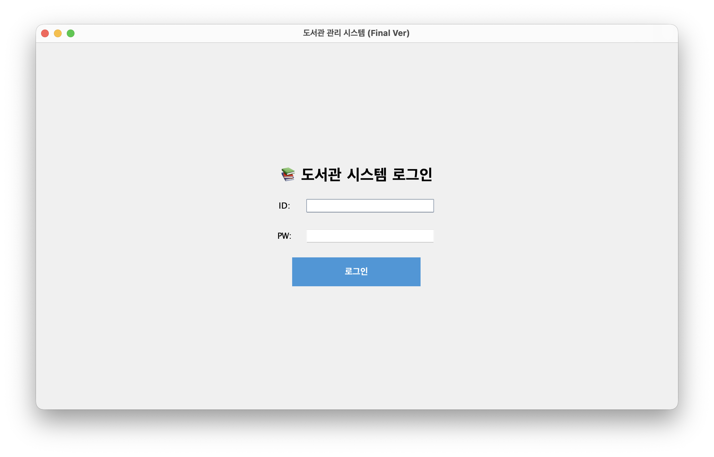
**1. 로그인 (SELECT & Function)**
- 아이디: user1 비밀번호 1234
- 아이디: user2 비밀번호 5678
 
>잘못된 비밀번호 입력시
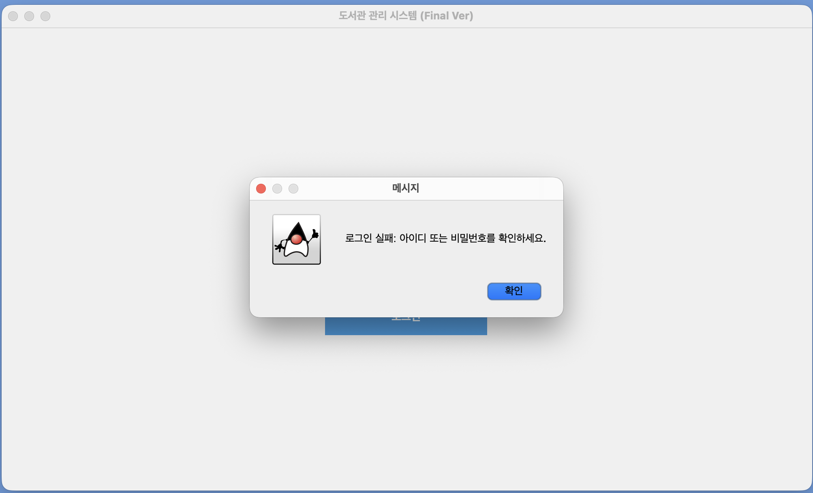
**2. 도서 목록 조회 (View)**
> user1으로 로그인 성공시 도서목록이 조회됨
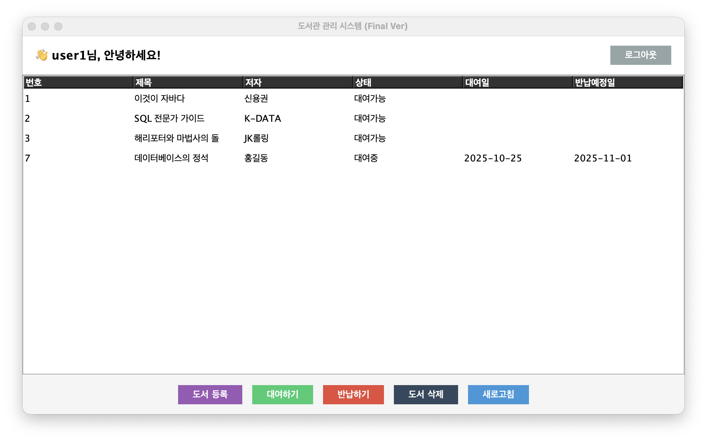


**3. 도서 등록 (INSERT Procedure)**
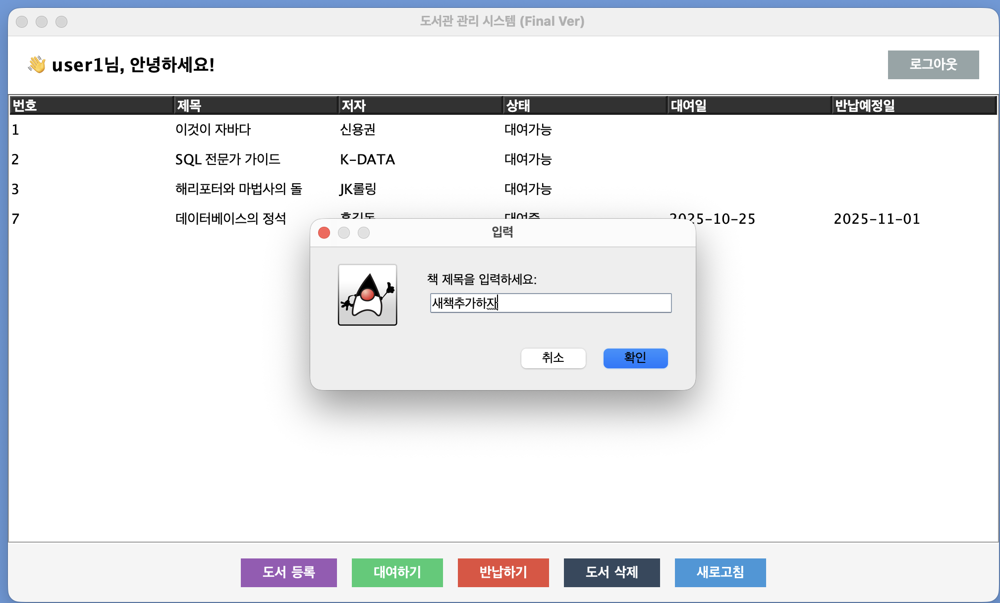
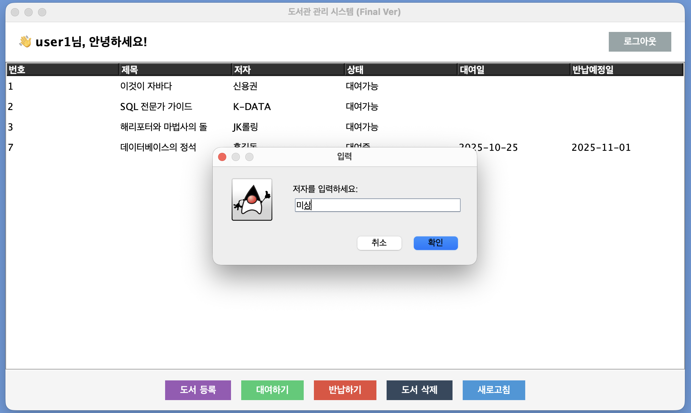


- 도서가 추가된 모습
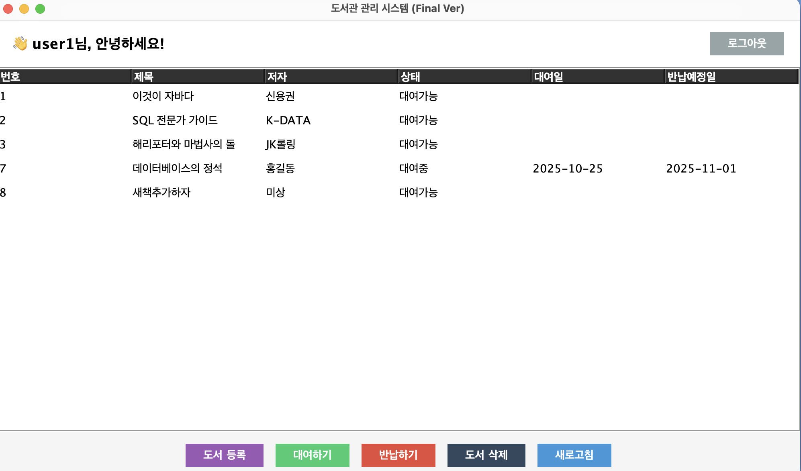
**4. 도서 대여 (UPDATE & Transaction)**
- 방금 만든 도서를 선택해 대여를 시도한다
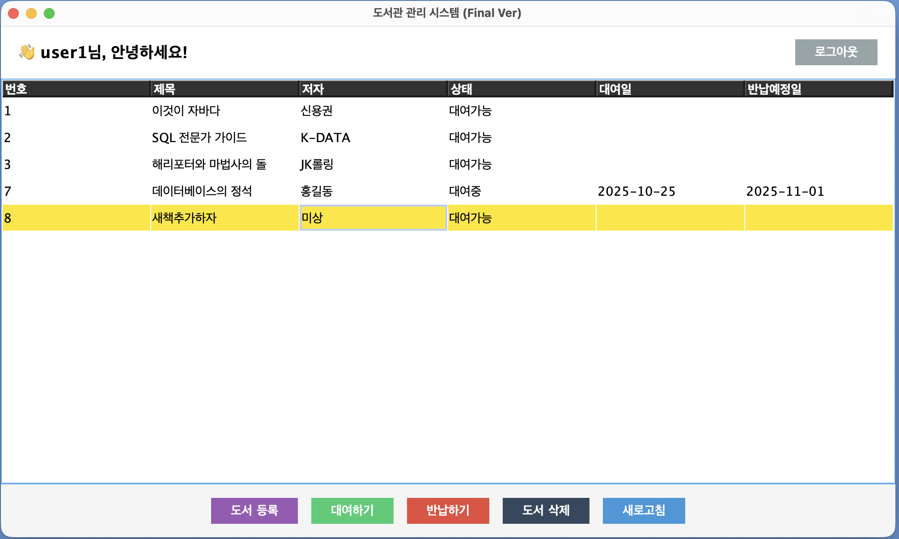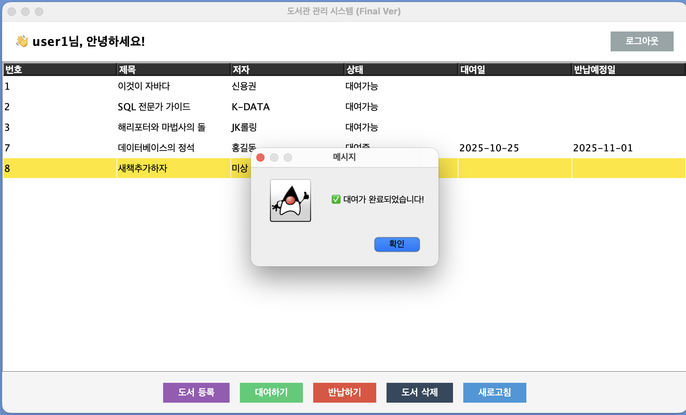


- 현재 날짜로 대여일이 정상등록된다
- 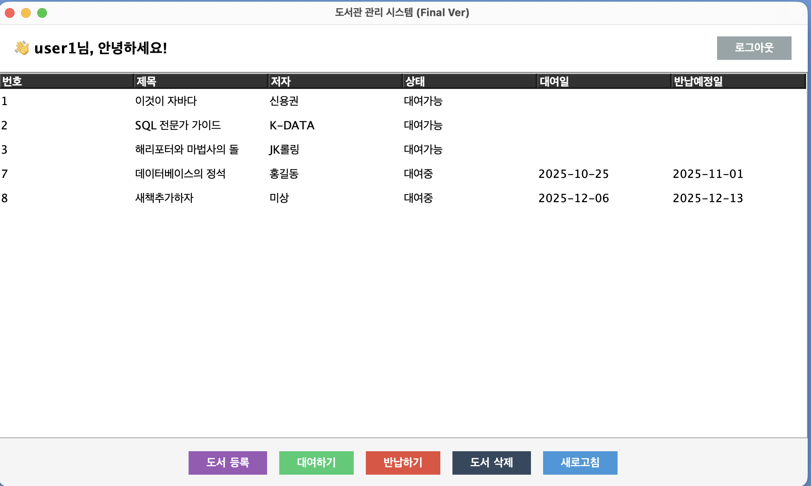
**5. 연체 도서 반납 테스트 (Function Logic)**

> 테스트를 위해 도서 데이터베이스를 과거 날짜(2025-11-01 반납예정)로 데이터를 미리 조작해놨다.
#### user1이 이미 대여중인 책 데이터를 추가
```SQL
-- 1. 새 책 추가 (처음부터 '대여중(Y)' 상태로 입력)
INSERT INTO TBL_BOOK (BOOK_NO, TITLE, AUTHOR, RENT_YN)
VALUES (SEQ_BOOK.NEXTVAL, '데이터베이스의 정석', '홍길동', 'Y');

-- 2. 방금 넣은 책을 'user1'이 빌려간 것으로 기록 (연체 조작)
INSERT INTO TBL_RENT (RENT_NO, MEM_NO, BOOK_NO, RENT_DATE, RTN_DUE, RTN_DATE)
VALUES (
    SEQ_RENT.NEXTVAL, 
    (SELECT MEM_NO FROM TBL_MEMBER WHERE MEM_ID = 'user1'), -- user1 번호 찾기
    SEQ_BOOK.CURRVAL, -- ★ 방금 추가한 그 새 책 번호
    TO_DATE('2025-10-25', 'YYYY-MM-DD'), -- 대여일: 10월 25일
    TO_DATE('2025-11-01', 'YYYY-MM-DD'), -- 반납 예정일: 11월 1일 (현재 12월 6일 기준 연체!)
    NULL -- 반납 안 함
);

-- 3. 저장
COMMIT;
```

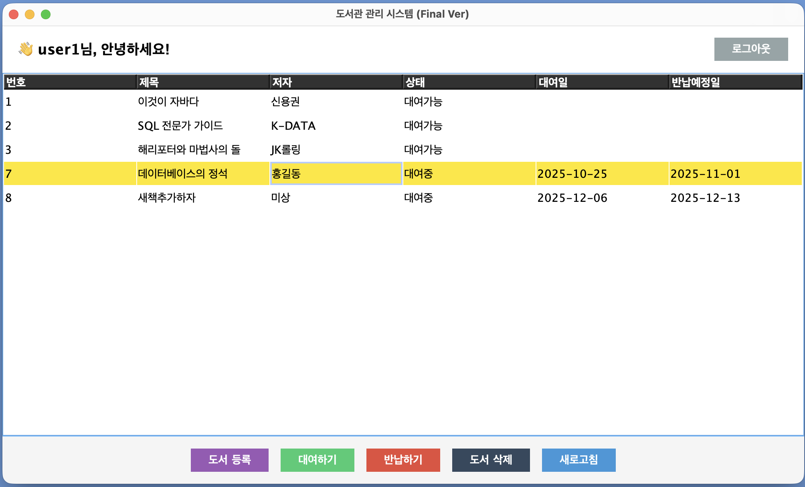
- 연체일이 명시된다.
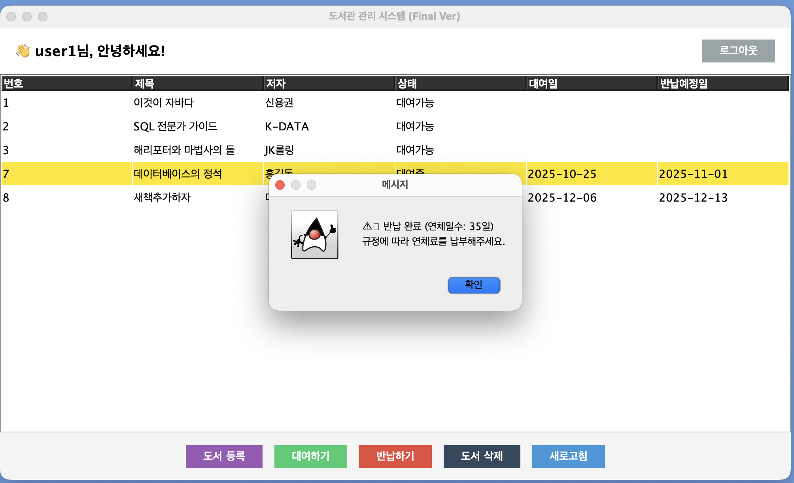
- 대여가능으로 전환된다
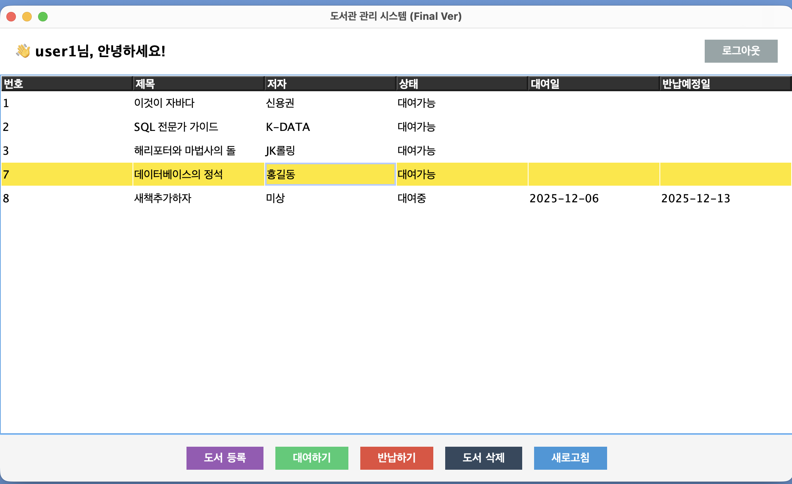
- 반납완료한 도서를 반납하기 누를시
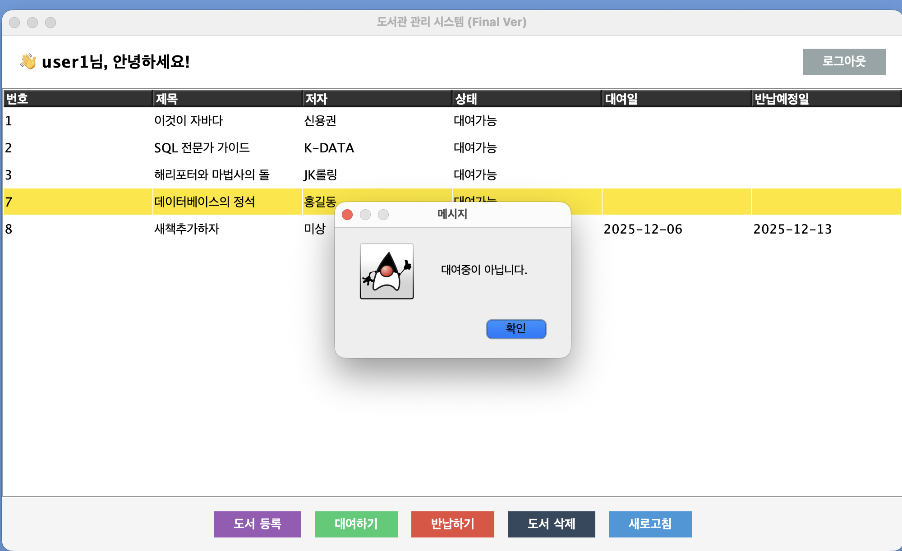
- 다른유저가 대여중인 도서를 반납하기 누를시
- 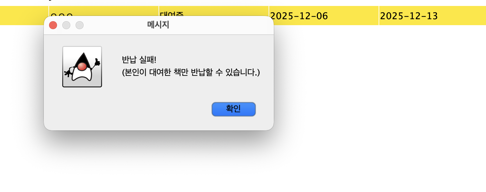
**6. 도서 삭제 (DELETE Procedure)**
- 데이터베이스의 정석을 클릭하고 도서삭제를 누르면 도서가 삭제된다

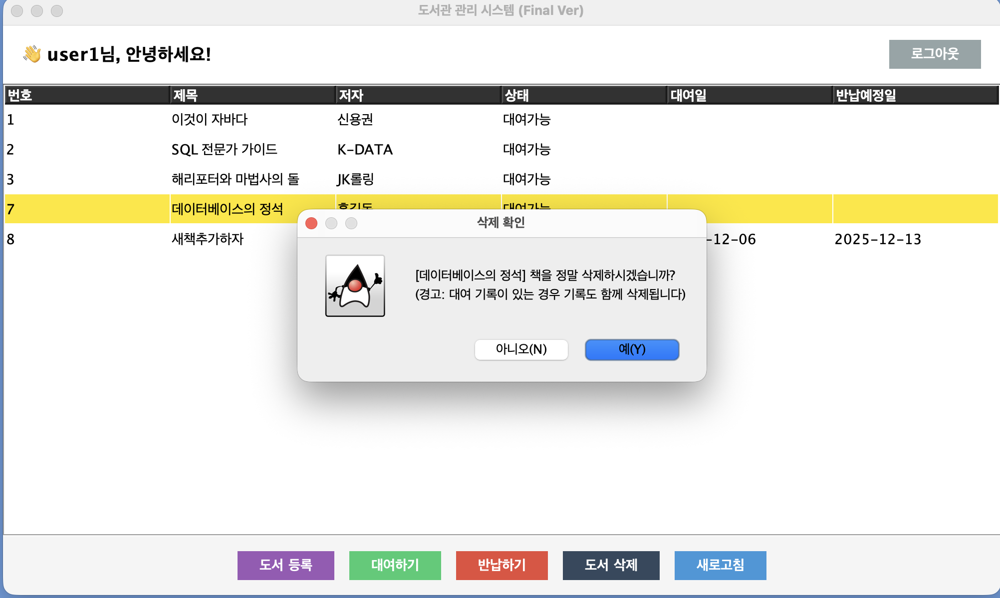

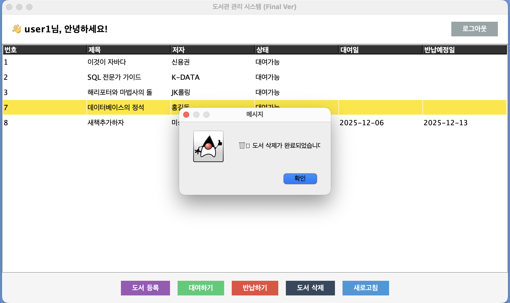
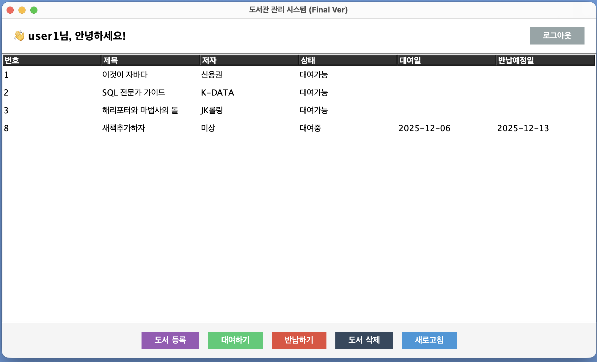


---


## 6. 결론 및 고찰 (Conclusion)

본 프로젝트를 통해 Java Swing 애플리케이션과 Oracle DB를 연동하는 전체 과정을 경험하였다. 특히 **"DB에 로직을 위임한다"** 는 설계 철학을 바탕으로, 자바 코드의 복잡성을 줄이고 데이터베이스의 **프로시저와 함수**를 적극 활용한 점이 주요 성과이다.

또한, **트랜잭션 관리**의 중요성을 이해하고 대여/반납 과정에서의 데이터 무결성을 확보하였으며, **뷰(View)** 를 통해 조회 쿼리를 추상화하는 등 실무적인 DB 설계 기법을 적용해 볼 수 있었다.


## 7. 자바 코드 첨부

```Java
import javax.swing.*;  
import javax.swing.table.DefaultTableModel;  
import javax.swing.table.JTableHeader;  
import java.awt.*;  
import java.sql.*;  
import java.util.Vector;  
  
public class LibrarySwingApp extends JFrame {  
  
    // 1. 데이터베이스 연결 설정 (DB Configuration)  
    private static final String DB_URL = "jdbc:oracle:thin:@localhost:1521:xe"; //  
    private static final String DB_ID = "SYSTEM"; //DB 아이디 (TEST대신 권한추가한 SYSTEM으로 진행)  
    private static final String DB_PW = "1234"; // DB 비밀번호  
  
  
  
    // 2. UI 컴포넌트 및 전역 변수  
    private CardLayout cardLayout; // 화면 전환을 위한 레이아웃 매니저  
    private JPanel mainPanel;      // 전체 화면을 담을 컨테이너  
  
    // 로그인 화면 관련    private JTextField txtId;  
    private JPasswordField txtPw;  
  
    // 메인(대시보드) 화면 관련  
    private JTable bookTable;  
    private DefaultTableModel tableModel;  
    private JLabel lblWelcome;  
  
    // 세션 정보: 로그인한 사용자의 고유 번호(PK)를 저장하여 대여 시 사용  
    private int sessionMemNo = -1;  
  
  
    // 3. 생성자: GUI 초기화 (Constructor)  
    public LibrarySwingApp() {  
        setTitle("도서관 관리 시스템 (Final Ver)");  
        setSize(1000, 600);  
        setDefaultCloseOperation(JFrame.EXIT_ON_CLOSE);  
        setLocationRelativeTo(null); // 화면 중앙 배치  
  
        // 기본 폰트 설정        Font mainFont = new Font("맑은 고딕", Font.PLAIN, 14);  
  
        // 카드 레이아웃 설정 (로그인 화면 <-> 메인 화면 전환용)  
        cardLayout = new CardLayout();  
        mainPanel = new JPanel(cardLayout);  
  
        // 패널 생성 및 추가  
        mainPanel.add(createLoginPanel(mainFont), "LOGIN");  
        mainPanel.add(createDashboardPanel(mainFont), "DASHBOARD");  
  
        add(mainPanel);  
        cardLayout.show(mainPanel, "LOGIN"); // 첫 화면은 로그인  
    }  
  
    /**  
     * 맥(Mac) OS 등에서도 배경색이 잘 보이도록 설정     */    private void styleButton(JButton btn, Color bgColor, Color fgColor) {  
        btn.setFont(new Font("맑은 고딕", Font.BOLD, 14));  
        btn.setBackground(bgColor);  
        btn.setForeground(fgColor);  
        btn.setOpaque(true);  
        btn.setBorderPainted(false);  
        btn.setFocusPainted(false);  
        btn.setCursor(new Cursor(Cursor.HAND_CURSOR));  
    }  
  
    /**  
     * [UI] 로그인 패널 생성     */    private JPanel createLoginPanel(Font font) {  
        JPanel panel = new JPanel(new GridBagLayout());  
        panel.setBackground(new Color(240, 240, 240));  
        GridBagConstraints gbc = new GridBagConstraints();  
        gbc.insets = new Insets(10, 10, 10, 10);  
  
        JLabel title = new JLabel("📚 도서관 시스템 로그인");  
        title.setFont(new Font("맑은 고딕", Font.BOLD, 24));  
  
        txtId = new JTextField(15); txtId.setFont(font);  
        txtPw = new JPasswordField(15); txtPw.setFont(font);  
  
        JButton btnLogin = new JButton("로그인");  
        btnLogin.setPreferredSize(new Dimension(200, 45));  
        styleButton(btnLogin, new Color(52, 152, 219), Color.WHITE);  
  
        // 컴포넌트 배치 (GridBagLayout 활용)  
        gbc.gridx = 0; gbc.gridy = 0; gbc.gridwidth = 2; panel.add(title, gbc);  
        gbc.gridwidth = 1; gbc.gridy = 1; panel.add(new JLabel("ID:"), gbc);  
        gbc.gridx = 1; panel.add(txtId, gbc);  
        gbc.gridx = 0; gbc.gridy = 2; panel.add(new JLabel("PW:"), gbc);  
        gbc.gridx = 1; panel.add(txtPw, gbc);  
        gbc.gridx = 0; gbc.gridy = 3; gbc.gridwidth = 2; panel.add(btnLogin, gbc);  
  
        // 이벤트 연결  
        txtPw.addActionListener(e -> processLogin());  
        btnLogin.addActionListener(e -> processLogin());  
  
        return panel;  
    }  
  
    /**  
     * [UI] 메인 대시보드 패널 생성     */    private JPanel createDashboardPanel(Font font) {  
        JPanel panel = new JPanel(new BorderLayout());  
  
        // 1. 상단 정보창  
        JPanel topPanel = new JPanel(new BorderLayout());  
        topPanel.setBackground(Color.WHITE);  
        topPanel.setBorder(BorderFactory.createEmptyBorder(15, 20, 15, 20));  
  
        lblWelcome = new JLabel("환영합니다!");  
        lblWelcome.setFont(new Font("맑은 고딕", Font.BOLD, 18));  
        JButton btnLogout = new JButton("로그아웃");  
        styleButton(btnLogout, new Color(149, 165, 166), Color.WHITE);  
  
        topPanel.add(lblWelcome, BorderLayout.WEST);  
        topPanel.add(btnLogout, BorderLayout.EAST);  
  
        // 2. 중앙 도서 목록 테이블  
        String[] columns = {"번호", "제목", "저자", "상태", "대여일", "반납예정일"};  
        tableModel = new DefaultTableModel(columns, 0) {  
            @Override public boolean isCellEditable(int row, int column) { return false; } // 수정 불가  
        };  
        bookTable = new JTable(tableModel);  
        bookTable.setRowHeight(30);  
        bookTable.setFont(font);  
        bookTable.setSelectionBackground(new Color(255, 230, 0)); // 선택 시 노란색  
        bookTable.setSelectionForeground(Color.BLACK);  
  
        // 테이블 헤더 디자인  
        JTableHeader header = bookTable.getTableHeader();  
        header.setFont(new Font("맑은 고딕", Font.BOLD, 14));  
        header.setBackground(new Color(50, 50, 50));  
        header.setForeground(Color.WHITE);  
  
        JScrollPane scrollPane = new JScrollPane(bookTable);  
        scrollPane.getViewport().setBackground(Color.WHITE);  
  
        // 3. 하단 기능 버튼 패널  
        JPanel bottomPanel = new JPanel(new FlowLayout(FlowLayout.CENTER, 15, 15));  
        bottomPanel.setBackground(new Color(245, 245, 245));  
  
        // 버튼 생성 (CRUD 기능 매핑)  
        JButton btnAdd = new JButton("도서 등록");    // INSERT  
        JButton btnRent = new JButton("대여하기");    // UPDATE + INSERT  
        JButton btnReturn = new JButton("반납하기");  // UPDATE  
        JButton btnDelete = new JButton("도서 삭제"); // DELETE  
        JButton btnRefresh = new JButton("새로고침"); // SELECT  
  
        // 버튼 색상 지정        styleButton(btnAdd, new Color(155, 89, 182), Color.WHITE);    // 보라  
        styleButton(btnRent, new Color(46, 204, 113), Color.WHITE);   // 초록  
        styleButton(btnReturn, new Color(231, 76, 60), Color.WHITE);  // 빨강  
        styleButton(btnDelete, new Color(52, 73, 94), Color.WHITE);   // 남색  
        styleButton(btnRefresh, new Color(52, 152, 219), Color.WHITE);// 파랑  
  
        bottomPanel.add(btnAdd);  
        bottomPanel.add(btnRent);  
        bottomPanel.add(btnReturn);  
        bottomPanel.add(btnDelete);  
        bottomPanel.add(btnRefresh);  
  
        panel.add(topPanel, BorderLayout.NORTH);  
        panel.add(scrollPane, BorderLayout.CENTER);  
        panel.add(bottomPanel, BorderLayout.SOUTH);  
  
        // --- 이벤트 리스너 (버튼 클릭 시 동작) ---  
  
        // 로그아웃        btnLogout.addActionListener(e -> {  
            sessionMemNo = -1; txtId.setText(""); txtPw.setText("");  
            cardLayout.show(mainPanel, "LOGIN");  
        });  
  
        // 목록 새로고침  
        btnRefresh.addActionListener(e -> loadBookList());  
  
        // [INSERT] 도서 등록  
        btnAdd.addActionListener(e -> {  
            String title = JOptionPane.showInputDialog(this, "책 제목을 입력하세요:");  
            if (title == null || title.trim().isEmpty()) return;  
  
            String author = JOptionPane.showInputDialog(this, "저자를 입력하세요:");  
            if (author == null || author.trim().isEmpty()) return;  
  
            processInsertBook(title, author);  
        });  
  
        // [DELETE] 도서 삭제  
        btnDelete.addActionListener(e -> {  
            int row = bookTable.getSelectedRow();  
            if (row == -1) {  
                JOptionPane.showMessageDialog(this, "삭제할 책을 선택해주세요."); return;  
            }  
            int bookNo = Integer.parseInt(tableModel.getValueAt(row, 0).toString());  
            String title = (String) tableModel.getValueAt(row, 1);  
  
            int confirm = JOptionPane.showConfirmDialog(this,  
                    "[" + title + "] 책을 정말 삭제하시겠습니까?\n(경고: 대여 기록이 있는 경우 기록도 함께 삭제됩니다)",  
                    "삭제 확인", JOptionPane.YES_NO_OPTION);  
  
            if (confirm == JOptionPane.YES_OPTION) {  
                processDeleteBook(bookNo);  
            }  
        });  
  
        // [UPDATE] 대여  
        btnRent.addActionListener(e -> {  
            int row = bookTable.getSelectedRow();  
            if (row == -1) { JOptionPane.showMessageDialog(this, "대여할 책을 선택해주세요."); return; }  
            int bookNo = Integer.parseInt(tableModel.getValueAt(row, 0).toString());  
            String status = (String) tableModel.getValueAt(row, 3);  
            if (!"대여가능".equals(status)) { JOptionPane.showMessageDialog(this, "이미 대여중입니다."); return; }  
            processRent(bookNo);  
        });  
  
        // [UPDATE] 반납  
        btnReturn.addActionListener(e -> {  
            int row = bookTable.getSelectedRow();  
            if (row == -1) { JOptionPane.showMessageDialog(this, "반납할 책을 선택해주세요."); return; }  
            int bookNo = Integer.parseInt(tableModel.getValueAt(row, 0).toString());  
            String status = (String) tableModel.getValueAt(row, 3);  
            if ("대여가능".equals(status)) { JOptionPane.showMessageDialog(this, "대여중이 아닙니다."); return; }  
            processReturn(bookNo);  
        });  
  
        return panel;  
    }  
  
  
    // 4. 비즈니스 로직  
    /**  
     * DB 연결 객체를 반환하는 공통 메소드     */    private Connection getConnection() throws Exception {  
        Class.forName("oracle.jdbc.driver.OracleDriver");  
        return DriverManager.getConnection(DB_URL, DB_ID, DB_PW);  
    }  
  
    /**  
     * [로그인 처리] FUNC_LOGIN 호출     */    private void processLogin() {  
        String id = txtId.getText(); String pw = new String(txtPw.getPassword());  
        try (Connection conn = getConnection();  
             // Function 호출 문법: {? = call 함수명(?, ?)}  
             CallableStatement cs = conn.prepareCall("{? = call FUNC_LOGIN(?, ?)}");  
             // 회원번호 조회를 위한 쿼리  
             PreparedStatement ps = conn.prepareStatement("SELECT MEM_NO FROM TBL_MEMBER WHERE MEM_ID = ?")) {  
  
            // 1. 함수 파라미터 설정  
            cs.registerOutParameter(1, Types.VARCHAR); // 리턴값  
            cs.setString(2, id);  
            cs.setString(3, pw);  
            cs.execute(); // 실행  
  
            // 2. 결과 확인            if ("TRUE".equals(cs.getString(1))) {  
                // 로그인 성공 시 회원번호(PK) 조회하여 세션에 저장  
                ps.setString(1, id);  
                ResultSet rs = ps.executeQuery();  
                if (rs.next()) {  
                    sessionMemNo = rs.getInt("MEM_NO");  
                    lblWelcome.setText("👋 " + id + "님, 안녕하세요!");  
                    cardLayout.show(mainPanel, "DASHBOARD"); // 화면 전환  
                    loadBookList(); // 데이터 로딩  
                }  
            } else {  
                JOptionPane.showMessageDialog(this, "로그인 실패: 아이디 또는 비밀번호를 확인하세요.");  
            }  
        } catch (Exception e) {  
            e.printStackTrace();  
            JOptionPane.showMessageDialog(this, "DB 오류: " + e.getMessage());  
        }  
    }  
  
    /**  
     * [도서 목록 조회] View: V_BOOK_LIST 조회     */    private void loadBookList() {  
        tableModel.setRowCount(0); // 테이블 초기화  
        try (Connection conn = getConnection();  
             Statement stmt = conn.createStatement();  
             ResultSet rs = stmt.executeQuery("SELECT * FROM V_BOOK_LIST ORDER BY BOOK_NO ASC")) {  
  
            while (rs.next()) {  
                Vector<Object> row = new Vector<>();  
                row.add(rs.getInt("BOOK_NO"));  
                row.add(rs.getString("TITLE"));  
                row.add(rs.getString("AUTHOR"));  
                row.add(rs.getString("RENT_STATUS")); // 뷰에서 DECODE로 변환된 상태값  
                row.add(rs.getDate("RENT_DATE"));  
                row.add(rs.getDate("RTN_DUE"));  
                tableModel.addRow(row);  
            }  
        } catch (Exception e) { e.printStackTrace(); }  
    }  
  
    /**  
     * [도서 등록] PROC_INSERT_BOOK 호출     */    private void processInsertBook(String title, String author) {  
        try (Connection conn = getConnection();  
             CallableStatement cs = conn.prepareCall("{call PROC_INSERT_BOOK(?, ?)}")) {  
            cs.setString(1, title);  
            cs.setString(2, author);  
            cs.execute();  
            JOptionPane.showMessageDialog(this, "✅ 도서 등록이 완료되었습니다.");  
            loadBookList(); // 목록 갱신  
        } catch (Exception e) {  
            JOptionPane.showMessageDialog(this, "등록 실패: " + e.getMessage());  
        }  
    }  
  
    /**  
     * [도서 삭제] PROC_DELETE_BOOK 호출     * - 참조 무결성을 고려하여 대여 기록 먼저 삭제 후 도서 삭제     */    private void processDeleteBook(int bookNo) {  
        try (Connection conn = getConnection();  
             CallableStatement cs = conn.prepareCall("{call PROC_DELETE_BOOK(?)}")) {  
            cs.setInt(1, bookNo);  
            cs.execute();  
            JOptionPane.showMessageDialog(this, "🗑️ 도서 삭제가 완료되었습니다.");  
            loadBookList(); // 목록 갱신  
        } catch (Exception e) {  
            JOptionPane.showMessageDialog(this, "삭제 실패: " + e.getMessage());  
        }  
    }  
  
    /**  
     * [도서 대여] PROC_RENT_BOOK 호출 (UPDATE + INSERT)     * - 트랜잭션으로 묶여 있어 상태 변경과 이력 생성이 동시에 처리됨     */    private void processRent(int bookNo) {  
        try (Connection conn = getConnection();  
             CallableStatement cs = conn.prepareCall("{call PROC_RENT_BOOK(?, ?)}")) {  
            cs.setInt(1, sessionMemNo); // 세션에 저장된 회원번호 사용  
            cs.setInt(2, bookNo);  
            cs.execute();  
            JOptionPane.showMessageDialog(this, "✅ 대여가 완료되었습니다!");  
            loadBookList();  
        } catch (Exception e) {  
            JOptionPane.showMessageDialog(this, "대여 실패: 시스템 오류");  
        }  
    }  
  
    /**  
     * [도서 반납] PROC_RETURN_BOOK 호출     * - 반납 처리 후 연체일수(OUT Parameter)를 반환받음  
     */    private void processReturn(int bookNo) {  
        String sql = "{call PROC_RETURN_BOOK(?, ?, ?)}";  
  
        try (Connection conn = getConnection();  
             CallableStatement cs = conn.prepareCall(sql)) {  
  
            cs.setInt(1, bookNo);       // 1. 반납할 책 번호  
            cs.setInt(2, sessionMemNo); // 2. [추가됨] 로그인한 나의 번호  
            cs.registerOutParameter(3, Types.NUMERIC); // 3. 결과(연체일)  
  
            cs.execute();  
  
            int lateDays = cs.getInt(3); // 3번째 물음표에서 값 꺼냄  
  
            // 결과 처리 메시지 수정            if (lateDays == -1) {  
                // 내 책이 아니거나 대여중이 아님  
                JOptionPane.showMessageDialog(this, "반납 실패!\n(본인이 대여한 책만 반납할 수 있습니다.)");  
            } else {  
                String msg = (lateDays > 0)  
                        ? "⚠️ 반납 완료 (연체일수: " + lateDays + "일)\n연체료를 납부해주세요."  
                        : "✅ 정상 반납되었습니다.";  
                JOptionPane.showMessageDialog(this, msg);  
                loadBookList();  
            }  
  
        } catch (Exception e) {  
            e.printStackTrace();  
            JOptionPane.showMessageDialog(this, "시스템 오류: " + e.getMessage());  
        }  
    }  
  
    // 메인 실행 메소드  
    public static void main(String[] args) {  
        // Swing UI의 스레드 안전성을 위해 EventQueue 사용  
        SwingUtilities.invokeLater(() -> new LibrarySwingApp().setVisible(true));  
    }  
}

```
