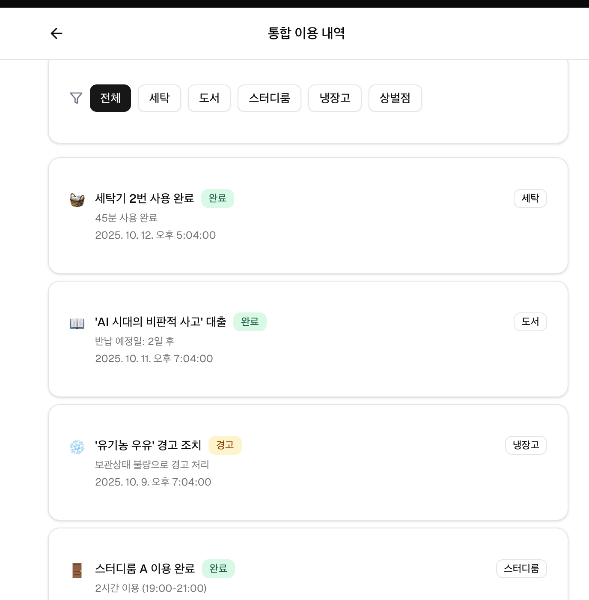

## 1. 기숙사생(RESIDENT) 전체 시나리오

### 1-1. 회원가입 및 최초 로그인

**회원가입 흐름**
- DormMate 웹사이트 접속 → 회원가입 버튼 클릭
- 호실 번호 입력 (예: 201, 313, 524 등)
- 개인 번호 선택 (1~3 중 선택, 1인실은 1 고정)
- **아이디 입력 (대소문자 무시)**
- 이메일 주소 입력 (비밀번호 변경용)
- 비밀번호 입력
- 이용약관 동의 및 제출
- 서버에서 호실/개인번호 조합 검증 (중복 방지)
- 회원가입 완료 후 자동으로 RESIDENT 역할 부여
- 호실에 따라 사용 가능한 냉장고 칸(compartment) 자동 매핑
	- 예: 201호 → 2층 냉장고 slot 1 (01~08호)
	- 예: 313호 → 3층 냉장고 slot 2 (09~16호)
	- 예: 524호 → 5층 냉장고 slot 3 (17~24호)
**로그인 흐름**
- 아이디/비밀번호 입력 → JWT 토큰 발급 (7일 유효)
- 메인 페이지 진입
- **하단 네비게이션**: 냉장고, 세탁, 메인, 도서관, 스터디
- **상단**: 제목, 알림, 프로필 메뉴

***

### 1-2. 냉장고 물품 등록 (장바구니 방식)

**등록 화면 진입**
- 냉장고 메뉴 → "물품 등록" 버튼 클릭
- 장바구니 방식 등록 화면 표시

**물품 추가 (장바구니)**

**입력 폼 영역**
```Java
물품명: [____________] (예: 계란 10구)
유통기한: [2025-10-20] (날짜 추가 버튼들)
수량: [−] [1] [+]
□ 이름 고정

[+ 장바구니에 추가] 버튼
```

**장바구니 영역**
```Java
장바구니 (N개 물품)
───────────────────────
• 계란 10구 (10/20) ×2  [−][+]
• 우유 1L (10/18) ×1    [−][+]
• 치즈 (10/25) ×1       [−][+]
```

**포장 정보 영역**
```Java
포장명: [아침 식재료____]
메모: [냉장실 앞쪽 보관_]
칸 선택: ◉ 냉장  ○ 냉동

[등록하기] 버튼
```

**사용 예시 1: 계란만 등록**
```Java
1. 입력: 물품명 "계란 10구", 유통기한 "2025-10-20", 수량 1
2. [+ 장바구니에 추가] 클릭
3. 장바구니에 "계란 10구 (10/20) ×1" 표시됨
4. 포장명: "계란", 메모: (비워둠 가능)
5. [등록하기] 클릭
6. 스티커 코드 발급: "1-001"
```

**사용 예시 2: 여러 물품 한번에 등록**
```Java
1. 입력: "계란 10구", "2025-10-20" → [추가]
   → 장바구니: 계란 10구 (10/20) ×1
   
2. 입력: "우유 1L", "2025-10-18" → [추가]
   → 장바구니: 계란 10구 (10/20) ×1
               우유 1L (10/18) ×1
   
3. 입력: "치즈", "2025-10-25" → [추가]
   → 장바구니: 계란 10구 (10/20) ×1
               우유 1L (10/18) ×1
               치즈 (10/25) ×1

4. 포장명: "오늘 산 식재료"
5. 메모: "냉장실 뒤쪽"
6. [등록하기] 클릭
7. 스티커 코드 발급: "1-002"
```

**사용 예시 3: 같은 물품 여러 개 (수량 증가)**
```Java
1. 입력: "계란 10구", "2025-10-20", 수량 1 → [추가]
   → 장바구니: 계란 10구 (10/20) ×1

2. 동일하게 입력 → [추가] (또는 장바구니에서 [+] 클릭)
   → 장바구니: 계란 10구 (10/20) ×2

3. 포장명: "계란"
4. [등록하기]
```

**사용 예시 4: 같은 이름, 다른 유통기한**
```Java
1. 입력: "계란 10구", "2025-10-20" → [추가]
   → 장바구니: 계란 10구 (10/20) ×1

2. ☑ 이름 고정 체크
3. 유통기한만 변경: "2025-10-25" → [추가]
   → 장바구니: 계란 10구 (10/20) ×1
               계란 10구 (10/25) ×1

4. 포장명: "계란 여러 날짜"
5. [등록하기]
```

**등록 완료**
- [등록하기] 버튼 클릭
- 서버에서 FridgeBundle 1개 생성
- 장바구니의 모든 물품을 FridgeItem으로 생성
- 라벨 번호 자동 발급 (예: "1-003")
- 스티커 코드 화면 표시
```Java
┌───────────────────────┐
│ ✅ 등록 완료!         │
│                       │
│ 스티커 코드: 1-003    │
│                       │
│ 이 코드를 스티커에    │
│ 적어서 포장에 붙여주세요 │
│                       │
│  [완료]  │
└───────────────────────┘
```

**칸 선택**
- 배정된 칸만 선택 가능
- 일반적으로 냉장칸 1개, 냉동칸 1개 배정됨
- 선택된 칸이 가득 찬 경우: "칸이 가득 찼습니다" 오류 메시지

***

### 1-3. 내 물품 조회 및 필터링
**필터 적용**
- 상단 필터 버튼 클릭
- 옵션 선택:
  - **임박**: 유통기한 3일 이내 (노란색 배지)
  - **만료**: 유통기한 지남 (빨간색 배지, 폐기 권장)
- 필터 적용 시 실시간 목록 업데이트

**기본 조회**
- 냉장고 메뉴 진입 시 내 포장 목록 표시 (최신순)

**검색 기능**
- 검색바에 품목명 또는 포장명 입력 (예: "계란", "아침")
- 부분 일치 검색 (포장명 + 물품명 모두 검색)
- 스티커 코드 정확 검색 (예: "1-003" 입력 시 해당 포장만 표시)
- 검색 결과 없을 시 "등록된 물품이 없습니다" 빈 목록

목록 클릭시 각 포장 카드:

```Java
┌─────────────────────────────┐
│ 스티커: 1-003               │
│ 포장명: 아침 식재료         │
│ 메모: 냉장실 앞쪽 보관      │
│                             │
│ 포장 내 물품 (3개): [수정] [삭제] │
│ • 계란 10구 (10/20) 🟡     │
│ • 우유 1L (10/18) 🔴       │
│ • 치즈 (10/25) ⚪          │
│                             │
│ 등록: 10/14 16:00          │
│            │
└─────────────────────────────┘

🟡 임박 (3일 이내)
🔴 만료 (유통기한 지남)
⚪ 정상
```

***

### 1-4. 물품 수정 및 삭제

**포장 정보 수정**
- 포장 카드에서 [수정] 버튼 클릭
- 수정 가능 항목:
  - 포장명 (예: "아침 식재료" → "오전용")
  - 메모 (예: "냉장실 앞쪽" → "냉장실 뒤쪽")
- 수정 불가 항목:
  - 스티커 코드
  - 등록 일시

**포장 내 물품 수정**
- 포장 상세 화면 진입
- 개별 물품 수정:
  - 물품명 변경 가능
  - 유통기한 변경 가능
  - 수정 시 `modified_at` 자동 갱신
  - **검사 후 수정인 경우**: `modified_after_inspection = true` 설정
  - 다음 검사 시 상단으로 표시됨 (검사 후 수정됨 표시)

**포장에 물품 추가**
- 포장 상세 화면에서 [+ 물품 추가] 버튼
- 장바구니 방식 입력 화면 표시 (기존 포장 선택됨)
- 물품 추가 후 [등록하기]
- 기존 포장에 새 물품 추가됨
- 새 물품의 `created_at`이 다르므로 추가 시점 추적 가능

**물품 개별 삭제**
- 포장 상세 화면에서 특정 물품 [삭제] 버튼
- 확인 다이얼로그: "정말 삭제하시겠습니까?"
- 확인 시 해당 물품만 소프트 삭제 (`deleted_at` 설정)
- 포장의 다른 물품은 유지됨

**포장 전체 삭제**
- 포장 카드에서 [삭제] 버튼 클릭
- 확인 다이얼로그: "포장과 모든 물품을 삭제하시겠습니까?"
- 확인 시:
  - 포장 상태 → REMOVED
  - 모든 물품 소프트 삭제
  - 라벨 번호 재사용 가능 상태로 전환 (트리거 자동)

**접근 제어**
- 본인이 등록한 포장/물품만 수정/삭제 가능
- 다른 사용자 물품 수정 시도 시 403 Forbidden 에러
- 검사 중인 칸의 물품은 수정 불가 (잠금 표시)
- 다른사용자의 메모는 볼수없다

***

### 1-5. 알림 수신 및 확인

**유통기한 임박 알림**
- 매일 오전 9시 배치 작업 실행
- 유통기한 3일 이내 물품 자동 검사
- 알림 생성 예시:
  ```Java
  [냉장고] 유통기한 임박
  
  아침 식재료 포장의 계란 10구 외 2개 물품의
  유통기한이 3일 이내입니다.
  
  • 계란 10구 (10/20) - D-3
  • 우유 1L (10/18) - D-1
  • 치즈 (10/25) - D-8
  ```
- 알림 배지: 상단 종 아이콘에 빨간 점 표시
- 하루 1회 제한 (중복 알림 방지)

**검사 결과 알림**
- 층별장이 검사 제출 시 즉시 발송
- 경고 또는 폐기 조치받은 사용자에게만 발송
- 알림 예시:
  ```Java
  [냉장고] 검사 결과
  
  아침 식재료 포장이 검사에서 경고를 받았습니다.
  
  • 사유: 보관 불량
  • 메모: 포장 훼손됨
  • 검사자: 김층별장
  • 검사일: 10/14 15:00
  ```
- 알림 클릭 시 해당 포장 상세 화면으로 이동
- 포장이 삭제된 경우 검사 이력만 표시

**알림 읽음 처리**
- 냉장고 메인 화면 진입 시 관련 알림 자동 읽음 처리
- 알림 목록에서 개별 클릭 시 읽음 상태로 변경
- 읽은 알림은 회색 처리, 24시간 후 자동 만료
- 만료된 알림은 목록에서 자동 제거

**알림 설정**
- 프로필 → 알림 설정 메뉴
- 유통기한 알림 켜기/끄기
- 검사 결과 알림 켜기/끄기
- 설정 변경 즉시 반영

***

### 1-6. 프로필 및 계정 관리

**내 정보 조회**
- 프로필 메뉴 클릭
- 표시 정보:
  - 아이디
  - 이메일
  - 호실 번호
  - 개인 번호
  - 역할 (RESIDENT)
  - 배정된 냉장고 칸 정보

**비밀번호 변경**
- 현재 비밀번호 입력
- 새 비밀번호 입력 (8자 이상, 영문+숫자)
- 변경 완료 시 자동 로그아웃 → 재로그인 필요

**로그아웃**
- 로그아웃 버튼 클릭
- JWT 토큰 무효화 (클라이언트 삭제)
- 로그인 화면으로 리다이렉트

***

## 2. 층별장(INSPECTOR) 전체 시나리오

### 2-1. 층별장 권한 부여

**관리자에 의한 임명**
- 관리자가 특정 기숙사생을 층별장으로 임명
- 역할이 RESIDENT → INSPECTOR로 업그레이드
- 임명 즉시 검사 권한 활성화

**층별장 해제**
- 관리자가 층별장 권한 해제
- 역할 INSPECTOR → RESIDENT로 복귀
- 진행 중인 검사 세션 강제 종료
- 검사 이력은 유지 (과거 기록 보존)

***

### 2-2. 검사 모드 시작

**검사 칸 선택**
- 냉장고 메뉴에서 "검사" 버튼 클릭 (INSPECTOR 전용)
- 검사 가능한 칸 목록 표시 (자기 층만)
- 칸 선택 (예: 3층 냉장고 냉장칸)
- "검사 시작" 버튼 클릭

**검사 세션 생성**
- 서버에서 InspectionSession 생성
- 세션 ID 발급 (UUID)
- 검사자 등록 (최대 2명)
- 해당 칸 물품 잠금 활성화 (일반 사용자 수정 불가)
- SSE 연결 수립
- 검사 대상 물품 목록 조회 (해당 칸의 모든 포장)

**다른 검사자 합류**
- 검사 중일 시 "검사 시작" 버튼이 "검사 합류"로 변경
- 클릭 시 동일 세션 ID로 연결
- 한 칸에는 동시에 한 검사만 진행 가능
- SSE로 기존 검사 상태 동기화
- 두 검사자의 화면이 실시간으로 동기화됨

***

### 2-3. 물품 검사 및 조치

**검사 화면 구성**

**상단 헤더**
- 제목: "냉장고 검사"
- 검사 중인 칸 정보 표시
- 검사자 정보 (본인 + 공동 검사자)

**탭 구조**
- **"검사 전" 탭**: 조치되지 않은 포장 목록
- **"검사 완료" 탭**: 조치된 포장 목록
  - 본인 조치: 일반 표시
  - 상대방 조치: 검정 테두리 표시

검사전 탭 **필터 버튼**

- **"만료" 필터**: 유통기한 지난 물품 포함 포장만 표시
- **"검사 후 수정됨" 필터**: 마지막 검사 후 변경된 포장만 표시

**검색바**
- 포장명 또는 물품명으로 검색 가능

경고 조치 처리

- 물품 카드에서 "조치" 버튼 클릭
- 경고 사유 선택:
	- 정보 불일치: 스티커 정보와 실제 물품 다름
	- 보관 불량: 포장 훼손, 냄새 등
- 해당 물품이 "검사 완료" 탭으로 이동
- SSE로 다른 검사자에게 실시간 전파
- 상대방 화면에서도 "검사 완료" 탭에 표시 (조치자 이름 표시)

폐기 조치 처리

- 유통기한 지난 목록의경우 조치버튼대신 폐기버튼 활성화
- 폐기 확인 다이얼로그: "정말 폐기하시겠습니까?"
- 확인 시 조치 완료, "검사 완료" 탭으로 이동
- 실시간 동기화

미등록 물품 즉시 등록 후 폐기

- 냉장고에서 시스템에 없는 물품 발견 시
- "미등록 물품 추가" 버튼 클릭
- 품목이름 간단입력후 검사완료탭에 미등록 폐기물품으로 등록

**통과 처리**
- 포장에 이상 없을 시 [통과] 버튼 클릭
- 조치 없이 "검사 완료" 탭으로 이동
- 통계에는 미포함 (정상 물품)

***

### 2-4. 실시간 동기화 (SSE)

**동시 검사 시나리오**
- 검사자 A가 포장 1에 "경고" 조치
- 서버에서 InspectionSession 업데이트
- SSE로 검사자 B에게 이벤트 전송
- 검사자 B 화면에서 포장 1이 "검사 전" → "검사 완료"로 자동 이동
- UI에 "검사자 A가 조치함" 표시 (검정 테두리)
- 검사자 B는 포장 2를 동시에 검사 가능

**네트워크 끊김 시 재연결**
- EventSource 자동 reconnection
- 재연결 시 서버에서 현재 세션 상태 전송
- 누락된 조치 내역 자동 동기화
- 검사 중단 없이 계속 진행 가능

***

### 2-5. 검사 결과 제출

**최종 제출 조건**
- 모든 포장이 "검사 완료" 탭에 있을 때 활성화
- "검사 전" 탭이 비어 있어야 함
- 두 검사자 중 누구나 제출 가능

**제출 프로세스**
- [최종 제출] 버튼 클릭
- 확인 다이얼로그: "검사를 종료하고 결과를 제출하시겠습니까?"
- 확인 시 서버로 검사 결과 일괄 전송
- DB에 검사 이력 저장:
  - 검사자 ID(들)
  - 검사 일시
  - 칸 ID
  - 각 포장별 조치 내역 (사유, 메모)
- 통계 자동 집계:
  - 경고 건수
  - 폐기 건수
  - 검사 포장 총 수
  - 호실별 조치 건수
- 조치받은 사용자에게 알림 자동 발송
- 검사 세션 종료, 칸 잠금 해제
- 일반 사용자 물품 수정 가능 상태로 복귀

**검사 취소**
- 검사 중 [취소] 버튼 클릭
- 확인 다이얼로그: "진행 중인 검사를 취소하시겠습니까? (저장되지 않습니다)"
- 확인 시 세션 삭제, 메모리 데이터 폐기
- DB 미반영, 알림 미발송
- 칸 잠금 즉시 해제

***

### 2-6. 검사 이력 조회

**검사 이력 페이지**
- 자신의 층에 대한 검사 이력만 표시
- 과거 검사 목록 표시 (최신순)
- 각 검사 카드:
  - 검사 일시
  - 칸 정보
  - 공동 검사자 (있을 경우)
  - 통계: 경고 N건, 폐기 M건
- 카드 클릭 시 상세 내역:
  - 조치된 포장 목록
  - 호실, 포장명, 사유
  - 조치별 필터링 가능

## 이후 수정하고 추가할것

## 3. 관리자(ADMIN) 전체 시나리오

### 3-1. 관리자 대시보드

**전체 현황 조회**
- 관리자 로그인 후 대시보드 진입
- 주요 통계 위젯:
  - 전체 등록 물품 수 (층별, 칸별)
  - 유통기한 임박 물품 수 (전체 기숙사)
  - 이번 주 검사 횟수 및 조치 건수
  - 활성 사용자 수 (RESIDENT, INSPECTOR)
- 최근 검사 이력 목록 (전체 층)
- 알림 발송 현황 (성공/실패)

### 3-2. 층별장 임명 및 관리

**층별장 임명**
- 사용자 관리 메뉴에서 "층별장 임명" 클릭
- 층/호실 검색으로 대상 기숙사생 조회
- 대상 선택 후 "INSPECTOR 권한 부여" 버튼 클릭
- 역할 변경 즉시 반영
- 알림 발송 (선택적, Band 중복 고려 시 제외 가능)

**층별장 해제**
- 현재 층별장 목록 조회
- 대상 선택 후 "권한 해제" 버튼 클릭
- 역할 RESIDENT로 복귀
- 진행 중인 검사 세션 강제 종료 (있을 경우)

### 3-3. 전체 물품 관리

**전체 물품 조회**
- 물품 관리 메뉴에서 전체 목록 조회
- 필터 옵션:
  - 층별 (2층~5층)
  - 칸별 (slot 1~4)
  - 호실별 (201~224, 301~324 등)
  - 상태별 (정상, 임박, 만료, 삭제됨)
- 검색: 품목명, 스티커 코드, 호실 번호
- 페이지네이션 (50개씩 표시)

**물품 강제 수정/삭제**
- 특정 물품 선택 후 "수정" 또는 "삭제"
- 수정: 유통기한, 품목명 등 변경 가능
- 삭제: 소프트 삭제, 사유 메모 입력 (예: "휴관 모드로 인한 일괄 삭제")
- 해당 사용자에게 알림 발송

**일괄 처리**
- 여러 물품 선택 (체크박스)
- 일괄 삭제, 상태 일괄 변경 (예: 모두 만료 처리)
- 확인 다이얼로그로 안전장치

### 3-4. 검사 이력 전체 조회

**전체 검사 이력**
- 검사 이력 메뉴에서 전체 목록 조회
- 필터: 층별, 검사자별, 기간별
- 각 검사 상세 조회:
  - 검사 일시, 검사자, 칸 정보
  - 통계: 경고/폐기 건수
  - 조치된 물품 목록

**통계 및 리포트**
- 월별/주별 검사 통계 그래프
- 호실별 조치 건수 순위 (위생 관리 지표)
- CSV 내보내기 기능 (엑셀 분석)

### 3-5. 사용자 관리

**사용자 목록 조회**
- 전체 기숙사생 목록 (호실, 이름, 이메일, 역할)
- 필터: 층별, 역할별, 호실별
- 검색: 이름, 이메일, 호실 번호

**역할 변경**
- 특정 사용자 선택 후 역할 변경
- RESIDENT ↔ INSPECTOR ↔ ADMIN
- 변경 시 권한 즉시 반영

**계정 비활성화**
- 퇴사자 또는 문제 사용자 계정 비활성화
- 비활성화 시 로그인 차단
- 등록된 물품은 유지 (검사 이력 보존)

### 3-6. 시스템 설정

**알림 배치 설정**
- 유통기한 알림 발송 시각 설정 (기본 09:00 KST)
- 배치 스케줄 활성화/비활성화
- 테스트 알림 발송 기능

**냉장고 자원 관리**
- 층별 냉장고 유닛 조회
- 칸 구조 확인 (slot 1~4)
- 호실별 칸 배분 현황 확인
- 냉장고 추가/삭제

**시스템 모니터링**
- Spring Boot Actuator 연동
- 서버 상태: CPU, 메모리, 디스크 사용률
- API 응답 시간 통계
- 에러 로그 조회 (최근 100건)

***

## 4. 공통 시나리오

### 4-1. 에러 처리

**네트워크 에러**
- API 호출 실패 시 Toast 알림 표시
- "네트워크 연결을 확인해주세요" 메시지
- 재시도 버튼 제공

**권한 에러**
- 권한 없는 기능 접근 시 403 Forbidden
- "접근 권한이 없습니다" 다이얼로그
- 메인 화면으로 리다이렉트

**검증 에러**
- 입력 필드 유효성 검사 실패 시 빨간색 테두리
- 에러 메시지 필드 하단 표시 (예: "유통기한을 입력해주세요")

### 4-2. 로딩 상태

**데이터 로딩**
- TanStack Query로 자동 로딩 상태 관리
- 스피너 또는 스켈레톤 UI 표시
- 로딩 중 중복 클릭 방지

**페이지 전환**
- 페이지 이동 시 부드러운 트랜지션
- 로딩바 상단 표시 (진행률)

### 4-3. 반응형 디자인

**모바일 우선**
- 기숙사생 대부분 모바일 사용 가정
- 터치 인터페이스 최적화 (버튼 크기 44px 이상)
- 가로 스크롤 없이 세로 스크롤만 사용

**태블릿/데스크탑**
- 화면 크기에 따라 레이아웃 자동 조정
- 데스크탑: 2열 그리드 레이아웃
- 태블릿: 1~2열 가변 레이아웃

***
